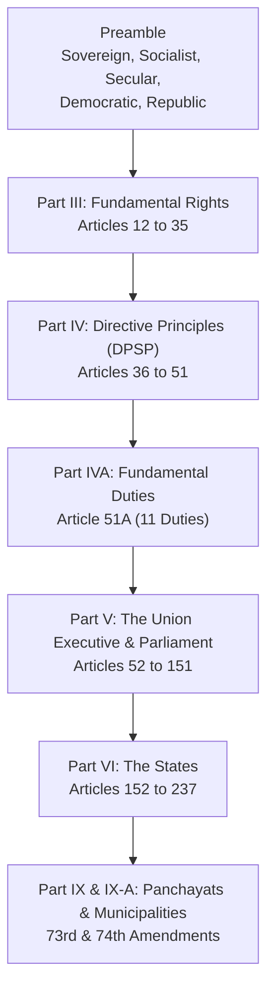

> [!exam-focus]
> **Exam Weightage & Testing Style:** 4–6 questions in Paper 1. Focus areas include:
> - Making of the Constitution: Drafting committee chairman Dr. B. R. Ambedkar, adoption date (26 Nov 1949), enforcement date (26 Jan 1950).
> - Preamble keywords (Sovereign, Socialist, Secular, Democratic, Republic).
> - Fundamental Rights (Articles 14–32), Right to Education (Article 21A, 86th Amendment 2002).
> - Directive Principles of State Policy (Part IV) and Fundamental Duties (Article 51A, Part IVA).
> - Local Self Government: 73rd and 74th Constitutional Amendments (1992).

---

## 1. Constitutional Framework & Historical Highlights

The flowchart above outlines the sequential structure of the Indian Constitution relevant to general competitive examinations. The sequence reflects the hierarchy from fundamental civil protections through governance machinery down to grassroots democracy.

---

## 2. Core Parts and Important Articles Summary

| Part / Schedule | Topic | Core Articles | High-Yield Exam Takeaway |
|---|---|---|---|
| **Preamble** | Objective Resolution moved by Jawaharlal Nehru | Adopted 26 Nov 1949 | Keywords "Socialist", "Secular", and "Integrity" were added by the 42nd Amendment (1976). |
| **Part I** | Union & its Territory | Articles 1–4 | Article 1: "India, that is Bharat, shall be a Union of States." |
| **Part II** | Citizenship | Articles 5–11 | Single citizenship in India; regulated by Citizenship Act, 1955. |
| **Part III** | Fundamental Rights | Articles 12–35 | Justiciable; enforceable by Supreme Court (Art 32) and High Courts (Art 226). |
| **Part IV** | Directive Principles of State Policy | Articles 36–51 | Non-justiciable guidelines; borrowed from the Irish Constitution. |
| **Part IV-A** | Fundamental Duties | Article 51A | Added by 42nd Amendment (1976) on Swaran Singh Committee recommendation; 11th duty (education) added by 86th Amendment (2002). |
| **Part IX** | Panchayats | Articles 243 to 243-O | 11th Schedule (29 subjects); 73rd Amendment 1992. |
| **Part IX-A** | Municipalities | Articles 243-P to 243-ZG | 12th Schedule (18 subjects); 74th Amendment 1992. |

---

## 3. High-Frequency Fundamental Rights for Teaching Exams

### Fundamental Rights Classification

| Right Category | Articles | Scope and Exceptions |
|---|---|---|
| **Right to Equality** | Articles 14–18 | - **Art 14:** Equality before law & equal protection of laws. - **Art 15:** Prohibition of discrimination on grounds of religion, race, caste, sex, or place of birth. - **Art 16:** Equality of opportunity in public employment. - **Art 17:** Abolition of untouchability. - **Art 18:** Abolition of titles. |
| **Right to Freedom** | Articles 19–22 | - **Art 19:** Six democratic freedoms (speech, assembly, association, movement, residence, profession). - **Art 20:** Protection in respect of conviction for offences (no ex-post facto, no double jeopardy, no self-incrimination). - **Art 21:** Protection of life and personal liberty. - **Art 21A:** **Right to Free and Compulsory Education** for children aged 6 to 14 years (inserted by 86th Amendment 2002). - **Art 22:** Protection against arrest and detention. |
| **Right against Exploitation** | Articles 23–24 | - **Art 23:** Prohibition of human trafficking and forced labour (begar). - **Art 24:** Prohibition of employment of children below 14 years in factories and hazardous mines. |
| **Right to Freedom of Religion** | Articles 25–28 | Freedom of conscience, profession, practice, and propagation of religion. |
| **Cultural & Educational Rights** | Articles 29–30 | Protection of interests of minorities to establish and administer educational institutions. |
| **Right to Constitutional Remedies** | Article 32 | Known as the *"Heart and Soul of the Constitution"* (Dr. B. R. Ambedkar). Empowers Supreme Court to issue 5 writs: *Habeas Corpus, Mandamus, Prohibition, Certiorari, Quo-Warranto*. |

---

## 4. Key Constitutional Amendments for Teachers

1. **42nd Amendment Act (1976) - "Mini-Constitution":**
   - Added Socialist, Secular, Integrity to Preamble.
   - Added Fundamental Duties (Part IVA, Article 51A).
   - Transferred Education from State List to Concurrent List.
2. **44th Amendment Act (1978):**
   - Removed Right to Property from Fundamental Rights (Art 31), making it a legal right under Article 300A.
3. **73rd and 74th Amendments (1992):**
   - Granted constitutional status to Panchayati Raj Institutions (3-tier structure: Gram, Taluk, Zilla) and Urban Local Bodies.
4. **86th Amendment Act (2002):**
   - Inserted Article 21A (Fundamental Right to Education).
   - Amended Article 45 (Early childhood care up to age 6).
   - Added Article 51A(k) (Parent/guardian duty to provide educational opportunity to child aged 6–14).
5. **103rd Amendment Act (2019):**
   - 10% EWS reservation in admissions and government employment (Articles 15(6) and 16(6)).
6. **106th Amendment Act (2023) - Nari Shakti Vandan Adhiniyam:**
   - 33% reservation for women in Lok Sabha and State Legislative Assemblies.

---

## 5. Karnataka State Governance & Legislature Structure

- **Bicameral Legislature:** Karnataka has a bicameral legislature (Vidhana Sabha and Vidhana Parishad).
  - **Vidhana Sabha (Legislative Assembly):** 224 elected members.
  - **Vidhana Parishad (Legislative Council):** 75 members (1/3 elected by MLAs, 1/3 by Local Authorities, 1/12 by Graduates, 1/12 by Teachers, 1/6 nominated by Governor).
- **Article 371J (98th Amendment Act 2012):**
  - Special provisions for Hyderabad-Karnataka (renamed **Kalyana Karnataka**) region comprising 7 districts: Bidar, Kalaburagi, Yadgir, Raichur, Koppal, Ballari, and Vijayanagara.
  - Mandates reservations in local cadre state appointments (80% local cadre allocation in GPT recruitment).
