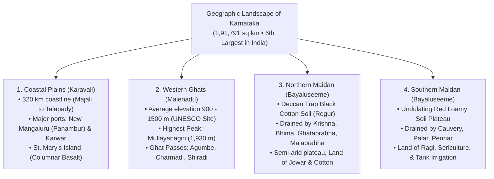
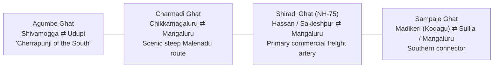
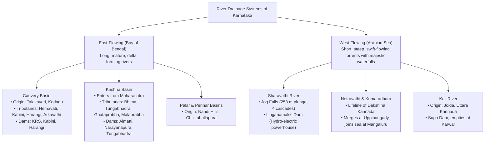
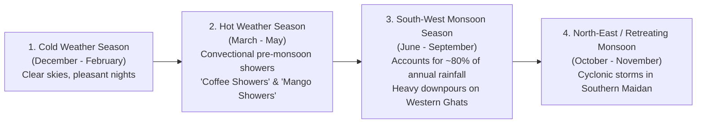

> [!exam-focus]
> **Exam Weightage & Testing Style:** 4–6 questions in Paper 1 General Knowledge. High-frequency target areas:
> - Physiographic regions: Karavali coastal strip, Western Ghats (Malenadu), Northern Maidan, Southern Maidan.
> - Mountain peaks and passes: Mullayanagiri (1,930 m, highest in Karnataka), Kudremukh, Tadiandamol; Agumbe Ghat, Charmadi Ghat, Shiradi Ghat.
> - River Drainage Systems:
>   - Cauvery origin at Talakaveri (Brahmagiri), tributaries (Hemavati, Harangi, Kabini, Arkavathi, Lakshmanatirtha), KRS dam, Shivanasamudra Falls (Asia's first hydro project, 1902).
>   - Krishna tributaries (Tungabhadra, Bhima, Ghataprabha, Malaprabha), Almatti Dam, Narayanapura Dam.
>   - West-flowing rivers: Sharavathi (Jog Falls 253 m, Linganamakki Dam), Netravathi, Kali (Supa Dam).
> - Soil classifications and crops: Red soil (South), Black cotton / Regur soil (North), Laterite soil (Malenadu/Coast).
> - Protected Areas: 5 National Parks, Ramsar wetland sites (Ranganathittu, Aghanashini, Magadi Kere, Ankasamudra), Hutti Gold Mines (Raichur).

---

## 1. Geographic Dimensions and Administrative Boundaries

Karnataka is situated in the west-central part of the Indian peninsula on the Deccan Plateau.
- **Geographical Extent:**
  - Latitude: $11^\circ 31' \text{ N}$ to $18^\circ 45' \text{ N}$
  - Longitude: $74^\circ 12' \text{ E}$ to $78^\circ 40' \text{ E}$
- **Geographic Area:** **1,91,791 sq km** (Accounts for **5.83% of India's total land area**; ranks **6th largest state** in India by area).
- **Coastline Length:** Approximately **320 km** along the Arabian Sea.
- **Bordering States (6):**
  1. *North:* Maharashtra
  2. *North-West:* Goa
  3. *West:* Arabian Sea
  4. *South-West:* Kerala
  5. *South & South-East:* Tamil Nadu
  6. *East:* Andhra Pradesh
  7. *North-East:* Telangana

The diagram above visualizes the core architecture, sequence flow, and structural taxonomy for systematic review.

---

## 2. The Four Physiographic Regions in Detail

### I. Coastal Plains (Karavali)
- Stretches between the Arabian Sea to the west and the towering scarp of the Western Ghats to the east across three districts: **Uttara Kannada, Udupi, and Dakshina Kannada**.
- **Width:** Narrowest at Bhatkal (~12–15 km); widest at Mangaluru (~50–60 km).
- **Islands of Note:**
  - **St. Mary's Island (Coconut Island), Udupi:** Famous for unique hexagonal columnar basaltic lava formations (National Geological Monument).
  - **Netrani Island (Pigeon Island), off Bhatkal:** Renowned for coral reefs and scuba diving.
  - **Kurumgad Island & Anjadip Island:** Off Karwar port.
- **Major Ports:**
  - **New Mangaluru Port (Panambur):** Karnataka's only major all-weather deep-water port (10th major port of India; handles iron ore, coffee, spices, crude petroleum).
  - **Karwar Port:** Intermediate port featuring the INS Kadamba Naval Base (*Project Seabird*).

---

### II. Western Ghats (Malenadu)
- A continuous, rugged escarpment intercepting the South-West Monsoon, creating dense tropical evergreen and semi-evergreen rainforests.
- **Key Mountain Peaks in Karnataka:**
  1. **Mullayanagiri (1,930 m):** **Highest peak in Karnataka**, located in the Chandra Drona / Baba Budangiri hill range of Chikkamagaluru district.
  2. **Kudremukh (1,892 m):** Second highest peak; horse-face shaped mountain in Chikkamagaluru.
  3. **Tadiandamol (1,748 m):** Highest mountain peak in **Kodagu district**.
  4. **Pushpagiri / Kumara Parvatha (1,712 m):** Second highest peak in Kodagu.
  5. **Bababudangiri (1,895 m):** Revered for Dattatreya Peetha / Sufi shrine; birthplace of Indian coffee cultivation (Baba Budan brought seven coffee beans from Yemen c. 1670).
  6. **Brahmagiri (1,608 m):** Source of River Cauvery on the Karnataka-Kerala border.
  7. **Kodachadri (1,343 m):** Shivasamudra background peak in Shivamogga district; temple of Mookambika.

The diagram above visualizes the core architecture, sequence flow, and structural taxonomy for systematic review.

---

### III. Northern Maidan & IV. Southern Maidan

| Parameter | Northern Maidan (ಉತ್ತರ ಮೈದಾನ) | Southern Maidan (ದಕ್ಷಿಣ ಮೈದಾನ) |
|---|---|---|
| **Districts Covered** | Belagavi, Bagalkot, Vijayapura, Kalaburagi, Yadgir, Raichur, Koppal, Gadag, Ballari. | Hassan, Mysuru, Mandya, Chamarajanagar, Tumakuru, Kolar, Chikkaballapura, Bengaluru Urban & Rural. |
| **Geological Formation** | Deccan Trap basaltic rock and sedimentary formations. | Ancient Archean Dharwar crystalline gneiss and granites. |
| **Dominant Soil** | **Deep Black Cotton Soil (Regur)**; moisture-retentive, clayey, rich in lime and magnesium. | **Red Sandy and Loamy Soil**; permeable, rich in iron peroxide, deficient in nitrogen and humus. |
| **Drainage System** | Krishna River, Bhima, Ghataprabha, Malaprabha, Tungabhadra. | Cauvery River, Hemavati, Kabini, Arkavathi, Palar, Pennar. |
| **Agricultural Profile**| **Jowar** (Granary of Jowar), Cotton, Sunflower, Tur Dal (Kalaburagi is "Tur Bowl"), Sugarcane, Bengal gram. | **Ragi** (Staple crop), Paddy, Sugarcane, Mulberry Sericulture, Groundnuts, Coconut, Mango. |
| **Irrigation Style** | Canal irrigation from massive multipurpose projects (Almatti, Narayanapura, Tungabhadra). | Traditional tank (*kere*) irrigation, borewells, and Cauvery canal networks. |

---

## 3. River Drainage Systems of Karnataka

Karnataka is drained by two major drainage systems: **East-Flowing Rivers** (emptying into the Bay of Bengal, draining ~80% of state area) and **West-Flowing Rivers** (emptying into the Arabian Sea, draining ~20%).

The diagram above visualizes the core architecture, sequence flow, and structural taxonomy for systematic review.

---

### The Cauvery (Kaveri) River System
- **Origin:** **Talakaveri** on Brahmagiri hill range in Kodagu district at an elevation of 1,341 m above MSL.
- **Total Length:** ~805 km (381 km flows within Karnataka).
- **Tributaries Breakdown:**
  - *Left Bank Tributaries:* **Harangi** (originates in Kodagu), **Hemavati** (originates at Ballalarayanadurga in Chikkamagaluru; Gorur dam), **Shimsha** (originates in Tumakuru dist), **Arkavathi** (originates in Nandi Hills; Hesaraghatta and Thippagondanahalli reservoirs).
  - *Right Bank Tributaries:* **Lakshmanatirtha** (originates in Brahmagiri; Iruppu Falls), **Kabini / Kapila** (originates in Wayanad, Kerala; large reservoir at Beechanahalli, H.D. Kote), **Suvarnavathi** (Chamarajanagar).
- **Major Waterfalls on Cauvery:**
  - *Chunchanakatte Falls:* Mysuru district.
  - *Shivanasamudra Falls:* Island bifurcation creating twin waterfalls: **Gaganachukki** and **Bharachukki** (Malavalli taluk, Mandya dist).
  - **Asia's First Hydro-Electric Generating Station:** Commissioned at Shivanasamudra (Bluff) in **1902** during the diwanship of K. Seshadri Iyer to supply electricity to the Kolar Gold Fields (KGF).
- **Major Reservoirs:**
  - **Krishna Raja Sagara (KRS) Dam:** Built across Cauvery below the confluence of Cauvery, Hemavati, and Lakshmanatirtha at Kannambadi (Mandya district) between 1911 and 1932 by Chief Engineer Sir M. Visvesvaraya; features the ornamental **Brindavan Gardens**.

---

### The Krishna River System
- Enters Karnataka at Kurundwad in Belagavi district and flows through Bagalkot, Vijayapura, Kalaburagi, and Yadgir districts.
- **Major Tributaries in Karnataka:**
  1. **Tungabhadra:** Formed by the holy confluence of **Tunga** and **Bhadra** rivers at **Koodli** near Shivamogga. Major reservoir: **Tungabhadra Dam at Hosapete** (Vijayanagara dist).
  2. **Bhima:** Longest tributary of Krishna; enters Karnataka in Afzalpur (Kalaburagi dist) and joins Krishna at Devasugur near Raichur.
  3. **Ghataprabha:** Originates in Western Ghats (Sindhudurg); flows 283 km. Features **Hidkal Dam (Raja Lakhamagouda reservoir)** and the picturesque **Gokak Falls (53 m plunge - 'Niagara of Karnataka')**.
  4. **Malaprabha:** Originates at Kanakumbi (Belagavi dist); flows into Krishna at **Kudalasangama** (historic samadhi site of Saint Basaveshwara). Major dam: **Navilatirtha Dam (Renukasagara)** in Saundatti.
- **Upper Krishna Project (UKP) Dams:**
  - **Almatti Dam (Lal Bahadur Shastri Reservoir):** Built across Krishna in Bagalkot/Vijayapura dist.
  - **Narayanapura Dam (Basavasagara Reservoir):** Yadgir district.

---

### West-Flowing Rivers of the Karavali
1. **Sharavathi River:**
   - Originates at Ambuthirtha near Nonabur in Thirthahalli taluk (Shivamogga).
   - Forms the world-renowned **Jog Falls (Gerosoppa Falls)** where the river plunges 253 m in four distinct cascades: **Raja, Roarer, Rocket, and Rani**.
   - Dams: **Linganamakki Dam** (storage capacity 152 TMC, built in 1964; feeds the Mahatma Gandhi Hydro-Electric Station and Sharavathi Generating Station).
2. **Kali River:**
   - Originates near Kushavali village in Joida taluk (Uttara Kannada); flows 184 km through dense gorges into the Arabian Sea near Karwar.
   - Dam: **Supa Dam** (massive concrete gravity dam in Joida).
3. **Netravathi River:**
   - Originates at Bangrabalige valley in Kudremukh (Chikkamagaluru); merges with Kumaradhara at **Uppinangady**; empties into the Arabian Sea at Mangaluru.
4. **Varahi River:**
   - Famous for **Kunchikal Falls** (stepped cascade) and India's first underground hydro-electric powerhouse at Hosangadi.

---

## 4. Climatic Seasons and Rainfall Distribution

Karnataka experiences a tropical monsoon climate modulated by relief features.

The diagram above visualizes the core architecture, sequence flow, and structural taxonomy for systematic review.

### Rainfall Extremes in Karnataka
- **Wettest Region:** **Agumbe** (Thirthahalli taluk, Shivamogga) receives ~7,600 mm rainfall annually; earned the title **"Cherrapunji of South India"**. Other rain hotspots: **Amagaon** (Khanapur, Belagavi), **Hulikal** (Hosanagara).
- **Driest Region:** **Challakere taluk** in Chitradurga district (Nayakarahatti belt) receives less than 450 mm rainfall annually (known as the *"Land of drought & oilseeds"*).

---

## 5. Forest Wealth, Protected Areas, and Biodiversity

Forest cover in Karnataka accounts for **~20.1% of the state's total geographical area** (against the national target of 33%).

### The Five National Parks of Karnataka

| National Park | District | Established | Major Fauna & Highlight |
|---|---|---|---|
| **Bandipur National Park** | Chamarajanagar | 1974 (Project Tiger 1973) | Tigers, Asian elephants, gaurs, Indian leopards; forms part of the **Nilgiri Biosphere Reserve**. |
| **Nagarahole (Rajiv Gandhi) NP** | Kodagu & Mysuru | 1988 (Project Tiger) | High tiger and elephant density; Kabini river reservoir forms boundary with Bandipur. |
| **Bannerghatta National Park** | Bengaluru Urban/Rural | 1974 | Country's first **Butterfly Park**; Lion & Tiger safari; Rescue rehabilitation centre. |
| **Kudremukh National Park** | Chikkamagaluru, Udupi, Dakshina Kannada | 1987 | Shola grassland ecosystem; lion-tailed macaque, Malabar giant squirrel. |
| **Anshi National Park / Kali TR** | Uttara Kannada | 1987 | Dense semi-evergreen forest; famous for rare **Black Panthers (Melanistic leopards)**. |

### Ramsar Wetland Sites in Karnataka (4)
1. **Ranganathittu Bird Sanctuary (Mandya):** First Ramsar site of Karnataka (designated in 2022); islets on Cauvery river; nesting site for painted storks, spot-billed pelicans.
2. **Aghanashini Estuary (Uttara Kannada):** Designated in 2024; estuary where Aghanashini river meets the Arabian Sea; rich in bivalve shellfish and mangrove beds.
3. **Magadi Kere Conservation Reserve (Gadag):** Wintering sanctuary for Central Asian migratory **Bar-headed Geese**.
4. **Ankasamudra Bird Conservation Reserve (Vijayanagara):** Wetland habitat harboring over 140 species of waterbirds.

---

## 6. Mineral Resources and Industrial Belts

| Mineral | Geological Belts in Karnataka | Key Mining Centres | State Rank / Exam Significance |
|---|---|---|---|
| **Gold (Au)** | Dharwar Schist Belts | - **Hutti Gold Mines (Raichur):** Currently India's **only actively producing primary gold mine**. - **Kolar Gold Fields (KGF, Kolar):** World's second deepest mines (Champion Reef, now inactive). | Karnataka accounts for over **80% of India's gold reserves and production**. |
| **Iron Ore (Fe)** | Dharwar Haematite & Magnetite formations | - **Sandur & Hospet (Ballari/Vijayanagara):** High-grade haematite ore. - **Bababudan Hills (Kemmangundi, Chikkamagaluru)**. - **Kudremukh:** Magnetite deposits. | Primary raw material supplier to Jindal Vijayanagar Steel (JSW Toranagallu) and VISL Bhadravathi. |
| **Manganese (Mn)**| Associated with iron schist belts | Sandur (Ballari), Kumsi (Shivamogga), Supa (Uttara Kannada). | Essential deoxidizing agent in steel manufacturing. |
| **Bauxite (Al)** | Laterite caps | Khanapur and Chikkodi (Belagavi), coastal hills of Udupi and Uttara Kannada. | Feeds the Indian Aluminium Company (INDAL) smelter plant at Belagavi. |
| **Limestone (CaCO3)**| Sedimentary Kaladgi & Bhima basins | Bagalkot, Mudhol, Sedam (Kalaburagi), Wadi, Lokapur. | Backbone of South India's largest cement manufacturing clusters (Wadi, Sedam, Bagalkot). |
