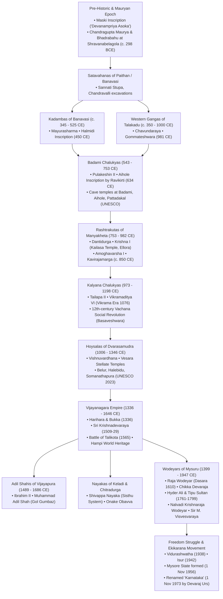
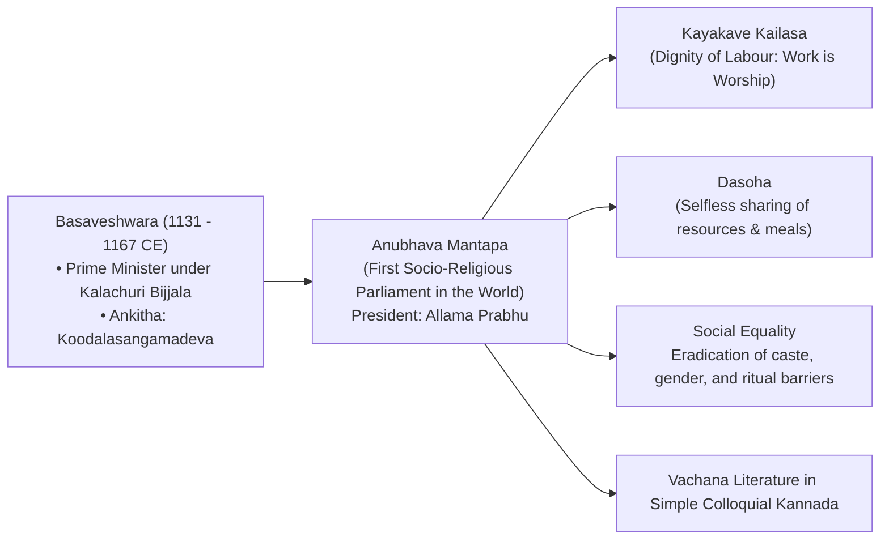
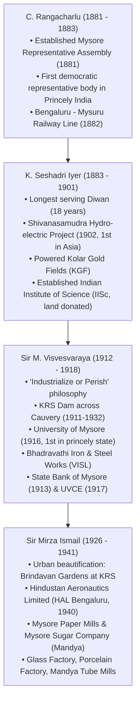
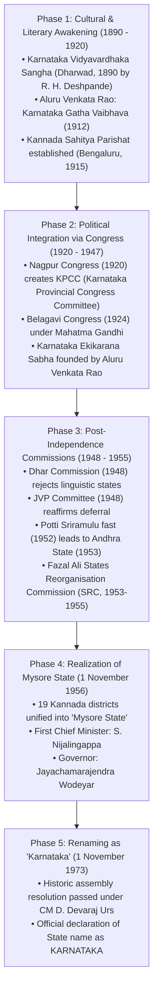

> [!exam-focus]
> **Exam Weightage & Testing Style:** 5–7 questions in Paper 1 General Knowledge. Key areas tested include:
> - Epigraphy & Early Inscriptions: Halmidi Inscription (c. 450 CE, Kakusthavarma), Talagunda Inscription (Kubja), Aihole Prashasti (634 CE, Ravikirti), *Kavirajamarga* (c. 850 CE).
> - Major Rulers & Battlefield Milestones: Mayurasharma, Pulakeshin II (Battle of Narmada against Harshavardhana), Amoghavarsha I Nrupatunga, Vishnuvardhana (*Talakadugonda*), Sri Krishnadevaraya (Battle of Raichur 1520), Battle of Talikota (Rakkasa-Tangadi, 23 Jan 1565).
> - Temple Architectural Styles: Badami Rock-cut & Aihole structural temples; Ellora monolithic Kailasa temple (Krishna I); Hoysala soapstone stellate shrines (Belur, Halebidu, Somanathapura - UNESCO 2023); Vijayanagara Dravidian Hampi monuments.
> - The 12th Century Vachana Movement: Basaveshwara, Anubhava Mantapa at Basavakalyana, Kayaka, Dasoha, Allama Prabhu, Akka Mahadevi.
> - Mysore Wodeyars & Modern Builders: Sir M. Visvesvaraya, Sir Mirza Ismail, Nalvadi Krishnaraja Wodeyar, Mysore Representative Assembly (1881).
> - Anti-British Uprisings: Kittur Rani Chennamma (1824), Sangolli Rayanna (1829–30), Vidurashwatha tragedy (25 April 1938), Isur village revolt (1942).
> - Karnataka Ekikarana: Aluru Venkata Rao (*Karnataka Gatha Vaibhava*), Fazal Ali Commission (1953–55), Unification on 1 Nov 1956, Renaming as Karnataka on 1 Nov 1973 by D. Devaraj Urs.

---

## 1. Dynastic Chronology and Evolution of Power

The diagram above visualizes the core architecture, sequence flow, and structural taxonomy for systematic review.

---

## 2. Comprehensive Dynastic Master Comparison Table

| Dynasty | Period | Capital & District | Founder & Greatest Ruler | Key Literary Works | Architectural Landmarks | High-Frequency Exam Points |
|---|---|---|---|---|---|---|
| **Kadambas** | 345–525 CE | **Banavasi** (Uttara Kannada) | **Founder:** Mayurasharma **Greatest:** Kakusthavarma | Court Sanskrit & early Old Kannada inscriptions | Madhukeshwara Temple (Banavasi) | - First indigenous Kannada royal dynasty. - Mayurasharma humiliated at Pallava capital Kanchi; performed 18 Ashvamedha sacrifices. - **Halmidi Inscription (c. 450 CE)** in Hassan dist: Earliest recorded Kannada stone epigraph. - **Talagunda Pillar Inscription** composed by poet Kubja gives Kadamba lineage. |
| **Western Gangas** | 350–1000 CE | **Kolar (Kuvalala)**, later **Talakadu** (Mysuru) | **Founder:** Dadiga & Madhava **Greatest:** Durvinita, Sripurusha | - Durvinita: Sanskrit commentary on *Kiratarjuniya* & translated *Brihatkatha*. - Chavundaraya: *Chavundaraya Purana* (978 CE). | - **Gommateshwara Monolith (57 ft)** at Shravanabelagola (consecrated by Chavundaraya in 981 CE). - Panchakuta Basadi, Kambadahalli. | - Durvinita was a prolific royal scholar proficient in Kannada and Sanskrit. - Sripurusha authored veterinary manual *Gajashastra*. - Shravanabelagola Mahamastakabhisheka celebrated once every 12 years. |
| **Badami Chalukyas** | 543–753 CE | **Vatapi / Badami** (Bagalkot) | **Founder:** Jayasimha / Pulakeshin I **Greatest:** **Pulakeshin II** (610–642 CE) | - **Aihole Prashasti (634 CE)** composed by Jain court poet **Ravikirti** in Sanskrit. - Court poetess Vijjika (Vijayabhattarika). | - Badami Rock-cut Caves (Caves 1 to 4). - **Aihole:** "Cradle of Indian Temple Architecture" (Lad Khan, Durga temple, Huchimalli). - **Pattadakal (UNESCO Site):** Virupaksha & Mallikarjuna temples (built by queens Lokamahadevi & Trailokyamahadevi). | - Pulakeshin II assumed title *Parameshvara* after defeating North Indian Emperor **Harshavardhana** on the banks of Narmada. - Chinese pilgrim **Xuanzang (Hiuen Tsang)** visited Pulakeshin II's court in 640 CE. - Conflict with Pallavas: Pulakeshin II defeated Mahendravarman I, but was later defeated and killed by Narasimhavarman I (*Vatapikonda*) in 642 CE. |
| **Rashtrakutas** | 753–982 CE | **Manyakheta / Malkhed** (Kalaburagi) | **Founder:** Dantidurga **Greatest:** **Amoghavarsha I Nrupatunga** (814–878 CE) | - ***Kavirajamarga* (c. 850 CE)**: Earliest extant Kannada treatise on poetics (court poet Srivijaya). - **Pampa:** *Adipurana*, *Vikramarjuna Vijaya* (*Pampa Bharata*). - **Ponna:** *Santipurana* (*Ubhaya Kavichakravarti*). - **Ranna:** *Ajitapurana*, *Sahasa Bhima Vijaya* (*Gadayuddha*). | - **Kailasa Temple at Ellora (Cave 16):** Magnificent monolithic rock-cut wonder carved from top to bottom by **Krishna I**. - Elephanta Caves (Trimurti sculpture). | - Arab merchant traveler **Sulaiman (851 CE)** listed Rashtrakuta Empire alongside Abbasid Baghdad, Byzantine Empire, and Tang China as the **four greatest empires in the world**. - *Kavirajamarga* famously declares the Kannada territory as stretching *"from the Cauvery to the Godavari"* (*ಕಾವೇರಿಯಿಂದಮಾ ಗೋದಾವರಿವರಮಿರ್ಪ ನಾಡದಾ ಕನ್ನಡದೊಳ್*). - Jainism flourished under Amoghavarsha I (disciple of Jinasenacharya). |
| **Kalyana Chalukyas** | 973–1198 CE | **Basavakalyana** (Bidar) | **Founder:** Tailapa II (overthrew Rashtrakutas) **Greatest:** **Vikramaditya VI** (1076–1126 CE) | - **Bilhana:** *Vikramankadevacharita*. - **Vijnaneshwara:** *Mitakshara* (Hindu law treatise on inheritance). - **Someshwara III:** *Manasollasa / Abhilashitartha Chintamani* (First Indian encyclopedia). | - Mahadeva Temple at Itagi (Koppal) – titled *"Devalaya Chakravarti"*. - Kasi Vishveshvara Temple at Lakkundi. - Mallikarjuna Temple at Kuruvatti. | - Vikramaditya VI founded the **Chalukya-Vikrama Era in 1076 CE** discarding the Saka Era. - Golden era of Kannada literature with Ranna patronized by Tailapa II and Satyashraya. - 12th-century **Vachana Revolution** led by Basaveshwara blossomed under the rule of Kalachuri usurper King Bijjala II at Kalyana. |
| **Hoysalas** | 1006–1346 CE | **Dvarasamudra / Halebidu** (Hassan) | **Founder:** Sala (legend of killing tiger: *"Poy Sala"* = Hoysala) **Greatest:** **Vishnuvardhana** (Bittideva, 1108–1152 CE) | - Janna: *Yashodhara Charite*, *Ananthanatha Purana*. - Raghavanka: *Harishchandra Kavya* (pioneered Shatpadi metre). - Harihara: *Girija Kalyana*, pioneer of Ragale metre. | - **Chennakeshava Temple, Belur** (1117 CE). - **Hoysaleshwara Temple, Halebidu**. - **Keshava Temple, Somanathapura** (Mysuru). *(Inscribed on UNESCO World Heritage list in September 2023 as 'Sacred Ensembles of the Hoysalas')*. | - Vishnuvardhana converted from Jainism to Srivaishnavism under saint **Ramanujacharya**. - Defeated Chola governors at Talakadu (1116 CE) and assumed title **Talakadugonda**; built Belur temple to commemorate this victory. - Unique architectural features: Soft **chloritic schist (soapstone)**, raised **stellate (star-shaped) platforms (*jagati*)**, lathe-turned polished pillars, exquisitely carved continuous friezes (*elephants, lions, horses, creepers*). |
| **Vijayanagara Empire** | 1336–1646 CE | **Vijayanagara / Hampi** (Bellary / Vijayanagara dist) | **Founders:** Harihara I & Bukka Raya I (Sangama Dynasty, 1336) **Greatest:** **Sri Krishnadevaraya** (1509–1529 CE, Tuluva Dynasty) | - Krishnadevaraya: *Amuktamalyada* (Telugu), *Jambavati Kalyanam* (Sanskrit). - Allasani Peddana, Tenali Ramakrishna (*Ashtadiggajas*). - Kumaravyasa: *Karnata Bharata Kathamanjari* (*Gadugina Bharata* in Bhamini Shatpadi). | - Virupaksha Temple, Vijaya Vittala Temple (Musical stone pillars & **Stone Chariot**). - Lotus Mahal, Queen's Bath, Elephant Stables, Hazara Rama Temple. - Mahanavami Dibba. | - Founded with blessings of sage **Vidyaranya** of Sringeri Sharada Peetham. - Four successive dynasties: **Sangama (1336–1485), Saluva (1485–1505), Tuluva (1505–1570), Aravidu (1570–1646)**. - Foreign visitors: Nicolo de Conti (Italian, 1420), Abdur Razzaq (Persian, 1443 under Deva Raya II), Duarte Barbosa & Domingo Paes (Portuguese, 1520 under Krishnadevaraya), Fernao Nuniz (1535). - Deva Raya II (Proudha Deva Raya) recruited Muslim archers and patronized poets. - Krishnadevaraya captured Raichur Fort from Ismail Adil Shah in 1520; built Nagalapura (Hospet). - **Battle of Rakkasa-Tangadi (Talikota):** 23 January 1565; combined Deccan Sultanates (Bijapur, Golconda, Ahmednagar, Bidar) routed Aliya Rama Raya. |
| **Adil Shahis of Vijayapura** | 1489–1686 CE | **Vijayapura (Bijapur)** | **Founder:** Yusuf Adil Shah **Greatest:** Ibrahim Adil Shah II (1580–1627 CE) | - Ibrahim Adil Shah II authored musical book ***Kitab-e-Navras*** in Dakhni Urdu (opened with praise to Saraswati, Ganesha, and Hazrat Gesudaraz). | - **Gol Gumbaz** (built by Muhammad Adil Shah, 1656 CE): World's second-largest dome without pillar support; contains the famous **Whispering Gallery**. - Ibrahim Rauza (Tomb & Mosque, known as Taj Mahal of South India). - Malik-e-Maidan (gigantic bronze cannon). | - Promoted syncretic Indo-Islamic culture. - Ibrahim II held titles *Jagat Guru* and *Abla Baba* (Friend of the Poor). - Defeated and annexed by Mughal Emperor Aurangzeb in 1686 CE. |
| **Wodeyars of Mysuru** | 1399–1947 CE | **Mysuru / Srirangapatna** | **Founder:** Yaduraya (1399) **Greatest:** Chikka Devaraja, Nalvadi Krishnaraja Wodeyar | - Chikka Devaraja: *Geetha Gopala*. - Tirumalarya: *Chikkadevaraja Vamshavali*. - Sanchi Honnamma: *Hadibadeya Dharma*. | - Mysore Amba Vilas Palace (Henry Irwin architect). - Krishna Raja Sagara (KRS) Dam (conceived & built by Sir M. Visvesvaraya across Cauvery). - Lalitha Mahal Palace, Jaganmohan Palace. | - **Raja Wodeyar (1610 CE):** Acquired Srirangapatna and instituted the world-famous **Mysore Dasara festival** on royal lines. - **Chikka Devaraja Wodeyar (1673–1704):** Established centralized 18 government departments (**Athara Kacheri**); bought Bengaluru from Mughal general Qasim Khan for 3 lakh rupees. - **Hyder Ali & Tipu Sultan era (1761–1799):** Anglo-Mysore wars; rocket artillery; Treaty of Srirangapatna (1792); Tipu died defending Srirangapatna on **4 May 1799**. - **British Commission Rule (1831–1881):** Nagar peasant rebellion (1830) led to direct takeover by William Bentinck; Mark Cubbon and L.B. Bowring consolidated judiciary and revenue systems. - **Rendition of Mysore (1881):** Power transferred back to Chamarajendra Wodeyar X. - **Nalvadi Krishnaraja Wodeyar (1902–1940):** Hailed by Mahatma Gandhi as *Rajarshi*; transformed Mysore into a model progressive princely state. |

---

## 3. The 12th-Century Vachana Social Revolution

The Vachana movement originated in the 12th century under the spiritual and social leadership of **Basaveshwara (Basavanna)** at Basavakalyana.

The diagram above visualizes the core architecture, sequence flow, and structural taxonomy for systematic review.

### Major Vachanakaras and Their Nom-de-Plumes (ಅಂಕಿತನಾಮಗಳು)

| Vachanakara | Social Background / Profession | Ankitha Nama (ಅಂಕಿತನಾಮ) | High-Frequency Exam Fact |
|---|---|---|---|
| **Basaveshwara** | Brahmin minister; social revolutionary | **Koodalasangamadeva (ಕೂಡಲಸಂಗಮದೇವ)** | Founded Anubhava Mantapa; proclaimed *Kayakave Kailasa*; condemned temple rituals and caste hierarchy. |
| **Allama Prabhu** | Temple drummer (*maddale* player) | **Goggeshwara / Guheshwara (ಗುಹೇಶ್ವರ)** | Chaired the Anubhava Mantapa as *Sunyashimhasanadhikari*; composed highly esoteric mystic Bedagina Vachanas. |
| **Akka Mahadevi** | Woman mystic of Udutadi (Shivamogga) | **Chennamallikarjuna (ಚೆನ್ನಮಲ್ಲಿಕಾರ್ಜುನ)** | Renounced worldly ties and clothes; ultimate embodiment of spiritual feminism and devotion. |
| **Channabasavanna** | Basavanna's nephew; intellectual theologian | **Koodalachannasangamadeva (ಕೂಡಲಚೆನ್ನಸಂಗಮದೇವ)** | Formulated the *Shatsthala* philosophical framework of Veerashaivism. |
| **Madivala Machideva** | Washerman (*dhobi*) | **Kalidevaradeva (ಕಲಿದೇವರದೇವ)** | Zealous defender of Vachana manuscripts during the Kalyana upheaval. |
| **Hadapada Appanna** | Barber | **Basavapriya Koodalasangamadeva** | Personal associate of Basaveshwara. |
| **Ambigara Chowdayya** | Ferryman / Boatman | **Ambigara Chowdayya (ಸ್ವನಾಮ)** | Outspoken, blunt critic of social hypocrisy. |
| **Sule Sankavva** | Reformed courtesan | **Nirlajjeshwara** | Proved that spiritual liberation was open to the most marginalized outcasts. |

---

## 4. Illustrious Diwans of Modern Mysore State

Following the **Rendition of Mysore in 1881**, four visionary Diwans laid the administrative, industrial, educational, and democratic foundations of modern Karnataka:

The diagram above visualizes the core architecture, sequence flow, and structural taxonomy for systematic review.

---

## 5. Resistance to Colonial Rule in Karnataka

### Early Revolts Pre-dating 1857
1. **Kittur Rebellion (1824):**
   - **Rani Chennamma** defied British Collector **St. John Thackeray**, who rejected her adopted son Shivalingappa under the aggressive pre-Dalhousie doctrine of lapse.
   - Thackeray was killed in battle at Kittur Fort on **23 October 1824**.
   - Second British campaign captured Chennamma; imprisoned at Bailhongal Fort until her death on **21 February 1829**.
2. **Sangolli Rayanna's Guerrilla Warfare (1829–1830):**
   - Army commander (*Senani*) of Kittur from the Kuruba community.
   - Conducted hit-and-run warfare, burning British taluk treasuries and offices.
   - Betrayed by local landlords and hanged by the British at **Nandagad** on **26 January 1831**.
3. **Nagar Peasant Uprising (1830–1831):**
   - Led by Sardar Mallaiah (Budi Basavappa) against extortionate British and royal tax collection in Shivamogga/Nagar region. Led to British takeover of Mysore administration under Mark Cubbon.
4. **Bedas of Halagali Revolt (1857):**
   - Hunters of Halagali village (Mudhol taluk, Bagalkot) took up arms refusing to surrender their weapons under the British **Disarming Act of 1857**.
   - Village was besieged and burnt; leaders Babaji and Jadgia were executed.
5. **Surapura Revolt (1857–1858):**
   - **Raja Venkatappa Nayaka** of Surapura (Yadgir dist) formed secret alliances with Peshwa Nana Saheb and rebelled against British Resident Meadows Taylor.
6. **Mundargi Bheema Rao (1858):**
   - Hereditary Deshmukh of Mundargi (Gadag dist); captured Koppal Fort; died heroically in battle defending Koppal against British forces.

---

### The Gandhian Phase in Karnataka
1. **Belagavi Congress Session (1924):**
   - The **39th Session of the Indian National Congress**, held at Belagavi (Veer Soudha), is the **only Congress session ever presided over by Mahatma Gandhi**.
   - Kannada welcome anthem: ***"Udayavagali Namma Cheluva Kannada Nadu"*** composed by **Huilgol Narayana Rao** was sung in Gandhi's presence.
2. **Ankola Salt Satyagraha (1930):**
   - Known as the **"Dandi of Karnataka"**.
   - Led by **M. P. Nadkarni**, Karnad Sadashiva Rao, and D. P. Karmarkar on 13 April 1930 at Ankola sea beach in Uttara Kannada.
3. **Vidurashwatha Tragedy (25 April 1938):**
   - Known as the **"Jallianwala Bagh of Karnataka"**.
   - British police opened indiscriminate fire on a peaceful crowd participating in the Dhwaja Satyagraha under the leadership of T. Ramachar at Vidurashwatha (Gowribidanur taluk, Chikkaballapura dist); **32 freedom fighters were killed**.
4. **Isur Village Uprising (1942 - Quit India):**
   - Village in Shikaripura taluk (Shivamogga district) where villagers declared their village independent of the British Raj and hoisted the Tricolour, proclaiming ***"Ee Sooru Namma Sooru"*** ("This village is our village").
   - Clashes resulted in the death of British Sub-Inspector and Amaldar; five freedom fighters (Gurusiddappa, Malappa, Suryanarayanachari, Halappa, Gouda Shankarappa) were sentenced to death and hanged in March 1943.

---

## 6. The Karnataka Ekikarana (Unification) Movement

Prior to 1956, the Kannada-speaking people were fragmented across **20 different administrative units** (Mysore Princely State, Bombay Presidency, Madras Presidency, Hyderabad Nizam State, Coorg Chief Commissioner's Province, and small princely states like Kolhapur, Sangli, Jamkhandi, Ramdurg).

The diagram above visualizes the core architecture, sequence flow, and structural taxonomy for systematic review.

### Key Ekikarana Pioneers & Milestones
- **Aluru Venkata Rao (1880–1964):** Revered as **"Kannada Kula Purohita"**. His stirring historical masterpiece ***Karnataka Gatha Vaibhava* (1912)** awakened Kannadigas to their forgotten royal heritage and unified identity.
- **R. H. Deshpande:** First Kannada graduate of Bombay University; founded Karnataka Vidyavardhaka Sangha in 1890.
- **Andanappa Doddameti:** Tabled the first official resolution in the Bombay Legislative Assembly demanding a separate Karnataka state in 1938.
- **Gudur Chennappa & K. R. Karanth:** Spearheaded the unification movement across Coastal and Hyderabad regions.
- **Fazal Ali Commission (SRC 1953–1955):**
  - Members: Justice Fazal Ali (Chairman), H. N. Kunzru, K. M. Panikkar.
  - Recommended integrating Bombay Karnataka (Belagavi, Dharwad, Bijapur, Uttara Kannada), Hyderabad Karnataka (Bidar, Gulbarga, Raichur), Madras Karnataka (Bellary, South Canara/Dakshina Kannada), and Coorg (Kodagu) with old Mysore State.
- **1 November 1956:** Formal birth of unified **Mysore State** with 19 districts; Chief Minister **S. Nijalingappa**.
- **1 November 1973:** Historic golden day when Mysore State was officially christened **KARNATAKA** under Chief Minister **D. Devaraj Urs**.
