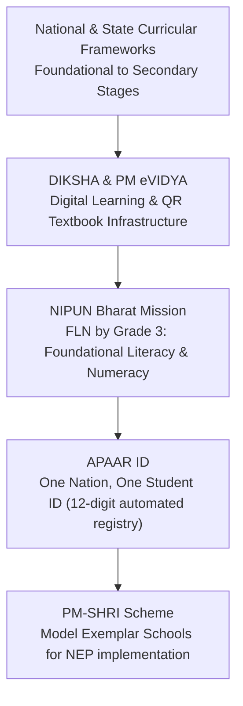

# Current Affairs Master Hub & 360° Syllabus Portal (2025–2026)

> [!exam-focus]
> **Exam Weightage & Testing Style:** 15 questions in Paper 1 (Section 2: Current Affairs). Focus areas include:
> - **Karnataka Flagship Programs:** The 5 Guarantee Schemes (eligibility criteria, administrative departments, financial caps).
> - **Education & Digital Schemes:** PM-SHRI Schools, DIKSHA portal, NIPUN Bharat, APAAR ID (One Nation One Student ID).
> - **National Polity & Legal Reforms:** The three new criminal laws (BNS, BNSS, BSA effective July 1, 2024), 106th Amendment Act (Women's reservation), One Nation One Election Kovind Committee.
> - **Science, Space & Environment:** ISRO missions (Chandrayaan-3, Aditya-L1, Gaganyaan, Chandrayaan-4), Agni-5 MIRV Mission Divyastra, Karnataka's 4 Ramsar sites.
> - **Awards & Sports:** Bharat Ratna 2024, 58th Jnanpith Award, Paris Olympics & Paralympics 2024, T20 World Cup, Chess Olympiad.

---

## 📚 Dedicated 360° Monthly Magazine Digests Subfolder

For deep-dive thematic study, comprehensive coverage has been synthesized from leading competitive journals (*Spardha Spoorthi*, *The Hindu*, *Times of India*, *Vision IAS*, *InsightsonIndia*) into dedicated notes in the Monthly Digests subfolder:

| Digest Volume & Note Link | Core Themes & Coverage | High-Yield Highlights |
|---|---|---|
| [[01_Karnataka_State_Affairs_and_Schemes_Digest_2025_2026\|01. Karnataka State Governance & Schemes Digest]] | Karnataka Five Guarantees, State Budget, KKRDB Art 371J, Mekedatu, Kalasa-Banduri, UKP-III, 87th Sahitya Sammelana | Nodal depts, DBT rules, Seva Sindhu procedures, State Emblems. |
| [[02_National_Polity_Governance_and_Constitutional_Digest_2025_2026\|02. National Polity & New Criminal Laws Digest]] | Bharatiya Nyaya Sanhita (BNS), BNSS, BSA (enforced 1 July 2024), 106th Amendment (Nari Shakti Vandan), Kovind simultaneous election panel, 16th Finance Commission | Sedition repeal, Zero FIR, Community service, SC/ST sub-classification verdict. |
| [[03_Economic_Survey_Union_Budget_and_Banking_Digest_2025_2026\|03. Economy, Union Budget & Central Schemes Digest]] | Union Budget, Capex ₹11.11 lakh cr, New Tax Regime slabs, PM-Surya Ghar (1 cr roofs), PM Vishwakarma, Lakhpati Didi, UPI global expansion | 4 pillars (G-Y-A-N), inflation targeting, NITI Aayog SDG Index (Karnataka score). |
| [[04_Science_Tech_ISRO_Defense_and_Environment_Digest_2025_2026\|04. Science, Technology, ISRO & Environment Digest]] | Chandrayaan-3 (Shiv Shakti point), Aditya-L1 (halo orbit), Gaganyaan 4 astronaut designates, Chandrayaan-4 sample return, Mission Divyastra (Agni-5 MIRV), Ramsar sites | 563 tigers in Karnataka (2nd in India), 4 Ramsar wetlands (Ranganathittu, Aghanashini, Magadi, Ankasamudra). |
| [[05_Awards_Honors_Sports_and_Personalia_Digest_2025_2026\|05. Awards, Honors, Sports & Personalia Digest]] | Bharat Ratna 2024 (5 recipients), 58th Jnanpith (Gulzar & Rambhadracharya), 70th National Film Awards (*Kantara* - Rishab Shetty), Paris Olympics (6 medals) & Paralympics (29 medals), ICC T20 World Cup, Chess Olympiad | Neeraj Chopra, Manu Bhaker, Rohit Sharma, D. Gukesh, Rohan Bopanna Australian Open. |
| [[06_Month_by_Month_Chronology_2025_2026\|06. Month-by-Month High-Yield Chronology (2025–2026)]] | Month-wise bulleted sequence from January 2025 through 2026 synthesized from Spardha Spoorthi and The Hindu | Perfect for rapid pre-exam revision of 1-liner facts and dates. |

---

## 1. Karnataka Flagship Governance Schemes (The Five Guarantees)

| Scheme Name | Nodal Department | Key Objective & Entitlement | High-Yield Exam Fact |
|---|---|---|---|
| **Gruha Lakshmi** | Women & Child Development | ₹2,000 monthly financial assistance directly to the woman head of BPL/APL/Antyodaya households. | DBT transferred via Aadhaar-linked accounts; over 1.2 crore women enrolled across Karnataka. |
| **Shakti Scheme** | Transport Department | Free bus travel for all domicile women and transgender persons in state-run non-premium road transport corporations (KSRTC, BMTC, NWKRTC, KKRTC). | Launched in June 2023; applicable within Karnataka state boundaries. |
| **Gruha Jyothi** | Energy Department | Free domestic electricity up to 200 units per month per household based on average consumption. | Implemented via Seva Sindhu portal registration. |
| **Anna Bhagya** | Food, Civil Supplies & Consumer Affairs | 10 kg free food grains per person per month to BPL and Antyodaya cardholders (5 kg rice + cash DBT in lieu of remaining 5 kg). | Cash equivalent DBT transferred at ₹34 per kg for the additional 5 kg. |
| **Yuva Nidhi** | Skill Development & Livelihood | Unemployment assistance of ₹3,000/month for degree holders and ₹1,500/month for diploma holders unemployed after 6 months of graduation. | Tenable for maximum 2 years or until employment is secured. |

---

## 2. Major Education & Digital Initiatives

### Digital Education Matrix

The diagram above visualizes the core architecture, sequence flow, and structural taxonomy for systematic review.

### Core Education Programs Summary
1. **NIPUN Bharat (National Initiative for Proficiency in Reading with Understanding and Numeracy):**
   - Launched under Samagra Shiksha.
   - Core Target: Every child in Grade 3 achieves Foundational Literacy and Numeracy (FLN) by 2026–27.
2. **APAAR ID (Automated Permanent Academic Account Registry):**
   - A unique 12-digit lifelong ID for all school and college students in India, linked to the Academic Bank of Credits (ABC) and DigiLocker.
3. **PM-SHRI (PM Schools for Rising India):**
   - Centrally sponsored scheme to upgrade 14,500+ schools across the country as exemplar green schools showcasing experiential, inquiry-driven pedagogy.
4. **Kalyana Karnataka Human Resource Development (KKRDB):**
   - Special financial allocation under Article 371J for constructing modern school classrooms, Akshara Avishkara learning labs, and recruiting Graduate Primary Teachers.

---

## 3. Current Constitutional & Administrative Officeholders

| Office | Dignitary |
|---|---|
| **President of India** | Smt. Droupadi Murmu (15th President; 1st tribal woman President) |
| **Vice President of India** | Shri Jagdeep Dhankhar (Ex-officio Chairman of Rajya Sabha) |
| **Prime Minister of India** | Shri Narendra Modi |
| **Chief Justice of India** | Dr. Justice D. Y. Chandrachud / Sanjiv Khanna |
| **Chief Election Commissioner** | Shri Rajiv Kumar |
| **Governor of Karnataka** | Shri Thaawarchand Gehlot |
| **Chief Minister of Karnataka** | Shri Siddaramaiah |
| **Deputy Chief Minister of Karnataka** | Shri D. K. Shivakumar |
| **Minister for Primary & Secondary Education (Karnataka)** | Shri Madhu Bangarappa |
| **Speaker, Karnataka Legislative Assembly** | Shri U. T. Khader |
