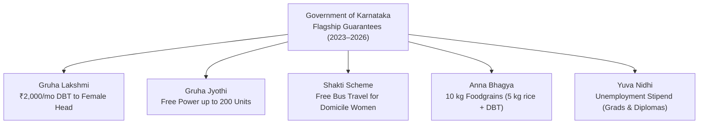

# Karnataka State Governance, Flagship Schemes & Policies Digest (2025–2026)

> [!abstract]
> **Source Attribution & Exam Orientation:** Digested from Karnataka Government notifications, *Spardha Spoorthi*, *Spardha Vani*, and state gazettes. Questions in Paper 1 frequently test nodal departments, DBT transfer mechanisms, financial ceilings, eligibility criteria, and administrative statutory bodies.

---

## 1. Deep Dive: The Karnataka Five Guarantee Schemes

The diagram above visualizes the core architecture, sequence flow, and structural taxonomy for systematic review.

### Detailed Operational Matrix

| Scheme | Administrative Department | Monthly Entitlement / Financial Benefit | Target Beneficiaries & Eligibility Rules | DBT / Delivery Channel & IT Platform |
|---|---|---|---|---|
| **Gruha Lakshmi** | Women & Child Development | **₹2,000 per month** directly to female household head | Women heads listed on BPL, Antyodaya (AAY), and APL ration cards. Women or spouses paying Income Tax or filing GST are excluded. | Direct Benefit Transfer (DBT) via Aadhaar-seeded NPCI bank accounts; Seva Sindhu / Grama One / Karnataka One portals. |
| **Gruha Jyothi** | Energy Department | **Free domestic electricity up to 200 units** monthly | Domestic consumers across ESCOMs (BESCOM, MESCOM, HESCOM, GESCOM, CHESCOM). Calculated on average monthly usage + 10% buffer, capped at 200 units. | Seva Sindhu billing integration; automatic deduction on energy utility bills. |
| **Shakti Scheme** | Transport Department | **100% Free bus travel** within Karnataka state limits | All domicile women, girl students, and transgender persons in ordinary state transport buses (KSRTC, BMTC, NWKRTC, KKRTC). Excludes Rajahamsa, Non-Stop, Airavat, and sleeper classes. | Zero-fare 'Shakti Smart Cards' / Domicile ID verification by bus conductors. |
| **Anna Bhagya** | Food, Civil Supplies & Consumer Affairs | **10 kg free foodgrains** per person per month | BPL and Antyodaya cardholders. 5 kg provided as free central rice under PMGKAY, and additional 5 kg provided by Karnataka State (cash DBT given at ₹34/kg when rice procurement faces deficits). | DBT cash transferred directly to the bank account of the card head or rice distribution via Fair Price Shops (FPS). |
| **Yuva Nidhi** | Skill Development, Entrepreneurship & Livelihood | **₹3,000/month** for degree holders; **₹1,500/month** for diploma holders | Domicile youth graduating in 2023, 2024, or 2025 who remain unemployed after 6 months of course completion. Discontinued upon securing private/government employment or self-employment. | Tenable for maximum 2 years; Seva Sindhu registration linked to university graduation database. |

---

## 2. Karnataka State Budget & Fiscal Priorities (2024–2025 & 2025–2026)

### Key Budgetary Facts for GPSTR/CST
1. **Total Budget Outlay:** The state budget crossed **₹3.71 lakh crore** with over ₹52,000 crore dedicated annually to sustain the Five Guarantee Schemes.
2. **Education Sector Allocation:** 
   - Over **₹44,000 crore (around 11–12% of total state budget)** allocated to Department of School Education and Higher Education.
   - Introduction of **Koosina Mane** (creches for children of MGNREGA women workers in 4,000 Gram Panchayats).
   - Construction of **Namma Shaale, Nanna Koduge** infrastructure initiative leveraging CSR funds.
3. **Kalyana Karnataka Human Resource Development Board (KKRDB):**
   - Special annual grant of **₹5,000 crore** allocated under **Article 371J** of the Constitution.
   - Priority focused on **Akshara Avishkara** (school building modernizations, lab equipment, STEM labs in 7 Kalyana Karnataka districts: Kalaburagi, Bidar, Raichur, Koppal, Yadgir, Ballari, and Vijayanagara).

---

## 3. Interstate River & Irrigation Projects in Current Focus

| Project / River System | Participating States / Authorities | Core Objective / Current Dispute Facts | Strategic Significance |
|---|---|---|---|
| **Mekedatu Balancing Reservoir** | Karnataka vs Tamil Nadu (Cauvery River) | Construction of a 67 TMC capacity reservoir at the confluence of Arkavathi and Cauvery in Kanakapura taluk (Ramanagara/Bengaluru Rural). | Designed to provide 4.75 TMC drinking water to Bengaluru Metropolitan area and generate 400 MW hydroelectricity. Tamil Nadu opposes citing regulation of flows. |
| **Upper Bhadra Project (UBP)** | Karnataka (Central National Project status) | Lifting water from Tunga to Bhadra and then from Bhadra to drought-prone central Karnataka. | Provides micro-irrigation to 2.25 lakh hectares in Chikkamagaluru, Chitradurga, Tumakuru, and Davanagere; designated as Karnataka's first National Irrigation Project. |
| **Kalasa-Banduri Nala Project** | Karnataka vs Goa vs Maharashtra (Mahadayi River) | Diverting 3.9 TMC of water from Mahadayi basin tributaries (Kalasa and Banduri streams) to Malaprabha river. | Drinking water supply project for drought-stricken towns of Hubballi-Dharwad, Belagavi, and Gadag districts. Revised DPR approved by Central Water Commission (CWC). |
| **Upper Krishna Project (UKP Stage III)** | Karnataka, Maharashtra, Andhra Pradesh, Telangana | Raising storage level of Almatti Dam (Lal Bahadur Shastri Dam) from 519.60 m to 524.256 m to utilize 130 TMC allocated water. | Irrigates northern dry districts of Bagalkote, Vijayapura, Kalaburagi, and Yadgir. Awaiting official gazette notification by Central Government. |

---

## 4. Karnataka Cultural, Literary & State Awards Landmarks

- **87th Akhila Bharata Kannada Sahitya Sammelana:**
  - Venue: **Mandya** (Sugar city).
  - President: Renowned folklorist and scholar **Go. Ru. Channabasappa** (Go. Ru. Cha).
- **Pampa Prashasti (State's Highest Literary Honor):**
  - Conferred by Karnataka Government for outstanding lifetime contribution to Kannada literature.
- **Karnataka Rajyotsava Prashasti (November 1):**
  - Awarded annually to 69 distinguished achievers across folklore, Yakshagana, literature, social service, classical music, and science.
- **State Emblems of Karnataka Quick Reference:**
  - *State Animal:* Asian Elephant (*Elephas maximus*).
  - *State Bird:* Indian Roller (*Coracias benghalensis*) / Neelakantha.
  - *State Flower:* Lotus (*Nelumbo nucifera*).
  - *State Tree:* Sandalwood (*Santalum album*) / Gandhadamara.
  - *State Butterfly:* Southern Birdwing (*Troides minos* - India's largest butterfly).
  - *State Song:* 'Jaya Bharata Jananiya Tanujate' (composed by Rashtrakavi Kuvempu; officially tuned in 2 minutes 30 seconds).

---

## 5. Important State Commissions & Administrative Appointments

- **Governor of Karnataka:** Shri Thaawarchand Gehlot.
- **Chief Minister:** Shri Siddaramaiah (holds Finance portfolio).
- **Deputy Chief Minister:** Shri D. K. Shivakumar (holds Major Irrigation & Bengaluru City Development).
- **Minister for Primary and Secondary Education:** Shri Madhu Bangarappa.
- **Speaker of Karnataka Legislative Assembly:** Shri U. T. Khader.
- **Chairman of Karnataka Legislative Council:** Shri Basavaraj Horatti.
- **Chairman of KPSC (Karnataka Public Service Commission):** Constitutional body functioning under Article 315–323.
