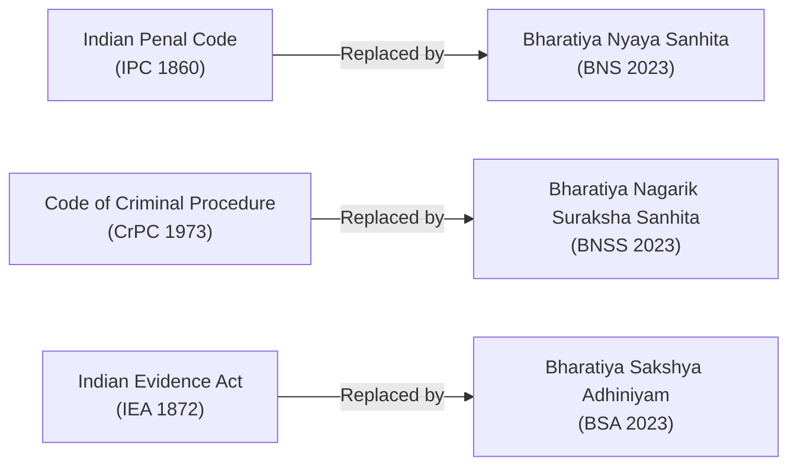

# National Polity, Governance & Landmark Legal Reforms Digest (2025–2026)

> [!abstract]
> **Source Attribution & Exam Orientation:** Digested from *The Hindu*, *Times of India*, and official Union Gazettes. Core exam themes include the replacement of colonial criminal codes by the new criminal laws (effective 1 July 2024), key constitutional amendment acts, and statutory commissions.

---

## 1. The Three New Criminal Laws (Enforced July 1, 2024)

On **July 1, 2024**, India replaced three major colonial-era British criminal laws with indigenous legal frameworks passed by Parliament in December 2023.

The diagram above visualizes the core architecture, sequence flow, and structural taxonomy for systematic review.

### Detailed Structural Comparison

| Old Statute | New Act | Total Sections | Landmark Legal Shifts & Key Exam Points |
|---|---|---|---|
| **Indian Penal Code (IPC 1860)** | **Bharatiya Nyaya Sanhita (BNS 2023)** | 358 Sections (down from 511) | 1. **Sedition (Old Sec 124A) repealed:** Replaced by Section 152 penalizing acts endangering the sovereignty, unity, and integrity of India. 2. **Community Service:** Introduced for the first time as a formal penal punishment for petty offenses (defamation, public misconduct, small theft). 3. **Organized Crime & Mob Lynching:** Defined explicitly as distinct severe offenses. 4. **Snatching:** Introduced as a specific offense under Section 304. |
| **Code of Criminal Procedure (CrPC 1973)** | **Bharatiya Nagarik Suraksha Sanhita (BNSS 2023)** | 531 Sections (modified from 484) | 1. **Zero FIR:** Mandated across India; police stations must register an FIR irrespective of jurisdictional territorial boundaries. 2. **Mandatory Forensic Investigation:** Required for all crimes punishable with 7 years or more imprisonment. 3. **Electronic Summons & Virtual Hearings:** Authorized digital production of accused and video evidence recording. 4. **Trial in Absentia:** Permitted for proclaimed offenders who have absconded abroad. |
| **Indian Evidence Act (IEA 1872)** | **Bharatiya Sakshya Adhiniyam (BSA 2023)** | 170 Sections (modified from 167) | 1. **Electronic and Digital Records:** Conferred equal legal status with traditional primary physical documents. 2. **Expansion of Secondary Evidence:** Oral admissions and written accounts recognized under defined strict conditions. |

---

## 2. The 106th Constitutional Amendment Act: Women's Reservation

- **Official Name:** *Nari Shakti Vandan Adhiniyam* (Constitution 106th Amendment Act, 2023).
- **Core Provision:** Provides **33% (one-third) reservation for women** in:
  1. **Lok Sabha** (House of the People) via new **Article 330A**.
  2. **State Legislative Assemblies** (Vidhan Sabha) via new **Article 332A**.
  3. **Legislative Assembly of NCT of Delhi** via amendment to **Article 239AA**.
- **Sub-reservation:** 33% reservation applies within the seats already reserved for Scheduled Castes (SC) and Scheduled Tribes (ST).
- **Implementation Mechanism:** The reservation will come into effect after the first Census conducted following the commencement of the Act and the subsequent **Delimitation exercise**.
- **Sunset Clause:** Prescribed for a period of **15 years** from the date of commencement, extendable by parliamentary law.

---

## 3. High-Level Committee on Simultaneous Elections (One Nation, One Election)

- **Chairman:** Shri **Ram Nath Kovind** (14th President of India).
- **Key Recommendations:**
  1. **Two-Step Synchronization:**
     - *Phase 1:* Conduct simultaneous elections for Lok Sabha and all State Legislative Assemblies.
     - *Phase 2:* Synchronize Municipal and Panchayat (Local Body) elections within 100 days of the national/state elections.
  2. **Single Electoral Roll:** Creation of a unified electoral roll and Electoral Photo Identity Card (EPIC) prepared by the Election Commission of India in consultation with State Election Commissions.
  3. **Hung Assembly / No-Confidence Solution:** In the event of an early dissolution or hung legislature, fresh elections will be held only for the **unexpired term** until the next synchronized cycle.

---

## 4. The 16th Finance Commission

- **Chairman:** Dr. **Arvind Panagariya** (noted economist and former Vice Chairman of NITI Aayog).
- **Constitutional Basis:** Constituted under **Article 280** of the Constitution by the President of India.
- **Mandate & Award Period:** Formulate recommendations on the vertical and horizontal distribution of net tax proceeds between the Union and the States for the **5-year period: 1 April 2026 to 31 March 2031**.
- **Terms of Reference (ToR):** Review disaster management financing arrangements, state revenue deficits, and fiscal consolidation trajectories.

---

## 5. Major Supreme Court Landmark Verdicts (2024–2025)

1. **Electoral Bonds Scheme Struck Down (February 2024):**
   - A unanimous 5-judge Constitution Bench headed by CJI D. Y. Chandrachud held the Electoral Bonds Scheme unconstitutional for violating the voter's **Right to Information** under **Article 19(1)(a)**.
   - Directed SBI to stop issuing bonds and disclose full donor and recipient purchase details to the ECI.
2. **Sub-classification of Scheduled Castes (SC) and Scheduled Tribes (ST) (August 2024):**
   - A landmark 7-judge Constitution Bench held (6:1) that State Governments possess the constitutional competence to create **sub-classifications within SC and ST categories** to grant preferential quota benefits to more backward/marginalized sub-castes.
   - Clarified that states must back sub-classification with verifiable empirical data showing inadequate representation.
3. **Digital Personal Data Protection Act (DPDP Act 2023):**
   - Established the Data Protection Board of India (DPBI) to enforce data privacy rights, mandate parental consent for processing children's data, and penalize data breaches up to ₹250 crore.
