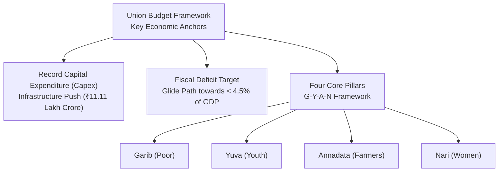

# Economy, Union Budget & Central Welfare Schemes Digest (2025–2026)

> [!abstract]
> **Source Attribution & Exam Orientation:** Digested from the *Union Budget Documents*, *Economic Survey*, *RBI Bulletins*, and *NITI Aayog SDG Index*. High-yield questions test scheme financial caps, beneficiaries, tax slab basics, inflation bands, and institutional rankings.

---

## 1. Union Budget Highlights & Macroeconomic Indicators

The diagram above visualizes the core architecture, sequence flow, and structural taxonomy for systematic review.

### Key Macroeconomic Metrics Table

| Indicator | Budget Estimate / Benchmark Figure | Analytical Context for Competitive Exams |
|---|---|---|
| **Capital Expenditure (Capex)** | **₹11.11 lakh crore** (3.4% of GDP) | Multiplier effect driving railways (Vande Bharat), highways, ports, and renewable energy grids. |
| **Fiscal Deficit Target** | **4.9% of GDP (2024–25)** and **< 4.5% by 2025–26** | Government committed to fiscal consolidation path set out in FRBM Act framework. |
| **Nominal GDP Growth** | Estimated around **10.5%** | Real GDP growth projected in the 6.5%–7.0% corridor by RBI and Economic Survey. |
| **Direct Tax: New Tax Regime** | Standard deduction raised from ₹50,000 to **₹75,000** for salaried employees | Nil tax payable up to ₹3,00,000; income up to ₹7.75 lakh incurs zero net tax due to Section 87A rebate. |

---

## 2. Central Flagship Schemes & Social Initiatives

### High-Yield Scheme Fact Sheet

1. **PM-Surya Ghar: Muft Bijli Yojana:**
   - *Target:* Solar rooftop systems on **1 crore households**.
   - *Financial Entitlement:* Free electricity up to **300 units per month**; central subsidy of up to ₹78,000 for a 3 kW solar plant.
   - *Environmental & Economic Goal:* Generating clean solar power, reducing discom subsidy burdens, and enabling surplus power sales back to the grid.

2. **PM Vishwakarma Scheme:**
   - *Objective:* Comprehensive financial, training, and toolkit support to traditional artisans and craftspersons across **18 designated family-based trades** (carpenters, blacksmiths, potters, sculptors, weavers, barbers, etc.).
   - *Financial Credit:* Collateral-free enterprise development loans up to **₹3 lakh** in two tranches (₹1 lakh and ₹2 lakh) at a concessional interest rate of **5%**.
   - *Stipend & Support:* ₹500/day during skill training and ₹15,000 e-voucher for modern toolkits.

3. **Lakhpati Didi Initiative:**
   - *Goal:* Empowering women Self-Help Group (SHG) members under Deendayal Antyodaya Yojana - National Rural Livelihoods Mission (DAY-NRLM).
   - *Target Ceiling:* Government revised the national target upwards from 2 crore to **3 crore rural women** earning a sustainable annual income of ₹1 lakh or more.

4. **Prime Minister's Package for Youth Employment & Skilling:**
   - *5 Schemes / Initiatives:* Covering 4.1 crore youth over 5 years with an outlay of ₹2 lakh crore.
   - *Scheme A (First Timers):* One month's wage (up to ₹15,000) directly transferred in 3 installments to newly registered EPFO employees.
   - *Internship Scheme:* Top 500 corporate companies offering 12-month paid internships to 1 crore youth with ₹5,000 monthly allowance and ₹6,000 one-time contingency grant.

---

## 3. Banking, Monetary Policy & Global Fintech Milestones

- **Reserve Bank of India (RBI) Monetary Framework:**
  - *Governor:* Shri Shaktikanta Das.
  - *Inflation Targeting Mandate:* Flexible Inflation Target of **4% with a tolerance band of +/- 2% (2% to 6%)** under Section 45ZA of the RBI Act, 1934.
  - *Monetary Policy Committee (MPC):* 6 members (3 from RBI, 3 external nominated by Central Government).
- **Internationalization of Unified Payments Interface (UPI):**
  - Spearheaded by NPCI International Payments Limited (NIPL).
  - UPI acceptance operationalized in **France (Eiffel Tower)**, **United Arab Emirates (Mashreq/NEOPAY)**, **Singapore (PayNow-UPI linkage)**, **Nepal**, **Bhutan**, **Sri Lanka**, and **Mauritius**.
- **Central Bank Digital Currency (CBDC):**
  - **Digital Rupee (e₹)** piloted in both Retail (e₹-R) and Wholesale (e₹-W) segments, utilizing blockchain-based distributed ledger mechanisms interoperable with QR codes.

---

## 4. NITI Aayog: Sustainable Development Goals (SDG) India Index

- **Top Performing States:**
  1. **Kerala** and **Uttarakhand** tied at Rank 1 (Composite Score: 79).
  2. **Tamil Nadu** (Score: 78).
  3. **Goa** (Score: 77).
- **Karnataka's Performance:**
  - Grouped into the **Front Runner** category (Score: 75+).
  - High performance recorded in SDG 6 (Clean Water and Sanitation), SDG 7 (Affordable and Clean Energy), and SDG 9 (Industry, Innovation, and Infrastructure).
- **Target Year for 17 Global Goals:** **2030** (Adopted by United Nations in 2015 as Transforming our World: the 2030 Agenda for Sustainable Development).
