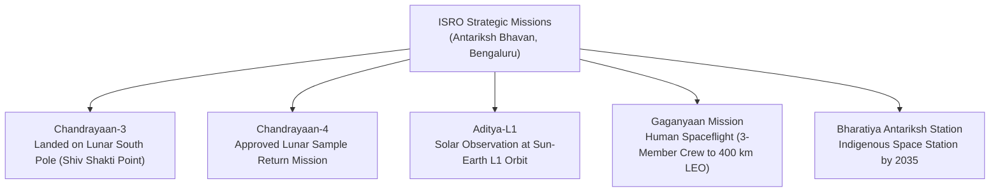

# Science, Technology, Space, Defense & Ecology Digest (2025–2026)

> [!abstract]
> **Source Attribution & Exam Orientation:** Digested from official communications of the Indian Space Research Organisation (ISRO), DRDO, and MoEFCC. High-frequency questions test space missions, payloads, defense missile testing names, astronaut designations, and wildlife conservation reserves in Karnataka.

---

## 1. Space Exploration: ISRO Landmarks & Roadmap

The diagram above visualizes the core architecture, sequence flow, and structural taxonomy for systematic review.

### Detailed Mission Profiles

| Mission Name | Launch Vehicle / Orbit | Scientific Payloads & Key Objectives | Critical Historical Facts for Exam |
|---|---|---|---|
| **Chandrayaan-3** | LVM3-M4 (Fat Boy) | Lander: *Vikram* (ChaSTE, ILSA, LP); Rover: *Pragyan* (APXS, LIBS). | **Landed on August 23, 2023**; landing spot designated as **Shiv Shakti Point**; August 23 declared **National Space Day**. Pragyan detected Sulfur (S), Iron, Calcium, and Aluminum on the lunar surface. |
| **Aditya-L1** | PSLV-C57 | 7 Scientific Payloads: VELC, SUIT, ASPEX, PAPA, SoLEXS, HEL1OS, Magnetometer. | India's **1st dedicated solar observatory**; inserted into a Halo orbit around Sun-Earth **Lagrangian Point 1 (L1)** (~1.5 million km from Earth) on January 6, 2024. Can view the Sun continuously without eclipses. |
| **Gaganyaan** | LVM3 (Human Rated Launch Vehicle - HRLV) | Crew Module (CM) and Service Module (SM) carrying 3 astronauts for 3 days to 400 km Low Earth Orbit. | Prime Minister revealed the 4 designated astronaut-elects (all Indian Air Force test pilots): 1. **Group Captain Prashanth Balakrishnan Nair** 2. **Group Captain Ajit Krishnan** 3. **Group Captain Angad Pratap** 4. **Wing Commander Shubhanshu Shukla** (selected for Indo-US Axiom-4 ISS mission). |
| **Chandrayaan-4** | Multi-launch modular architecture | Lunar sample collection, lunar surface ascent, docking in lunar orbit, and safe return to Earth. | Approved by the Union Cabinet in September 2024; precursor to India's planned crewed lunar landing by **2040**. |
| **SpaDeX** | PSLV | Space Docking Experiment. | Demonstrates autonomous docking technology between two spacecraft in orbit; foundational for space stations and satellite servicing. |
| **NISAR** | GSLV (Joint NASA-ISRO) | Dual-frequency L-band and S-band Synthetic Aperture Radar (SAR). | Earth observation satellite tracking ice-sheet dynamics, ecosystem disturbances, deforestation, and natural hazards globally every 12 days. |

---

## 2. Indigenous Defense Technology & DRDO Landmark Milestones

1. **Mission Divyastra (Agni-5 with MIRV Technology):**
   - Conducted on **March 11, 2024**, from Dr. A. P. J. Abdul Kalam Island, Odisha.
   - First flight test of indigenously developed **Agni-5** intercontinental ballistic missile equipped with **Multiple Independently Targetable Re-entry Vehicle (MIRV)** technology.
   - Allows a single missile to deliver nuclear warheads to multiple distinct targets hundreds of kilometers apart, joining an elite club of nations (USA, Russia, China, France, UK).
2. **LCA Tejas Mk1A Induction:**
   - Single-engine multi-role fighter aircraft manufactured by **Hindustan Aeronautics Limited (HAL)**, Bengaluru, equipped with active electronically scanned array (AESA) radar and Astra beyond-visual-range missiles.
3. **Submarine Fleet & Navy Expansion:**
   - Commissioning of Scorpene-class conventional attack submarines (Kalvari, Khanderi, Karanj, Vela, Vagir, Vagsheer) under **Project 75** at Mazagon Dock Shipbuilders Limited (MDL).

---

## 3. Environment, Biodiversity & Wildlife Conservation

### Status of Tigers in India (50 Years of Project Tiger)
- **Total Tiger Population:** **3,682 tigers** (recorded in 2022–2023 census, holding ~75% of global wild tigers).
- **Top Tiger Range States:**
  1. **Madhya Pradesh:** 785 tigers.
  2. **Karnataka:** **563 tigers** (Bandipur, Nagarahole, Biligiriranganatha Temple / BRT, Bhadra, Kali).
  3. **Uttarakhand:** 560 tigers.
- **International Big Cat Alliance (IBCA):**
  - Headquarters established in India; dedicated to conserving 7 major big cats (Tiger, Lion, Leopard, Snow Leopard, Cheetah, Jaguar, Puma).

### Ramsar Wetland Sites of International Importance in Karnataka

| Ramsar Site Name | District | Year Declared | Key Ecological Features |
|---|---|---|---|
| **Ranganathittu Bird Sanctuary** | Mandya | 2022 | **Karnataka's 1st Ramsar Site**; island cluster on Cauvery river; nesting site for Painted Storks, Spot-billed Pelicans, Mugger Crocodiles. |
| **Aghanashini Estuary** | Uttara Kannada | 2024 | Estuary of the Aghanashini river flowing into Arabian Sea; rich in bivalve shell mining, mangrove forests, and brackish fish fauna. |
| **Magadi Kere Conservation Reserve** | Gadag | 2024 | Critical wintering lake for migratory **Bar-headed Geese** (*Anser indicus*) flying over the Himalayas from Central Asia. |
| **Ankasamudra Bird Conservation Reserve** | Vijayanagara | 2024 | Man-made percolation irrigation tank supporting large heronries of Painted Storks, Black-headed Ibis, and breeding waterbirds. |

---

## 4. Artificial Intelligence & Frontier Computing

- **IndiaAI Mission:**
  - Approved by Union Cabinet with an allocation of **₹10,372 crore**.
  - Creates a sovereign computing infrastructure of **10,000+ GPUs** for AI startups, academia, and public governance models.
  - Development of indigenous foundational Multimodal Large Language Models (LLMs) supporting 22 recognized Indian languages under the **Bhashini** AI translation framework.
