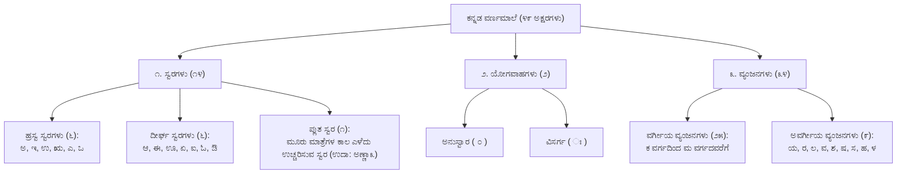
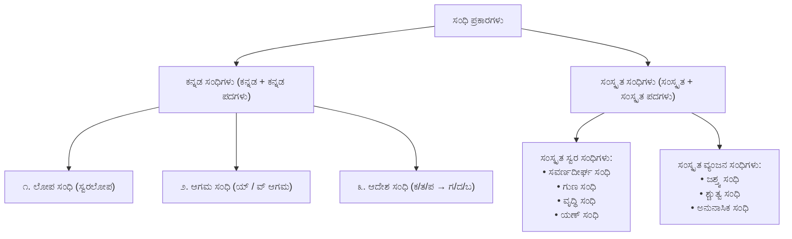
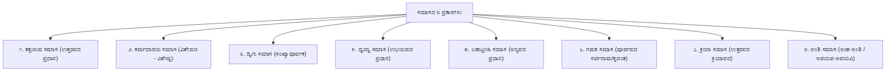

> [!exam-focus]
> **Exam Weightage & Testing Style:** 20–25 questions in Paper 1 General Kannada. High-yield syllabus areas:
> - **ವರ್ಣಮಾಲೆ (Alphabetics):** ಸ್ವರಗಳು (ಹ್ರಸ್ವ, ದೀರ್ಘ, ಪ್ಲುತ), ವ್ಯಂಜನಗಳು (ಅಲ್ಪಪ್ರಾಣ, ಮಹಾಪ್ರಾಣ, ಅನುನಾಸಿಕ), ಉಚ್ಚಾರಣಾ ಸ್ಥಾನಗಳು (ಕಂಠ್ಯ, ತಾಲವ್ಯ, ಮೂರ್ಧನ್ಯ, ದಂತ್ಯ, ಓಷ್ಠ್ಯ).
> - **ಸಂಧಿಗಳು:** ಕನ್ನಡ ಸಂಧಿಗಳು (ಲೋಪ, ಆಗಮ, ಆದೇಶ: ಕ-ತ-ಪ ಗಳಿಗೆ ಗ-ದ-ಬ, ಪ/ಬ/ವ ವಿಕಲ್ಪ) vs ಸಂಸ್ಕೃತ ಸಂಧಿಗಳು (ಸವರ್ಣದೀರ್ಘ, ಗುಣ, ವೃದ್ಧಿ, ಯಣ್, ಜಶ್ತ್ವ, ಶ್ಚುತ್ವ, ಅನುನಾಸಿಕ).
> - **ಸಮಾಸಗಳು (೮ ಪ್ರಕಾರಗಳು):** ತತ್ಪುರುಷ, ಕರ್ಮಧಾರಯ, ದ್ವಿಗು, ದ್ವಂದ್ವ, ಬಹುವ್ರೀಹಿ, ಗಮಕ, ಕ್ರಿಯಾ, ಅಂಶಿ ಸಮಾಸಗಳು.
> - **ವಿಭಕ್ತಿ ಪ್ರತ್ಯಯಗಳು & ಕಾರಕಾರ್ಥಗಳು:** ಹಳಗನ್ನಡ vs ಹೊಸಗನ್ನಡ ಪ್ರತ್ಯಯಗಳು (ಪ್ರಥಮಾ ರಿಂದ ಸಪ್ತಮೀ + ಸಂಬೋಧನಾ).
> - **ಕೃದಂತ & ತದ್ಧಿತಾಂತ:** ಕೃನ್ನಾಮ, ಕೃದ್ಭಾವ, ಕೃದಂತಾವ್ಯಯ; ತದ್ಧಿತನಾಮ, ತದ್ಧಿತಭಾವ, ತದ್ಧಿತಾವ್ಯಯ.
> - **ಪ್ರಯೋಗಗಳು:** ಕರ್ತರಿ ಪ್ರಯೋಗ vs ಕರ್ಮಣಿ ಪ್ರಯೋಗ (ಪದ ಪರಿವರ್ತನೆ).
> - **ಅಲಂಕಾರ & ಛಂದಸ್ಸು:** ಉಪಮಾ, ರೂಪಕ, ದೃಷ್ಟಾಂತ ಅಲಂಕಾರಗಳು; ಭಾಮಿನಿ & ವಾರ್ಧಕ ಷಟ್ಪದಿಗಳು, ಕಂದ ಪದ್ಯ ಮಾತ್ರಾಗಣ.
> - **ತತ್ಸಮ-ತದ್ಭವ ಮತ್ತು ನುಡಿಗಟ್ಟುಗಳು:** ೧೦೦+ ಅತಿ ಮುಖ್ಯ ಪರೀಕ್ಷಾ ಪದಗಳು.

---

## 1. ಕನ್ನಡ ವರ್ಣಮಾಲೆ ಮತ್ತು ಧ್ವನಿವಿಜ್ಞಾನ (Phonetics)

ಕನ್ನಡ ವರ್ಣಮಾಲೆಯಲ್ಲಿ ಒಟ್ಟು **೪೯ ಅಕ್ಷರಗಳು** ಇವೆ.

The diagram above visualizes the core architecture, sequence flow, and structural taxonomy for systematic review.

---

### ವರ್ಗೀಯ ವ್ಯಂಜನಗಳ ವಿಂಗಡಣೆ ಮತ್ತು ಉಚ್ಚಾರಣಾ ಸ್ಥಾನಗಳ ಕೋಷ್ಟಕ

| ವರ್ಗ | ಉಚ್ಚಾರಣಾ ಸ್ಥಾನ | ಅಲ್ಪಪ್ರಾಣ (೧ ಮಾತ್ರೆ) | ಮಹಾಪ್ರಾಣ (೨ ಮಾತ್ರೆ) | ಅನುನಾಸಿಕ (ನಾಸಿಕ ಸಹಾಯ) |
|:---:|:---:|:---:|:---:|:---:|
| **ಕ-ವರ್ಗ** | **ಕಂಠ್ಯ (ಗಂಟಲು)** | ಕ, ಗ | ಖ, ಘ | ಙ |
| **ಚ-ವರ್ಗ** | **ತಾಲವ್ಯ (ಅಂಗುಳ)** | ಚ, ಜ | ಛ, ಝ | ಞ |
| **ಟ-ವರ್ಗ** | **ಮೂರ್ಧನ್ಯ (ನಾಲಗೆಯ ತುದಿಯ ಮಡಿಕೆ)** | ಟ, ಡ | ಠ, ಢ | ಣ |
| **ತ-ವರ್ಗ** | **ದಂತ್ಯ (ಹಲ್ಲು)** | ತ, ದ | ಥ, ಧ | ನ |
| **ಪ-ವರ್ಗ** | **ಓಷ್ಠ್ಯ (ತುಟಿ)** | ಪ, ಬ | ಫ, ಭ | ಮ |

> [!NOTE]
> - **ಸಂಧ್ಯಕ್ಷರಗಳು:** 'ಐ' ಮತ್ತು 'ಔ' (ಎರಡು ಸ್ವರಗಳು ಸೇರಿ ಆಗುವ ಅಕ್ಷರಗಳು).
> - **ಅನುನಾಸಿಕಗಳು:** ಮೂಗಿನ ಸಹಾಯದಿಂದ ಉಚ್ಚರಿಸಲ್ಪಡುವ ಅಕ್ಷರಗಳು (ಙ, ಞ, ಣ, ನ, ಮ).

---

## 2. ಸಂಧಿಗಳ ಸಮಗ್ರ ವಿಶ್ಲೇಷಣೆ (Sandhi Mechanics)

ಎರಡು ಅಕ್ಷರಗಳು ಕಾಲವಿಳಂಬವಿಲ್ಲದೆ ಅರ್ಥ ಕೆಡದಂತೆ ಕೂಡುವುದಕ್ಕೆ **ಸಂಧಿ** ಎನ್ನಲಾಗುತ್ತದೆ.

The diagram above visualizes the core architecture, sequence flow, and structural taxonomy for systematic review.

---

### ಕನ್ನಡ ಸಂಧಿಗಳು (ಪರೀಕ್ಷಾ ಸೂತ್ರಗಳು & ಉದಾಹರಣೆಗಳು)

| ಸಂಧಿ ಹೆಸರು | ಸೂತ್ರ ಮತ್ತು ಲಕ್ಷಣ | ಸೂತ್ರ ವಿಶ್ಲೇಷಣೆ | ಪ್ರಮುಖ ಪರೀಕ್ಷಾ ಉದಾಹರಣೆಗಳು |
|---|---|---|---|
| **ಲೋಪ ಸಂಧಿ** | ಸ್ವರದ ಮುಂದೆ ಸ್ವರವು ಬಂದು ಸಂಧಿಯಾಗುವಾಗ ಪೂರ್ವಪದದ ಕೊನೆಯ ಸ್ವರವು ಅರ್ಥ ಕೆಡದಂತೆ ಬಿಟ್ಟುಹೋಗುವುದು (ಲೋಪವಾಗುವುದು). | ಸ್ವರ + ಸ್ವರ = ಉತ್ತರಪದದ ಸ್ವರ ಮಾತ್ರ ಉಳಿಯುವುದು (ಪೂರ್ವಪದದ ಸ್ವರ ಲೋಪ) | - ಊರು + ಊರು = **ಊರೂರು** (ಉ ಲೋಪ) - ಮಾತು + ಇಲ್ಲ = **ಮಾತಿಲ್ಲ** (ಉ ಲೋಪ) - ಬೇರೆ + ಒಬ್ಬ = **ಬೇರೊಬ್ಬ** (ಎ ಲೋಪ) - ನಿನಗೆ + ಅಲ್ಲದೆ = **ನಿನಗಲ್ಲದೆ** (ಎ ಲೋಪ) - ಬಲ್ಲೆನು + ಎಂದು = **ಬಲ್ಲೆನೆಂದು** (ಉ ಲೋಪ) |
| **ಆಗಮ ಸಂಧಿ** | ಸ್ವರದ ಮುಂದೆ ಸ್ವರವು ಬಂದು ಸಂಧಿಯಾಗುವಾಗ ಸ್ವರಲೋಪ ಮಾಡಿದರೆ ಅರ್ಥ ಕೆಡುವಂತಿದ್ದರೆ ನಡುವೆ ಹೊಸದಾಗಿ **'ಯ್'** ಅಥವಾ **'ವ್'** ವ್ಯಂಜನ ಬರುವುದು. | - 'ಇ, ಈ, ಎ, ಏ, ಐ' ಮುಂದೆ ಸ್ವರ ಬಂದರೆ $\to$ **ಯ-ಕಾರಾಗಮ**. - 'ಅ, ಆ, ಉ, ಊ, ಋ, ಒ, ಓ, ಔ' ಮುಂದೆ ಸ್ವರ ಬಂದರೆ $\to$ **ವ-ಕಾರಾಗಮ**. | - ಮಳೆ + ಅನ್ನು = **ಮಳೆಯನ್ನು** (ಯ್ ಆಗಮ) - ಕೈ + ಅನ್ನು = **ಕೈಯನ್ನು** (ಯ್ ಆಗಮ) - ಬೆಟ್ಟ + ಅನ್ನು = **ಬೆಟ್ಟವನ್ನು** (ವ್ ಆಗಮ) - ಗುರು + ಅನ್ನು = **ಗುರುವನ್ನು** (ವ್ ಆಗಮ) - ಪೂ + ಅನ್ನು = **ಪೂವನ್ನು** (ವ್ ಆಗಮ) |
| **ಆದೇಶ ಸಂಧಿ** | ಉತ್ತರಪದದ ಆದಿಯಲ್ಲಿರುವ **'ಕ, ತ, ಪ'** ವ್ಯಂಜನಗಳಿಗೆ ಕ್ರಮವಾಗಿ **'ಗ, ದ, ಬ'** ವ್ಯಂಜನಗಳು ಆದೇಶವಾಗಿ ಬರುವುದು. | ಕ $\to$ ಗ ತ $\to$ ದ ಪ $\to$ ಬ | - ಮಳೆ + ಕಾಲ = **ಮಳೆಗಾಲ** (ಕ $\to$ ಗ) - ಕಣ್ + ಪನಿ = **ಕಣ್ಬನಿ** (ಪ $\to$ ಬ) - ಬೆಟ್ಟ + ತಾವರೆ = **ಬೆಟ್ಟದಾವರೆ** (ತ $\to$ ದ) - ಮೈ + ತೊಳೆ = **ಮೈದೊಳೆ** (ತ $\to$ ದ) - ಕಡು + ಬೆಳುಪು = **ಕಡುಬೆಳುಪು** (ಪ $\to$ ಬ) - ಪರೆ + ತಪ್ಪು = **ಪರೆದಪ್ಪು** (ತ $\to$ ದ) |

---

### ಸಂಸ್ಕೃತ ಸಂಧಿಗಳು (ನಿಯಮಗಳು & ಪರೀಕ್ಷಾ ಉದಾಹರಣೆಗಳು)

1. **ಸವರ್ಣದೀರ್ಘ ಸಂಧಿ:** ಸಮಾನ ಸ್ವರಗಳು ಒಂದರ ಮುಂದೊಂದು ಬಂದಾಗ ಅವುಗಳ ದೀರ್ಘಸ್ವರ ಬರುವುದು ($ಅ+ಅ=ಆ, ಇ+ಇ=ಈ, ಉ+ಉ=ಊ$).
   - *ಉದಾಹರಣೆಗಳು:* ದೇವ + ಆಲಯ = **ದೇವಾಲಯ**, ಗಿರಿ + ಈಶ = **ಗಿರೀಶ**, ಭಾನು + ಉದಯ = **ಭಾನೂದಯ**, ವಿದ್ಯಾ + ಅಭ್ಯಾಸ = **ವಿದ್ಯಾಭ್ಯಾಸ**.
2. **ಗುಣ ಸಂಧಿ:** ಅ/ಆ ಸ್ವರಗಳ ಮುಂದೆ ಇ/ಈ ಬಂದಾಗ **'ಏ'**, ಉ/ಊ ಬಂದಾಗ **'ಓ'**, ಋ ಬಂದಾಗ **'ಅರ್'** ಬರುವುದು.
   - *ಉದಾಹರಣೆಗಳು:* ದೇವ + ಇಂದ್ರ = **ದೇವೇಂದ್ರ**, ಸೂರ್ಯ + ಉದಯ = **ಸೂರ್ಯೋದಯ**, ಮಹಾ + ಋಷಿ = **ಮಹರ್ಷಿ**, ಚಂದ್ರ + ಉದಯ = **ಚಂದ್ರೋದಯ**.
3. **ವೃದ್ಧಿ ಸಂಧಿ:** ಅ/ಆ ಸ್ವರಗಳ ಮುಂದೆ ಏ/ಐ ಬಂದಾಗ **'ಐ'**, ಓ/ಔ ಬಂದಾಗ **'ಔ'** ಕಾರ ಬರುವುದು.
   - *ಉದಾಹರಣೆಗಳು:* ಏಕ + ಏಕ = **ಏಕೈಕ**, ಲೋಕ + ಐಕ್ಯ = **ಲೋಕೈಕ್ಯ**, ವನ + ಔಷಧ = **ವನೌಷಧ**, ಜಲ + ಓಘ = **ಜಲೌಘ**.
4. **ಯಣ್ ಸಂಧಿ:** ಇ/ಈ, ಉ/ಊ, ಋ ಸ್ವರಗಳ ಮುಂದೆ ಬೇರೆ ಸ್ವರಗಳು ಬಂದಾಗ ಕ್ರಮವಾಗಿ **'ಯ್, ವ್, ರ್'** ಕಾರಗಳು ಬರುವುದು.
   - *ಉದಾಹರಣೆಗಳು:* ಅತಿ + ಆಶೆ = **ಅತ್ಯಾಶೆ** (ಇ $\to$ ಯ್), ಮನು + ಅಂತರ = **ಮನ್ವಂತರ** (ಉ $\to$ ವ್), ಪಿತೃ + ಆರ್ಜಿತ = **ಪಿತ್ರಾರ್ಜಿತ** (ಋ $\to$ ರ್), ಕೋಟಿ + ಅಧೀಶ = **ಕೋಟ್ಯಧೀಶ**.
5. **ಜಶ್ತ್ವ ಸಂಧಿ:** ವರ್ಗದ ಪ್ರಥಮಾಕ್ಷರಗಳಿಗೆ (ಕ, ಚ, ಟ, ತ, ಪ) ಯಾವುದೇ ಸ್ವರ ಅಥವಾ ಮೃದುವ್ಯಂಜನ ಪರವಾದಾಗ ಅದೇ ವರ್ಗದ ಮೂರನೆಯ ಅಕ್ಷರಗಳು (ಗ, ಜ, ಡ, ದ, ಬ) ಬರುವುದು.
   - *ಉದಾಹರಣೆಗಳು:* ವಾಕ್ + ಈಶ = **ವಾಗೀಶ** (ಕ್ $\to$ ಗ್), ಷಟ್ + ಆನನ = **ಷಡಾನನ** (ಟ್ $\to$ ಡ್), ಅಚ್ + ಅಂತ = **ಅಜಂತ** (ಚ್ $\to$ ಜ್).
6. **ಶ್ಚುತ್ವ ಸಂಧಿ:** ಸ-ಕಾರ ತ-ವರ್ಗಗಳಿಗೆ ಶ-ಕಾರ ಚ-ವರ್ಗಗಳು ಪರವಾದರೆ ಸ-ಕಾರಕ್ಕೆ **'ಶ'** ಕಾರವೂ, ತ-ವರ್ಗಕ್ಕೆ **'ಚ'** ವರ್ಗವೂ ಬರುವುದು.
   - *ಉದಾಹರಣೆಗಳು:* ಸತ್ + ಚಿತ್ = **ಸಚ್ಚಿತ್**, ಶರತ್ + ಚಂದ್ರ = **ಶರಚ್ಚಂದ್ರ**, ಮನಸ್ + ಶಾಂತಿ = **ಮನಶ್ಶಾಂತಿ**.
7. **ಅನುನಾಸಿಕ ಸಂಧಿ:** ವರ್ಗದ ಪ್ರಥಮಾಕ್ಷರಗಳಿಗೆ ಅನುನಾಸಿಕ ಅಕ್ಷರಗಳು ಪರವಾದರೆ ಆಯಾ ವರ್ಗದ ಐದನೆಯ (ಅನುನಾಸಿಕ) ಅಕ್ಷರ ಬರುವುದು.
   - *ಉದಾಹರಣೆಗಳು:* ವಾಕ್ + ಮಯ = **ವಾಙ್ಮಯ**, ಸತ್ + ಮಾರ್ಗ = **ಸನ್ಮಾರ್ಗ**, ಷಟ್ + ಮುಖ = **ಷಣ್ಮುಖ**.

---

## 3. ಸಮಾಸಗಳ ಸಮಗ್ರ ವಿಶ್ಲೇಷಣೆ (The Eight Samasas)

ಎರಡು ಅಥವಾ ಎರಡಕ್ಕಿಂತ ಹೆಚ್ಚು ಪದಗಳು ಅರ್ಥಕ್ಕನುಗುಣವಾಗಿ ಸೇರಿ ಮಧ್ಯದಲ್ಲಿರುವ ವಿಭಕ್ತಿ ಪ್ರತ್ಯಯವನ್ನು ಲೋಪಮಾಡಿಕೊಂಡು ಒಂದು ಪದವಾಗುವುದು **ಸಮಾಸ**.

The diagram above visualizes the core architecture, sequence flow, and structural taxonomy for systematic review.

---

### ಸಮಾಸಗಳ ವಿವರಣಾ ಕೋಷ್ಟಕ

| ಸಮಾಸದ ಹೆಸರು | ಪ್ರಧಾನ ಪದ | ಲಕ್ಷಣ ಹಾಗೂ ನಿಯಮ | ವಿಗ್ರಹವಾಕ್ಯ ಹಾಗೂ ಸಮಾಸ ಪದಗಳು |
|---|---|---|---|
| **೧. ತತ್ಪುರುಷ ಸಮಾಸ** | **ಉತ್ತರಪದ ಪ್ರಧಾನ** | ಪೂರ್ವಪದವು ದ್ವಿತೀಯಾದಿ ವಿಭಕ್ತಿಯಲ್ಲಿದ್ದು, ಉತ್ತರಪದದಲ್ಲಿರುವ ನಾಮಪದದೊಂದಿಗೆ ಸೇರುವುದು. | - ತಲೆಯೊಳ್ + ನೋವು = **ತಲೆನೋವು** - ಮರದೊಳ್ + ಕಾಲ್ = **ಮರಗಾಲು** - ಬೆಟ್ಟದ + ತಪ್ಪಲು = **ಬೆಟ್ಟದತಪ್ಪಲು** - ಕಲ್ಲಿನಿಂದ + ಕಟ್ಟಡ = **ಕಲ್ಕಟ್ಟಡ** |
| **೨. ಕರ್ಮಧಾರಯ ಸಮಾಸ** | **ವಿಶೇಷಣ-ವಿಶೇಷ್ಯ** | ಪೂರ್ವಪದವು ವಿಶೇಷಣವಾಗಿಯೂ (ಗುಣವಾಚಕ), ಉತ್ತರಪದವು ವಿಶೇಷ್ಯವಾಗಿಯೂ (ನಾಮಪದ) ಇರುವುದು. | - ಹಿರಿದು + ಜೇನು = **ಹೆಜ್ಜೇನು** - ಕಿರಿದು + ನಾಲಗೆ = **ಕಿರುನಾಲಗೆ** - ಬಿಳಿದು + ಕೊಡೆ = **ಬಿಳಿಕೊಡೆ** - ಇನಿದು + ದನಿ = **ಇನಿದನಿ** - ಚೆಲುವಾದ + ಕಣ್ಣು = **ಚೆಲ್ಗಣ್ಣು** |
| **೩. ದ್ವಿಗು ಸಮಾಸ** | **ಸಂಖ್ಯಾಪೂರ್ವಕ** | ಪೂರ್ವಪದವು ಸಂಖ್ಯಾವಾಚಕವಾಗಿದ್ದು, ಉತ್ತರಪದವು ನಾಮಪದವಾಗಿರುವ ಸಮಾಸ. | - ಮೂರು + ಲೋಕ = **ಮೂಲೋಕ** - ನಾಲ್ಕು + ಮಡಿ = **ನಾಲ್ಮಡಿ** - ಪಂಚ + ಇಂದ್ರಿಯ = **ಪಂಚೇಂದ್ರಿಯ** - ನೂರು + ಮಡಿ = **ನೂರುಮಡಿ** |
| **೪. ದ್ವಂದ್ವ ಸಮಾಸ** | **ಉಭಯಪದ ಪ್ರಧಾನ** | ಅನೇಕ ನಾಮಪದಗಳು ಜೊತೆಯಾಗಿ ಸೇರಿ ಎಲ್ಲ ಪದಗಳ ಅರ್ಥವೂ ಸಮಾನ ಪ್ರಾಧಾನ್ಯತೆಯನ್ನು ಹೊಂದಿರುವುದು. | - ಗಿಡವೂ + ಮರವೂ + ಬಳ್ಳಿಯೂ = **ಗಿಡಮರಬಳ್ಳಿಗಳು** - ರಾಮನೂ + ಲಕ್ಷ್ಮಣನೂ = **ರಾಮಲಕ್ಷ್ಮಣರು** - ಕರಿಯೂ + ಕುದುರೆಯೂ + ತೇರೂ = **ಕರಿಕುದುರೆತೇರುಗಳು** |
| **೫. ಬಹುವ್ರೀಹಿ ಸಮಾಸ** | **ಅನ್ಯಪದ ಪ್ರಧಾನ** | ಸಮಾಸದಲ್ಲಿರುವ ಪದಗಳ ಅರ್ಥ ಗೌಣವಾಗಿ ಮೂರನೆಯ ಬೇರೊಂದು ಸ್ವತಂತ್ರ ವಸ್ತುವಿನ ಅರ್ಥ ಪ್ರಧಾನವಾಗುವುದು. | - ಮುಕ್ಕಣ್ಣ (ಮೂರು ಕಣ್ಣುಗಳುಳ್ಳವನು - **ಶಿವ**) - ಚಕ್ರಪಾಣಿ (ಕೈಯಲ್ಲಿ ಚಕ್ರವುಳ್ಳವನು - **ವಿಷ್ಣು**) - ಫಾಲನೇತ್ರ (ಹಣೆಯಲ್ಲಿ ಕಣ್ಣುಳ್ಳವನು - **ಶಿವ**) - ಚತುರ್ಮುಖ (ನಾಲ್ಕು ಮುಖಗಳುಳ್ಳವನು - **ಬ್ರಹ್ಮ**) - ನೀಲಕಂಠ (ನೀಲಿ ಕಂಠವುಳ್ಳವನು - **ಶಿವ**) |
| **೬. ಗಮಕ ಸಮಾಸ** | ಪೂರ್ವಪದ ಸರ್ವನಾಮ ಅಥವಾ ಕೃದಂತ | ಪೂರ್ವಪದವು ಸರ್ವನಾಮ, ಕೃದಂತ ಅಥವಾ ಸಂಖ್ಯಾವಾಚಕವಾಗಿದ್ದು ಉತ್ತರಪದವು ನಾಮಪದವಾಗಿರುವುದು. | - ಮಾಡಿದುದು + ಕೆಲಸ = **ಮಾಡಿದಕೆಲಸ** - ಆ + ಪಟ್ಟಣ = **ಆಪಟ್ಟಣ** - ಉರಿವುದು + ಕೆಂಡ = **ಉರಿಕೆಂಡ** - ಬೇಯಿಸಿದುದು + ಅನ್ನ = **ಬೆಂದನ್ನ** |
| **೭. ಕ್ರಿಯಾ ಸಮಾಸ** | ಉತ್ತರಪದ ಕ್ರಿಯಾಪದ | ಪೂರ್ವಪದ ನಾಮಪದವಾಗಿದ್ದು (ದ್ವಿತೀಯಾ ವಿಭಕ್ತಿ), ಉತ್ತರಪದ ಕ್ರಿಯಾಪದವಾಗಿ ಸೇರಿ ಸಂಯುಕ್ತ ಪದವಾಗುವುದು. | - ಕೈಯನ್ನು + ಮುಗಿ = **ಕೈಮುಗಿ** - ತಲೆಯನ್ನು + ತೂಗು = **ತಲೆತೂಗು** - ಕಾಲನ್ನು + ಕೀಳು = **ಕಾಲ್ಕೀಳು** - ಮೈಯನ್ನು + ಮುರಿ = **ಮೈಮುರಿ** |
| **೮. ಅಂಶಿ ಸಮಾಸ** | ಅವಯವ ಪ್ರಧಾನ | ಪೂರ್ವಪದವು ಅವಯವವನ್ನೂ (ಭಾಗ/ಅಂಶ), ಉತ್ತರಪದವು ಅವಯವಿಯನ್ನೂ (ಪೂರ್ಣವಸ್ತು/ಅಂಶಿ) ಬೋಧಿಸುವುದು. | - ಕಾಲಿನ + ಮುಂದು = **ಮುಂಗಾಲು** - ಕೈಯ + ಮುಂದು = **ಮುಂಗೈ** - ನಾಲಗೆಯ + ಕೊನೆ = **ಕೊನೆನಾಲಗೆ** - ರಾತ್ರಿಯ + ನಡು = **ನಡುರಾತ್ರಿ** |

---

## 4. ವಿಭಕ್ತಿ ಪ್ರತ್ಯಯಗಳು ಮತ್ತು ಕಾರಕಾರ್ಥಗಳು (Vibhakti & Karakas)

| ವಿಭಕ್ತಿ | ಹಳಗನ್ನಡ ಪ್ರತ್ಯಯ | ಹೊಸಗನ್ನಡ ಪ್ರತ್ಯಯ | ಕಾರಕಾರ್ಥ (Karakartha) | ವ್ಯಾಕರಣ ಕಾರ್ಯ | ಉದಾಹರಣೆ |
|:---:|:---:|:---:|:---:|---|---|
| **ಪ್ರಥಮಾ** | ಮ್ | **ಉ** | **ಕರ್ತೃ (Agent)** | ಕ್ರಿಯೆಯನ್ನು ಮಾಡುವವನು | ಅರಸನು, ಮರವು |
| **ದ್ವಿತೀಯಾ** | ಅಮ್ | **ಅನ್ನು** | **ಕರ್ಮ (Object)** | ಕ್ರಿಯೆಯ ಫಲವನ್ನು ಅನುಭವಿಸುವ ವಸ್ತು | ಮರವನ್ನು, ಹಣ್ಣನ್ನು |
| **ತೃತೀಯಾ** | ಇಮ್ / ಇಂದಮ್ | **ಇಂದ** | **ಕರಣ (Instrument)** | ಕ್ರಿಯೆಗೆ ಸಾಧನವಾದದ್ದು | ಕತ್ತಿಯಿಂದ, ಕೈಯಿಂದ |
| **ಚತುರ್ಥೀ** | ಗೆ / ಕೆ | **ಗೆ / ಇಗೆ / ಕ್ಕೆ** | **ಸಂಪ್ರದಾನ (Recipient)** | ಯಾವುದಕ್ಕಾಗಿ ಕ್ರಿಯೆ ನಡೆಯುವುದೋ ಅದು | ಶಾಲೆಗೆ, ದೇವರಿಗೆ, ಊರಿಗೆ |
| **ಪಂಚಮೀ** | ಅತ್ತಣಿಮ್ | **ದೆಸೆಯಿಂದ** | **ಅಪಾದಾನ (Separation)** | ಯಾವುದರಿಂದ ಪ್ರತ್ಯೇಕವಾಗುವುದೋ ಅದು | ಊರದೆಸೆಯಿಂದ, ಮರದಿಂದ |
| **ಷಷ್ಠೀ** | ಅ | **ಅ** | **ಸಂಬಂಧ (Possessive)** | ಇನ್ನೊಂದು ವಸ್ತುವಿನೊಂದಿಗಿನ ಸಂಬಂಧ | ನಾಡಿನ, ತಾಯಿಯ |
| **ಸಪ್ತಮೀ** | ಒಳ್ | **ಅಲ್ಲಿ** | **ಅಧಿಕರಣ (Locative)** | ಕ್ರಿಯೆ ನಡೆಯುವ ಸ್ಥಳ ಅಥವಾ ಕಾಲ | ಮನೆಯಲ್ಲಿ, ಊರಿನಲ್ಲಿ |
| **ಸಂಬೋಧನಾ** | ಆ / ಈ | **ಏ / ಈರಾ** | **ಆಹ್ವಾನ (Address)** | ಕೂಗಿ ಕರೆಯುವುದು | ಅರಸನೇ! ಮಕ್ಕಳೇ! |

---

## 5. ಕೃದಂತ ಮತ್ತು ತದ್ಧಿತಾಂತ ಶಬ್ದಗಳು

### ಕೃದಂತಗಳು (ಧಾತುವಿನಿಂದ ಹುಟ್ಟಿದ ಶಬ್ದಗಳು)
- **ಕೃನ್ನಾಮ (ಧಾತು + ನಾಮಪ್ರತ್ಯಯ):** ಬೇಡು + ವ = **ಬೇಡುವ**, ಮಾಡು + ದ = **ಮಾಡಿದ**, ಓದು + ಇಕೆ = **ಓದಿಕೆ**.
- **ಕೃದ್ಭಾವ (ಧಾತು + ಭಾವನಾಮ ಪ್ರತ್ಯಯ):** ನಂಬು + ಇಕೆ = **ನಂಬಿಕೆ**, ಬಿಡು + ಉ = **ಬಿಡುವು**, ಅರಿ + ವು = **ಅರಿವು**.
- **ಕೃದಂತಾವ್ಯಯ (ಧಾತು + ಅವ್ಯಯ ಪ್ರತ್ಯಯ):** ಮಾಡು + ತ್ತ = **ಮಾಡುತ್ತ**, ಓದು + ಅಲು = **ಓದಲು**, ನೋಡು + ತ = **ನೋಡುತ್ತ**.

### ತದ್ಧಿತಾಂತಗಳು (ನಾಮಪ್ರಕೃತಿಯಿಂದ ಹುಟ್ಟಿದ ಶಬ್ದಗಳು)
- **ತದ್ಧಿತನಾಮ (ನಾಮಪದ + ಪ್ರತ್ಯಯ):** ಒಡೆಯ + ತನ = **ಒಡೆತನ**, ಜಾಣ + ಇಕೆ = **ಜಾಣ್ಮೆ**, ಮಡಿವಾಳ + ಗಿತ್ತಿ = **ಮಡಿವಾಳಗಿತ್ತಿ**, ಊರು + ಇಗ = **ಊರಿಗ**.
- **ತದ್ಧಿತಭಾವ (ಗುಣ ಅಥವಾ ಸ್ವಭಾವ):** ಜಾಣ + ತನ = **ಜಾಣತನ**, ಸಿಹಿ + ತನ = **ಸಿಹಿತನ**, ದೊಡ್ಡ + ತನ = **ದೊಡ್ಡತನ**.
- **ತದ್ಧಿತಾವ್ಯಯ:** ಮುಂದು + ಗಡೆ = **ಮುಂಗಡೆ**, ಕೆಳಗೆ, ಒಳಗೆ.

---

## 6. ಕರ್ತರಿ ಪ್ರಯೋಗ vs ಕರ್ಮಣಿ ಪ್ರಯೋಗ (Active vs Passive)

| ಪ್ರಯೋಗ | ಲಕ್ಷಣ | ರಚನಾ ಸೂತ್ರ | ಉದಾಹರಣೆ |
|---|---|---|---|
| **ಕರ್ತರಿ ಪ್ರಯೋಗ** | ಕ್ರಿಯೆಯ ಫಲ ಕರ್ತೃವಿಗೆ ಅನ್ವಯಿಸುವುದು. ಕರ್ತೃ ಪ್ರಥಮಾವಿಭಕ್ತಿಯಲ್ಲಿರುವುದು. | $ಕರ್ತೃ (ಉ) + ಕರ್ಮ (ಅನ್ನು) + ಕ್ರಿಯಾಪದ$ | **ವಾಲ್ಮೀಕಿಯು ರಾಮಾಯಣವನ್ನು ರಚಿಸಿದನು.** |
| **ಕರ್ಮಣಿ ಪ್ರಯೋಗ** | ಕರ್ಮಕ್ಕೆ ಪ್ರಾಧಾನ್ಯತೆ. ಕರ್ತೃ ತೃತೀಯಾ ವಿಭಕ್ತಿಯಲ್ಲಿದ್ದು, ಧಾತುವಿಗೆ **'ಪಡು'** ಧಾತು ಸೇರುವುದು. | $ಕರ್ತೃ (ಇಂದ) + ಕರ್ಮ (ಉ) + ಧಾತು + ಪಡು (ಆಯಿತು)$ | **ವಾಲ್ಮೀಕಿಯಿಂದ ರಾಮಾಯಣವು ರಚಿಸಲ್ಪಟ್ಟಿತು.** |

---

## 7. ಅಲಂಕಾರಗಳು (Figures of Speech)

1. **ಉಪಮಾಲಂಕಾರ:** ಎರಡು ವಸ್ತುಗಳ ನಡುವಿನ ಸಾದೃಶ್ಯವನ್ನು (ಹೋಲಿಕೆಯನ್ನು) 'ಅಂತೆ', 'ಹಾಗೆ', 'ವೊಲು' ಎಂಬ ಉಪಮಾವಾಚಕಗಳ ಮೂಲಕ ವರ್ಣಿಸುವುದು.
   - *ನಾಲ್ಕು ಅಂಗಗಳು:*
     1. **ಉಪಮೇಯ:** ಹೋಲಿಸಲ್ಪಡುವ ವಸ್ತು (ಉದಾ: ಮುಖ).
     2. **ಉಪಮಾನ:** ಹೋಲಿಕೆಗೆ ತಂದ ಪ್ರಸಿದ್ಧ ವಸ್ತು (ಉದಾ: ಕಮಲ).
     3. **ಉಪಮಾವಾಚಕ:** ಹೋಲಿಕೆಯನ್ನು ಸೂಚಿಸುವ ಪದ ('ಅಂತೆ', 'ವೊಲು').
     4. **ಸಮಾನಧರ್ಮ:** ಎರಡರಲ್ಲೂ ಇರುವ ಸಮಾನ ಗುಣ (ಸೌಂದರ್ಯ).
   - *ಉದಾಹರಣೆ:* "ಆಕೆಯ ಮುಖವು ಕಮಲದಂತೆ ಸುಂದರವಾಗಿದೆ."
2. **ರೂಪಕಾಲಂಕಾರ:** ಉಪಮೇಯ ಮತ್ತು ಉಪಮಾನಗಳ ನಡುವೆ ಯಾವುದೇ ಭೇದವಿಲ್ಲದೆ, ಎರಡೂ ಒಂದೇ ಎಂದು ಅಭೇದವಾಗಿ ವರ್ಣಿಸುವುದು.
   - *ಉದಾಹರಣೆ:* "ಮುಖಕಮಲ", "ಜ್ಞಾನಜ್ಯೋತಿ", "ಬೆಳದಿಂಗಳ ನೊರೆಹಾಲು".
3. **ದೃಷ್ಟಾಂತಾಲಂಕಾರ:** ಎರಡು ಬೇರೆ ಬೇರೆ ವಾಕ್ಯಗಳ ಅರ್ಥಗಳನ್ನು ಬಿಂಬ-ಪ್ರತಿಬಿಂಬ ಭಾವದಿಂದ ಹೋಲಿಸಿ ಹೇಳುವುದು.
   - *ಉದಾಹರಣೆ:* "ತಾಯಿಗಿಂತ ಬಂಧುವಿಲ್ಲ, ಉಪ್ಪಿಗಿಂತ ರುಚಿಯಿಲ್ಲ."

---

## 8. ಛಂದಸ್ಸು (Metrics & Prosody)

### ಲಘು ( U ) ಮತ್ತು ಗುರು ( - ) ನಿಯಮಗಳು
- **ಲಘು ( U ):** ಹ್ರಸ್ವ ಸ್ವರಗಳು (ಅ, ಇ, ಉ, ಎ, ಒ) ಮತ್ತು ಹ್ರಸ್ವಸ್ವರ ಸಹಿತ ವ್ಯಂಜನಗಳು. (೧ ಮಾತ್ರೆ).
- **ಗುರು ( - ):**
  1. ದೀರ್ಘ ಸ್ವರಗಳು (ಆ, ಈ, ಊ, ಏ, ಐ, ಓ, ಔ) ಮತ್ತು ದೀರ್ಘಸ್ವರ ಸಹಿತ ವ್ಯಂಜನಗಳು.
  2. ಅನುಸ್ವಾರ ಸಹಿತ ( ೦ ) ಮತ್ತು ವಿಸರ್ಗ ಸಹಿತ ( ಃ ) ಅಕ್ಷರಗಳು.
  3. ಒತ್ತಕ್ಷರದ (ಸಂಯುಕ್ತಾಕ್ಷರದ) ಹಿಂದಿನ ಅಕ್ಷರ.
  4. ವ್ಯಂಜನಾಂತ್ಯ (ಹಲಂತ) ಅಕ್ಷರದ ಹಿಂದಿನ ಅಕ್ಷರ.
  5. ಪಾದದ ಕೊನೆಯ ಅಕ್ಷರ (ವಿಕಲ್ಪವಾಗಿ).

### ಷಟ್ಪದಿಗಳು (೬ ಸಾಲುಗಳ ಪದ್ಯಜಾತಿ - ಮಾತ್ರಾಗಣ)
1. **ಭಾಮಿನಿ ಷಟ್ಪದಿ:** ೧, ೨, ೪, ೫ ಸಾಲುಗಳಲ್ಲಿ ತಲಾ **೩ + ೪ ಮಾತ್ರೆಗಳ ೨ ಗಣಗಳು (೧೪ ಮಾತ್ರೆಗಳು)**; ೩ ಮತ್ತು ೬ ನೇ ಸಾಲುಗಳಲ್ಲಿ **೩ + ೪ ಮಾತ್ರೆಗಳ ೩ ಗಣಗಳು + ೧ ಗುರು (೨೩ ಮಾತ್ರೆಗಳು)**. (ಉದಾ: ಕುಮಾರವ್ಯಾಸನ ಗದುಗಿನ ಭಾರತ).
2. **ವಾರ್ಧಕ ಷಟ್ಪದಿ:** ೧, ೨, ೪, ೫ ಸಾಲುಗಳಲ್ಲಿ ತಲಾ **೫ ಮಾತ್ರೆಗಳ ೪ ಗಣಗಳು (೨೦ ಮಾತ್ರೆಗಳು)**; ೩ ಮತ್ತು ೬ ನೇ ಸಾಲುಗಳಲ್ಲಿ **೫ ಮಾತ್ರೆಗಳ ೬ ಗಣಗಳು + ೧ ಗುರು (೩೨ ಮಾತ್ರೆಗಳು)**. (ಉದಾ: ರಾಘವಾಂಕನ ಹರಿಶ್ಚಂದ್ರ ಕಾವ್ಯ).

---

## 9. ಉನ್ನತ ಪರೀಕ್ಷಾ ತತ್ಸಮ - ತದ್ಭವಗಳ ಸಮಗ್ರ ಕೋಷ್ಟಕ (೧೦೦+ ಶಬ್ದಗಳು)

| ಸಂಸ್ಕೃತ ತತ್ಸಮ | ಕನ್ನಡ ತದ್ಭವ | ಸಂಸ್ಕೃತ ತತ್ಸಮ | ಕನ್ನಡ ತದ್ಭವ | ಸಂಸ್ಕೃತ ತತ್ಸಮ | ಕನ್ನಡ ತದ್ಭವ |
|---|---|---|---|---|---|
| **ಆಶ್ಚರ್ಯ** | ಅಚ್ಚರಿ | **ಮುಖ** | ಮೊಗ | **ಕಾರ್ಯ** | ಕಜ್ಜ |
| **ಕಾವ್ಯ** | ಕಬ್ಬ | **ಯುದ್ಧ** | ಜುದ್ಧ | **ಅಕ್ಷರ** | ಅಕ್ಕರ |
| **ವರ್ಣ** | ಬಣ್ಣ | **ವಿದ್ಯಾ** | ಬಿಜ್ಜೆ | **ಅಗ್ನಿ** | ಅಗ್ಗಿ |
| **ಸ್ಥಾನ** | ತಾಣ | **ಸ್ವರ್ಗ** | ಸಗ್ಗ | **ಯಜ್ಞ** | ಜನ್ನ |
| **ಶ್ರೇಷ್ಠಿ** | ಸೆಟ್ಟಿ | **ಬ್ರಹ್ಮ** | ಬಮ್ಮ | **ಪ್ರಾಣ** | ಪರಣ |
| **ಭಿಕ್ಷಾ** | ಬಿಕ್ಕೆ | **ವರ್ಷ** | ವರುಷ | **ಸ್ತ್ರೀ** | ಇತ್ತಿ |
| **ಚಂದ್ರ** | ಚಂದಿರ | **ರಾಜ** | ರಾಯ | **ವೃಕ್ಷ** | ರುಕ್ಸ / ಮರ |
| **ಭಕ್ತಿ** | ಬತ್ತಿ | **ಶಕ್ತಿ** | ಸತ್ತಿ | **ಸ್ನಾನ** | ನಾನ |
| **ದೇವತಾ** | ದೇವತೆ | **ಯಮ** | ಜಮ | **ಪ್ರಯಾಣ** | ಪಯಣ |
| **ಆಕಾಶ** | ಆಗಸ | **ದೀಪ** | ದೀವಿಗೆ | **ಭೂಮಿ** | ಭುವಿ |
| **ಶುಂಠಿ** | ಸುಂಟಿ | **ಸಂಧ್ಯಾ** | ಸಂಜೆ | **ರಾತ್ರಿ** | ರಾತಿರಿ |
| **ಕನ್ಯಾ** | ಕನ್ನೆ | **ಪಟ್ಟಣ** | ಪಟ್ಟಣ | **ಸ್ತಂಭ** | ಕಂಬ |
| **ಕುಲ** | ಕೊಳ | **ಕೃಷ್ಣ** | ಕಿಟ್ಟ / ಕಣ್ಣ | **ಲಕ್ಷ್ಮೀ** | ಲಕುಮಿ |
| **ದೂತ** | ದೂವ | **ಸ್ಫಟಿಕ** | ಪಟಿಕ | **ಯಾತ್ರೆ** | ಜಾತ್ರೆ |
