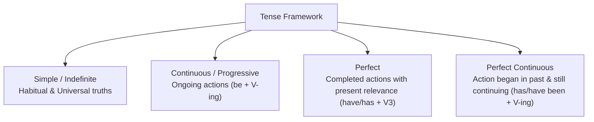

> [!exam-focus]
> **Exam Weightage & Testing Style:** 8–10 questions in Paper 1 General English. Key tested areas include:
> - Active to Passive voice transformations (specifically interrogative sentences and modal auxiliaries).
> - Direct to Indirect speech (tense backshifting, pronoun shifts, time/place adverb shifts).
> - Subject-Verb Agreement (rules for *neither...nor*, *either...or*, *along with*, *each/every*).
> - Preposition collocations (*congratulate on*, *abstain from*, *preside over*).
> - Error spotting in sentence structures.

---

## 1. The Tense Matrix and Auxiliary Patterns

The flowchart above delineates the four grammatical aspects across Present, Past, and Future timelines.

---

### Active vs Passive Voice Transformation Rules

| Tense | Active Voice Form | Passive Voice Form | Example (Active $\to$ Passive) |
|---|---|---|---|
| **Simple Present** | $S + V_1(s/es) + O$ | $O + \text{am/is/are} + V_3 + \text{by } S$ | She writes a letter. $\to$ **A letter is written by her.** |
| **Present Continuous** | $S + \text{am/is/are} + V\text{-ing} + O$ | $O + \text{am/is/are} + \text{being} + V_3 + \text{by } S$ | They are painting the wall. $\to$ **The wall is being painted by them.** |
| **Present Perfect** | $S + \text{has/have} + V_3 + O$ | $O + \text{has/have} + \text{been} + V_3 + \text{by } S$ | He has solved the problem. $\to$ **The problem has been solved by him.** |
| **Simple Past** | $S + V_2 + O$ | $O + \text{was/were} + V_3 + \text{by } S$ | The teacher praised the student. $\to$ **The student was praised by the teacher.** |
| **Past Continuous** | $S + \text{was/were} + V\text{-ing} + O$ | $O + \text{was/were} + \text{being} + V_3 + \text{by } S$ | She was preparing notes. $\to$ **Notes were being prepared by her.** |
| **Past Perfect** | $S + \text{had} + V_3 + O$ | $O + \text{had been} + V_3 + \text{by } S$ | They had finished the work. $\to$ **The work had been finished by them.** |
| **Simple Future** | $S + \text{will/shall} + V_1 + O$ | $O + \text{will/shall be} + V_3 + \text{by } S$ | The commission will declare results. $\to$ **Results will be declared by the commission.** |
| **Modals** | $S + \text{can/could/must} + V_1 + O$ | $O + \text{modal} + \text{be} + V_3 + \text{by } S$ | You must submit the form. $\to$ **The form must be submitted by you.** |

> [!NOTE]
> Present Perfect Continuous, Past Perfect Continuous, Future Continuous, and Future Perfect Continuous generally do not have standard passive voice constructions in competitive exams.

---

## 2. Direct to Indirect Speech Transformation Rules

### Reporting Verb and Tense Backshifting Rules

| Direct Speech Tense | Changes to (Indirect Speech) | Direct Speech Example | Indirect Speech Transformation |
|---|---|---|---|
| **Simple Present** | **Simple Past** | He said, "I work in Bengaluru." | He said that he **worked** in Bengaluru. |
| **Present Continuous** | **Past Continuous** | She said, "I am studying." | She said that she **was studying**. |
| **Present Perfect** | **Past Perfect** | They said, "We have completed the project." | They said that they **had completed** the project. |
| **Simple Past** | **Past Perfect** | He said, "I bought a computer." | He said that he **had bought** a computer. |
| **Past Continuous** | **Past Perfect Continuous** | She said, "I was coding." | She said that she **had been coding**. |
| **Universal Truth / Habitual** | **No Tense Change** | The teacher said, "The earth revolves round the sun." | The teacher said that the earth **revolves** round the sun. |

### Adverbial Shifts in Indirect Speech
- *now* $\to$ *then*
- *today* $\to$ *that day*
- *yesterday* $\to$ *the previous day / the day before*
- *tomorrow* $\to$ *the next day / the following day*
- *here* $\to$ *there*
- *this / these* $\to$ *that / those*

---

## 3. Core Subject-Verb Agreement Rules (High-Yield MCQs)

1. **Neither...nor / Either...or:**
   - The verb agrees with the subject **nearest to it**.
   - *Example:* "Neither the teacher nor the **students were** present."
   - *Example:* "Either the boys or the **principal is** speaking."
2. **Along with / As well as / Together with / In addition to:**
   - The verb agrees with the **first subject**.
   - *Example:* "The **teacher**, along with his students, **was** felicitated."
3. **Each / Every / Everyone / Someone:**
   - Always takes a **singular verb**.
   - *Example:* "**Each** of the candidates **has** received the hall ticket."
4. **A number of vs The number of:**
   - "*A number of* students **are** absent" (Plural).
   - "*The number of* applicants **is** increasing" (Singular).

---

## 4. High-Frequency Prepositions & Phrasal Collocations

| Verb / Adjective | Obligatory Preposition | Illustrative Sentence |
|---|---|---|
| **Congratulate** | **on** | She congratulated him **on** his success in the exam. |
| **Abstain / Refrain** | **from** | Candidates must abstain **from** malpractice. |
| **Prefer** | **to** (never 'than') | He prefers coffee **to** tea. |
| **Accused** | **of** (never 'for') | The clerk was accused **of** theft. |
| **Different** | **from** (never 'than') | This syllabus is different **from** the previous one. |
| **Dispose** | **of** (single 'f') | He disposed **of** his old textbooks. |
| **Junior / Senior / Prior** | **to** | He is junior **to** me in service. |
