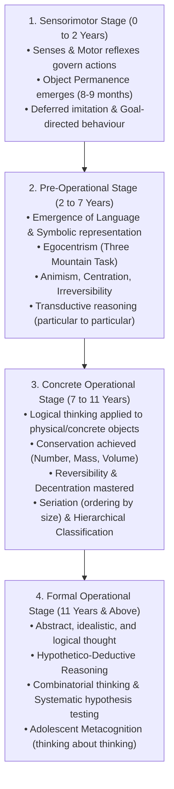
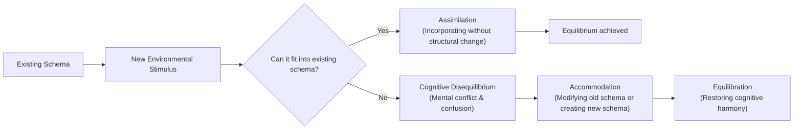
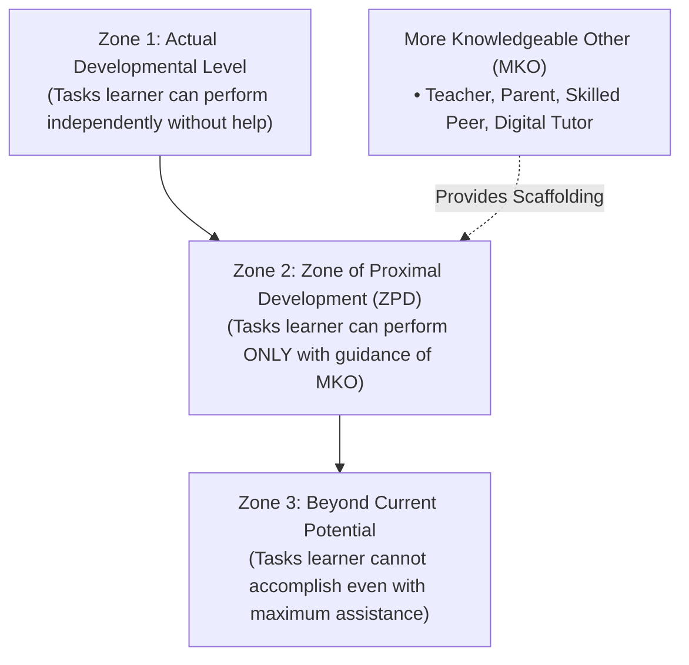
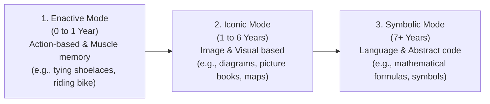
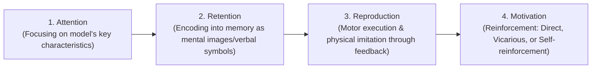
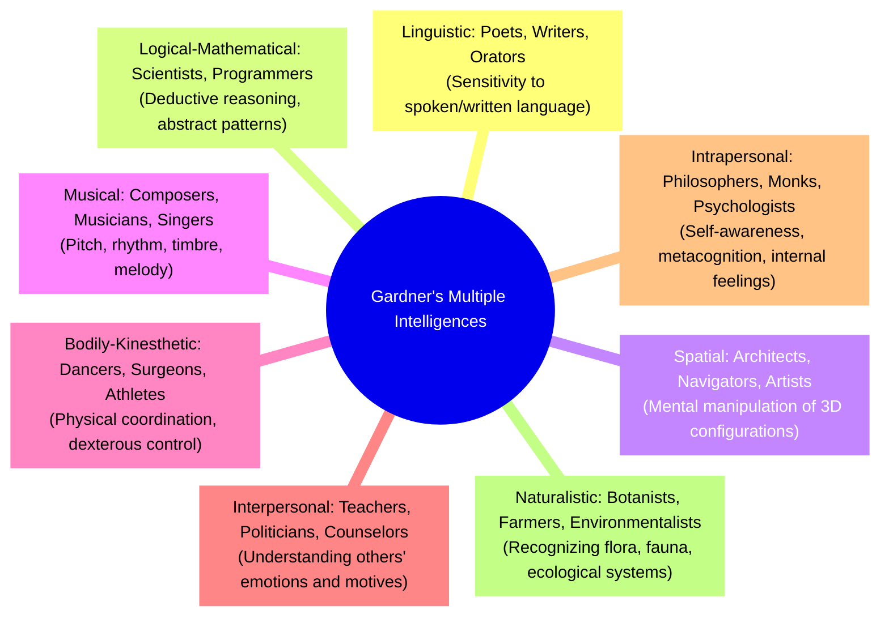
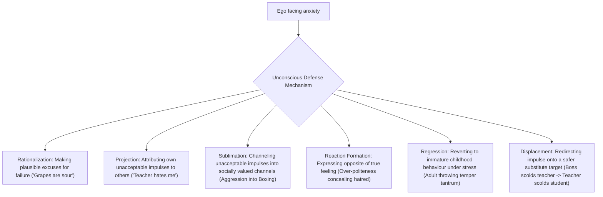
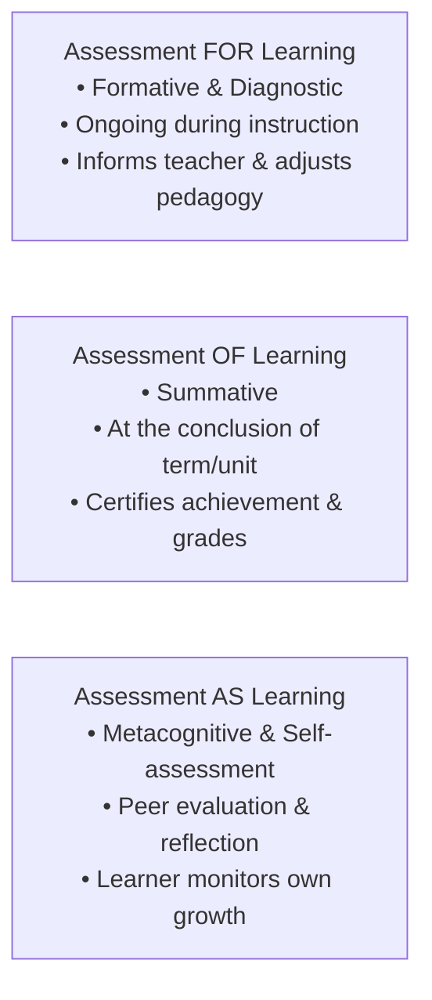
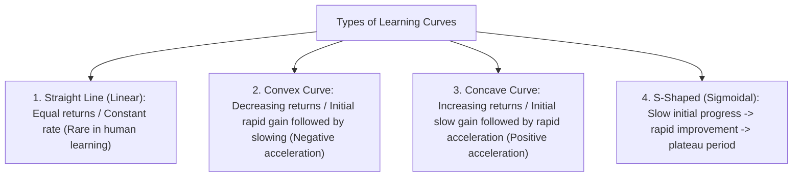

> [!exam-focus]
> **Exam Weightage & High-Yield Focus:** 25 questions (25 marks) in Paper 1 Educational Psychology. Historically, question patterns center around:
> - **Cognitive & Constructivist Development:** Piaget's 4 stages, Assimilation/Accommodation/Equilibration, Vygotsky's ZPD/Scaffolding/Private Speech, Bruner's Enactive-Iconic-Symbolic progression.
> - **Learning Theories & Conditioning:** Thorndike's 3 Primary Laws, Pavlov's Classical Conditioning paradigms, Skinner's Operant schedules & Programmed Instruction, Köhler's Insight learning (Gestalt), Bandura's 4 observational learning steps.
> - **Theories of Intelligence:** Gardner's Multiple Intelligences (8/9 types), Sternberg's Triarchic Theory, Spearman's two-factor ($g$ and $s$), Thurstone's 7 Primary Mental Abilities, IQ formula ($MA/CA \times 100$) and Terman classification.
> - **Personality & Mental Health:** Freud's Id-Ego-Superego, Ego Defense Mechanisms (Projection, Rationalization, Sublimation, Reaction Formation).
> - **Inclusive Education & Special Needs (CWSN):** RPwD Act 2016 (21 disabilities), Dyslexia, Dysgraphia, Dyscalculia, ADHD, Gifted child identification.
> - **Evaluation & Measurement:** CCE (FA 40% + SA 60%), Assessment *for* / *of* / *as* learning, Diagnostic testing vs Remedial teaching, Characteristics of a standard test (Reliability, Validity, Objectivity, Usability), Bloom's Revised Taxonomy (Cognitive, Affective, Psychomotor domains).

---

## 1. Jean Piaget's Theory of Cognitive Development

Piaget regarded children as **active builders of knowledge ("Little Scientists")** who organize information into cognitive schemas.

### 1.1 The Four Invariant Cognitive Stages

The flowchart above outlines Piaget's developmental trajectory. Stages are biologically determined and sequential; no stage can be skipped.

### 1.2 Cognitive Adaptation Mechanisms

The diagram above displays Piaget's equilibration process. Cognitive growth occurs through resolving disequilibrium.

### 1.3 Core Piagetian Concepts Glossary

| Concept | Definition | Pedagogical / Exam Application |
|---|---|---|
| **Schema** | Mental building blocks of knowledge; cognitive structures. | Child's initial schema: "Anything with wheels is a car." |
| **Assimilation** | Fitting new data into existing schemes without altering them. | Calling a bus a "big car" because it has wheels. |
| **Accommodation** | Modifying existing schemes or creating new ones when new data conflicts. | Realizing a bus carries many passengers and has different features, creating a separate "bus" schema. |
| **Equilibration** | The self-regulatory drive reconciling assimilation and accommodation. | Transitioning from confusion to intellectual clarity. |
| **Object Permanence** | Understanding that an object exists even when concealed from vision. | Appears around 8–9 months; marks end of early sensorimotor reflexive period. |
| **Egocentrism** | Inability to distinguish between one's own perspective and that of another. | Tested by the *Three Mountain Problem*; child assumes others see exactly what they see. |
| **Animism** | Attributing lifelike qualities, feelings, and intentions to inanimate objects. | A toddler apologizing to a table for bumping into it. |
| **Centration** | Focusing on a single striking perceptual dimension while ignoring others. | Judging volume purely by height: choosing a tall narrow glass over a wide bowl. |
| **Decentration** | Ability to consider multiple dimensions simultaneously. | Required to understand conservation (height and diameter compensate each other). |
| **Reversibility** | Understanding that an operation can be mentally undone to return to original state. | Knowing that melting ice into water can be reversed by freezing ($2 + 3 = 5 \implies 5 - 3 = 2$). |
| **Conservation** | Principle that quantity/mass remains constant despite perceptual transformations. | Mastered in Concrete Operations: liquid conservation (7 yrs), mass (7–8 yrs), volume (11 yrs). |
| **Hypothetico-Deductive Reasoning** | Ability to formulate hypothetical propositions and systematically deduce consequences. | Hallmarking the Formal Operational Stage; solving pendulum problem. |

---

## 2. Lev Vygotsky's Socio-Cultural Theory of Cognitive Development

Vygotsky asserted that cognitive development is inherently **social, cultural, and linguistically mediated**. Learning precedes development.

### 2.1 Zone of Proximal Development (ZPD) & Scaffolding

The flowchart above illustrates Vygotsky's ZPD. True instruction occurs precisely inside the ZPD.

- **More Knowledgeable Other (MKO):** Any individual who has a higher understanding or ability level than the learner with respect to a specific task, process, or concept.
- **Scaffolding (Coined by Jerome Bruner):** Temporary supportive structure provided during initial learning phases that is progressively removed (*faded*) as the learner attains self-regulation.
- **Vygotskian Speech Stages:**
  1. **Social (External) Speech (Birth to 3 yrs):** Used strictly for interpersonal communication and expressing basic biological desires.
  2. **Private Speech / Self-Talk (3 to 7 yrs):** Spoken aloud by the child to self-guide, plan, and regulate behaviour. Vygotsky considered this an essential cognitive self-regulatory tool (contrasting Piaget, who dismissed it as immature egocentrism).
  3. **Inner Speech (7+ yrs):** Private speech becomes completely covert and internalized as silent verbal thinking.

---

## 3. Jerome Bruner: Modes of Representation & Discovery Learning

Bruner proposed that cognitive growth involves representing reality through three successive modes:

- **Spiral Curriculum:** Any concept can be taught effectively in some intellectually honest form to any child at any stage of development. The curriculum revisits key topics across grades, increasing depth, rigor, and complexity.
- **Discovery Learning:** Encourages learners to discover principles independently through active inquiry rather than passive memorization.

---

## 4. Behavioural Conditioning & Associationist Theories

### 4.1 Classical Conditioning (Ivan P. Pavlov)
- **Paradigm:** Stimulus Substitution (S-S learning).
- **Core Process:**
  - Before Conditioning: Unconditioned Stimulus (UCS: Food) $\to$ Unconditioned Response (UCR: Salivation). Neutral Stimulus (NS: Bell) $\to$ No Salivation.
  - During Conditioning: NS (Bell) + UCS (Food) repeatedly paired $\to$ UCR (Salivation).
  - After Conditioning: Conditioned Stimulus (CS: Bell alone) $\to$ Conditioned Response (CR: Salivation).
- **Key Concepts:**
  - *Stimulus Generalization:* Responding to stimuli similar to CS (e.g., buzzer).
  - *Stimulus Discrimination:* Differentiating between CS and other non-reinforced stimuli.
  - *Extinction:* Gradual disappearance of CR when CS is presented repeatedly without UCS.
  - *Spontaneous Recovery:* Reappearance of extinguished CR after a rest interval.

### 4.2 Operant Conditioning (B. F. Skinner)
- **Paradigm:** Response-Stimulus (R-S learning). Behaviour is shaped and maintained by its consequences.
- **Contingency Matrix:**

| Contingency | Stimulus Action | Effect on Target Behaviour | Classroom Example |
|---|---|---|---|
| **Positive Reinforcement** | Adding a pleasant stimulus | Increases behaviour frequency | Praising a student who completes homework promptly. |
| **Negative Reinforcement** | Removing an aversive stimulus | Increases behaviour frequency | Excusing students from weekend quiz if they score 100% on classwork. |
| **Positive Punishment** | Adding an unpleasant stimulus | Decreases behaviour frequency | Assigning extra detention writing for disrupting class. |
| **Negative Punishment (Penalty)** | Removing a pleasant stimulus | Decreases behaviour frequency | Withholding recreation / sports period for fighting. |

- **Schedules of Reinforcement:**
  - *Continuous:* Reinforcing every correct response; fastest acquisition, but quickest extinction.
  - *Fixed Ratio (FR):* Reinforcement after fixed number of responses (e.g., reward after every 5 solved math problems).
  - *Variable Ratio (VR):* Reinforcement after unpredictable number of responses (e.g., lottery/gambling); produces highest response rate and maximum resistance to extinction.
  - *Fixed Interval (FI):* Reinforcement after fixed elapsed time (e.g., monthly salary, monthly unit test).
  - *Variable Interval (VI):* Reinforcement after varying intervals (e.g., surprise unannounced pop quizzes); produces steady, consistent response rates.
- **Programmed Instruction:** Linear programming (B.F. Skinner) vs Branching programming (Norman Crowder).

### 4.3 Connectionism & Trial and Error (Edward L. Thorndike)
- **The 3 Primary Laws of Learning:**
  1. **Law of Readiness:** Learning occurs most efficiently when the organism's neurological conduction units are prepared to act. Forcing action when unready causes annoyance; preventing action when ready causes frustration.
  2. **Law of Exercise:** Divided into *Law of Use* (frequent practice strengthens neural connections) and *Law of Disuse* (lack of practice weakens neural connections).
  3. **Law of Effect:** Responses accompanied or closely followed by satisfaction become more strongly connected to the situation; responses followed by discomfort have connections weakened. (Direct precursor to Skinner's reinforcement).

---

## 5. Social Cognitive Learning: Albert Bandura

Bandura bridge between behaviourism and cognitive psychology, establishing that **learning occurs through observation, modeling, and imitation** without direct reinforcement.

### 5.1 The Four Observational Modeling Processes

- **Bobo Doll Experiment (1961):** Children exposed to aggressive adult models displayed novel aggressive acts towards an inflatable Bobo doll, demonstrating observational learning.
- **Vicarious Reinforcement:** Observing another person receiving rewards or punishments modifies the observer's subsequent behaviour.
- **Reciprocal Determinism:** Continuous bidirectional interaction between:
  1. *Personal Factors* (Cognitive, affective, biological events)
  2. *Behaviour* (Actions, choices, statements)
  3. *Environment* (Social context, physical surroundings)
- **Self-Efficacy:** An individual's belief in their own capability to organize and execute actions required to manage prospective situations.

---

## 6. Gestalt Psychology & Insight Learning: Wolfgang Köhler

- **Experiment:** Sultan the Chimpanzee inside a cage with bananas placed out of reach. Sultan tried multiple futile attempts, sat quietly, and suddenly joined two hollow bamboo sticks together to reach the fruit.
- **Nature of Insight Learning:**
  - Learning is sudden and discrete (*"Aha! / Eureka!"* moment), not slow incremental trial and error.
  - Relies on perceptual restructuring of the entire field (Gestalt).
  - Once solved, the solution can be repeated immediately without error and easily transposed/transferred to novel situations.

---

## 7. Theories of Intelligence

### 7.1 Master Comparison of Major Intelligence Theories

| Theorist | Theory Name | Core Proposition / Factor Structure | Key Components |
|---|---|---|---|
| **Charles Spearman** | Two-Factor Theory (1904) | Intelligence comprises a general factor and task-specific factors. | **$g$-factor** (General mental energy, innate, constant across tasks) + **$s$-factor** (Specific abilities acquired through training). |
| **Louis Thurstone** | Group Factor Theory / 7 PMAs | Intelligence is not a unitary $g$-factor, but consists of 7 independent Primary Mental Abilities. | 1. Verbal Comprehension ($V$) 2. Word Fluency ($W$) 3. Number Facility ($N$) 4. Spatial Visualization ($S$) 5. Associative Memory ($M$) 6. Perceptual Speed ($P$) 7. Inductive Reasoning ($R$). |
| **Howard Gardner** | Multiple Intelligences Theory (1983) | Rejects IQ score as single metric; human mind possesses distinct semi-autonomous modules of intelligence. | 8+1 Intelligences: Linguistic, Logical-Mathematical, Spatial, Musical, Bodily-Kinesthetic, Interpersonal, Intrapersonal, Naturalistic, (Existential). |
| **Robert Sternberg** | Triarchic Theory of Intelligence | Intelligence is information processing applied to real-world context across 3 distinct subtheories. | 1. **Analytical (Componential):** Academic problem-solving, evaluation. 2. **Creative (Experiential):** Dealing with novelty, synthetic insight. 3. **Practical (Contextual):** Street smarts, adapting, shaping, selecting environments. |
| **Raymond Cattell** | Fluid and Crystallized Intelligence | Divides general intelligence into biological vs educational components. | **Fluid ($G_f$):** Innate, culture-free, inductive reasoning, peaks in early 20s. **Crystallized ($G_c$):** Acquired knowledge, cultural learning, increases across life. |

### 7.2 Howard Gardner's 8 Multiple Intelligences in Detail

The mindmap above displays Gardner's 8 distinct intelligences. Each student exhibits a unique intelligence profile.

### 7.3 Intelligence Quotient (IQ) & Distribution
- **IQ Formula (William Stern / Lewis Terman):**
  $$\text{IQ} = \frac{\text{Mental Age (MA)}}{\text{Chronological Age (CA)}} \times 100$$
- **Terman's Stanford-Binet IQ Classification:**
  - **140 and above:** Genius / Near Genius
  - **120 – 139:** Very Superior
  - **110 – 119:** Superior
  - **90 – 109:** Normal / Average (approximately 50% of the population)
  - **80 – 89:** Dull Normal / Low Average
  - **70 – 79:** Borderline Deficiency
  - **Below 70:** Intellectual Disability (formerly Mental Retardation)

---

## 8. Personality & Ego Defense Mechanisms: Sigmund Freud

### 8.1 Structural Model of Psyche
- **Id (Pleasure Principle):** Innate, unconscious, primal animal drives (Eros & Thanatos); demands immediate gratification.
- **Ego (Reality Principle):** Realistic, conscious executive mediator balancing demands of the Id against constraints of reality and the Superego.
- **Superego (Morality Principle):** Internalized parental and societal ethical conscience; enforces guilt and moral ideals.

### 8.2 Ego Defense Mechanisms Glossary (High-Yield for Exam)

The diagram above visualizes the core architecture, sequence flow, and structural taxonomy for systematic review.

---

## 9. Inclusive Education & Children with Special Needs (CWSN)

### 9.1 Rights of Persons with Disabilities (RPwD) Act, 2016
- Replaced the earlier PwD Act 1995.
- Increased the number of recognized benchmark disabilities from **7 to 21**.
- Benchmark disability is defined as having at least **40%** of a specified disability.
- Mandates **4% reservation in government jobs** and **5% reservation in higher educational institutions**.
- Free education guaranteed for children with benchmark disabilities between the ages of **6 and 18 years**.

### 9.2 Key Learning Disabilities (Specific Learning Disorders - SLD)

| Disability | Core Symptom / Manifestation | Classroom Intervention Strategy |
|---|---|---|
| **Dyslexia** | Reading impairment; letter reversals ($b \leftrightarrow d$, $p \leftrightarrow q$), slow word decoding. | Audiobooks, multi-sensory phonics instruction (Orton-Gillingham), extra time in exams. |
| **Dysgraphia** | Writing impairment; illegible handwriting, inconsistent spacing, fine-motor fatigue. | Allowing oral examinations, assistive typing software, speech-to-text, pencil grips. |
| **Dyscalculia** | Mathematical computation disorder; inability to grasp number facts, symbols, and spatial arithmetic. | Concrete manipulatives (Abacus, base-10 blocks), visual number lines, formula reference sheets. |
| **Dyspraxia** | Motor planning and coordination disorder; clumsy gross/fine motor control. | Occupational therapy, step-by-step physical task breakdown, adapted scissors/tools. |
| **ADHD** | Attention-Deficit/Hyperactivity Disorder; short attention span, impulsivity, physical restlessness. | Chunking assignments, frequent physical stretch breaks, seating near the teacher's desk. |

---

## 10. Evaluation, Assessment & Test Construction

### 10.1 Forms of Assessment

The diagram above visualizes the core architecture, sequence flow, and structural taxonomy for systematic review.

### 10.2 Characteristics of a Standardized Test

| Characteristic | Definition | Verification Question |
|---|---|---|
| **Validity** | The extent to which a test actually measures what it purports to measure. | "Does a computer science test evaluate programming logic or English vocabulary?" |
| **Reliability** | The consistency and stability of test scores across repeated administrations. | "Does a student obtain identical marks if retested or graded by different examiners?" |
| **Objectivity** | Freedom from personal bias, subjective prejudice, or examiner mood. | "Would two independent examiners award the exact same score to this answer sheet?" |
| **Usability / Practicability** | Ease of test administration, scoring, time efficiency, and economic cost. | "Can the exam be administered within the available 150-minute timetable and budget?" |

### 10.3 Bloom's Taxonomy: The Three Domains of Learning

1. **Cognitive Domain (Bloom, Revised by Anderson & Krathwohl, 2001):**
   - *Remember $\to$ Understand $\to$ Apply $\to$ Analyze $\to$ Evaluate $\to$ Create*.
2. **Affective Domain (Krathwohl, Bloom, Masia, 1964):**
   - *Receiving $\to$ Responding $\to$ Valuing $\to$ Organization $\to$ Characterization by a value complex*.
3. **Psychomotor Domain (R. H. Dave, 1970):**
   - *Imitation $\to$ Manipulation $\to$ Precision $\to$ Articulation $\to$ Naturalization*.

---

## 11. Learning Curves and Plateaus

- **Learning Plateau:** A flat horizontal stretch on a learning curve showing zero apparent progress despite continued practice.
  - *Causes:* Fatigue, loss of interest/boredom, improper teaching methods, reaching ceiling of current method.
  - *Remedies:* Rest intervals, changing pedagogical approach, positive reinforcement, motivating the learner with novel challenges.\n
