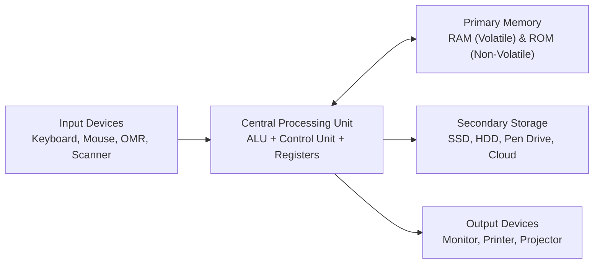
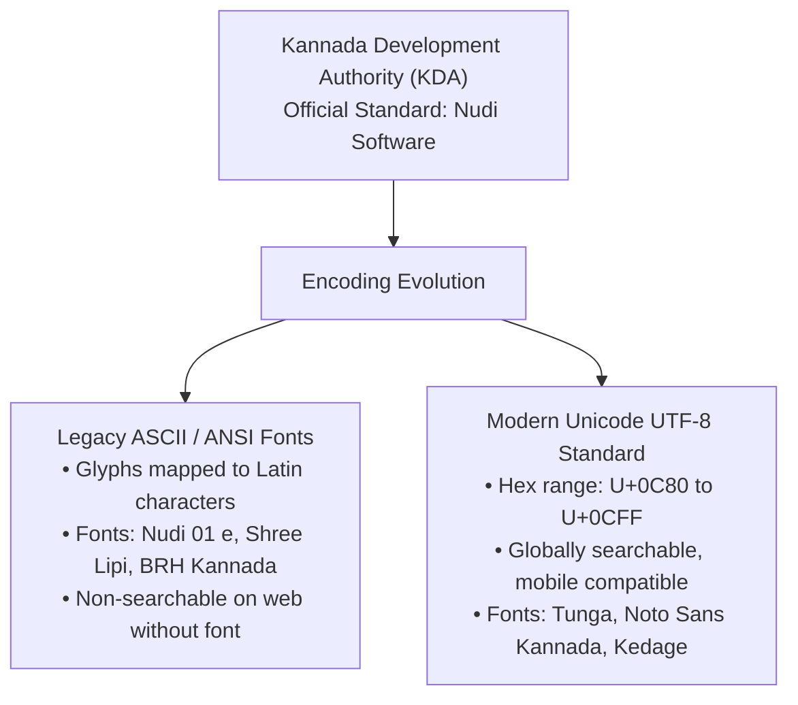

> [!exam-focus]
> **Exam Weightage & Testing Style:** 8–10 questions in Paper 1 Computer Literacy. Key tested areas:
> - Hardware peripherals and storage: Primary (RAM, ROM) vs Secondary (SSD, HDD, Optical).
> - Keyboard shortcuts in Windows, MS Word, and Excel.
> - High-yield Excel formulas: `SUM`, `AVERAGE`, `COUNT`, `COUNTA`, `IF`, `VLOOKUP`, `CONCATENATE`.
> - Kannada software: Nudi font encoding (Nudi 01 e vs Nudi B-Akshar), Unicode range for Kannada (`0C80` to `0CFF`), Baraha vs Nudi, toggle key for Nudi (`Scroll Lock` or `F12`), phonetic layout.
> - Computer viruses, phishing, and school cybersecurity best practices.

---

## 1. Hardware Architecture & Storage Units

The diagram above models the standard information flow and bus interconnections in computer hardware.

### Memory Hierarchy & Capacity Metrics
- **Bit:** Smallest binary digit (0 or 1).
- **Nibble:** 4 bits.
- **Byte:** 8 bits (represents 1 ASCII character).
- **Kilobyte (KB):** $1024 \text{ Bytes} = 2^{10} \text{ Bytes}$.
- **Megabyte (MB):** $1024 \text{ KB} = 2^{20} \text{ Bytes}$.
- **Gigabyte (GB):** $1024 \text{ MB} = 2^{30} \text{ Bytes}$.
- **Terabyte (TB):** $1024 \text{ GB} = 2^{40} \text{ Bytes}$.

---

## 2. MS Office Suite Shortcuts & High-Yield Functions

### Essential Office Shortcuts

| Shortcut Key | Function in MS Word / Windows | Function in MS Excel |
|---|---|---|
| **Ctrl + N** | New Document | New Workbook |
| **Ctrl + S** | Save File | Save Workbook |
| **Ctrl + Z / Ctrl + Y** | Undo / Redo | Undo / Redo |
| **Ctrl + F / Ctrl + H** | Find / Find and Replace | Find / Find and Replace |
| **Ctrl + K** | Insert Hyperlink | Insert Hyperlink |
| **Ctrl + ;** | — | **Insert current date** |
| **Ctrl + Shift + :** | — | **Insert current time** |
| **F4** | Repeat last action | **Toggle Absolute Cell Reference ($A$1)** |
| **F5** | Go to dialog | Refresh / Go To |
| **F7** | Spelling and Grammar Check | Spelling Check |
| **F12** | Save As | Save As |

---

### Core MS Excel Formulas Tested in Recruitment Exams

1. **Sum & Conditional Sum:**
   - `=SUM(A1:A10)`: Sums values from cell A1 through A10.
   - `=SUMIF(range, criteria, [sum_range])`: Sums cells meeting a specific criterion.
   - *Example:* `=SUMIF(B2:B20, ">50", C2:C20)`.
2. **Count Functions:**
   - `=COUNT(A1:A10)`: Counts only cells containing **numbers**.
   - `=COUNTA(A1:A10)`: Counts non-empty cells (numbers, text, logical values).
   - `=COUNTBLANK(A1:A10)`: Counts empty cells.
   - `=COUNTIF(A1:A20, "Pass")`: Counts cells matching text criteria.
3. **Lookup & Logical:**
   - `=IF(logical_test, value_if_true, value_if_false)`:
     *Example:* `=IF(D2>=35, "PASS", "FAIL")`.
   - `=VLOOKUP(lookup_value, table_array, col_index_num, [range_lookup])`:
     Searches vertically in the first column and returns value in the specified column index (`0` or `FALSE` for exact match).
4. **Cell References:**
   - **Relative Reference:** `A1` (changes when formula is copied across rows/columns).
   - **Absolute Reference:** `$A$1` (remains anchored when formula is copied).
   - **Mixed Reference:** `$A1` (column locked) or `A$1` (row locked).

---

## 3. Kannada Software Tools: Nudi, Baraha & Unicode

### Kannada Typing Technologies in Karnataka Government

The flowchart above outlines the evolution from legacy proprietary glyph-based ASCII fonts to modern Unicode standards adopted across all Karnataka government digital portals (KSHIP, SATS, Seva Sindhu).

### Critical Facts for Paper 1 MCQs
1. **Official Status of Nudi:** Developed by the **Kannada Ganaka Parishat (KaGaPa)** and adopted as the official standard software by the **Government of Karnataka** via Government Order.
2. **Toggle Shortcuts:**
   - In Nudi 5.0, toggling between English and Kannada typing is achieved via **Scroll Lock** or **F12**.
3. **Phonetic Layout (KG Phonetic):**
   - Enables typing Kannada phonetically using English QWERTY keyboard (e.g., `k + a = ಕ`, `k + A = ಕಾ`, `k + i = ಕಿ`).
4. **KGP Keymap (KaGaPa layout):** Standard typewriter layout used in government secretariats.
5. **Unicode Kannada Range:** `U+0C80` through `U+0CFF` in the Universal Character Set.
6. **Conversion Tools:** Nudi software includes an internal ASCII-to-Unicode font converter allowing legacy documents typed in *Nudi 01 e* or *Baraha* to be converted into searchable Unicode.
