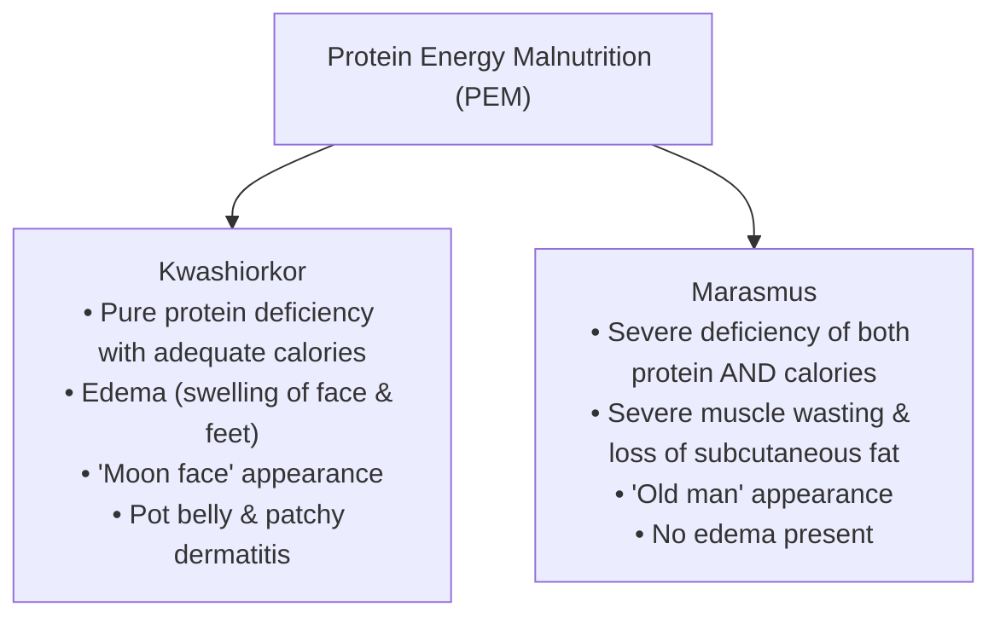

> [!exam-focus]
> **Exam Weightage & Testing Style:** 4–5 questions in Paper 1. Focus areas include:
> - Macro vs micro nutrients and their calorific energy values.
> - Vitamin deficiency diseases: Night blindness (Vit A), Beriberi (Vit B1), Scurvy (Vit C), Rickets (Vit D), Bleeding disorder (Vit K).
> - Mineral deficiencies: Goitre (Iodine), Anaemia (Iron), Osteoporosis (Calcium).
> - Protein Energy Malnutrition (PEM): Kwashiorkor vs Marasmus.
> - PM POSHAN / Mid-Day Meal norms in Karnataka primary schools.

---

## 1. Nutrients, Vitamins, and Deficiency Diseases

### Vitamin Classifications & Clinical Syndromes

| Vitamin | Chemical Name | Solubility | Primary Dietary Sources | Deficiency Disease / Symptoms |
|---|---|---|---|---|
| **Vitamin A** | Retinol | **Fat Soluble** | Carrots, papaya, green leafy vegetables, milk | **Night Blindness (Nyctalopia)**, Xerophthalmia, Bitot's spots |
| **Vitamin B1** | Thiamine | **Water Soluble** | Unpolished rice, cereals, legumes | **Beriberi** (Wet beriberi affects heart; Dry affects nerves) |
| **Vitamin B2** | Riboflavin | **Water Soluble** | Milk, eggs, yeast | **Ariboflavinosis**, Cheilosis (cracks at corners of mouth) |
| **Vitamin B3** | Niacin | **Water Soluble** | Meat, groundnuts, whole grains | **Pellagra** (4 Ds: Dermatitis, Diarrhea, Dementia, Death) |
| **Vitamin B12** | Cyanocobalamin | **Water Soluble** | Dairy, eggs, fish, meat (absent in plants) | **Pernicious Anaemia**, neurological deficits |
| **Vitamin C** | Ascorbic Acid | **Water Soluble** | Citrus fruits (amla, lemon, orange), tomatoes | **Scurvy** (bleeding gums, delayed wound healing) |
| **Vitamin D** | Calciferol | **Fat Soluble** | Sunlight synthesis in skin, fish liver oil | **Rickets** in children (bow legs, pigeon chest); **Osteomalacia** in adults |
| **Vitamin E** | Tocopherol | **Fat Soluble** | Vegetable oils, nuts, wheat germ | Fertility reduction, mild haemolytic anaemia |
| **Vitamin K** | Phylloquinone | **Fat Soluble** | Green leafy vegetables, intestinal flora | **Defective blood clotting**, prolonged haemorrhage |

---

## 2. Protein Energy Malnutrition (PEM)

The flowchart above contrasts Kwashiorkor and Marasmus, a recurrent question in school teacher examinations.

---

## 3. School Health Programs & Nutrition Norms

### PM POSHAN (Mid-Day Meal) Mandate in Karnataka
- **Primary Stage (Classes 1 to 5):**
  - Minimum **450 Calories** and **12 grams of protein** per child per day.
  - 100 grams of food grains per child.
- **Upper Primary Stage (Classes 6 to 8):**
  - Minimum **700 Calories** and **20 grams of protein** per child per day.
  - 150 grams of food grains per child.
- **Ksheera Bhagya Scheme:**
  - Distribution of hot milk to school children 5 days a week across all government and aided schools to eradicate childhood malnutrition.
- **WIFS (Weekly Iron and Folic Acid Supplementation):**
  - Blue IFA tablets provided to adolescent students weekly in schools to counter iron-deficiency anaemia.
- **National Deworming Day (NDD):**
  - Biannual administration of **Albendazole (400 mg)** tablets to all school-aged children.
