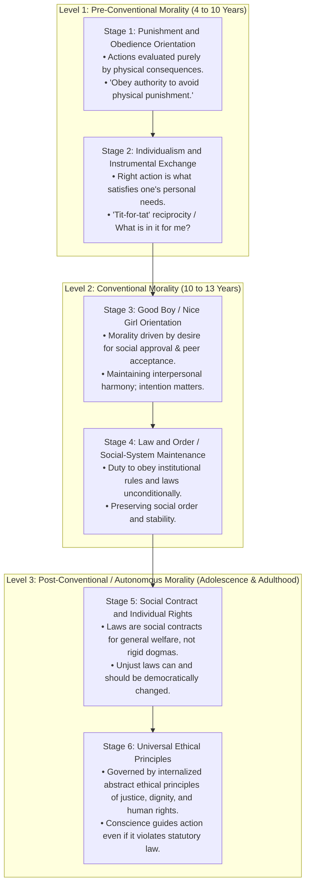
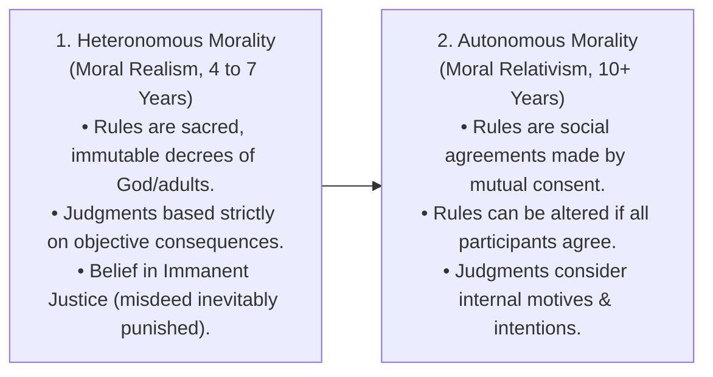
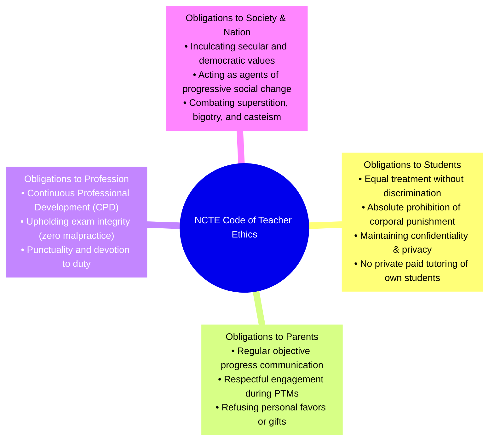
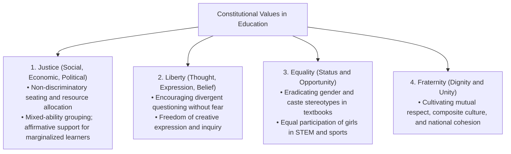
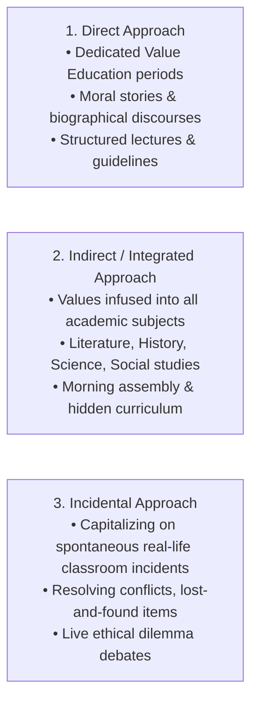

> [!exam-focus]
> **Exam Weightage & Testing Patterns:** 10 questions (10 marks) in Paper 1 Value Education. High-yield core focus areas include:
> - **Moral Development Theories:** Kohlberg's 3 levels & 6 stages (Heinz Dilemma, Good Boy/Nice Girl, Social Contract), Piaget's Heteronomous vs Autonomous morality, Carol Gilligan's Ethics of Care.
> - **NCTE Code of Professional Ethics:** Teacher's obligations towards students, parents, community, colleagues, and the profession; disciplinary boundaries.
> - **Child Rights & Child Protection Laws:** POCSO Act 2012 (mandatory reporting under Section 19/21), RTE Act 2009 Section 17 (absolute ban on corporal punishment and mental harassment), Juvenile Justice Act 2015.
> - **Constitutional Values:** Sovereign, Socialist, Secular, Democratic Republic; Justice, Liberty, Equality, Fraternity; Fundamental Duties (Article 51A).
> - **Methodologies of Value Inculcation:** Direct vs Indirect / Integrated approach vs Incidental approach.

---

## 1. Theories of Moral Development

### 1.1 Lawrence Kohlberg's Stages of Moral Development

Kohlberg presented moral dilemmas (notably the *Heinz Dilemma*, where Heinz's wife is dying of cancer and he must decide whether to steal an exorbitantly priced drug) to determine **how** individuals reason about ethical dilemmas.

The flowchart above delineates Kohlberg's progression of moral judgment from consequence-avoidance to universal ethical reasoning.

---

### 1.2 Jean Piaget's Theory of Moral Development

Piaget studied children playing marbles and proposed two primary stages of moral development:

| Dimension | Heteronomous Morality (Moral Realism) | Autonomous Morality (Moral Relativism) |
|---|---|---|
| **Age Group** | 4 – 7 years | 10 years and above |
| **Origin of Rules** | Sacred, fixed, external authority (parents, God). | Social conventions created through mutual negotiation and cooperation. |
| **Criterion of Guilt** | Objective damage caused (breaking 15 cups accidentally is worse than breaking 1 cup intentionally). | Subjective intention and motive (breaking 1 cup while stealing jam is worse than breaking 15 accidentally). |
| **Concept of Justice** | Expiatory punishment; belief in **Immanent Justice** (a child trips because they lied earlier). | Reciprocal restitution; restorative justice tailored to repair harm. |

---

### 1.3 Carol Gilligan's Ethics of Care

- **Critique of Kohlberg:** Gilligan (*In a Different Voice*, 1982) argued that Kohlberg's sample consisted exclusively of white American males, biasing his model toward a male-centric **"Ethic of Justice"** (abstract rights and rules) while devaluing the female-oriented **"Ethic of Care"** (empathy, relationships, nurturing, and responsibility).
- **Gilligan's 3 Levels of Moral Development:**
  1. **Pre-Conventional (Orientation to Individual Survival):** Selfish focus on personal needs and physical survival.
     - *Transition:* From selfishness to responsibility towards others.
  2. **Conventional (Goodness as Self-Sacrifice):** Subordinating one's own needs to nurture and please others; self-abnegation.
     - *Transition:* From self-sacrifice to acknowledging self-worth and nonviolence.
  3. **Post-Conventional (Morality of Nonviolence / Interdependence):** Reconciling care for oneself with care for others; mutual responsibility and universal nonviolence.

---

## 2. Professional Code of Ethics for Teachers (NCTE Guidelines)

Teaching is not merely an occupation, but a public trust. The National Council for Teacher Education (NCTE) outlines a rigorous code of professional conduct:

The mindmap above outlines the 4 cardinal pillars of teacher ethics mandated by the NCTE.

### 2.1 NCTE Ethical Standards & Examination Red Flags

| Ethical Domain | Mandated Professional Standard | Unethical Malpractice (Strictly Prohibited) |
|---|---|---|
| **Towards Students** | - Nurture democratic, inclusive classroom climate. - Identify individual learning barriers with empathy. - Encourage student questioning and independent thought. | - Inflicting physical beatings, ear-pinching, or kneeling. - Subjecting students to public humiliation or verbal abuse. - Conducting private commercial coaching for personal gain. |
| **Towards Parents** | - Provide constructive, evidence-based academic feedback. - Guide parents regarding child career pathways and mental well-being. | - Demanding monetary contributions or unofficial donations. - Passing derogatory remarks on parents' socio-economic status. |
| **Towards Colleagues** | - Collaborate cooperatively in lesson planning and peer review. - Support novice teachers through professional mentoring. | - Undermining colleagues' professional reputation or dignity. - Formulating regional/caste cliques within staff rooms. |
| **Towards Management** | - Adhere to institutional regulations and academic calendar. - Maintain transparent school registers, attendance, and evaluation records. | - Unauthorized absence without prior sanctioned leave. - Misappropriation of Mid-Day Meal (MDM) or school development grants. |

---

## 3. Child Rights & Child Protection Laws in Indian Schools

### 3.1 Protection of Children from Sexual Offences (POCSO) Act, 2012
- **Gender-Neutral Legislation:** Protects all children below the age of **18 years** from sexual assault, harassment, and pornography.
- **Section 19 (Mandatory Reporting):** Any person (including school teachers, headmasters, non-teaching staff, and doctors) who has apprehension or knowledge that an offence under this Act has been committed **MUST report** it to the Special Juvenile Police Unit (SJPU) or local police.
- **Section 21 (Penalties for Failure to Report):** Failure to report an offence by a person in charge of an institution is punishable with imprisonment up to **one year**, or a fine, or both.
- **Aggravated Sexual Assault (Section 5/9):** Sexual assault committed by a person in a position of trust or authority (including school teachers, principals, hostel wardens) attracts severe aggravated penal liability.
- **Child-Friendly Procedures:** Child's identity shall not be disclosed in media; statements recorded at child's residence; no overnight detention in police station.

### 3.2 Right to Education (RTE) Act, 2009 — Section 17
- **Section 17(1):** Absolute prohibition: *"No child shall be subjected to physical punishment or mental harassment."*
- **Section 17(2):** Whoever contravenes sub-section (1) shall be liable to disciplinary action under the service rules applicable to such person.
- Corporal punishment violates the child's fundamental right to dignity under **Article 21** of the Constitution.

### 3.3 Juvenile Justice (Care and Protection of Children) Act, 2015 (JJ Act)
- Distinguishes between:
  1. **Child in Need of Care and Protection (CNCP):** Orphans, abandoned children, child victims of abuse or exploitation. Handled by Child Welfare Committees (CWC).
  2. **Child in Conflict with Law (CCL):** Juveniles who have committed offences. Handled by Juvenile Justice Boards (JJB).
- Absolute prohibition against sentencing a juvenile to death or life imprisonment without possibility of release.

---

## 4. Constitutional & Democratic Values in Education

### 4.1 Preamble Values Reflected in Classroom Pedagogy

The diagram above visualizes the core architecture, sequence flow, and structural taxonomy for systematic review.

### 4.2 Fundamental Duties (Article 51A) Relevant to Education
- **Article 51A(h):** To develop the **scientific temper, humanism, and the spirit of inquiry and reform**.
- **Article 51A(g):** To protect and improve the natural environment, including forests, lakes, rivers, and wildlife, and to have compassion for living creatures.
- **Article 51A(k):** Duty of every parent or guardian to provide educational opportunities to their child between the age of **6 and 14 years** (added via 86th Constitutional Amendment Act, 2002).

---

## 5. Approaches to Value Inculcation in Schools

- **The Hidden Curriculum:** The unwritten, unofficial, and unintended lessons, values, and perspectives that students learn in school (e.g., teacher punctuality, fairness in grading, respect shown to support staff).
- **Role Modeling:** The teacher is the foremost visual embodiment of values. Children absorb modeled ethical conduct faster than verbal preaching.\n
