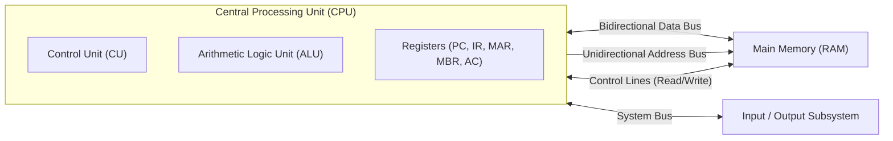
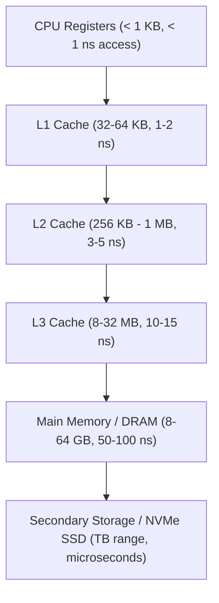

> [!exam-focus]
> **Exam Weightage & Testing Style:** 8–10 questions in Paper 2 Unit 1. Frequently tested topics:
> - Register roles during the instruction fetch-execute cycle (PC vs IR vs MAR vs MBR).
> - Von Neumann vs Harvard architecture differences.
> - System bus classifications (Address bus width $\implies$ addressable memory space; Data bus width $\implies$ word size throughput).
> - Memory hierarchy: Register $\to$ L1/L2/L3 Cache $\to$ Main Memory (RAM) $\to$ Secondary Storage (SSD/HDD).
> - Computer generations and switching technologies (Vacuum tubes $\to$ Transistors $\to$ ICs $\to$ VLSI/ULSI).

---

## 1. The Von Neumann Architecture Model

The classical Von Neumann model relies on the **stored-program concept**, where program instructions and operational data share the same unified physical memory space and bus system.

The flowchart above illustrates the operational pathways interconnecting the CPU, Main Memory, and peripheral I/O modules. Notice that the address bus originates strictly from the CPU to point to target RAM cells, whereas data travels bidirectionally depending on whether an instruction executes a memory read or memory write cycle.

---

### Functional CPU Registers Breakdown

| Register Name | Abbreviation | Bit Width Typical | Role in Instruction Cycle | Bus Connection |
|---|---|---|---|---|
| **Program Counter** | **PC** | 16 / 32 / 64 bits | Holds the memory address of the **next instruction** to be fetched; automatically incremented. | Address Bus |
| **Memory Address Register** | **MAR** | 16 / 32 / 64 bits | Holds the physical address of the memory location currently being accessed for read or write. | Address Bus |
| **Memory Buffer / Data Register**| **MBR / MDR** | Word size (e.g., 32/64 bits) | Holds the actual data/instruction word just read from memory or waiting to be written to memory. | Data Bus |
| **Instruction Register** | **IR** | Word size | Holds the **currently executing instruction** opcode and operand bits while the Control Unit decodes it. | Internal CU |
| **Accumulator** | **AC** | Word size | General-purpose working register holding immediate operands and ALU computational results. | Internal ALU |

---

## 2. Von Neumann vs Harvard Architecture

| Parameter | Von Neumann Architecture | Harvard Architecture |
|---|---|---|
| **Memory Space** | Unified memory for instructions and data. | Separate physical memory spaces for instructions and data. |
| **Buses** | Shared address and data buses for code and data. | Separate instruction and data buses running concurrently. |
| **Speed / Throughput** | Slower due to **Von Neumann Bottleneck** (cannot fetch instruction and data simultaneously). | Faster; simultaneous instruction fetch and operand read/write. |
| **Hardware Complexity** | Simpler circuitry, cheaper to fabricate. | More complex bus controllers and pin counts. |
| **Typical Usage** | General-purpose desktop computers and servers. | Digital Signal Processors (DSPs), embedded microcontrollers (ARM Cortex, PIC). |

---

## 3. Memory Hierarchy & Cache Memory Fundamentals

### The Memory Pyramid

The diagram above models the trade-off in computer memory: as capacity increases, access latency increases while cost per bit decreases.

### Cache Mapping Techniques
1. **Direct Mapping:** Each main memory block maps to exactly one predetermined cache line using formula:
   $$\text{Cache Line} = (\text{Main Memory Block Number}) \pmod{\text{Total Cache Lines}}$$
   - *Pros:* Simple and fast lookup.
   - *Cons:* High conflict misses (thrashing).
2. **Fully Associative Mapping:** Any block can be placed in any cache line.
   - *Pros:* Zero conflict misses.
   - *Cons:* Requires expensive associative content-addressable memory (CAM) for simultaneous tag comparisons.
3. **Set-Associative Mapping (K-way):** Cache is partitioned into sets of $K$ lines. A memory block maps to a specific set but can occupy any of the $K$ lines within that set.
   - Most modern CPUs employ 4-way, 8-way, or 16-way set-associative caches.

---

## 4. Computer Generations and Technological Milestones

| Generation | Timeline | Primary Electronic Device | Primary Memory / Storage | Programming Language | Notable Machines |
|---|---|---|---|---|---|
| **1st Gen** | 1940–1956 | **Vacuum Tubes (Thermionic Valves)** | Magnetic Drums, Magnetic Tape | Machine Code (Binary) | ENIAC, EDVAC, UNIVAC I |
| **2nd Gen** | 1956–1963 | **Transistors** (BJT) | Magnetic Core Memory | Assembly, Early High-level (FORTRAN, COBOL) | IBM 1401, CDC 1604 |
| **3rd Gen** | 1964–1971 | **Integrated Circuits (ICs)** (SSI/MSI) | Magnetic Core, Early Semiconductor | Structured High-Level (BASIC, Pascal, C) | IBM System/360, PDP-8 |
| **4th Gen** | 1971–Present | **Microprocessors (VLSI / ULSI)** | Semiconductor DRAM, Cache, SSD | C++, Java, Python, SQL | Intel 4004, IBM PC, Apple Mac |
| **5th Gen** | Emerging | **Ultra Large Scale Integration (ULSI), Quantum, AI** | High-Bandwidth Memory (HBM), Optical, Cloud | AI Frameworks, Natural Language | Supercomputers (Frontier, Fugaku, Param Ananta) |
