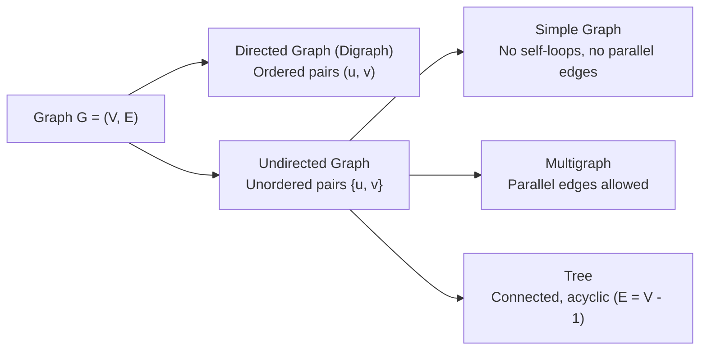

> [!exam-focus]
> **Exam Weightage & Testing Style:** 4–6 questions in Paper 2 Unit 2. Frequently tested concepts:
> - **Handshaking Lemma:** $\sum_{v \in V} \deg(v) = 2 |E|$. Consequence: The number of vertices of odd degree in any undirected graph is always **even**.
> - Euler Circuit condition (connected graph where **every vertex has an even degree**).
> - Euler Path condition (connected graph with **exactly 0 or 2 vertices of odd degree**).
> - Tree properties: A connected acyclic graph with $n$ vertices has **exactly $n - 1$ edges**.
> - Planar graphs and Euler's Formula: $V - E + F = 2$. Maximum edges in planar graph without triangles: $E \le 3V - 6$.
> - Complete graph $K_n$ has $\frac{n(n-1)}{2}$ edges.

---

## 1. Graph Definitions and The Handshaking Theorem

A graph $G = (V, E)$ consists of a non-empty set of vertices $V$ and a set of edges $E$ connecting pairs of vertices.

The flowchart above categorizes graph topologies based on edge orientation, multiplicities, and cyclic paths.

---

### Core Theorems & Formulas

1. **The Handshaking Lemma (First Theorem of Graph Theory):**
   $$\sum_{v \in V} \deg(v) = 2 |E|$$
   - *Proof Intuition:* Each edge has two endpoints, contributing exactly 1 to the degree of each incident vertex (or 2 if it is a self-loop).
   - *Direct Corollary:* In any undirected graph, the **number of vertices with odd degree is always even**.
2. **Complete Graph ($K_n$):**
   - A simple graph containing an edge between every pair of distinct vertices.
   - Total edges: $|E| = \frac{n(n - 1)}{2}$.
   - Degree of every vertex: $\deg(v) = n - 1$ (Regular graph of degree $n - 1$).
3. **Complete Bipartite Graph ($K_{m, n}$):**
   - Vertices partitioned into two disjoint sets of sizes $m$ and $n$, with edges only between sets.
   - Total edges: $|E| = m \cdot n$.

---

## 2. Eulerian vs Hamiltonian Graphs

| Feature | Eulerian Graph (Euler Circuit / Path) | Hamiltonian Graph (Hamiltonian Cycle / Path) |
|---|---|---|
| **Traverses** | Every **edge** exactly once. | Every **vertex** exactly once (except starting/ending). |
| **May repeat vertices?** | Yes, vertices may be revisited. | No, vertices must not be repeated. |
| **Necessary & Sufficient Test** | **Euler's Theorem:** - **Euler Circuit:** Connected graph where **all vertices have even degree**. - **Euler Path:** Connected graph with **exactly two vertices of odd degree** (path starts at one odd vertex and ends at the other). | **NP-Complete Problem:** No simple necessary and sufficient condition exists. |
| **Sufficient Conditions** | Trivial (check degree parity). | **Dirac's Theorem:** If $n \ge 3$ and $\deg(v) \ge \frac{n}{2}$ for all $v$, then $G$ is Hamiltonian. **Ore's Theorem:** If $\deg(u) + \deg(v) \ge n$ for every non-adjacent pair, $G$ is Hamiltonian. |

---

## 3. Trees and Spanning Trees

A **tree** is a connected, undirected graph with no simple circuits.

### Fundamental Tree Properties
- An undirected graph $T = (V, E)$ is a tree if and only if there is a **unique simple path** between any two of its vertices.
- If $T$ has $n$ vertices, it has **exactly $n - 1$ edges**:
  $$|E| = |V| - 1$$
- Adding any single edge to a tree creates exactly one simple cycle.
- Removing any edge from a tree disconnects it into a forest of two disjoint components.
- **Spanning Tree:** A subgraph of $G$ that contains all vertices of $G$ and is a tree.
  - Algorithms to find Minimum Spanning Tree (MST): **Kruskal's Algorithm** ($O(E \log E)$, greedy by edge weight) and **Prim's Algorithm** ($O(E + V \log V)$, greedy by expanding tree).

---

## 4. Planar Graphs and Graph Coloring

### Planar Graphs
A graph is **planar** if it can be drawn in the plane without any edges crossing.
- **Euler's Planar Formula:** For any connected planar graph with $V$ vertices, $E$ edges, and $F$ regions (faces):
  $$\mathbf{V - E + F = 2}$$
- **Inequalities for Simple Connected Planar Graphs ($V \ge 3$):**
  - $E \le 3V - 6$ (for any simple planar graph).
  - $E \le 2V - 4$ (if the planar graph has no triangles / circuits of length 3).
- **Kuratowski's Theorem:** A graph is planar if and only if it does not contain a subgraph homeomorphic to $K_5$ (complete graph on 5 vertices) or $K_{3, 3}$ (utility graph).

### Graph Coloring & Chromatic Number $\chi(G)$
- **Vertex Coloring:** Assigning colors to vertices such that no two adjacent vertices share the same color.
- **Chromatic Number $\chi(G)$:** The minimum number of colors needed to color graph $G$.
  - $\chi(K_n) = n$.
  - $\chi(C_n) = 2$ if cycle length $n$ is even; $\chi(C_n) = 3$ if $n$ is odd.
  - $\chi(\text{Bipartite}) = 2$.
  - **Four Color Theorem:** Every planar graph can be colored using at most **4 colors** ($\chi(G) \le 4$).
