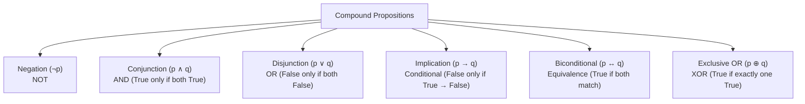

> [!exam-focus]
> **Exam Weightage & Testing Style:** 5–7 questions in Paper 2 Unit 2. Frequently tested concepts:
> - Equivalence of conditional propositions: $p \to q \equiv \neg p \lor q$.
> - Contrapositive ($(\neg q \to \neg p) \equiv (p \to q)$), Converse ($q \to p$), Inverse ($\neg p \to \neg q$).
> - Identifying Tautologies ($\top$), Contradictions ($\bot$), and Contingencies.
> - Negation of universal and existential quantifiers ($\neg \forall x P(x) \equiv \exists x \neg P(x)$).
> - Conversion of compound propositions into Conjunctive Normal Form (CNF) and Disjunctive Normal Form (DNF).

---

## 1. Logical Connectives and Truth Tables

A **proposition** is a declarative statement that is either True ($\top$) or False ($\bot$), but not both.

The flowchart above outlines the standard propositional connectives used in Boolean logic synthesis and formal proofs.

---

### Master Truth Table of Connectives

| $p$ | $q$ | Negation $\neg p$ | Conjunction $p \land q$ | Disjunction $p \lor q$ | Implication $p \to q$ | Biconditional $p \leftrightarrow q$ | Exclusive OR $p \oplus q$ |
|:---:|:---:|:---:|:---:|:---:|:---:|:---:|:---:|
| **T** | **T** | F | **T** | **T** | **T** | **T** | F |
| **T** | **F** | F | F | **T** | **F** | F | **T** |
| **F** | **T** | T | F | **T** | **T** | F | **T** |
| **F** | **F** | T | F | F | **T** | **T** | F |

> [!IMPORTANT]
> **Critical Implication Rule:** Notice that $p \to q$ is **FALSE only when the hypothesis $p$ is True and the conclusion $q$ is False**. In all other cases (including when $p$ is False), the implication evaluates vacuously to **True**.

---

## 2. Related Variations of Conditional Statements

For any given conditional statement $p \to q$:
- **Converse:** $q \to p$ (Not logically equivalent to $p \to q$).
- **Inverse:** $\neg p \to \neg q$ (Not logically equivalent to $p \to q$).
- **Contrapositive:** $\neg q \to \neg p$ (**Logically Equivalent** to $p \to q$).
  $$\mathbf{p \to q \equiv \neg q \to \neg p}$$
- **Converse and Inverse** are equivalent to each other: $(q \to p) \equiv (\neg p \to \neg q)$.

---

## 3. High-Yield Logical Equivalences (Boolean Laws)

| Law Name | Formulation 1 | Formulation 2 |
|---|---|---|
| **Identity Laws** | $p \land \top \equiv p$ | $p \lor \bot \equiv p$ |
| **Domination Laws** | $p \lor \top \equiv \top$ | $p \land \bot \equiv \bot$ |
| **Idempotent Laws** | $p \lor p \equiv p$ | $p \land p \equiv p$ |
| **Double Negation** | $\neg(\neg p) \equiv p$ | — |
| **Commutative Laws**| $p \lor q \equiv q \lor p$ | $p \land q \equiv q \land p$ |
| **Associative Laws**| $(p \lor q) \lor r \equiv p \lor (q \lor r)$ | $(p \land q) \land r \equiv p \land (q \land r)$ |
| **Distributive Laws**| $p \lor (q \land r) \equiv (p \lor q) \land (p \lor r)$ | $p \land (q \lor r) \equiv (p \land q) \lor (p \land r)$ |
| **De Morgan's Laws** | $\mathbf{\neg(p \land q) \equiv \neg p \lor \neg q}$ | $\mathbf{\neg(p \lor q) \equiv \neg p \land \neg q}$ |
| **Absorption Laws** | $p \lor (p \land q) \equiv p$ | $p \land (p \lor q) \equiv p$ |
| **Implication Equiv**| $\mathbf{p \to q \equiv \neg p \lor q}$ | $\neg(p \to q) \equiv p \land \neg q$ |

---

## 4. Normal Forms: DNF and CNF

1. **Disjunctive Normal Form (DNF):**
   - A disjunction of conjunctions (Sum of Products / SOP form).
   - *Example:* $(p \land q) \lor (\neg p \land r) \lor (q \land \neg r)$.
2. **Conjunctive Normal Form (CNF):**
   - A conjunction of disjunctions (Product of Sums / POS form).
   - *Example:* $(p \lor q) \land (\neg p \lor r) \land (q \lor \neg r)$.

---

## 5. Predicate Logic and Quantifiers

A **predicate** $P(x)$ assigns a truth value to a variable $x$ within a domain of discourse $D$.
- **Universal Quantifier ($\forall$):** $\forall x P(x)$ means "$P(x)$ is true for all $x$ in domain $D$".
- **Existential Quantifier ($\exists$):** $\exists x P(x)$ means "there exists at least one $x$ in domain $D$ for which $P(x)$ is true".

### De Morgan's Laws for Quantifiers (Negation Rules)
1. $\mathbf{\neg \forall x P(x) \equiv \exists x \neg P(x)}$ ("Not everyone is honest" $\equiv$ "Someone is dishonest").
2. $\mathbf{\neg \exists x P(x) \equiv \forall x \neg P(x)}$ ("There is no prime greater than $N$" $\equiv$ "All primes are less than or equal to $N$").
