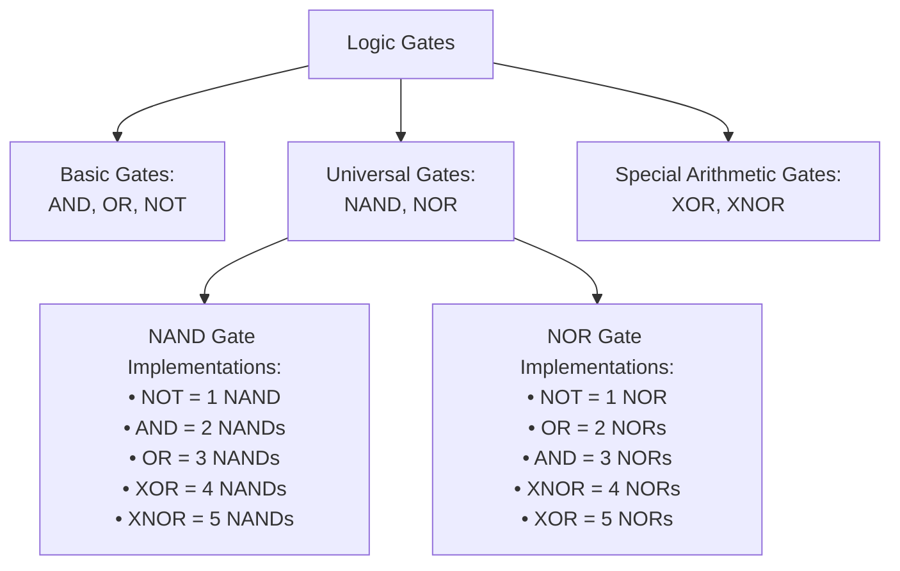
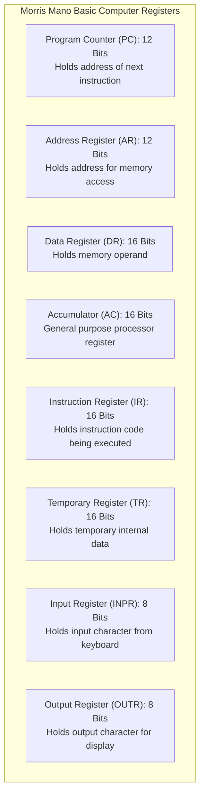
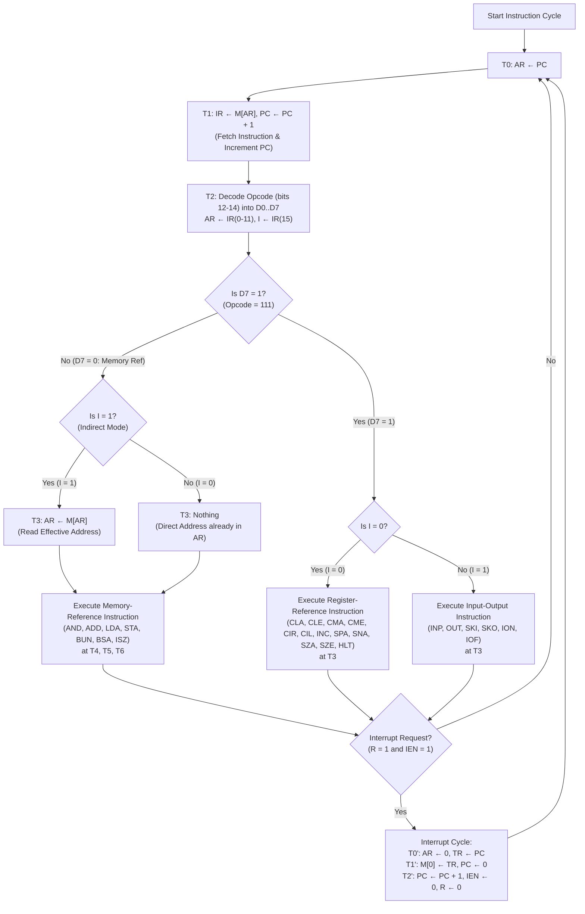
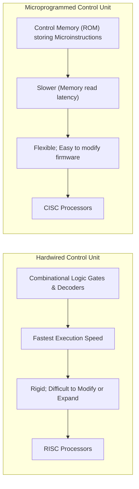

> [!exam-focus]
> **Exam Weightage & Testing Style:** 15 questions (15 marks) in Paper 2 Unit 3. Core exam areas:
> - Universal Gates: Minimum NAND/NOR gate implementations for AND, OR, NOT, XOR, XNOR.
> - K-Map minimization (Gray code ordering: 00, 01, 11, 10; eliminating variables across pairs, quads, octets).
> - Combinational modules: Half/Full Adder and Subtractor equations; Multiplexers as universal function generators; Decoders.
> - Sequential logic: Flip-Flop characteristic equations ($SR, JK, D, T$), excitation tables, and eliminating JK race-around condition via Master-Slave flip-flops.
> - Morris Mano Basic Computer Architecture: Register bit-widths (PC, AR, DR, AC, IR, TR), common bus architecture, direct vs indirect addressing ($I$ bit 15).
> - Complete Instruction Cycle: Fetch, Decode, Effective Address Calculation ($T_0, T_1, T_2, T_3$), Execution, and Interrupt cycle.
> - Hardwired Control Unit vs Microprogrammed Control Unit (Control Memory, CAR, CDR).

---

## 1. Logic Gates and Universal Gate Implementations

Universal gates can implement any Boolean switching function without requiring any other gate type.



The diagram above models the gate hierarchy and universal gate synthesis costs.

### Minimum Gate Count Table for Standard Functions

| Target Function | Minimum 2-input **NAND** Gates | Minimum 2-input **NOR** Gates | Boolean Expression |
|---|:---:|:---:|---|
| **NOT ($A'$)** | **1** | **1** | $\overline{A}$ |
| **AND ($A \cdot B$)** | **2** | **3** | $A \cdot B$ |
| **OR ($A + B$)** | **3** | **2** | $A + B$ |
| **XOR ($A \oplus B$)** | **4** | **5** | $A'B + AB'$ |
| **XNOR ($\overline{A \oplus B}$)** | **5** | **4** | $AB + A'B'$ |

---

## 2. Karnaugh Map (K-Map) Simplification

Karnaugh maps organize truth tables geometrically so that adjacent cells differ in only a single literal bit (**Gray Code ordering: 00, 01, 11, 10**).

### Rules for K-Map Reduction
1. **Grouping Sizes:** Groups must be powers of 2 ($2^0 = 1, 2^1 = 2, 2^2 = 4, 2^3 = 8, 2^4 = 16$).
2. **Elimination Rule:**
   - Group of 2 (Pair) eliminates **1 variable**.
   - Group of 4 (Quad) eliminates **2 variables**.
   - Group of 8 (Octet) eliminates **3 variables**.
3. **Wrapping:** Edge cells wrap around top-to-bottom and left-to-right (e.g., 4 corners form a quad).
4. **Don't Care Conditions ($d$ or $X$):** May be included in groups if they enlarge the group size, or ignored if they do not assist reduction.

---

## 3. Combinational Logic Circuits

### Adders and Subtractors

| Circuit | Inputs | Outputs | Sum / Difference Expression | Carry / Borrow Expression | Minimum NAND Gates |
|---|:---:|:---:|---|---|:---:|
| **Half Adder** | 2 ($A, B$) | 2 ($S, C$) | $S = A \oplus B$ | $C = A \cdot B$ | **5** |
| **Full Adder** | 3 ($A, B, C_{\text{in}}$) | 2 ($S, C_{\text{out}}$) | $S = A \oplus B \oplus C_{\text{in}}$ | $C_{\text{out}} = AB + BC_{\text{in}} + AC_{\text{in}}$ | **9** |
| **Half Subtractor** | 2 ($A, B$) | 2 ($D, B_{\text{out}}$) | $D = A \oplus B$ | $B_{\text{out}} = A' \cdot B$ | **5** |
| **Full Subtractor** | 3 ($A, B, B_{\text{in}}$) | 2 ($D, B_{\text{out}}$) | $D = A \oplus B \oplus B_{\text{in}}$ | $B_{\text{out}} = A'B + (A \oplus B)' B_{\text{in}}$ | **9** |

> [!NOTE]
> A Full Adder can be constructed using **Two Half Adders and One OR gate**.

---

### Multiplexers and Decoders
1. **Multiplexer ($2^n \times 1$ MUX):**
   - Has $2^n$ data inputs, $n$ selection lines, and 1 output line.
   - A $2^n \times 1$ MUX can implement any Boolean function of $n + 1$ variables without additional gates.
2. **Decoder ($n \times 2^n$):**
   - Converts binary code on $n$ input lines into up to $2^n$ unique output lines (minterm generator).
   - $3 \times 8$ Decoder produces 8 minterms ($m_0$ to $m_7$).

---

## 4. Sequential Logic: Latches and Flip-Flops

### Flip-Flop Characteristic and Excitation Tables

| Flip-Flop | Characteristic Equation | Inputs | Next State $Q_{n+1}$ | State Condition |
|---|---|:---:|:---:|---|
| **SR Flip-Flop** | $Q_{n+1} = S + R' Q_n$<br/>(Constraint: $S \cdot R = 0$) | $S=0, R=0$<br/>$S=0, R=1$<br/>$S=1, R=0$<br/>$S=1, R=1$ | $Q_n$<br/>0<br/>1<br/>**Invalid / Indeterminate** | No Change<br/>Reset<br/>Set<br/>Forbidden |
| **JK Flip-Flop** | $Q_{n+1} = J Q_n' + K' Q_n$ | $J=0, K=0$<br/>$J=0, K=1$<br/>$J=1, K=0$<br/>$J=1, K=1$ | $Q_n$<br/>0<br/>1<br/>$\overline{Q_n}$ | No Change<br/>Reset<br/>Set<br/>**Toggle** |
| **D Flip-Flop** | $Q_{n+1} = D$ | $D=0$<br/>$D=1$ | 0<br/>1 | Reset<br/>Set (Transparent Data) |
| **T Flip-Flop** | $Q_{n+1} = T \oplus Q_n$ | $T=0$<br/>$T=1$ | $Q_n$<br/>$\overline{Q_n}$ | No Change<br/>**Toggle** |

### Eliminating JK Race-Around Condition
- Occurs when $J = 1, K = 1$ and clock pulse duration $t_p > \Delta t$ (propagation delay).
- **Remedies:**
  1. **Master-Slave JK Flip-Flop:** Master triggers on positive edge, Slave on negative edge.
  2. **Edge-Triggered Flip-Flops.**
  3. Setting clock pulse width $t_p < \Delta t$.

---

## 5. Morris Mano Basic Computer Architecture

The Basic Computer designed by M. Morris Mano consists of memory, registers, and a common bus system.

### 5.1 Basic Computer Registers and Bit-Widths



- **Memory Unit:** 4096 words of 16 bits each ($4096 \times 16$). Requires a **12-bit address bus** ($2^{12} = 4096$).
- **Common Bus System:** An 8-line common bus multiplexes data between registers using a $3 \times 8$ decoder with selection lines $S_2, S_1, S_0$.

### 5.2 Instruction Format (16 Bits)

```text
 15    14      12  11                                  0
+----+-----------+--------------------------------------+
| I  |  Opcode   |            Address (12 Bits)         |
+----+-----------+--------------------------------------+
```
- **Bit 15 ($I$):** Addressing mode bit ($I = 0$: Direct Addressing; $I = 1$: Indirect Addressing).
- **Bits 12–14 (Opcode):** 3-bit operation code ($000$ to $111$).
  - If Opcode $\ne 111$: **Memory-Reference Instruction**.
  - If Opcode $= 111$ and $I = 0$: **Register-Reference Instruction**.
  - If Opcode $= 111$ and $I = 1$: **Input-Output Instruction**.
- **Bits 0–11 (Address):** 12-bit memory address operand.

---

## 6. Complete Morris Mano Instruction Cycle Flowchart

The instruction cycle repeats indefinitely and consists of 4 primary phases:
1. **Fetch**
2. **Decode**
3. **Read Effective Address (if indirect)**
4. **Execute**



The flowchart above models the complete Morris Mano instruction cycle with hardware timing signals $T_0$ to $T_6$ and interrupt handling.

---

## 7. Addressing Modes Summary

| Addressing Mode | Effective Address ($EA$) Formula | Primary Advantage | Example Instruction |
|---|---|---|---|
| **Immediate** | Operand is part of instruction itself ($EA = \text{None}$) | No memory access required for operand | `MOV R1, #25` |
| **Direct (Absolute)** | $EA = \text{Address Field}$ | Simple memory reference | `LDA 2000H` |
| **Indirect** | $EA = M[\text{Address Field}]$ | Enables pointer dereferencing and dynamic pointers | `ADD @2000H` |
| **Register** | Operand resides in named CPU Register | Fastest execution; no bus cycles | `ADD R1, R2` |
| **Register Indirect** | $EA = [\text{Register}]$ | Fast pointer operations in loops | `MOV A, @R0` |
| **Relative (PC-Relative)**| $EA = \text{PC} + \text{Address Offset}$ | Position-independent code; short jump branches | `JMP +12` |
| **Indexed** | $EA = \text{Index Register (XR)} + \text{Address Field}$| Efficient array and table indexing | `LDA 1000H(XR)` |
| **Base Register** | $EA = \text{Base Register (BR)} + \text{Displacement}$ | Relocatable programs in multiprogramming OS | `MOV R1, 50(BR)` |

---

## 8. Hardwired Control Unit vs Microprogrammed Control Unit



| Feature | Hardwired Control Unit | Microprogrammed Control Unit |
|---|---|---|
| **Mechanism** | Hardware digital logic gates, multiplexers, decoders, and flip-flops. | Microprogram stored in high-speed Control Memory (ROM). |
| **Speed** | **Fastest** (direct electronic propagation delay). | Slower (requires microinstruction fetch from control store). |
| **Modifiability** | Inflexible; modifying instruction set requires hardware rewiring. | Flexible; changes achieved by updating microcode in ROM. |
| **Control Logic Complexity** | Complex for extensive instruction sets. | Systematic, structured, and modular. |
| **Typical Architecture** | **RISC** architectures. | **CISC** architectures. |\n