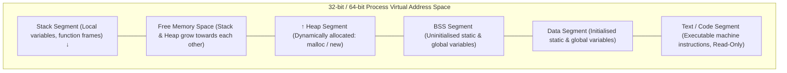
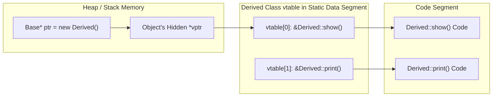
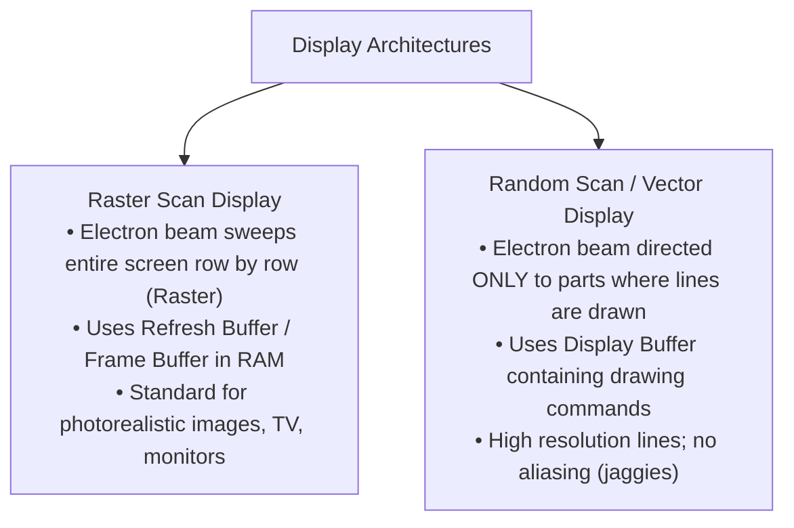
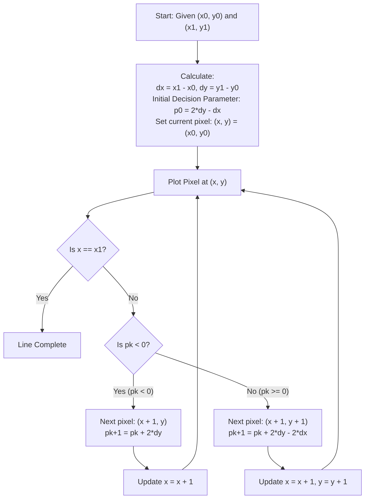

> [!exam-focus]
> **Exam Weightage & Testing Style:** 15 questions (15 marks) in Paper 2 Unit 4. Core exam areas:
> - Pointers and memory addressing: Pointer arithmetic, `*p++` vs `(*p)++`, function pointers, dangling pointers, memory leaks.
> - Compilation & Linking stages: Preprocessor $\to$ Compiler $\to$ Assembler $\to$ Linker.
> - Dynamic memory management: `malloc()` vs `calloc()` (initialises to zero) vs `realloc()`, and C++ `new` vs `delete`.
> - OOP Core: Access specifiers, Virtual functions, Pure virtual functions $\to$ Abstract classes, Virtual base class (Diamond problem).
> - Virtual Table Mechanism: How `vtable` and `vptr` resolve runtime polymorphism in C++.
> - Computer Graphics: Raster Scan vs Random Scan (Vector) display architecture; Bresenham's Line Generation Decision parameter; 2D Affine transformations ($3 \times 3$ homogeneous coordinate matrices).

---

## 1. C Compilation and Build Pipeline


The flowchart above tracks the transformation of C source text into an executable binary through preprocessing, compilation, assembly, and linking.

---

## 2. Process Memory Model & Pointers

In C and C++, variables reside in distinct virtual memory segments:
1. **Code Segment (Text):** Read-only executable binary instructions.
2. **Data Segment:** Initialised global and static variables.
3. **BSS Segment (Block Started by Symbol):** Uninitialised global and static variables (automatically zeroed by OS kernel at load time).
4. **Stack:** Local variables, function call frames, parameters, return addresses (grows downwards; LIFO order).
5. **Heap:** Dynamically allocated memory managed at runtime via `malloc`/`calloc`/`new` (grows upwards).



The diagram above visualizes the core architecture, sequence flow, and structural taxonomy for systematic review.

### Dynamic Memory Allocation Functions in C vs C++

| Function / Operator | Header | Syntax | Initial Value | Return Type | Memory Freeing Mechanism |
|---|---|---|---|---|---|
| **malloc()** | `<stdlib.h>` | `ptr = (int*)malloc(n * sizeof(int));` | Indeterminate **garbage values**. | `void*` (requires explicit typecast in C++) | `free(ptr);` |
| **calloc()** | `<stdlib.h>` | `ptr = (int*)calloc(n, sizeof(int));` | All allocated bytes are **initialised to zero**. | `void*` | `free(ptr);` |
| **realloc()** | `<stdlib.h>` | `ptr = (int*)realloc(ptr, new_size);` | Preserves existing data up to minimum size. | `void*` | `free(ptr);` |
| **new / delete** | Core C++ | `int* p = new int(10);`<br/>`int* arr = new int[n];` | Calls **class constructor**; zero-initialises if requested. | Exact type pointer (Type safe) | `delete p;`<br/>`delete[] arr;` |

---

## 3. Object-Oriented Programming (OOP) in C++

### Runtime Polymorphism & Virtual Table (`vtable` / `vptr`) Mechanics

When a class declares or inherits a `virtual` function, the C++ compiler:
1. Generates a static **Virtual Method Table (`vtable`)** for that class containing pointers to its virtual functions.
2. Inserts an invisible pointer member, **`vptr`**, into every instantiated object of that class, pointing directly to that class's `vtable`.



The flowchart above models dynamic dispatch: calling `ptr->show()` dereferences `ptr->vptr`, indexes into `vtable[0]`, and jumps to the derived method at runtime.

---

### Virtual Destructors and The Diamond Problem
- **Virtual Destructor:** Crucial when deleting a derived object via a base pointer:
  ```cpp
  class Base {
  public:
      virtual ~Base() { cout << "Base destroyed"; }
  };
  ```
  Without `virtual`, only the base class destructor is invoked, causing memory leaks for resources held by the derived class.
- **The Diamond Problem (Virtual Base Class):** When class $D$ inherits from $B$ and $C$, both of which inherit from $A$, $D$ receives two duplicate copies of $A$.
  - *Fix:* Declare inheritance using `virtual`:
    `class B : virtual public A { ... };`
    `class C : virtual public A { ... };`

---

## 4. Computer Graphics: Display Architectures & Line Drawing

### 4.1 Raster Scan vs Random Scan (Vector) Display



| Characteristic | Raster Scan Display | Random Scan (Vector / Stroke) Display |
|---|---|---|
| **Beam Deflection Pattern** | Sweeps line by line from top to bottom (Horizontal & Vertical Retrace). | Directed directly from point to point along line paths. |
| **Resolution** | Limited by pixel grid (Frame buffer resolution). | Extremely high; smooth continuous lines. |
| **Refresh Rate** | 60 to 120 frames per second (independent of picture complexity). | Depends inversely on total number of lines to be drawn. |
| **Picture Storage** | Frame Buffer (stores color/intensity for every pixel). | Display Buffer / Display File (stores vector draw commands). |
| **Aliasing (Jaggies)** | Present (requires anti-aliasing filtering). | **Absent** (straight vector lines). |

---

### 4.2 Bresenham's Line Generation Algorithm

Bresenham's algorithm uses **pure integer addition and subtraction** (no floating point arithmetic or multiplication/division) to determine the next pixel coordinates along a line with slope $0 < m < 1$.



The flowchart above traces Bresenham's integer decision loop. Because it avoids floating-point operations, it is significantly faster than the Digital Differential Analyzer (DDA) algorithm.

---

## 5. 2D Computer Graphics Affine Transformations

In computer graphics, affine transformations in 2D Euclidean space are represented as matrix operations using **$3 \times 3$ homogeneous coordinate matrices**.

### Homogeneous Transformation Matrices

1. **Translation ($T_{t_x, t_y}$):**
   $$\begin{bmatrix} x' \\ y' \\ 1 \end{bmatrix} = \begin{bmatrix} 1 & 0 & t_x \\ 0 & 1 & t_y \\ 0 & 0 & 1 \end{bmatrix} \begin{bmatrix} x \\ y \\ 1 \end{bmatrix}$$

2. **Scaling ($S_{s_x, s_y}$):**
   $$\begin{bmatrix} x' \\ y' \\ 1 \end{bmatrix} = \begin{bmatrix} s_x & 0 & 0 \\ 0 & s_y & 0 \\ 0 & 0 & 1 \end{bmatrix} \begin{bmatrix} x \\ y \\ 1 \end{bmatrix}$$

3. **Rotation ($R_\theta$ Counter-Clockwise about Origin):**
   $$\begin{bmatrix} x' \\ y' \\ 1 \end{bmatrix} = \begin{bmatrix} \cos\theta & -\sin\theta & 0 \\ \sin\theta & \cos\theta & 0 \\ 0 & 0 & 1 \end{bmatrix} \begin{bmatrix} x \\ y \\ 1 \end{bmatrix}$$\n
