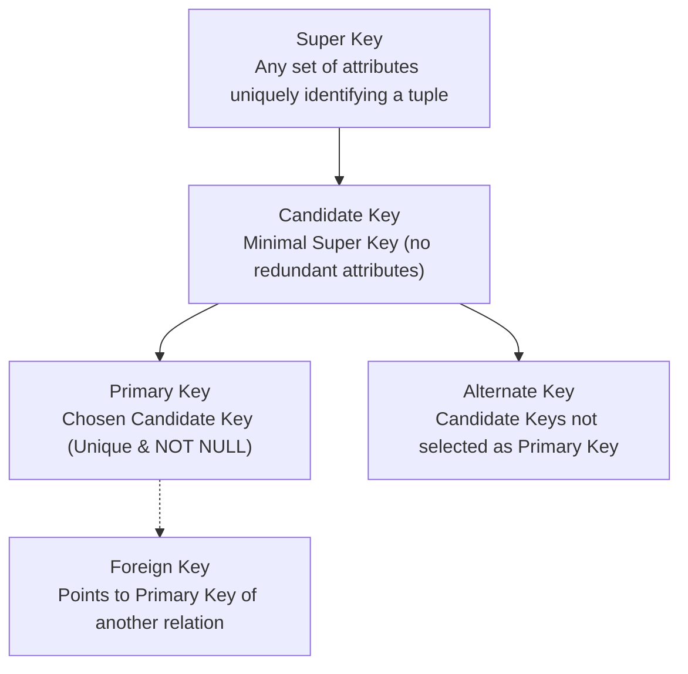
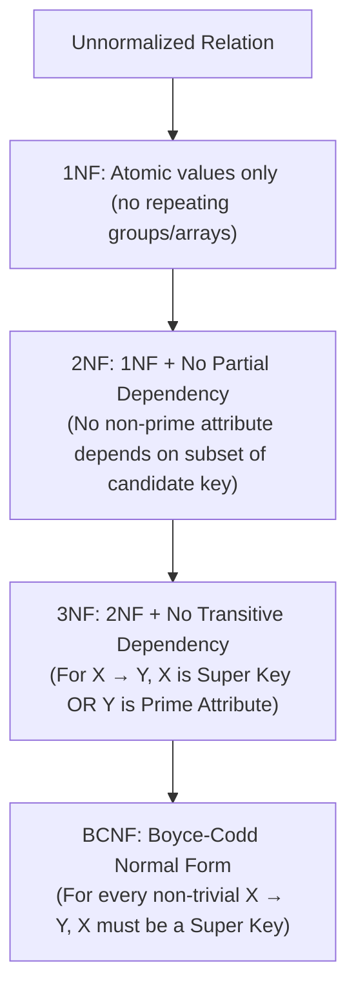
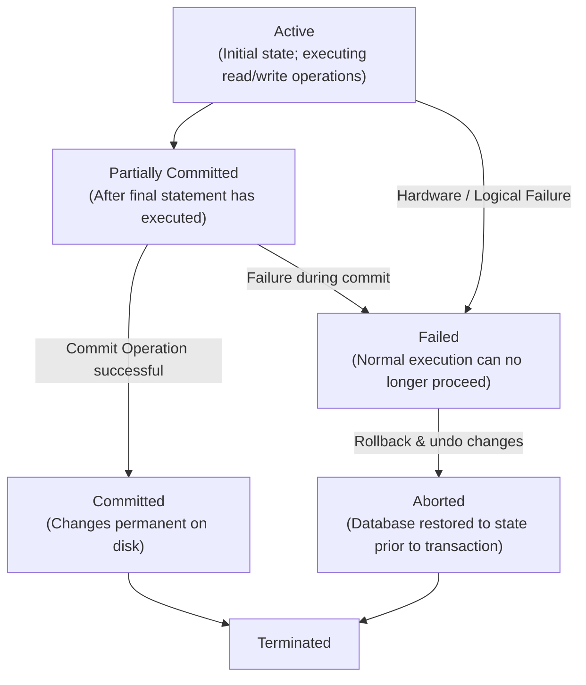
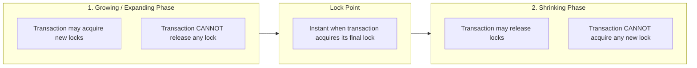

> [!exam-focus]
> **Exam Weightage & Testing Style:** 15 questions (15 marks) in Paper 2 Unit 5. Frequently tested areas:
> - Keys hierarchy: Super Key $\supseteq$ Candidate Key. Primary Key cannot be NULL (Entity Integrity).
> - Foreign Key constraint: References a Primary Key; enforces Referential Integrity.
> - Computing Attribute Closure $X^+$ and finding minimal Candidate Keys.
> - Distinguishing normal forms:
>   - 1NF: Atomic attribute values.
>   - 2NF: 1NF + No partial dependencies (every non-prime attribute fully functionally dependent on whole key).
>   - 3NF: 2NF + No transitive dependencies (for $X \to Y$, $X$ is super key OR $Y$ is prime attribute).
>   - BCNF: For every non-trivial $X \to Y$, $X$ **must be a Super Key**.
> - Transaction State Transitions: Active $\to$ Partially Committed $\to$ Committed; Active $\to$ Failed $\to$ Aborted.
> - Concurrency Control: Two-Phase Locking (2PL: Growing phase & Shrinking phase), Strict 2PL, Rigorous 2PL, and Conflict Serializability Precedence Graphs.

---

## 1. Relational Keys and Integrity Constraints



The flowchart above models the key hierarchy in relational database theory.

### Integrity Constraints Summary

| Constraint Name | Rule & Formal Definition | Violation Example |
|---|---|---|
| **Entity Integrity** | Primary key attributes cannot contain **NULL values** (since NULL cannot identify a unique tuple). | Inserting a student record with `RollNo = NULL`. |
| **Referential Integrity** | A Foreign Key in a child table must either match a valid Primary Key in the parent table or be entirely NULL. | Inserting an `Order` with `CustomerID = 999` when no customer with ID 999 exists. |
| **Domain Integrity** | All values in a column must adhere to the defined data type, format, and range. | Entering `"ABC"` into an `Age` integer field. |

---

## 2. Functional Dependencies & Attribute Closure

Given a relation $R$, a **Functional Dependency (FD)** $X \to Y$ states that whenever two tuples have the same value for attribute set $X$, they must also have the same value for attribute set $Y$.
- **Trivial FD:** $X \to Y$ where $Y \subseteq X$ (e.g., $A B \to A$).
- **Non-Trivial FD:** $X \to Y$ where $Y \not\subseteq X$ (e.g., $A \to B$).

### Armstrong's Axioms (Sound and Complete)
1. **Reflexivity:** If $Y \subseteq X$, then $X \to Y$.
2. **Augmentation:** If $X \to Y$, then $X Z \to Y Z$.
3. **Transitivity:** If $X \to Y$ and $Y \to Z$, then $X \to Z$.

---

## 3. Database Normalization (1NF, 2NF, 3NF, BCNF)

Normalization systematically decomposes tables to eliminate redundancy and prevent **insertion, deletion, and update anomalies**.



The diagram above visualizes the core architecture, sequence flow, and structural taxonomy for systematic review.

### Comparative Normal Form Evaluation Table

| Normal Form | Formal Condition for every non-trivial $X \to Y$ | Anomalies Eliminated | Always Dependency Preserving? |
|---|---|---|:---:|
| **1NF** | Attribute values must be single atomic values. | Repeating groups, nested tables. | Yes |
| **2NF** | In 1NF and no non-prime attribute is partially dependent on any candidate key. | Partial key redundancy. | Yes |
| **3NF** | In 2NF and for every $X \to Y$, either **$X$ is a Super Key** OR **$Y$ is a Prime Attribute** (part of a candidate key). | Transitive dependencies ($A \to B \to C$). | **Yes** (Lossless join & dependency preservation always achievable). |
| **BCNF** | For every non-trivial $X \to Y$, **$X$ must be a Super Key**. | Redundancy due to functional dependencies where LHS is not a candidate key. | **No** (BCNF decomposition is always lossless, but may not preserve dependencies). |

---

## 4. Transaction Management & State Transitions

A **transaction** is a logical unit of database processing that includes one or more database access operations.



The flowchart above outlines the standard 5 transaction lifecycle states. Once in the *Committed* state, changes cannot be rolled back.

---

## 5. Concurrency Control: Two-Phase Locking (2PL)

To ensure **conflict serializability**, transactions acquire shared ($S$) and exclusive ($X$) locks according to the Two-Phase Locking protocol:



The diagram above visualizes the core architecture, sequence flow, and structural taxonomy for systematic review.

### Variations of 2PL Protocols

| 2PL Variant | Locking Rule | Cascading Rollback Free? | Deadlock Free? |
|---|---|:---:|:---:|
| **Basic 2PL** | Locks acquired in growing phase, released in shrinking phase. | No | No |
| **Strict 2PL** | All **Exclusive ($X$) locks** held until transaction commits or aborts. | **Yes** (Avoids cascading aborts) | No |
| **Rigorous 2PL** | **ALL locks (Shared and Exclusive)** held until transaction commits or aborts. | **Yes** | No |
| **Conservative 2PL** | Acquires **all required locks prior to starting execution**; if any lock unavailable, waits without holding any. | Yes | **Yes (Deadlock Free)** |

---

## 6. Conflict Serializability & Precedence Graph

A schedule $S$ of transactions is **conflict serializable** if it is conflict equivalent to some serial schedule.
- Two operations conflict if:
  1. They belong to different transactions.
  2. They access the same data item $Q$.
  3. At least one of the operations is a **Write($Q$)**.

```mermaid
flowchart TD
    SG["Precedence Graph / Serialization Graph"] --> NODES["Nodes: Represent active transactions (T1, T2, ... Tn)"]
    SG --> EDGES["Directed Edge Ti → Tj:<br/>If Ti executes a conflicting operation before Tj"]
    SG --> TEST{"Does the graph contain a CYCLE?"}
    TEST -- "Yes (Cycle Detected)" --> NOT_SER["Schedule is NOT Conflict Serializable (Potential Inconsistency)"]
    TEST -- "No (Acyclic Graph)" --> SER["Schedule IS Conflict Serializable (Equivalent to Topological Sort order)"]
```\n

The diagram above visualizes the core architecture, sequence flow, and structural taxonomy for systematic review.
