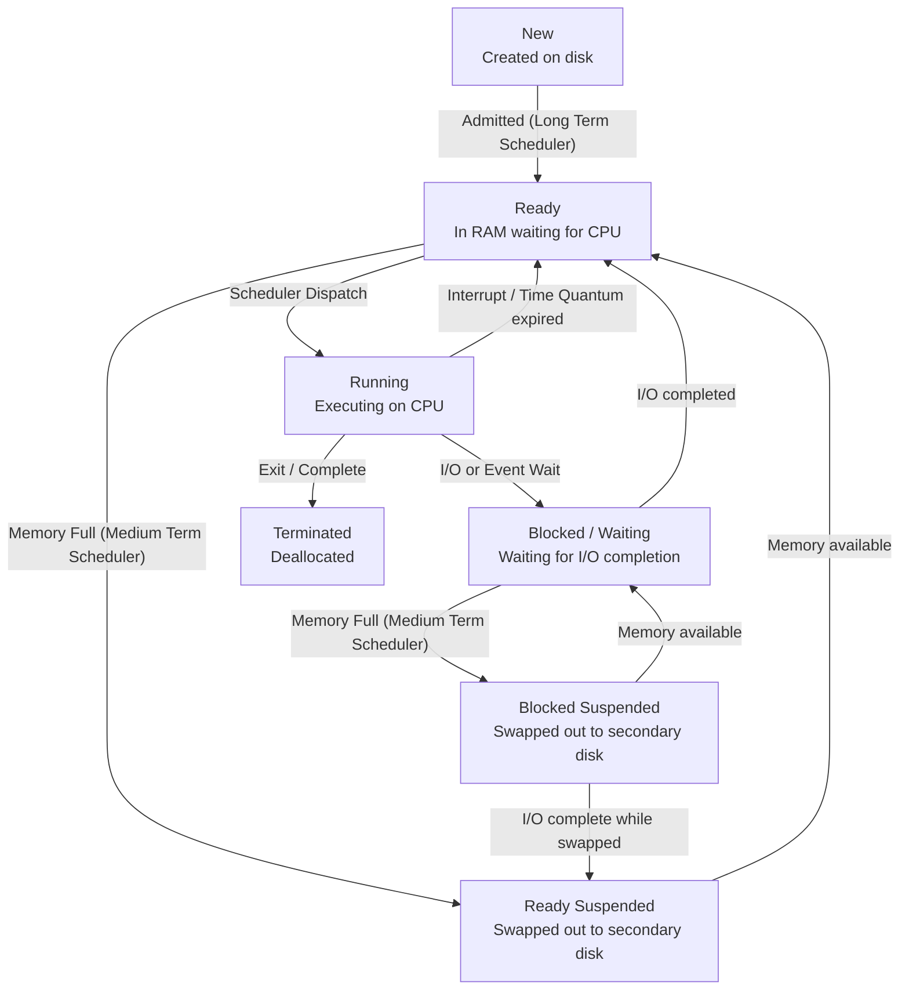
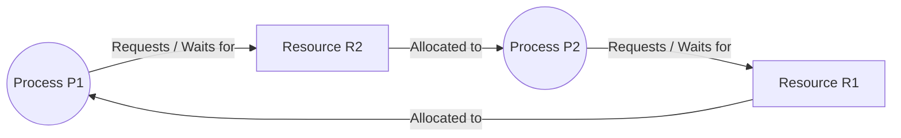
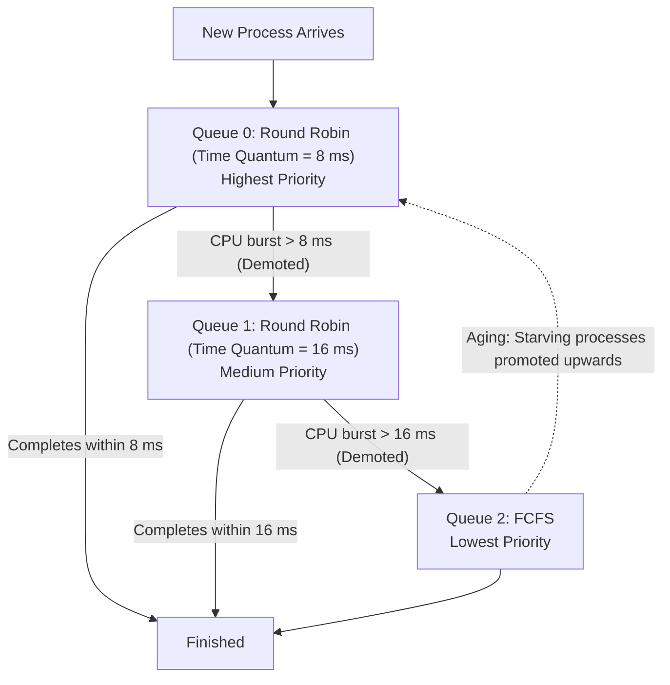

> [!exam-focus]
> **Exam Weightage & Testing Style:** 15 questions (15 marks) in Paper 2 Unit 6. High-yield numericals and conceptual traps:
> - Average Turnaround Time (TAT) and Average Waiting Time (WT):
>   $$\text{TAT} = \text{Completion Time (CT)} - \text{Arrival Time (AT)}$$
>   $$\text{WT} = \text{Turnaround Time (TAT)} - \text{Burst Time (BT)}$$
> - Shortest Remaining Time First (SRTF) is optimal for minimizing average waiting time among preemptive schedulers.
> - The 4 Coffman conditions required for Deadlock to occur.
> - Resource Allocation Graph (RAG): Cycle detection rule (Single instance resource cycle $\implies$ Definite Deadlock).
> - Banker's Algorithm: Need matrix computation ($\text{Need} = \text{Max} - \text{Allocation}$) and finding a Safe Sequence.
> - Belady's Anomaly: Occurs in **FIFO** page replacement where increasing page frames leads to *more* page faults.

---

## 1. 7-State Process Transition Model

A **process** moves through various execution states managed by the operating system kernel:

The flowchart above models the complete 7-state process lifecycle including swapping by the Medium-Term Scheduler.

---

## 2. CPU Scheduling Algorithms Comparison

| Algorithm | Preemption Mode | Scheduling Criteria | Advantages | Disadvantages & Pitfalls |
|---|---|---|---|---|
| **First-Come, First-Served (FCFS)** | Non-preemptive | Arrival Time ($AT$) | Simple, zero overhead. | **Convoy Effect:** Short processes trapped behind long CPU-intensive jobs, inflating average waiting time. |
| **Shortest Job First (SJF)** | Non-preemptive | Burst Time ($BT$) | **Provably optimal** for minimum average waiting time among non-preemptive schedulers. | Starvation of longer jobs; impossible to know exact future burst time in general OS. |
| **Shortest Remaining Time First (SRTF)** | **Preemptive** | Remaining Burst Time | Optimal average waiting time for preemptive systems. | Frequent context-switch overhead; high starvation risk for long processes. |
| **Round Robin (RR)** | **Preemptive** | Time Quantum ($q$) | Fair; responsive in time-sharing interactive systems; starvation-free. | If $q \to \infty$, behaves like FCFS. If $q$ is too small, context-switching overhead degrades CPU throughput. |
| **Priority Scheduling** | Preemptive or Non-preemptive | Priority integer | High-priority processes execute first. | **Starvation (indefinite blocking)** of low-priority tasks. Solved by **Aging** (gradually increasing priority over time). |

---

## 3. Deadlocks & Resource Allocation Graph (RAG)

A **deadlock** is a state where every process in a set is waiting for an event that can be caused only by another process in the set.

### 3.1 The Four Coffman Conditions
1. **Mutual Exclusion:** Resources cannot be shared simultaneously.
2. **Hold and Wait:** Process holds at least one resource while waiting for others.
3. **No Preemption:** Resources cannot be forcibly taken from a process.
4. **Circular Wait:** Closed chain of processes exists where each waits for a resource held by the next.

### 3.2 Resource Allocation Graph (RAG) Deadlock Cycle

The diagram above models a Resource Allocation Graph cycle.
- **Single Instance per Resource Type:** A cycle in the graph is a **necessary AND sufficient condition** for Deadlock.
- **Multiple Instances per Resource Type:** A cycle is a **necessary condition, but NOT sufficient** (other processes with available instances might break the cycle).

---

## 4. Multilevel Feedback Queue (MLFQ) Scheduling Pipeline

The flowchart above models an adaptive Multilevel Feedback Queue. Interactive short CPU tasks finish rapidly in $Q_0$, while long compute-bound jobs sink to lower priority queues without starving thanks to periodic Aging.

---

## 5. Virtual Memory & Page Replacement

### Comparative Page Replacement Matrix

| Algorithm | Decision Criteria | Belady's Anomaly Susceptible? | Performance & Implementability |
|---|---|:---:|---|
| **FIFO (First-In, First-Out)** | Replaces the page that entered memory earliest. | **YES (Susceptible)** | Simple to implement using a queue; exhibits poor locality of reference. |
| **Optimal (OPT / MIN)** | Replaces the page that will **not be used for the longest period in the future**. | **NO** (Stack algorithm) | **Theoretical benchmark** producing minimum page faults; unimplementable in real systems. |
| **LRU (Least Recently Used)** | Replaces the page that has **not been referenced for the longest period in the past**. | **NO** (Stack algorithm) | Excellent performance; approximates OPT; implemented via hardware timestamping or reference stack. |\n