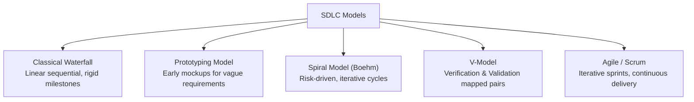
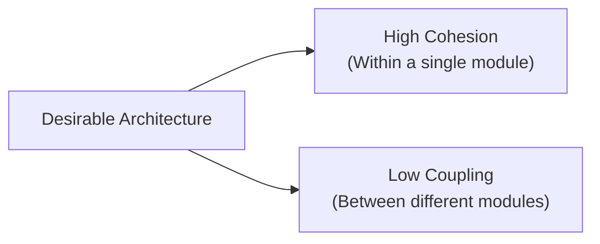

> [!exam-focus]
> **Exam Weightage & Testing Style:** 8–10 questions in Paper 2 Unit 7. Frequent exam targets:
> - Identifying the optimal SDLC model based on project parameters (e.g., Spiral model for high-risk projects; Agile Scrum for evolving requirements).
> - High cohesion and low coupling as the gold standard of modular design.
> - Calculating **McCabe's Cyclomatic Complexity**:
>   $$V(G) = E - N + 2P \quad \text{or} \quad V(G) = P + 1$$
> - Black-box testing techniques (Equivalence Partitioning, Boundary Value Analysis) vs White-box testing (Basis Path, Branch/Condition coverage).
> - Verification ("Are we building the product right?") vs Validation ("Are we building the right product?").

---

## 1. Software Development Life Cycle (SDLC) Models

The flowchart above outlines the evolution of software engineering lifecycle methodologies.

---

### Comparative Evaluation of SDLC Models

| Model | Primary Driving Philosophy | Best Suited Scenario | Critical Weakness / Limitation |
|---|---|---|---|
| **Classical Waterfall** | Strict sequential progression through phases without feedback loops. | Well-understood, fixed, immutable requirements (e.g., defence, regulatory systems). | High risk of late defect discovery; impossible to accommodate shifting customer requirements. |
| **Iterative Waterfall** | Waterfall with feedback loops to adjacent preceding phases. | Moderate projects with clear initial baseline. | Changes become exponentially costly in late verification phases. |
| **Prototyping Model** | Build a throwaway mock-up to elicit user feedback before actual coding. | Unclear, ambiguous, or customer-undefined requirements. | Risk of customer mistaking prototype for final product; scope creep. |
| **Spiral Model (Barry Boehm)** | **Risk analysis** performed at every evolutionary quadrant (Plan $\to$ Risk Analyze $\to$ Engineer $\to$ Evaluate). | **Large, complex, high-budget, high-risk mission-critical projects**. | Expensive; heavily dependent on specialized risk assessment expertise. |
| **V-Model (Verification & Validation)** | Each development phase maps directly to an equivalent testing verification phase. | Safety-critical systems requiring stringent traceability (medical, aerospace). | Inflexible to requirement changes mid-stream. |
| **Agile Scrum** | Collaborative, empirical process using 2–4 week **sprints**, daily standups, backlog burndown. | Dynamic modern software, web/mobile applications with evolving customer needs. | Demands disciplined continuous customer collaboration. |

---

## 2. Modular Design: Cohesion and Coupling

The fundamental design goal of software engineering is to achieve **High Cohesion** and **Low (Loose) Coupling**.

The diagram above visualizes the core architecture, sequence flow, and structural taxonomy for systematic review.

### Cohesion Hierarchy (Worst to Best)
*Cohesion measures the functional strength and singularity of purpose within a single module.*
1. **Coincidental Cohesion (Worst):** Elements grouped arbitrarily without meaningful relation.
2. **Logical Cohesion:** Elements perform logically similar operations (e.g., an error-handling module handling file errors, network errors, and math errors).
3. **Temporal Cohesion:** Elements grouped because they are executed at the same time (e.g., system startup/initialisation routine).
4. **Procedural Cohesion:** Elements grouped because they follow a specific execution sequence.
5. **Communicational Cohesion:** Elements operate on the same shared input/output data structure.
6. **Sequential Cohesion:** Output of one element forms the direct input to the next element.
7. **Functional Cohesion (Best):** **Every single instruction in the module contributes to executing exactly one focused task**.

### Coupling Hierarchy (Best to Worst)
*Coupling measures the degree of interdependence between two distinct modules.*
1. **Data Coupling (Best / Lowest):** Modules communicate solely by passing basic primitive parameters (e.g., passing an integer).
2. **Stamp Coupling:** Modules communicate by passing entire composite data structures, even when only a few fields are needed.
3. **Control Coupling:** One module directs the internal logic of another by passing control flags (e.g., passing a boolean flag).
4. **Common Coupling:** Modules share read/write access to **global memory variables**.
5. **Content Coupling (Worst / Highest):** One module directly modifies or accesses internal code or private data of another module.

---

## 3. McCabe's Cyclomatic Complexity Metric

Developed by Thomas McCabe, **Cyclomatic Complexity $V(G)$** measures the quantitative structural complexity of a program's Control Flow Graph (CFG) and determines the **number of independent basis execution paths**.

### Mathematical Formulas for $V(G)$
1. **From Graph Theory:**
   $$\mathbf{V(G) = E - N + 2P}$$
   Where:
   - $E$ = Number of edges in the control flow graph.
   - $N$ = Number of nodes in the control flow graph.
   - $P$ = Number of connected components (typically $P = 1$ for a single program).
2. **From Predicate Decision Nodes:**
   $$\mathbf{V(G) = P_{\text{nodes}} + 1}$$
   Where $P_{\text{nodes}}$ is the number of decision/predicate conditions (e.g., `if`, `while`, `for`, `case` statements).
3. **From Enclosed Regions:**
   $$\mathbf{V(G) = R}$$
   Where $R$ is the number of bounded planar regions plus the unbounded outer region.

---

## 4. Software Testing Methodologies

### Testing Levels Progression
1. **Unit Testing:** Tests individual functions/classes in isolation (performed by developers; uses stubs and drivers).
2. **Integration Testing:** Tests interactions between interconnected modules (Top-down, Bottom-up, Big-Bang).
3. **System Testing:** Tests the fully integrated end-to-end software against the original functional requirements.
4. **Acceptance Testing:** Alpha testing (at developer site by internal users) and Beta testing (at customer site by external users).

### Black-Box vs White-Box Testing

| Parameter | Black-Box Testing (Functional) | White-Box Testing (Structural) |
|---|---|---|
| **Underlying Focus** | Tests system functionality without inspecting internal code logic or data paths. | Tests internal code logic, data flow paths, loops, and condition branches. |
| **Prerequisite** | Requirements Specification document (SRS). | Full Source Code access and Control Flow Graph. |
| **Typical Techniques** | - **Boundary Value Analysis (BVA):** Tests values at edges ($min, min+, nominal, max-, max$). - **Equivalence Class Partitioning (ECP):** Partitions input domain into valid and invalid equivalence classes. - **Cause-Effect Graphing** & **Decision Tables**. | - **Basis Path Testing** (McCabe paths). - **Statement Coverage**. - **Branch / Decision Coverage**. - **Condition / Mutation Coverage**. |
