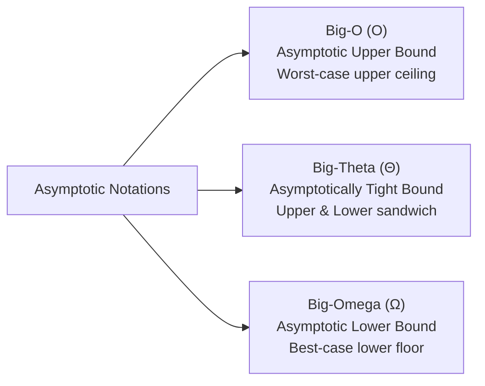

> [!exam-focus]
> **Exam Weightage & Testing Style:** 10–12 questions in Paper 2 Unit 8. High-frequency exam topics:
> - Rigorous mathematical definitions of Big-O ($f(n) \le c \cdot g(n)$), Big-$\Omega$ ($f(n) \ge c \cdot g(n)$), and Big-$\Theta$ ($c_1 g(n) \le f(n) \le c_2 g(n)$).
> - Stack applications: Evaluating postfix expressions and operator precedence during infix-to-postfix conversion.
> - Circular Queue pointer arithmetic: Full condition ($(\text{rear} + 1) \pmod{\text{size}} == \text{front}$) and Empty condition ($\text{front} == -1$).
> - Binary Search Tree (BST) inorder traversal **always produces sorted order**.
> - AVL Tree balance factor $\text{BF} \in \{-1, 0, +1\}$ and the 4 rotation types (LL, RR, LR, RL).
> - Master Complexity Table for sorting algorithms (Worst-case time, Auxiliary space, and Algorithm Stability).

---

## 1. Asymptotic Notations and Growth of Functions

The diagram above models the three primary bounding notations used in algorithm analysis.

### Formal Mathematical Definitions
1. **Big-O ($O$ - Upper Bound):**
   $$f(n) = O(g(n)) \iff \exists c > 0, n_0 \ge 1 \text{ such that } 0 \le f(n) \le c \cdot g(n) \quad \forall n \ge n_0$$
2. **Big-Omega ($\Omega$ - Lower Bound):**
   $$f(n) = \Omega(g(n)) \iff \exists c > 0, n_0 \ge 1 \text{ such that } 0 \le c \cdot g(n) \le f(n) \quad \forall n \ge n_0$$
3. **Big-Theta ($\Theta$ - Tight Bound):**
   $$f(n) = \Theta(g(n)) \iff \exists c_1, c_2 > 0, n_0 \ge 1 \text{ such that } c_1 \cdot g(n) \le f(n) \le c_2 \cdot g(n) \quad \forall n \ge n_0$$
- *Standard Growth Rate Hierarchy (Slowest to Fastest):*
  $$O(1) < O(\log n) < O(\sqrt{n}) < O(n) < O(n \log n) < O(n^2) < O(n^3) < O(2^n) < O(n!)$$

---

## 2. Linear Data Structures: Stacks, Queues, and Lists

### Stacks (LIFO - Last In, First Out)
- **Core Operations:** `push(x)` ($O(1)$), `pop()` ($O(1)$), `peek()` ($O(1)$).
- **Key Applications:**
  - Function call recursion stack.
  - Balanced parentheses checking using stack matching.
  - Infix to Postfix / Prefix conversion using Shunting-Yard algorithm.
  - Postfix expression evaluation (operands pushed to stack; operators pop top two operands).

### Queues (FIFO - First In, First Out)
- **Linear Queue Limitation:** Suffer from "false overflow" where empty spaces at the front cannot be reused once rear reaches the end.
- **Circular Queue Solution:**
  - Wrap around pointers using modulo arithmetic:
    $$\text{rear} = (\text{rear} + 1) \pmod N, \quad \text{front} = (\text{front} + 1) \pmod N$$
  - **Full Condition:** $(\text{rear} + 1) \pmod N == \text{front}$
  - **Empty Condition:** $\text{front} == -1$ (or $\text{front} == \text{rear}$ depending on implementation).

---

## 3. Trees: Binary Search Trees (BST) & AVL Trees

### Binary Search Tree (BST)
- **Property:** For any node $X$, all keys in its left subtree are $< \text{key}(X)$, and all keys in its right subtree are $> \text{key}(X)$.
- **Inorder Traversal:** Visiting Left $\to$ Root $\to$ Right yields the keys in **strictly ascending sorted order**.
- **Time Complexities:**
  - Search / Insert / Delete in Average Case: $O(\log n)$.
  - Worst Case (Skewed BST): $O(n)$.

### AVL Tree (Adelson-Velsky and Landis)
- A self-balancing binary search tree where the **Balance Factor (BF)** of every node is defined as:
  $$\mathbf{\text{BF} = \text{Height}(\text{Left Subtree}) - \text{Height}(\text{Right Subtree})}$$
  Admissible range: $\text{BF} \in \{-1, 0, +1\}$.
- **Four Rebalancing Rotations:**
  1. **LL Rotation:** Single Right rotation when node inserted into left subtree of left child.
  2. **RR Rotation:** Single Left rotation when node inserted into right subtree of right child.
  3. **LR Rotation:** Double rotation (Left rotate on child, then Right rotate on unbalanced node).
  4. **RL Rotation:** Double rotation (Right rotate on child, then Left rotate on unbalanced node).
- Search, insertion, and deletion guaranteed in worst-case $O(\log n)$ time.

---

## 4. Sorting Algorithms Master Comparison Table

| Sorting Algorithm | Best Case Time | Average Case Time | Worst Case Time | Auxiliary Space | Stable? | Algorithm Paradigm |
|---|:---:|:---:|:---:|:---:|:---:|---|
| **Bubble Sort** | $O(n)$ (Optimised) | $O(n^2)$ | $O(n^2)$ | $O(1)$ | **YES** | Comparison / Swapping |
| **Selection Sort**| $O(n^2)$ | $O(n^2)$ | $O(n^2)$ | $O(1)$ | **NO** | Comparison / Selection |
| **Insertion Sort**| $O(n)$ | $O(n^2)$ | $O(n^2)$ | $O(1)$ | **YES** | Incremental Insertion |
| **Merge Sort** | $O(n \log n)$ | $O(n \log n)$ | $O(n \log n)$ | $O(n)$ | **YES** | **Divide and Conquer** |
| **Quick Sort** | $O(n \log n)$ | $O(n \log n)$ | $O(n^2)$ (Sorted array with bad pivot) | $O(\log n)$ (Recursion stack) | **NO** | **Divide and Conquer** |
| **Heap Sort** | $O(n \log n)$ | $O(n \log n)$ | $O(n \log n)$ | $O(1)$ | **NO** | Selection / Complete Binary Heap |

> [!IMPORTANT]
> **Stability Definition:** A sorting algorithm is **Stable** if two elements with equal keys appear in the same relative order in the sorted output as they appeared in the initial input list. (Merge Sort and Insertion Sort are stable; Quick Sort and Heap Sort are not).
