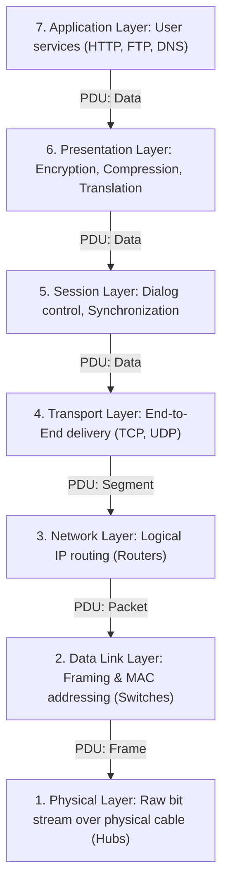
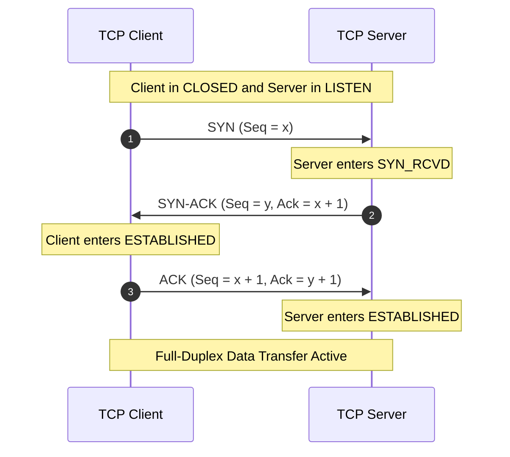
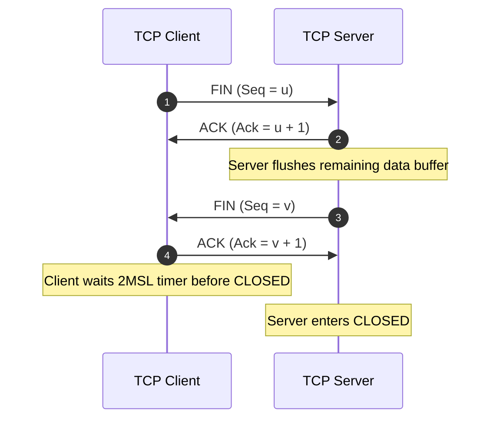

> [!exam-focus]
> **Exam Weightage & Testing Style:** 15 questions (15 marks) in Paper 2 Unit 9. Frequent numerical and protocol questions:
> - OSI layer functionality: Encryption/Compression at Presentation; Dialog control at Session; Process-to-process delivery at Transport; Routing at Network; Framing and MAC at Data Link.
> - Data units (PDU): Bits $\to$ Frames $\to$ Packets $\to$ Segments $\to$ Data.
> - TCP 3-Way Handshake ($SYN \to SYN-ACK \to ACK$) and Connection Teardown ($FIN \to ACK \to FIN \to ACK$).
> - Subnetting calculations: Finding Network Address, Broadcast Address, and number of usable hosts ($2^H - 2$).
> - Address Resolution Protocol (ARP): Maps logical IP address to physical MAC address.

---

## 1. The OSI 7-Layer Reference Model and PDU Encapsulation

The flowchart above models the OSI layered protocol stack and Protocol Data Unit (PDU) encapsulation hierarchy.

---

## 2. TCP 3-Way Handshake & Connection Teardown Sequence

TCP provides a **reliable, full-duplex, connection-oriented** transport stream using sequence and acknowledgement numbers.

### 2.1 Connection Establishment (3-Way Handshake)

The sequence diagram above illustrates the 3-Way Handshake protocol establishing synchronized sequence numbers.

### 2.2 Connection Teardown (4-Way Handshake)

The sequence diagram above models the graceful bidirectional teardown ensuring zero lost data.

---

## 3. TCP vs UDP Comparison

| Feature | Transmission Control Protocol (TCP) | User Datagram Protocol (UDP) |
|---|---|---|
| **Connection Type** | **Connection-Oriented** (Requires 3-Way Handshake). | **Connectionless** (Sends datagrams immediately). |
| **Reliability** | **Reliable** (Guaranteed delivery via ACKs and retransmissions). | **Unreliable / Best Effort** (No ACKs; packets may be lost or disordered). |
| **Header Size** | 20 to 60 Bytes (Minimum 20 bytes). | Fixed **8 Bytes**. |
| **Speed / Overhead** | Slower due to flow control, congestion control, and ACK tracking. | Extremely fast, lightweight, minimal overhead. |
| **Typical Use Cases** | Web browsing (HTTP/HTTPS), File transfer (FTP), Email (SMTP), SSH. | Real-time streaming (VoIP, YouTube live), Video games, DNS queries, DHCP. |

---

## 4. IPv4 Addressing & CIDR Subnetting Calculations

An IPv4 address is a **32-bit logical address** expressed in dotted decimal format consisting of four 8-bit octets ($X.X.X.X$).

| Class | Leading Bits | 1st Octet Range | Default Subnet Mask | Network Bits ($N$) / Host Bits ($H$) | Usable Hosts per Network |
|:---:|:---:|:---:|:---:|:---:|:---:|
| **Class A** | `0` | 1 – 126 | `255.0.0.0` (/8) | $N=8, H=24$ | $2^{24} - 2 = 16,777,214$ |
| **Class B** | `10` | 128 – 191 | `255.255.0.0` (/16) | $N=16, H=16$ | $2^{16} - 2 = 65,534$ |
| **Class C** | `110` | 192 – 223 | `255.255.255.0` (/24) | $N=24, H=8$ | $2^8 - 2 = 254$ |
| **Class D** | `1110` | 224 – 239 | — | — | **Multicasting** |
| **Class E** | `1111` | 240 – 255 | — | — | Experimental / Research |

- **Subnetting Formula:** For a `/N` prefix, Host bits $H = 32 - N$.
  $$\mathbf{\text{Usable Hosts} = 2^H - 2}$$
  *(1st address is Network Address; last address is Directed Broadcast Address).*\n