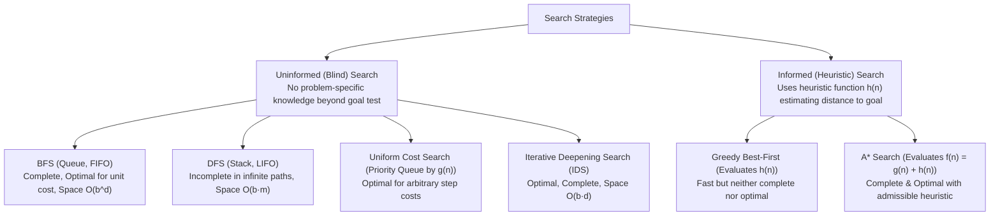

> [!exam-focus]
> **Exam Weightage & Testing Style:** 6–8 questions in Paper 2 Unit 10. Frequently tested concepts:
> - Uninformed Search Space: BFS uses Queue (Complete & Optimal for unit costs; high memory $O(b^d)$) vs DFS uses Stack (Low memory $O(b \cdot m)$; Incomplete in infinite spaces).
> - Iterative Deepening Search (IDS): Combines completeness/optimality of BFS with space efficiency of DFS ($O(b \cdot d)$).
> - **A* Search evaluation function:**
>   $$\mathbf{f(n) = g(n) + h(n)}$$
> - **Admissible Heuristic:** Never overestimates the true lowest cost to reach the goal ($h(n) \le h^*(n)$). Guarantees A* tree search is optimal.
> - **Consistent (Monotonic) Heuristic:** Satisfies triangle inequality: $h(n) \le c(n, a, n') + h(n')$. Guarantees A* graph search is optimal.
> - Alpha-Beta Pruning: Reduces effective branching factor without altering the final minimax decision.

---

## 1. Uninformed (Blind) Search Strategies Comparison

The diagram above models the classification and performance characteristics of state-space search algorithms.

---

### Complexity Analysis of Search Algorithms

| Algorithm | Completeness? | Optimality? | Time Complexity | Space Complexity | Data Structure Utilized |
|---|:---:|:---:|:---:|:---:|---|
| **Breadth-First Search (BFS)** | **YES** | **YES** (if all step costs are equal) | $O(b^d)$ | $O(b^d)$ (Exponential memory limit) | **FIFO Queue** |
| **Depth-First Search (DFS)** | NO (in infinite depth) | NO | $O(b^m)$ | $\mathbf{O(b \cdot m)}$ (Linear memory) | **LIFO Stack** / Recursion |
| **Depth-Limited Search (DLS)**| NO (if $l < d$) | NO | $O(b^l)$ | $O(b \cdot l)$ | LIFO Stack with depth limit $l$ |
| **Iterative Deepening (IDS)** | **YES** | **YES** (for unit step costs) | $O(b^d)$ | $\mathbf{O(b \cdot d)}$ (Linear memory) | LIFO Stack running iterated DLS |
| **Uniform Cost Search (UCS)** | **YES** | **YES** (for arbitrary costs $\ge \epsilon$) | $O(b^{1 + \lfloor C^* / \epsilon \rfloor})$ | $O(b^{1 + \lfloor C^* / \epsilon \rfloor})$ | **Priority Queue ordered by $g(n)$** |
| **A* Search** | **YES** | **YES** (if $h(n)$ is admissible) | $O(b^d)$ | $O(b^d)$ | **Priority Queue ordered by $f(n)$** |

*(Where $b$ = branching factor, $d$ = shallowest goal depth, $m$ = maximum state-space depth).*

---

## 2. Informed Heuristic Search: A* Algorithm

A* evaluates search nodes using the combined cost function:
$$\mathbf{f(n) = g(n) + h(n)}$$
Where:
- $g(n)$: Exact path cost accumulated from the start node to the current node $n$.
- $h(n)$: Estimated heuristic cost from current node $n$ to the closest goal node.
- $f(n)$: Estimated total cost of the cheapest solution passing through node $n$.

### Conditions for Optimality of A*
1. **Admissibility (Required for Tree Search Optimality):**
   A heuristic $h(n)$ is **admissible** if it never overestimates the actual cost to reach the goal:
   $$\mathbf{0 \le h(n) \le h^*(n) \quad \forall n}$$
   *(Where $h^*(n)$ is the true shortest path cost from $n$ to the goal).*
   - *Example:* Straight-line Euclidean distance in route-planning is always admissible because a straight line is the shortest physical distance between two points.
2. **Consistency / Monotonicity (Required for Graph Search Optimality):**
   A heuristic $h(n)$ is **consistent** if, for every node $n$ and every successor $n'$ generated by action $a$:
   $$\mathbf{h(n) \le c(n, a, n') + h(n')}$$
   - Consistency enforces the **triangle inequality**.
   - If $h(n)$ is consistent, then $h(n)$ is automatically admissible, and the sequence of $f$-values along any path is non-decreasing ($f(n') \ge f(n)$). This guarantees that whenever A* expands a node in graph search, the path to that node is already optimal.

---

## 3. Adversarial Search & Alpha-Beta Pruning

In zero-sum, two-player perfect-information games (e.g., Chess, Tic-Tac-Toe):
- **MAX player:** Seeks to maximize the terminal utility score.
- **MIN player:** Seeks to minimize the terminal utility score.
- **Minimax Decision Rule:**
  $$\text{Minimax}(s) = \begin{cases} \text{Utility}(s) & \text{if Terminal}(s) \\ \max_{a \in \text{Actions}(s)} \text{Minimax}(\text{Result}(s, a)) & \text{if Player}(s) = \text{MAX} \\ \min_{a \in \text{Actions}(s)} \text{Minimax}(\text{Result}(s, a)) & \text{if Player}(s) = \text{MIN} \end{cases}$$

### Alpha-Beta Pruning Mechanism
Maintains two values along the game tree:
- **$\alpha$ (Alpha):** The best (highest value) choice found so far along the path for **MAX** (Initialised to $-\infty$).
- **$\beta$ (Beta):** The best (lowest value) choice found so far along the path for **MIN** (Initialised to $+\infty$).
- **Pruning Rule:** Prune the remaining sub-branches beneath a node as soon as:
  $$\mathbf{\alpha \ge \beta}$$
- In optimal move ordering, Alpha-Beta pruning cuts the effective branching factor from $b$ down to $\sqrt{b}$, doubling the search depth reachable within the same time limit without changing the final decision.
