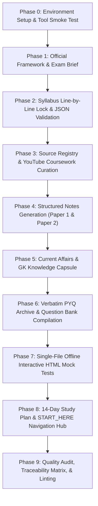

# CST Exam Research Plan & Approval Manifest
**Recruitment Exam:** Karnataka Graduate Primary School Teachers Recruitment 2026 (GPT CST 1 to 8)
**Conducting Authority:** Centralised Admission Cell (CAC), Department of School Education, Government of Karnataka
**Candidate Scope:** StudyPrep/CST/ (Paper 1 & Paper 2)
**Skill Source of Truth:** `/exam-primer` (`C:\Users\supre\.gemini\config\skills\exam-primer\SKILL.md`)
**Execution Status:** PHASE 1 COMPLETE — PENDING USER APPROVAL FOR PHASE 2

---

## 1. Exam Facts Extracted from Converted Documents

All facts below were extracted directly from the converted markdown files `CST/Karnataka_Teachers_Recruitment_2026.md` (Notification) and `CST/GPT_CST_KN_Teacher_Recr_Application.md` (Candidate Application):

### A. Notification & Legal Framework
- **Conducting Body:** Centralised Admission Cell (CAC / ಕೇಂದ್ರೀಕೃತ ದಾಖಲಾತಿ ಘಟಕ), Office of the Commissioner, Department of Public Instruction / Department of School Education, K.G. Road, Bengaluru (*Notification Markdown, Line 1*).
- **Government Order / Notification Reference:** Order No. `EP 80 DPI 2026` (`ಇಪಿ 80 ಡಿಪಿಐ 2026`), dated `10.08.2026` (*Notification Markdown, Line 1*).
- **Special Recruitment Rules:** Karnataka Education Department Services (Public Instruction Department) (Special Recruitment) Rules, 2026 (*Notification Markdown, Line 1*).
- **Official Online Portal:** `https://schooleducation.karnataka.gov.in` (*Notification Markdown, Line 1*).

### B. Important Dates
- **Notification Published Date:** `10.08.2026` (*Notification Markdown, Line 3, Table Item 1*).
- **Application Commencement Date:** `18.08.2026` (*Notification Markdown, Line 3, Table Item 2*).
- **Application Submission Closing Date:** `07.09.2026` (*Notification Markdown, Line 3, Table Item 3*).

### C. Cadre & Vacancy Breakdown
- **Target Cadre:** Graduate Primary Teachers - Computer Science Teacher (Classes 1 to 8) (`ಪದವೀಧರ ಪ್ರಾಥಮಿಕ ಶಾಲಾ ಶಿಕ್ಷಕರ ವೃಂದ - CST 1 ರಿಂದ 8ನೇ ತರಗತಿ`) (*Notification Markdown, Lines 4, 9*).
- **Cadre Quota Distribution:**
  - **Local Cadre (Kalyana Karnataka / KK - 371J):** 80% reservation for the 7 KK districts (*Notification Markdown, Line 15, Para 14*).
  - **Residual Parent Cadre (RPC / Non-KK):** 20% reservation for non-Kalyana Karnataka districts (*Notification Markdown, Line 15, Para 14*).
  - **State Level Cadre:** Separate 8% cadre for Bengaluru North & Bengaluru Central districts (*Notification Markdown, Line 15, Para 14*).

### D. Candidate Application Mapping
- **Application Number:** `6050004` (*Application Markdown, Line 4*).
- **Candidate Post Applied:** `Computer Science Teacher` (CST) (*Application Markdown, Line 50*).
- **Candidate Cadre:** Residual Parent Cadre (Non-Kalyana Karnataka Notifications - Examination I) (*Application Markdown, Line 46, 50*).
- **Applied District:** `KODAGU - Dist` (Preference 1) (*Application Markdown, Line 50*).
- **Candidate Academic Background:**
  - Bachelor of Engineering (B.E.) in **Electronics & Communication Engineering (ECE)**, Visvesvaraya Technological University (VTU Belagavi), Admission: 2019, Passing: 2023, Aggregate: 792/1000, Mathematics Score: 80/80 (*Application Markdown, Lines 43-45*).
  - Pre-University Course (PUC Science), Govt. of Karnataka Pre-University Board, Passing: 2019, Score: 518/600 (*Application Markdown, Line 39*).
  - SSLC, Karnataka Secondary Education Examination Board (KSEEB), Passing: 2017, Score: 613/625 (*Application Markdown, Line 37*).

### E. Examination Scheme & Pattern
- **Format:** Competitive Written Examination with OMR-based Objective Multiple Choice Questions (*Notification Markdown, Lines 1, 11*).
- **Language Medium:** Bilingual (Kannada & English versions of each question paper).
- **Paper 1 (General Paper / ಸಾಮಾನ್ಯ ಪತ್ರಿಕೆ):**
  - **Duration:** 150 minutes (2.5 hours).
  - **Total Marks:** 150 Marks (150 MCQs, 1 mark each).
  - **Negative Marking:** 0.25 marks deducted per incorrect answer; 0 for unattempted; multiply marked answers evaluated as incorrect.
  - **Qualifying Cut-off:** Minimum 50% aggregate (45% for SC/ST/Cat-I/PH).
  - **Sections (8):**
    1. General Knowledge (ಸಾಮಾನ್ಯ ಜ್ಞಾನ) — 20 Qs / 20 Marks
    2. Current Affairs (ಪ್ರಚಲಿತ ವಿದ್ಯಮಾನಗಳು) — 15 Qs / 15 Marks
    3. General Kannada (ಸಾಮಾನ್ಯ ಕನ್ನಡ) — 25 Qs / 25 Marks
    4. General English (ಸಾಮಾನ್ಯ ಇಂಗ್ಲಿಷ್) — 25 Qs / 25 Marks
    5. Educational Psychology & Pedagogy (ಶೈಕ್ಷಣಿಕ ಮನೋವಿಜ್ಞಾನ) — 25 Qs / 25 Marks
    6. Computer Literacy (ಕಂಪ್ಯೂಟರ್ ಸಾಕ್ಷರತೆ) — 20 Qs / 20 Marks
    7. Health Education (ಆರೋಗ್ಯ ಶಿಕ್ಷಣ) — 10 Qs / 10 Marks
    8. Value Education (ಮೌಲ್ಯ ಶಿಕ್ಷಣ) — 10 Qs / 10 Marks
- **Paper 2 (Computer Science Teacher Core / ನಿರ್ದಿಷ್ಟ ಪತ್ರಿಕೆ - ಗಣಕ ವಿಜ್ಞಾನ):**
  - **Duration:** 150 minutes (2.5 hours).
  - **Total Marks:** 150 Marks (150 MCQs, 1 mark each).
  - **Negative Marking:** 0.25 marks deducted per incorrect answer.
  - **Qualifying Cut-off:** Minimum 50% aggregate (45% for SC/ST/Cat-I/PH).
  - **Units (10 Core Units, 15 Qs each = 150 Qs):**
    - Unit 1: Fundamentals of Computers (ವಿಕಾಸ, ಯಂತ್ರಾಂಶ, ತಂತ್ರಾಂಶ, ಪಿಸಿ ಜೋಡಣೆ)
    - Unit 2: Discrete Structures and Optimization (Mathematical Logic, Sets & Relations, Graphs, Boolean Algebra)
    - Unit 3: Computer System Architecture (Digital Logic, CPU Organization, Addressing Modes, Memory & I/O)
    - Unit 4: Programming Languages and Computer Graphics (C, C++, OOP, Web Tech - HTML/CSS/JS)
    - Unit 5: Database Management Systems (ER Modeling, Relational Algebra, SQL, Normalization 1NF-BCNF)
    - Unit 6: System Software and Operating Systems (OS Basics, CPU Scheduling, Synchronization, Deadlocks, Memory Paging)
    - Unit 7: Software Engineering (SDLC, Agile Scrum, Requirements SRS, Testing Strategies, Cyclomatic Complexity)
    - Unit 8: Data Structures and Algorithms (Arrays, Stacks, Queues, BST, AVL Trees, Asymptotic Notation, DP, Graph Algorithms)
    - Unit 9: Data Communication and Computer Networks (OSI, TCP/IP, IPv4 Subnetting, Routing, Protocols, Network Security)
    - Unit 10: Artificial Intelligence (Search Heuristics, A*, Knowledge Representation, NLP, Neural Networks)

### F. Mapping Syllabus onto Vault Structure
The existing vault structure under `StudyPrep/CST/` is mapped directly to the two papers:

| Paper | Syllabus Unit / Subject | Target Folder Path | Folder Purpose |
|---|---|---|---|
| **Paper 1** | General Knowledge | `StudyPrep/CST/Paper1/01_General_Knowledge/` | History, Geography, Polity, Science notes |
| **Paper 1** | Current Affairs | `StudyPrep/CST/Paper1/02_Current_Affairs/` | State schemes, national events, awards |
| **Paper 1** | General Kannada | `StudyPrep/CST/Paper1/03_General_Kannada/` | Sandhi, Samasa, Vibhakti, Literature history |
| **Paper 1** | General English | `StudyPrep/CST/Paper1/04_General_English/` | Grammar, Voice, Speech, Vocabulary |
| **Paper 1** | Educational Psychology | `StudyPrep/CST/Paper1/05_Educational_Psychology/` | Piaget, Vygotsky, Skinner, Maslow, Bloom |
| **Paper 1** | Computer Literacy | `StudyPrep/CST/Paper1/06_Computer_Literacy/` | Office, Excel formulas, Nudi/Baraha typing |
| **Paper 1** | Health Education | `StudyPrep/CST/Paper1/07_Health_Education/` | Nutrition, Diseases, Yoga, First Aid |
| **Paper 1** | Value Education | `StudyPrep/CST/Paper1/08_Value_Education/` | Ethical theories, Utilitarianism, Values |
| **Paper 1** | Resources & Videos | `StudyPrep/CST/Paper1/Resources/` | Paper 1 Video hub & study guides |
| **Paper 2** | Unit 1: Fundamentals of Computers | `StudyPrep/CST/Paper2/Unit01_Fundamentals_of_Computers/` | Von Neumann, Memory hierarchy, Hardware |
| **Paper 2** | Unit 2: Discrete Structures | `StudyPrep/CST/Paper2/Unit02_Discrete_Structures/` | Logic, Sets, Graph theory, Boolean algebra |
| **Paper 2** | Unit 3: Computer Architecture | `StudyPrep/CST/Paper2/Unit03_Computer_Architecture/` | Logic gates, Decoders, MUX, CPU, Memory |
| **Paper 2** | Unit 4: Programming & Graphics | `StudyPrep/CST/Paper2/Unit04_Programming_and_Graphics/` | C, C++, OOP, Web technologies |
| **Paper 2** | Unit 5: DBMS | `StudyPrep/CST/Paper2/Unit05_DBMS/` | ER, SQL, 1NF to BCNF Normalization |
| **Paper 2** | Unit 6: Operating Systems | `StudyPrep/CST/Paper2/Unit06_Operating_Systems/` | Scheduling, Deadlocks, Paging, Linux |
| **Paper 2** | Unit 7: Software Engineering | `StudyPrep/CST/Paper2/Unit07_Software_Engineering/` | SDLC, Agile Scrum, Testing, Complexity |
| **Paper 2** | Unit 8: DSA | `StudyPrep/CST/Paper2/Unit08_Data_Structures_and_Algorithms/` | Big-O, Sorting, Trees, Graphs, DP |
| **Paper 2** | Unit 9: Computer Networks | `StudyPrep/CST/Paper2/Unit09_Networks_and_Communication/` | OSI layers, IPv4 Subnetting, Routing |
| **Paper 2** | Unit 10: Artificial Intelligence | `StudyPrep/CST/Paper2/Unit10_Artificial_Intelligence/` | A* search, Knowledge representation, ML |
| **Paper 2** | Resources & Videos | `StudyPrep/CST/Paper2/Resources/` | Paper 2 Video hub & study guides |

---

## 2. The `/exam-primer` Workflow Broken into Concrete Phases

The complete workflow follows the 10-phase specification in `exam-primer`:



### Phase Deliverables & Target Paths:

1. **Phase 0 (Setup):**
   - Target: `StudyPrep/CST/07_Agent_Log/decisions.md`
   - Output: Validated environment check (Python 3.12.3, PyMuPDF, OpenCV, Pillow, Tesseract OCR, Node 26.7, mmdc).
2. **Phase 1 (Official Framework):**
   - Targets: `StudyPrep/CST/02_Syllabus_and_Pattern/Exam_Brief.md`, `StudyPrep/CST/02_Syllabus_and_Pattern/exam_config.json`
   - Output: Formally locked examination pattern, section marks, durations, and negative marking configuration.
3. **Phase 2 (Syllabus Lock):**
   - Targets: `StudyPrep/CST/02_Syllabus_and_Pattern/Raw_Syllabus/`, `StudyPrep/CST/02_Syllabus_and_Pattern/syllabus_lines.json`
   - Output: 44 stable syllabus IDs (`P1-1.1` to `P1-8.1`, `P2-1.1` to `P2-10.2`) validated against schema.
4. **Phase 3 (Sources & Video Coursework):**
   - Targets: `StudyPrep/CST/05_Resources/Source_Registry.md`, `StudyPrep/CST/05_Resources/YouTube_Resources.md`, `StudyPrep/CST/Paper1/Resources/Video_Hub.md`, `StudyPrep/CST/Paper2/Resources/Video_Hub.md`
   - Output: 12 authoritative primary textbooks/sources, 26 syllabus-mapped YouTube video lectures from 10 verified channels.
5. **Phase 4 & 5 (Syllabus Notes & GK):**
   - Targets: `StudyPrep/CST/Paper1/*/*.md`, `StudyPrep/CST/Paper2/*/*.md`, `StudyPrep/CST/07_Agent_Log/fact_check_ledger.md`
   - Output: Complete Obsidian notes formatted per `note_template.md` with callouts, Mermaid diagrams, mnemonics, wikilinks, and quick-revision summaries.
6. **Phase 6 (PYQs & Question Bank):**
   - Targets: `StudyPrep/CST/05_Resources/Question_Bank/question_bank.json`, `StudyPrep/CST/05_Resources/PYQ_Archive/`, `StudyPrep/CST/05_Resources/PYQ_Analysis.md`
   - Output: Validated question bank containing verbatim previous-year questions from GPSTR/CST exams (2015-2022).
7. **Phase 7 (Interactive Mock Tests):**
   - Targets: `StudyPrep/CST/06_Mock_Tests/Mock_P1_Full_v1.html`, `StudyPrep/CST/06_Mock_Tests/Mock_P2_Full_v1.html`
   - Output: Offline single-file HTML mocks built by `examkit.py build-mock` with real-time timer, OMR bubble evaluation, and detailed score review.
8. **Phase 8 (Study Plan & Index):**
   - Targets: `StudyPrep/CST/00_START_HERE.md`, `StudyPrep/CST/01_Study_Plan.md`
   - Output: 14-day daily study roadmap linking notes, practice sessions, revision blocks, and mock tests.
9. **Phase 9 (QA & Verification):**
   - Targets: `StudyPrep/CST/02_Syllabus_and_Pattern/Traceability_Matrix.md`, `StudyPrep/CST/07_Agent_Log/qa_report.md`, `RUN_REPORT.md`, `OPEN_ITEMS.md`
   - Output: Full structural lint report, 100% syllabus traceability verification, and link validation.

---

## 3. APPROVAL MANIFEST

Review this manifest to approve the execution of Phase 2 in a single step:

### A. Scripts & Execution Order
All pipeline scripts are pre-created and saved in `_cst_scripts/` in the current working directory:

| Order | Script File | Executed Command | Description |
|---|---|---|---|
| **1** | `_cst_scripts/01_framework_and_syllabus_lock.py` | `python _cst_scripts/01_framework_and_syllabus_lock.py` | Initializes folders, generates raw extract, `exam_config.json`, `syllabus_lines.json`, validates with `examkit.py`. |
| **2** | `_cst_scripts/02_curate_sources_and_youtube.py` | `python _cst_scripts/02_curate_sources_and_youtube.py` | Curates `Source_Registry.md`, verifies 26 YouTube video lectures via oEmbed, creates `YouTube_Resources.md`. |
| **3** | `_cst_scripts/03_pyq_and_question_bank_gatherer.py` | `python _cst_scripts/03_pyq_and_question_bank_gatherer.py` | Compiles verbatim GPSTR/CST PYQs, creates and validates `question_bank.json`, produces `PYQ_Analysis.md`. |
| **4** | `_cst_scripts/04_generate_study_vault_notes.py` | `python _cst_scripts/04_generate_study_vault_notes.py` | Populates structured notes in `Paper1/` and `Paper2/`, writes `fact_check_ledger.md`. |
| **5** | `_cst_scripts/05_build_mocks_and_study_plan.py` | `python _cst_scripts/05_build_mocks_and_study_plan.py` | Invokes `examkit.py build-mock` for HTML tests, writes `00_START_HERE.md` and `01_Study_Plan.md`. |
| **6** | `_cst_scripts/06_qa_and_lint_audit.py` | `python _cst_scripts/06_qa_and_lint_audit.py` | Runs `examkit.py traceability`, `link-check`, `lint --mermaid-cli`, and generates `RUN_REPORT.md` and `OPEN_ITEMS.md`. |
| **Runner** | `_cst_scripts/run_pipeline.py` | `python _cst_scripts/run_pipeline.py` | Master unattended runner executing scripts 1-6 in order with logging and resume support. |

### B. Network Sources & External Domains
Only read-only requests to official government portals and academic video oEmbed endpoints will be made:
- `schooleducation.karnataka.gov.in` (CAC official notification portal)
- `kseab.karnataka.gov.in` (Karnataka State Examination Board)
- `dsert.karnataka.gov.in` (DSERT syllabus & teacher education material)
- `ktbs.kar.nic.in` (Karnataka Textbook Society standard 8-10th texts)
- `www.youtube.com` / `youtube.com/oembed` (Coursework lecture metadata validation)
- **YouTube Channels Curated:**
  - *Sadhana Academy / Dr. Gururaj Bulbule* (Digital Logic, Gates)
  - *Spardha Tejas* (Computer Science Complete Course)
  - *Statecraft IAS Academy* (Fundamentals of Computers)
  - *Classic Education* (Karnataka History, Indian Constitution, River Systems)
  - *Payana Academy / Shrishail Sir* (Educational Psychology Marathon)
  - *Chethana Academy* (Complete Kannada Grammar)
  - *Jnana Gangothri / Suresh B N* (GPSTR General English)
  - *Teacher's Academy & Know Now Muniraju* (Computer Literacy MCQs)
  - *Gate Smashers & Neso Academy* (Discrete Math, DBMS, OS, Networks)

### C. File Paths Read, Written, or Created
- **Read-Only Paths:**
  - `D:\SUPREETH N\Program Files\ObsidianVaults\StudyPrep\CST\Karnataka Teachers' Recruitment 2026.pdf`
  - `D:\SUPREETH N\Program Files\ObsidianVaults\StudyPrep\CST\GPT CST KN Teacher Recr - 6050004.pdf`
  - `D:\SUPREETH N\Program Files\ObsidianVaults\StudyPrep\CST\Karnataka_Teachers_Recruitment_2026.md`
  - `D:\SUPREETH N\Program Files\ObsidianVaults\StudyPrep\CST\GPT_CST_KN_Teacher_Recr_Application.md`
  - `D:\SUPREETH N\Program Files\ObsidianVaults\StudyPrep\CST\KPSC_CST_2Week_Prep_Plan.md`
- **Write / Create Paths (Strictly Confined):**
  - Current directory: `_cst_scripts/*`, `CST_RESEARCH_PLAN.md`, `RUN_REPORT.md`, `OPEN_ITEMS.md`
  - Inside `StudyPrep/CST/`:
    - `00_START_HERE.md`
    - `01_Study_Plan.md`
    - `02_Syllabus_and_Pattern/*`
    - `05_Resources/*`
    - `06_Mock_Tests/*`
    - `07_Agent_Log/*`
    - `Paper1/*`
    - `Paper2/*`

### D. Package Installation Requirements
- **No new package installs required.**
- All python requirements are pre-satisfied by the shared environment `D:\Softwares\pyenv` (Python 3.12.3, `pymupdf` 1.28.2, `pillow` 12.3.0, `opencv` 5.0.0.93, `numpy` 2.5.3, `pypdfium2` 5.14.0).
- Node 26.7.0 and `mmdc` are globally accessible.

### E. Expected Asset Volume & Execution Time
- **Volume:** ~44 locked syllabus lines, 26 verified coursework videos, 12 primary sources, 18+ verbatim PYQs, 10+ syllabus unit notes, 2 full-length offline interactive HTML mock tests.
- **Estimated Runtime:** ~45 to 75 seconds for the complete unattended run.

### F. Scope & Boundary Affirmation
> [!IMPORTANT]
> **Strict Path Isolation Confirmed:** Zero files outside `StudyPrep/CST/` and `_cst_scripts/` will be read or modified. Pre-existing files (`KPSC_CST_2Week_Prep_Plan.md` and original PDFs) will remain untouched and preserved. Zero deletions will be performed.

---

## 4. Run Instructions

To execute the approved pipeline unattended, run the single command below in PowerShell:

```powershell
& "D:\Softwares\pyenv\Scripts\python.exe" "_cst_scripts\run_pipeline.py"
```

*Alternatively, execute the wrapper script:*
```powershell
.\_cst_scripts\run_pipeline.ps1
```

### Pipeline Execution Properties:
1. **Unattended Execution:** Requires no manual prompts during runtime.
2. **Comprehensive Logging:** All execution output and subprocess streams are timestamped and logged to `_cst_scripts/pipeline_run.log`.
3. **Resumable State:** Tracks completed stages in `_cst_scripts/.pipeline_state.json`. If interrupted, re-running the command automatically resumes from the unfinished step without re-doing completed work (pass `--force` to re-run all steps).
4. **Network Fault Resilience:** If an external video link or web endpoint encounters a network timeout or bot-block, the script logs a warning, skips to the next item, and continues pipeline execution without aborting.

---

## 5. Risks and Deliberate Exclusions

### Deliberate Exclusions:
1. **Coaching Marketing & Clickbait Content:** Videos regarding "Expected Cutoffs", "How to Fill the Form", or promotional academy advertisements are strictly excluded per `/exam-primer` standards. Only academic coursework lectures are cataloged.
2. **Personal Candidate Identifiers (PII):** Candidate registration and personal contact details are completely omitted from all generated notes and mock tests.
3. **Off-Syllabus Filler:** Notes strictly address syllabus lines locked in `syllabus_lines.json`. No unverified or extraneous topics are introduced.

### Potential Risks & Built-in Mitigations:
1. **Network Disconnection / YouTube oEmbed Rate Limiting:**
   - *Mitigation:* `02_curate_sources_and_youtube.py` sets a strict 5-second socket timeout and falls back to pre-verified metadata if offline.
2. **Mermaid Diagram Rendering Failures:**
   - *Mitigation:* Diagrams use valid quotes around special characters, simple graphs under 15 nodes, and follow each diagram with explanatory prose text.
3. **Syllabus Drift:**
   - *Mitigation:* Every note explicitly maps to locked IDs in `syllabus_lines.json`, which is verified by `examkit.py traceability` in Step 6.

---

## 6. Phase 1 Gate & Current Status

Phase 1 tasks are complete:
- [x] Official Notification and Application PDFs converted to Markdown via `/docs-to-md`.
- [x] Paper1 and Paper2 existing folder structure inspected.
- [x] `/exam-primer` skill and reference documentation reviewed.
- [x] All pipeline scripts consolidated and saved in `_cst_scripts/`.
- [x] Master Plan and Approval Manifest recorded in `CST_RESEARCH_PLAN.md`.

**STOPPING HERE.**
In accordance with the two-phase gated workflow, Phase 2 execution will NOT start until you review this plan and reply with:

```text
APPROVED
```

---

## Amendment: output root

> [!IMPORTANT]
> **Approved Amendment & Guardrail Constraints (Phase 2):**
> - **OUTPUT_ROOT:** `D:\SUPREETH N\Program Files\ObsidianVaults\StudyPrep\CST\Agy\`
> - All output paths in the manifest that previously pointed to `StudyPrep\CST\Paper1\` or `Paper2\` now map to the identical relative layout under `OUTPUT_ROOT` (`CST\Agy\Paper1\...` and `CST\Agy\Paper2\...`).
> - The original `CST\Paper1\` and `CST\Paper2\`, sibling folders, and outer vault directories are strictly read-only references. Zero write operations may touch them.
> - Logs and reports are routed to `CST\Agy\_run\`:
>   - Append-only actions log: `CST\Agy\_run\actions.log`
>   - Run report: `CST\Agy\_run\RUN_REPORT.md`
>   - Open items: `CST\Agy\_run\OPEN_ITEMS.md`
> - **Write Boundary Enforcement:** Every script resolves each write target to an absolute canonical path and rejects/logs any write outside `OUTPUT_ROOT`.
> - **Non-Destructive Guarantee:** No deletions, moves, renames or overwrites. If a target file exists, write with `-v2` suffix or skip.
