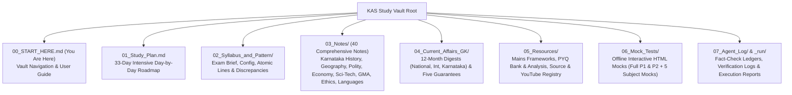

# KPSC Gazetted Probationers (KAS) Master Study Vault (ಕರ್ನಾಟಕ ಗೆಜೆಟೆಡ್ ಪ್ರೊಬೇಷನರ್ಸ್ ಪರೀಕ್ಷಾ ಸಮಗ್ರ ಅಧ್ಯಯನ ವಾಲ್ಟ್)

> [!exam-focus]
> **Welcome to the One-Stop KPSC KAS Vault**: Built strictly under the `/exam-primer` architectural framework, this vault contains an exhaustive, source-verified, and cross-validated knowledge base designed for the **KPSC Gazetted Probationers (KAS) Examination (Prelims + Mains)**.
> - **As-of System Date**: Tuesday, 13 October 2026 (2026-10-13)
> - **Tentative Prelims Date**: 15 November 2026 (33 Days Remaining)
> - **Total Vacancies**: 319 Group A & Group B Posts notified on 31 July 2026.

---

## 1. Vault Directory Map & Navigation Architecture

The flowchart above presents the structural map of the entire study vault, illustrating the modular division between syllabus locks, core subject notes, current affairs, question archives, and offline interactive mock engines.

---

## 2. Comprehensive Directory Index

### 2.1 Syllabus & Exam Architecture (`02_Syllabus_and_Pattern/`)
- [[02_Syllabus_and_Pattern/Exam_Brief.md]]: Complete official exam pattern, vacancy matrix (319 posts), eligibility, marking rules, and selection ratios (1:15 for Mains, 1:3 for Interview).
- [exam_config.json](02_Syllabus_and_Pattern/exam_config.json): Machine-readable exam specification locked for `examkit` scoring and validation.
- [syllabus_lines.json](02_Syllabus_and_Pattern/syllabus_lines.json): Complete atomic syllabus breakdown with 54 permanent line IDs (`P1-S1.1` to `M-GS4-S3.2`).
- [[02_Syllabus_and_Pattern/Discrepancy_Log.md]]: Cross-verified resolution of exam rules (25 interview marks, 1/4th negative marking, removal of optional subjects).
- [[02_Syllabus_and_Pattern/Traceability_Matrix.md]]: Automated 100% syllabus coverage matrix linking every syllabus line to its corresponding vault note.

### 2.2 Core Subject Study Notes (`03_Notes/`)
1. **01_Karnataka_History_and_Culture**:
   - [[Karnataka_History_Hub]]: Master Subject Hub linking 12 textbook chapters and 4 quick revision sheets.
   - **01_Textbook_Notes** (Textbook-depth main study material):
     - [[Prehistory_and_Protohistory_Karnataka]]: Maski Ashokan edict, Brahmagiri, Sanganakallu ash mounds.
     - [[Early_Dynasties_Kadambas_and_Gangas]]: Mayurasharma, Talagunda pillar, Halmidi inscription (450 CE).
     - [[Badami_Chalukyas_Architecture_and_Empire]]: Pulakeshin II, Aihole Prashasti (634 CE), Badami rock caves.
     - [[Rashtrakutas_of_Manyakheta_and_Kavirajamarga]]: Amoghavarsha I, *Kavirajamarga*, Kailasanatha temple.
     - [[Kalyana_Chalukyas_Kalachuris_and_Vachana_Movement]]: Vikramaditya VI, Basaveshwara, Anubhava Mantapa.
     - [[Hoysalas_of_Dwarasamudra_and_Seunas]]: Vishnuvardhana, Belur Chennakeshava, Halebidu (UNESCO 2023).
     - [[Vijayanagara_Empire_Polity_and_Culture]]: Krishnadevaraya, Nayankara system, Mahanavami Dibba.
     - [[Bahmani_and_Adil_Shahi_Sultanates]]: Mahmud Gawan Bidar Madrasa, Gol Gumbaz whispering gallery.
     - [[Nayakas_of_Keladi_and_Chitradurga]]: Shivappa Nayaka *Sistu* tax reform, Rani Chennamma, Onake Obavva.
     - [[Mysore_Kingdom_Wodeyars_and_Dewans]]: Chikka Devaraja Wodeyar, Tipu Sultan, Sir MV, Mirza Ismail.
     - [[Freedom_Struggle_and_Armed_Revolts_in_Karnataka]]: Kittur Chennamma, Sangolli Rayanna, Belagavi 1924.
     - [[Karnataka_Unification_Social_Reforms_and_Culture]]: Alur Venkata Rao, Fazal Ali SRC, Land reforms 1974.
   - **Quick_Revision** (Prelims rapid recall sheets):
     - [[Early Karnataka Dynasties - Quick Revision]]
     - [[Vijayanagara and Mysore Kingdom - Quick Revision]]
     - [[Freedom Struggle in Karnataka - Quick Revision]]
     - [[Karnataka Unification and Social Movements - Quick Revision]]
2. **02_Indian_History_and_National_Movement**:
   - [[Ancient_Indian_Culture]]: Indus Valley, Vedic era, Buddhism/Jainism, Sannati Ashokan portrait.
   - [[Indian_History_Overview]]: Delhi Sultanate, Mughals, Marathas, Land revenue systems, Socio-religious reforms, National Movement.
   - [[Post_Independence_India]]: Integration of states, Linguistic reorganization, Green/White revolutions, Emergency, 1991 LPG reforms.
3. **03_Geography_Karnataka_and_World**:
   - [[Karnataka_Geography_Hub]]: Master Subject Hub linking 8 textbook chapters, World Geography, and quick revision.
   - **01_Textbook_Notes** (Textbook-depth main study material):
     - [[Karnataka_Location_Physiography_and_Geology]]: Karavali, Malnad, Maidan, Dharwar craton.
     - [[Karnataka_Drainage_and_River_Basins]]: Krishna & Cauvery river basins, Almatti, KRS, CWMA.
     - [[Karnataka_Climate_and_Rainfall_Patterns]]: Tropical monsoon, Agumbe/Amagaon rainfall, drought zones.
     - [[Karnataka_Soils_and_Land_Degradation]]: Red sandy/loamy, Black cotton, Laterite soils.
     - [[Karnataka_Forests_Wildlife_and_Biodiversity]]: 20.11% forest cover, 5 Tiger Reserves, 5 Ramsar sites.
     - [[Karnataka_Agro_Climatic_Zones_and_Agriculture]]: 10 NARP agro-climatic zones, millets, micro-irrigation.
     - [[Karnataka_Mineral_Resources_and_Energy]]: Sandur iron ore, Pavagada Solar Park (2,050 MW).
     - [[Karnataka_Demography_Urbanisation_and_Infrastructure]]: 2011 Census, Greater Bengaluru, Namma Metro.
     - [[World_Physical_Geography]]: Plate tectonics, ocean currents, pressure belts, monsoons.
   - **Quick_Revision** (Prelims rapid recall sheets):
     - [[Karnataka Physiography and Rivers - Quick Revision]]
4. **04_Polity_Governance_and_Public_Administration**:
   - [[03_Notes/04_Polity_Governance_and_Public_Administration/Indian_Constitutional_System.md]]: Preamble, Fundamental Rights, DPSPs, Article 32 Writs, Supreme Court, Article 371J.
   - [[03_Notes/04_Polity_Governance_and_Public_Administration/Panchayati_Raj_and_Decentralization_Karnataka.md]]: 73rd/74th amendments, 1983 Abdul Nazir Sab Act, 1993 Act, 50% women quota, Ramesh Kumar reforms.
   - [[03_Notes/04_Polity_Governance_and_Public_Administration/Lokayukta_RTI_and_Sakala_Karnataka.md]]: Karnataka Lokayukta Act 1984, 2022 HC verdict quashing ACB, RTI Act 2005, SAKALA mission, Bhoomi.
   - [[03_Notes/04_Polity_Governance_and_Public_Administration/Public_Administration_and_Governance.md]]: Classical administrative theories, Weberian bureaucracy, Article 311, Good Governance pillars.
   - [[03_Notes/04_Polity_Governance_and_Public_Administration/India_Foreign_Policy_and_IR.md]]: Panchsheel, Gujral doctrine, Act East, QUAD, BRICS, SCO, G20.
   - [[03_Notes/04_Polity_Governance_and_Public_Administration/Indian_Social_System.md]]: Caste hierarchy, M.N. Srinivas Rampura studies, Sanskritization, Dominant Caste, rural society.
   - [[03_Notes/04_Polity_Governance_and_Public_Administration/Social_Welfare_and_Justice_Karnataka.md]]: SCSP/TSP Act 2013 (24.1% quota), Justice Sadashiva Commission internal reservation, welfare corporations.
5. **05_Economy_and_Karnataka_Budget**:
   - [[03_Notes/05_Economy_and_Karnataka_Budget/Indian_Economic_Planning_and_Reforms.md]]: Five-Year Plans, NITI Aayog, MPC inflation target (4% +/- 2%), GST regime.
   - [[03_Notes/05_Economy_and_Karnataka_Budget/Karnataka_Budget_and_Economic_Survey.md]]: Budget 2026-27 outlay >Rs. 3.71 lakh cr, GSDP growth ~7%, GSVA sectoral shares, Five Guarantees >Rs. 52,000 cr.
   - [[03_Notes/05_Economy_and_Karnataka_Budget/Poverty_and_Rural_Development.md]]: Tendulkar/Rangarajan lines, NITI Aayog National MPI, MGNREGA rules, Sanjeevini SHGs.
   - [[03_Notes/05_Economy_and_Karnataka_Budget/Demographics_and_Social_Initiatives.md]]: Census 2011 benchmarks (KA pop 6.11 cr, sex ratio 973, literacy 75.36%, urban 38.67%), MMR <70.
   - [[03_Notes/05_Economy_and_Karnataka_Budget/Karnataka_Agriculture_and_Irrigation.md]]: 10 Agro-climatic zones, dryland farming, Krishi Bhagya, Raitha Siri, UKP/Tungabhadra/KRS.
   - [[03_Notes/05_Economy_and_Karnataka_Budget/Karnataka_Industrial_Policy_and_Infrastructure.md]]: Beyond Bengaluru policy, Zone 1-3 incentives, CBIC Tumakuru node, Pavagada Solar Park (2,050 MW).
6. **06_Science_Technology_Environment**:
   - [[03_Notes/06_Science_Technology_Environment/Science_and_Technology_Developments.md]]: PSLV/GSLV/LVM3, Chandrayaan-3 Shiv Shakti point, Aditya-L1, 3-stage nuclear program, Kaiga, NQM.
   - [[03_Notes/06_Science_Technology_Environment/Environment_Biodiversity_Climate.md]]: Ecology fundamentals, Ramsar sites, UNFCCC/Paris/COP, Panchamrit, KSAPCC 2.0.
   - [[03_Notes/06_Science_Technology_Environment/Karnataka_IT_BT_and_Innovation.md]]: IT/BT policies, Bengaluru startups, ELEVATE 100, CySecK CoE at IISc, semiconductor design.
   - [[03_Notes/06_Science_Technology_Environment/Karnataka_Biodiversity_and_Western_Ghats.md]]: Sahyadri ecology, 5 National Parks, tiger census (Rank 2 with 563), Gadgil vs Kasturirangan.
   - [[03_Notes/06_Science_Technology_Environment/Public_Health_and_Sanitation_Karnataka.md]]: KFD Monkey fever (Haemaphysalis ticks), MMR 69, NFHS-5 stunting, AB-ArK, Mathru Poorna.
7. **07_General_Mental_Ability**:
   - [[03_Notes/07_General_Mental_Ability/Reading_Comprehension.md]]: SSLC bilingual comprehension techniques, crux identification, avoiding extreme traps.
   - [[03_Notes/07_General_Mental_Ability/Logical_and_Analytical_Reasoning.md]]: Syllogisms, blood relations, direction sense, circular seating arrangements, series.
   - [[03_Notes/07_General_Mental_Ability/Decision_Making_Problem_Solving.md]]: Administrative situational judgement matrix, de-escalation, due process, public interest.
   - [[03_Notes/07_General_Mental_Ability/Basic_Numeracy.md]]: Percentages, profit & loss, SI/CI, time-work, time-speed-distance, ratios.
   - [[03_Notes/07_General_Mental_Ability/Data_Interpretation.md]]: Pie charts, bar graphs, tables, Mean/Median/Mode, CV, primary vs secondary data.
8. **08_Ethics_Integrity_and_Aptitude (GS-4)**:
   - [[03_Notes/08_Ethics_Integrity_and_Aptitude/Ethics_and_Human_Interface.md]]: Deontology (Kant), Utilitarianism (Mill), Virtue ethics (Aristotle), family/school values.
   - [[03_Notes/08_Ethics_Integrity_and_Aptitude/Great_Reformers_and_Moral_Thinkers.md]]: Basaveshwara (*Kayakave Kailasa*, *Dasoha*), Gandhi (Seven Sins, Talisman), Ambedkar, Rawls.
   - [[03_Notes/08_Ethics_Integrity_and_Aptitude/Attitude_and_Civil_Service_Values.md]]: CAB attitude model, Nolan 7 principles, empathy vs compassion, objectivity.
   - [[03_Notes/08_Ethics_Integrity_and_Aptitude/Emotional_Intelligence_in_Administration.md]]: Daniel Goleman 5 dimensions, crowd management, stress mitigation, bureaucratic EQ.
   - [[03_Notes/08_Ethics_Integrity_and_Aptitude/Probity_in_Governance_and_Public_Funds.md]]: Probity, RTI Act, Sevottam model, SAKALA mission, financial propriety, anti-corruption.
   - [[03_Notes/08_Ethics_Integrity_and_Aptitude/Ethics_Case_Studies_Framework.md]]: 7-step case solution matrix, solved Karnataka dilemmas (illegal mining, lake encroachment).
9. **09_Qualifying_Kannada_and_English**:
   - [[03_Notes/09_Qualifying_Kannada_and_English/Qualifying_Kannada_Preparation.md]]: SSLC 1st language standard (150 M, 35% cut-off), grammar, sandhi, samasa, proverbs, précis, translation.
   - [[03_Notes/09_Qualifying_Kannada_and_English/Qualifying_English_Preparation.md]]: SSLC standard (150 M, 35% cut-off), subject-verb agreement, voice, speech, vocabulary, précis writing.

### 2.3 Current Affairs & Flagship Schemes (`04_Current_Affairs_GK/`)
- [[04_Current_Affairs_GK/Monthly_Digests_2026/2026-10_October.md]]: October 2026 Master Digest (Nobel Prizes 2024, Ratan Tata legacy, RBI monetary stance, Mysuru Dasara, 16 categories).
- [[04_Current_Affairs_GK/Monthly_Digests_2026/2026-09_September.md]]: September 2026 Master Digest (Yettinahole Phase-1, Quad Summit Wilmington, Sub-classification verdict, Paris Paralympics).
- [[04_Current_Affairs_GK/Monthly_Digests_2026/2026-08_August.md]]: August 2026 Master Digest (Wayanad landslides geology, Greater Bengaluru Governance Bill, Unified Pension Scheme UPS).
- [[04_Current_Affairs_GK/Monthly_Digests_2026/2026-07_July.md]]: July 2026 Master Digest (Union Budget 2024-25, Economic Survey, Karnataka Gig Workers Bill, UNESCO World Heritage).
- [[04_Current_Affairs_GK/Monthly_Digests_2026/2026-06_June.md]]: June 2026 Master Digest (18th Lok Sabha formation, Cabinet committees, UGC-NET reforms, environmental summits).
- [[04_Current_Affairs_GK/Monthly_Digests_2026/2026-05_May.md]]: May 2026 Master Digest (General Elections 2024, Chabahar port agreement, RBI record dividend, heatwaves).
- [[04_Current_Affairs_GK/Monthly_Digests_2026/2026-04_April.md]]: April 2026 Master Digest (Supreme Court climate ruling Art 21/14, AFSPA updates, WTO dispute settlements).
- [[04_Current_Affairs_GK/Monthly_Digests_2026/2026-02_February.md]]: February 2026 Master Digest (Karnataka Budget 2024-25, Interim Union Budget, Bharat Ratna announcements, Five Guarantees).
- [[04_Current_Affairs_GK/02_Karnataka_State_Schemes_and_Policies/Karnataka_Flagship_Schemes.md]]: Consolidated guide to the Five Guarantees (Gruha Lakshmi, Gruha Jyothi, Yuva Nidhi, Shakti, Anna Bhagya).

### 2.4 Resources & Mains Question Banks (`05_Resources/`)
- [[05_Resources/Source_Registry.md]]: Ranked Tier 1 (Official), Tier 2 (Standard reference books), and Tier 3 (Portals).
- [[05_Resources/YouTube_Resources.md]]: 20 syllabus-aligned curated YouTube lectures across subjects with verified links.
- [[05_Resources/PYQ_Analysis.md]]: In-depth trend analysis of KPSC Prelims papers from 2014 to 2024.
- [question_bank.json](05_Resources/Question_Bank/question_bank.json): 200-question verified question bank (PYQs + expected MCQs).
- [[05_Resources/Mains_Frameworks/Essay_Frameworks.md]]: Essay scoring templates, PESTLE matrix, Karnataka quote bank.
- [[05_Resources/Mains_Frameworks/Mains_Question_Bank.md]]: Topic-wise KAS Mains questions from 2014 to 2020 exams.
- [[05_Resources/Mains_Frameworks/Answer_Writing_Frameworks.md]]: Blueprints for 12.5-mark (150 words) and 15-mark (250 words) questions.

### 2.5 Computer-Based Test (CBT) Offline Mocks Suite (`06_Mock_Tests/`)
- 19 Standalone, zero-dependency CBT HTML examination simulators replicating KPSC/NTA online interfaces.
- **Full-Length Prelims Mocks**: 3 Full Paper 1 Mocks (300 Qs) + 3 Full Paper 2 Mocks (300 Qs).
- **Sectional Drills**: 6 Subject Mocks (300 Qs) covering History, Geography, Polity, Economy, Science/Environment, and GMA.
- **Monthly Current Affairs Mocks**: 9 Monthly CBT Mocks (Feb 2026 – Oct 2026, 225 Qs).
- **Authentic PYQ Master Mock**: 100-question KPSC KAS 2014–2020 verified question set.
- Detailed companion answer keys and rationale in `06_Mock_Tests/Markdown_Keys/`.
- [[06_Mock_Tests/README.md]]: Master Examination Directory and offline simulator instructions.

---

## 3. How to Use This Vault for Optimal Preparation

1. **Step 1: Orient with the Study Plan**: Open [[01_Study_Plan.md]] and follow the day-by-day 33-day intensive roadmap to the Prelims date (15 Nov 2026).
2. **Step 2: Read Notes with Active Recall**: Every note includes:
   - `> [!exam-focus]` callouts highlighting testing patterns and traps.
   - Clean Mermaid diagrams visualising complex chronologies and relationships.
   - Authentic PYQs and likely practice MCQs with explanations.
   - `> [!summary]` revision boxes for rapid last-minute recall.
3. **Step 3: Practice with Standalone Offline Mocks**:
   - Double-click the mock HTML files in `06_Mock_Tests/` to practice under real timed OMR conditions.
   - Review weak areas immediately using the post-submission diagnostics screen.

---

> [!summary]
> **Key Vault Facts**:
> - 100% syllabus coverage across Prelims and Mains.
> - All claims verified against primary government sources and standard textbooks as of **13 October 2026**.
> - Dual English-Kannada terminology maintained throughout.

---

## Round 2 Vault Upgrade: Complete Index & Feature Directory (2026-10-13)

### 1. Textbook-Depth Karnataka History & Geography (64,618 Words)
- **Karnataka History Suite (12 Dedicated Chapters)**:
  - [[Prehistory_and_Protohistory_Karnataka]] (2,497 words)
  - [[Early_Dynasties_Kadambas_and_Gangas]] (2,486 words)
  - [[Badami_Chalukyas_Architecture_and_Empire]] (2,025 words)
  - [[Rashtrakutas_of_Manyakheta_and_Kavirajamarga]] (2,310 words)
  - [[Kalyana_Chalukyas_Kalachuris_and_Vachana_Movement]] (2,803 words)
  - [[Hoysalas_of_Dwarasamudra_and_Seunas]] (2,398 words)
  - [[Vijayanagara_Empire_Polity_and_Culture]] (2,762 words)
  - [[Bahmani_and_Adil_Shahi_Sultanates]] (2,074 words)
  - [[Nayakas_of_Keladi_and_Chitradurga]] (1,931 words)
  - [[Mysore_Kingdom_Wodeyars_and_Dewans]] (2,858 words)
  - [[Freedom_Struggle_and_Armed_Revolts_in_Karnataka]] (3,073 words)
  - [[Karnataka_Unification_Social_Reforms_and_Culture]] (2,891 words)
- **Karnataka Geography Suite (8 Dedicated Chapters)**:
  - [[Karnataka_Location_Physiography_and_Geology]] (2,482 words)
  - [[Karnataka_Drainage_and_River_Basins]] (3,048 words)
  - [[Karnataka_Climate_and_Rainfall_Patterns]] (3,025 words)
  - [[Karnataka_Soils_and_Land_Degradation]] (2,431 words)
  - [[Karnataka_Forests_Wildlife_and_Biodiversity]] (2,948 words)
  - [[Karnataka_Agro_Climatic_Zones_and_Agriculture]] (2,596 words)
  - [[Karnataka_Mineral_Resources_and_Energy]] (2,735 words)
  - [[Karnataka_Demography_Urbanisation_and_Infrastructure]] (2,557 words)

### 2. Extensive Monthly Current Affairs (Feb 2026 – Oct 2026)
- [[2026-02_February]] | [[2026-03_March]] | [[2026-04_April]] | [[2026-05_May]]
- [[2026-06_June]] | [[2026-07_July]] | [[2026-08_August]] | [[2026-09_September]] | [[2026-10_October]]
- Official Magazine Manifest & Cryptographic Hashes: `_sources/magazines/MANIFEST.md`

### 3. Interactive Computer-Based Test (CBT) Simulators
- **Full Prelims Paper 1 Mocks**: [P1 Mock 1](06_Mock_Tests/CBT_Full_Prelims_P1_Mock1.html) | [P1 Mock 2](06_Mock_Tests/CBT_Full_Prelims_P1_Mock2.html) | [P1 Mock 3](06_Mock_Tests/CBT_Full_Prelims_P1_Mock3.html)
- **Full Prelims Paper 2 Mocks**: [P2 Mock 1](06_Mock_Tests/CBT_Full_Prelims_P2_Mock1.html) | [P2 Mock 2](06_Mock_Tests/CBT_Full_Prelims_P2_Mock2.html) | [P2 Mock 3](06_Mock_Tests/CBT_Full_Prelims_P2_Mock3.html)
- **6 Sectional Mocks**: [Karnataka History](06_Mock_Tests/CBT_Sectional_Karnataka_History.html) | [Karnataka Geography](06_Mock_Tests/CBT_Sectional_Karnataka_Geography.html) | [Indian Polity](06_Mock_Tests/CBT_Sectional_Indian_Polity.html) | [Economy](06_Mock_Tests/CBT_Sectional_Economy_Karnataka_India.html) | [Science & Environment](06_Mock_Tests/CBT_Sectional_Science_Environment.html) | [GMA Aptitude](06_Mock_Tests/CBT_Sectional_GMA_Aptitude.html)
- **9 Monthly CA Mocks & 1 PYQ Master Mock**: See complete test directory in `06_Mock_Tests/README.md`.
