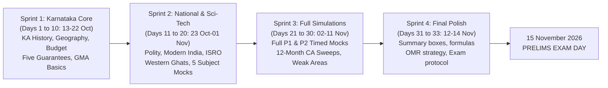

# 33-Day Intensive KPSC KAS Study Plan (೩೩ ದಿನಗಳ ತೀವ್ರಗತಿಯ ಕೆಪಿಎಸ್‌ಸಿ ಕೆಎಎಸ್ ಅಧ್ಯಯನ ಯೋಜನೆ)

> [!exam-focus]
> **Actionable Target**: Designed for the candidate preparing for the **KPSC Gazetted Probationers Preliminary Examination scheduled on 15 November 2026 (~33 Days Remaining)**.
> - **Daily Study Commitment**: 8 to 10 Hours daily, partitioned into:
>   - *Slot 1 (3 Hours - Morning)*: Core Static GS (Karnataka History, Polity, Geography, Economy).
>   - *Slot 2 (2 Hours - Midday)*: General Mental Ability (GMA problem solving & formulas).
>   - *Slot 3 (2 Hours - Afternoon)*: Current Affairs & Karnataka State Programmes (Five Guarantees & Budget).
>   - *Slot 4 (2 Hours - Evening)*: Mock Test Drills, PYQ Practice & Error Log Review.
>   - *Slot 5 (1 Hour - Night)*: Mains Foundation (Ethics case study or Essay brainstorming).

---

## 1. The Four-Sprint Periodization

The flowchart above outlines the 4 progressive preparation sprints leading up to the examination day.

---

## 2. Sprint 1: Karnataka Core & Quantitative Foundations (Days 1 to 10: 13 Oct – 22 Oct 2026)

| Day & Date | Morning (Static GS) | Midday (Mental Ability) | Afternoon (State Schemes & CA) | Evening & Night (Drills & Mains) |
|---|---|---|---|---|
| **Day 1 (13 Oct)** | Early Karnataka Dynasties (Kadambas, Gangas, Badami Chalukyas) | Reading Comprehension (Bilingual passage techniques) | Karnataka Flagship Schemes (Gruha Lakshmi & Gruha Jyothi) | PYQ Analysis review; Essay Hook brainstorming |
| **Day 2 (14 Oct)** | Rashtrakutas, Kalyana Chalukyas & Hoysalas | Syllogisms & Venn Diagrams (AEIO rules) | Yuva Nidhi, Shakti & Anna Bhagya operational rules | 20 History PYQs; Ethics (Basaveshwara's Kayaka) |
| **Day 3 (15 Oct)** | Vijayanagara Empire & Bahmani/Sultanate Kingdoms | Blood Relations & Direction Sense Tests | Karnataka Budget 2026-27 (Outlay & Sectoral allocations) | Vijayanagara PYQs; Essay on Heritage preservation |
| **Day 4 (16 Oct)** | Mysore Kingdom, Keladi Nayakas, Tipu Sultan & Dewans | Linear & Circular Seating Arrangements | Economic Survey of Karnataka (GSDP growth, GSVA shares) | Modern Mysore PYQs; Nolan Committee Principles |
| **Day 5 (17 Oct)** | Armed Rebellions in KA (Chennamma, Rayanna, Bedas) | Number Systems, Divisibility, LCM & HCF | Krishi Bhagya, Raitha Siri & Dryland Agriculture | Armed revolt PYQs; Ethics (Categorical Imperative) |
| **Day 6 (18 Oct)** | Belagavi 1924, Vidurashwatha & Quit India in Karnataka | Percentages, Profit and Loss calculations | Karnataka Industrial Policy 2020-25 & 'Beyond Bengaluru' | Unification timeline; Essay on Regional Imbalance |
| **Day 7 (19 Oct)** | Karnataka Unification Movement & Social Movements (DSS/KRRS)| Simple Interest & Compound Interest ($P(R/100)^2$) | Karnataka Platform Gig Workers Bill & Greater Bengaluru Bill | 30 GMA questions; Ethics (Trusteeship) |
| **Day 8 (20 Oct)** | Karnataka Physiography (Coastal, Malnad, Maidan zones) | Time and Work (Unit efficiency method) | Demographics & Census 2011 (Karnataka indicators) | Physiography map quiz; Solved Case Study 1 |
| **Day 9 (21 Oct)** | River Systems (Krishna & Cauvery basins, KWDT/CWMA) | Time, Speed and Distance (Relative speeds, km/h to m/s) | Poverty & Rural Development (MPI, MGNREGA rules) | River basin disputes; Answer outline (12.5M) |
| **Day 10 (22 Oct)** | **Checkpoint Revision**: Revise all Karnataka History notes | **Diagnostic Drill**: `Subject_Mock_General_Mental_Ability.html` | Revise Five Guarantees and Budget highlights | Take `Subject_Mock_Karnataka_Affairs.html` (30 Qs) |

---

## 3. Sprint 2: National Core, Science & Ecology (Days 11 to 20: 23 Oct – 01 Nov 2026)

| Day & Date | Morning (Static GS) | Midday (Mental Ability) | Afternoon (National/Global CA) | Evening & Night (Drills & Mains) |
|---|---|---|---|---|
| **Day 11 (23 Oct)** | Ancient Indian Culture (Indus Valley, Vedic, Sannati Ashoka) | Data Interpretation (Pie charts, degree-percentage) | National Current Affairs (BNS, BNSS, BSA criminal laws) | Ancient History PYQs; Ethics (Ambedkar) |
| **Day 12 (24 Oct)** | Medieval India (Delhi Sultanate, Mughals, Shivaji) | DI (Bar charts, Histograms, Line graphs) | New Laws & Constitutional 106th Amendment (Women Quota) | Medieval India PYQs; Essay on Federalism |
| **Day 13 (25 Oct)** | Modern India: 1857 Revolt to Moderate & Extremist phase | Statistical Measures (Mean, Median, Mode, CV) | International Summits (BRICS 10-member expansion, G20 AU) | Freedom struggle PYQs; Nolan Principles |
| **Day 14 (26 Oct)** | Gandhian Phase (Non-Cooperation, Civil Disobedience, Quit India)| Decision Making & Problem Solving Scenarios | Trade Pacts (India-EFTA TEPA, IMEC Corridor, COP28/29) | Modern History PYQs; Solved Case Study 2 |
| **Day 15 (27 Oct)** | Indian Constitution: Preamble, Fundamental Rights, Writs | Decision Making Matrix (Administrative legality) | Defense Milestones (Mission Divyastra, INS Arighat) | Constitution Articles drill; Essay (Digital divide) |
| **Day 16 (28 Oct)** | Article 371J & Panchayati Raj (Abdul Nazir Sab Act) | Speed Math & Arithmetic shortcut practice | Science & Tech (ISRO LVM3, Chandrayaan-3, Aditya-L1) | Article 371J PYQs; Ethics (Sevottam model) |
| **Day 17 (29 Oct)** | Karnataka Lokayukta, RTI Act 2005 & SAKALA Mission | Logical Reasoning Mixed Practice (25 Qs) | 3-Stage Nuclear Programme, Kaiga, IndiaAI Mission | Governance PYQs; SAKALA model answer |
| **Day 18 (30 Oct)** | Western Ghats Ecology, 5 NPs, 5 Tiger Reserves, Ramsar Sites | GMA Problem Solving Weak Area Drill | Environmental Conventions (UNFCCC, Ramsar 85, CITES) | Ecology quiz; Gadgil vs Kasturirangan |
| **Day 19 (31 Oct)** | Public Health (KFD Monkey Fever, MMR 69, NFHS-5) | GMA Speed Drill (30 questions in 35 mins) | National Quantum Mission, Semiconductor Fabs | Health indicators review; Ethics (Compassion) |
| **Day 20 (01 Nov)** | **Rajyotsava Checkpoint**: Revise entire Polity & Geography | **Diagnostic Drill**: `Subject_Mock_Humanities.html` | Revise 12-Month National/Global Current Affairs | Take `Subject_Mock_Current_Affairs.html` (30 Qs) |

---

## 4. Sprint 3: Full-Length Exam Simulations (Days 21 to 30: 02 Nov – 11 Nov 2026)

| Day & Date | Morning (10:00 AM - 12:00 PM) | Midday (Review & Fix) | Afternoon (02:00 PM - 04:00 PM) | Night (Consolidation) |
|---|---|---|---|---|
| **Day 21 (02 Nov)** | **Full Mock 1 - Paper 1**: `Full_Prelims_P1_Mock1.html` | Analyze Paper 1 incorrect answers; mark weak topics | Subject Drill: `Subject_Mock_Science_and_Environment.html` | Flashcard review of wrong answers |
| **Day 22 (03 Nov)** | Revision: Karnataka History Dynasties & Inscriptions | GMA Timed Practice (Divisibility & Permutations) | **Full Mock 1 - Paper 2**: `Full_Prelims_P2_Mock1.html` | Analyze Paper 2 incorrect answers |
| **Day 23 (04 Nov)** | Revise Indian Freedom Struggle & Gandhi Sessions | Revise Blood Relations & Circular Seating | Sweep: 12-Month Karnataka Current Affairs (Prajavani) | Re-attempt weak questions from Mock 1 |
| **Day 24 (05 Nov)** | Revise Karnataka Geography & River Disputes | Revise Time-Work & Average Speed formulas | Sweep: 12-Month National Current Affairs (PIB) | Review Discrepancy Log (25 marks interview) |
| **Day 25 (06 Nov)** | Revise Constitution Articles, Writs & 73rd Amendment | Revise Pie Chart angle-percent conversions | Sweep: Five Guarantees rules & Cabinet resolutions | Review negative marking decision tree |
| **Day 26 (07 Nov)** | Revise Budget 2026-27 & Economic Survey Figures | Revise Syllogisms & Either-Or conditions | Sweep: ISRO missions & Western Ghats protected areas | High-yield fact-check ledger sweep |
| **Day 27 (08 Nov)** | **Dress Rehearsal**: Re-take Paper 1 Mock (Target: >125 M) | Scorecard review & time management check | **Dress Rehearsal**: Re-take Paper 2 Mock (Target: >135 M) | Total composite score target >260 M |
| **Day 28 (09 Nov)** | Deep Review: Ancient & Medieval Karnataka Dynasties | Formula Revision: CI/SI, Time-Distance, Ratios | Deep Review: KFD, NFHS-5, Ramsar 4 Karnataka sites | Note down top 50 volatile facts |
| **Day 29 (10 Nov)** | Deep Review: Karnataka Unification & Devaraj Urs reforms| GMA Quick 20-Question Sprint | Deep Review: Yettinahole, Hoysala UNESCO, Sammelana | Revise proverbs & vocabulary |
| **Day 30 (11 Nov)** | Deep Review: Indian Polity, SCSP/TSP & Sadashiva Report| Rest and mental calm | Final rapid sweep of Current Events 2025-2026 | Pack exam kit, hall ticket verification |

---

## 5. Sprint 4: Final 72 Hours & Exam Day Protocol (Days 31 to 33: 12 Nov – 14 Nov 2026)

### Day 31 (12 Nov 2026 - 72 Hours Out):
- Read only the `> [!summary]` quick revision boxes from all 40 notes in `03_Notes/`.
- Review the 20 High-Yield Karnataka Dynasties, Inscriptions, and Rivers.
- Review Five Guarantees eligibility conditions and budget figures.

### Day 32 (13 Nov 2026 - 48 Hours Out):
- Review General Mental Ability formula sheet: Divisibility rules, Pythagoras theorem, CI/SI differences, Pie chart formulas.
- Review New Criminal Laws dates (1 July 2024), Bharat Ratna 5 recipients, and Ramsar 4 Karnataka sites.
- Avoid solving brand new difficult mock tests to protect psychological confidence.

### Day 33 (14 Nov 2026 - Exam Eve):
- Light revision until 5:00 PM; relax and rest in the evening.
- Confirm examination center, hall ticket printouts (2 copies), original photo ID (Aadhaar / Voter ID), blue/black ballpoint pens.
- Sleep for at least 7–8 hours.

### Exam Day (15 November 2026 - Sunday):
- **Paper 1 (10:00 AM - 12:00 PM)**:
  - First Pass (0-60 mins): Solve all 100% sure questions (aim for 50-60 questions).
  - Second Pass (60-100 mins): Solve 50-50 eliminated questions (aim for 25-30 questions).
  - Final Pass (100-120 mins): Final bubbling verification; leave zero-knowledge questions blank.
- **Intermission (12:00 PM - 02:00 PM)**: Hydrate, light meal, stay calm, avoid post-exam debates with other candidates.
- **Paper 2 (02:00 PM - 04:00 PM)**:
  - Start with Section 1 (Karnataka Programmes: rapid scoring).
  - Move to Section 2 (Science & Ecology: direct facts).
  - Allocate a dedicated 45–50 minutes to Section 3 (General Mental Ability: steady calculations, zero silly errors).

---

> [!summary]
> **Key Strategy Mantras**:
> - Consistency over cramming: 8-10 focused hours daily beats erratic all-nighters.
> - Karnataka weightage is king: Master Kamath's history, state schemes, and Western Ghats ecology.
> - Respect negative marking: Eliminate two options before taking calculated risks.
> - Trust your preparation: You have an exhaustive, verified vault behind you.
