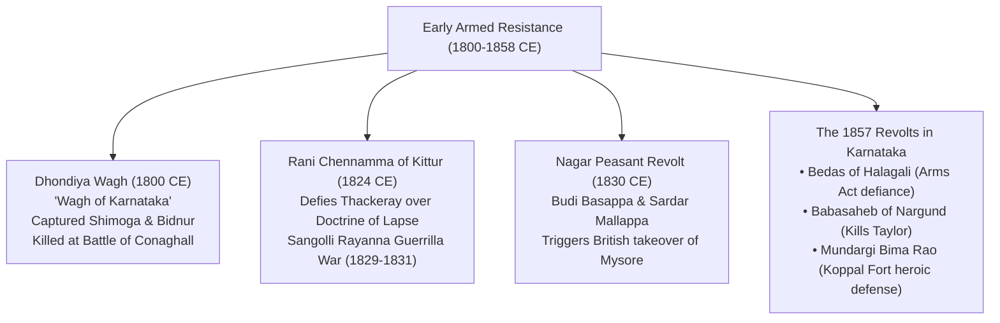
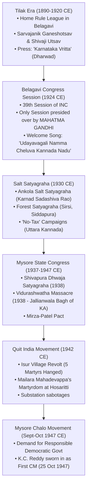
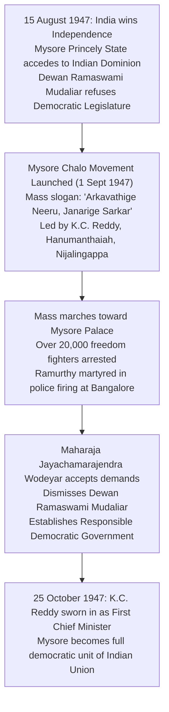

# The Freedom Struggle and Armed Revolts in Karnataka (ಕರ್ನಾಟಕದಲ್ಲಿ ಸ್ವಾತಂತ್ರ್ಯ ಸಂಗ್ರಾಮ ಮತ್ತು ಸಶಸ್ತ್ರ ಬಂಡಾಯಗಳು: ೧೮೦೦-೧೯೪೭)

> [!exam-focus]
> **KPSC High-Yield Examination Focus**:
> - **Early Armed Resistance**:
>   - **Rani Chennamma of Kittur (1824 CE)**: Armed revolt rejecting the Doctrine of Lapse; death of British Collector Thackeray; Bailhongal imprisonment.
>   - **Sangolli Rayanna (1829-1831 CE)**: Master of indigenous guerrilla warfare; hanged on a banyan tree at Nandagad (26 Jan 1831).
>   - **Bedas of Halagali (1857 CE)**: Resistance against the Indian Arms Disarmament Act 1857; massacre of indigenous hunter-warriors.
>   - **Dhondiya Wagh (1800 CE)**, **Babasaheb of Nargund (1858 CE)**, **Mundargi Bima Rao (1858 CE)** at Koppal fort.
> - **Gandhian Era & Congress Sessions**:
>   - **Belagavi Congress Session (1924 CE)**: 39th Session of INC; **only session presided over by Mahatma Gandhi**; Gangadhar Rao Deshpande titled "Lion of Karnataka"; welcome song *Udayavagali Namma Cheluva Kannada Nadu* by Huilgol Narayana Rao.
> - **Salt Satyagraha (1930 CE)**: **Ankola Salt Satyagraha** (13 April 1930) led by Karnad Sadashiva Rao and Hardekar Manjappa ("Karnataka Gandhi"); coastal women leadership under Umabai Kundapur and Kamaladevi Chattopadhyay.
> - **Forest Satyagraha**: Sirsi, Siddapura, and Sagar peasant resistance against colonial forest laws.
> - **Vidurashwatha Massacre (25 April 1938 CE)**: Known as the **"Jallianwala Bagh of Karnataka"**; police firing killed 32 peaceful flag satyagrahis in Gowribidanur taluk; mediated by Sardar Vallabhbhai Patel (Mirza-Patel Pact).
> - **Shivapura Dhwaja Satyagraha (April 1938 CE)**: Defiance of flag ban at Maddur led by T. Siddalingaiah.
> - **Quit India Movement (1942 CE)**:
>   - **Isur Village Revolt (Shivamogga)**: Declaration of independent village republic (*"Esuru Kottaru, Isuru Kodevu"*); five martyrs hanged: Gurappa, Mallappa, Suryanarayanachari, Halappa, and Shankarappa.
>   - **Mailara Mahadevappa**: Dandi marcher from Haveri; martyred in police firing at Hosaritti treasury raid (1943).
> - **Mysore Chalo Movement (September 1947 CE)**: Mass agitation demanding responsible democratic government in Mysore State; installation of K.C. Reddy as first Chief Minister (25 Oct 1947).

---

## 1. Early Armed Revolts Against the British (1800–1858 CE)

Long before the national uprising of 1857, Karnataka witnessed fiercely contested local armed insurrections against the East India Company's military and administrative expansion.

### 1.1 Rani Chennamma of Kittur (1824 CE)
- **Background**: Following the death of Raja Mallasarja and his son Shivalingarudra Sarja without biological male issue, Queen **Chennamma** adopted young Shivalingappa to preserve the independence of the Kittur principality (Belagavi district).
- **The British Ultimatum**: John Thackeray, British Political Agent and Collector of Dharwad, invoked an early precursor to the Doctrine of Lapse, declaring the adoption invalid and attempting to take over the royal treasury.
- **The Battle of Kittur (23 October 1824 CE)**:
  - Thackeray attacked the fort. Kittur forces, led by Chennamma, Gurusiddappa, and Amatya Balappa, mounted a ferocious defense.
  - Thackeray was shot dead by Amatya Balappa, and two British officers (Stevenson and Elliot) were captured as hostages.
  - Chennamma released the hostages upon British promises of peace, but British reinforcements under Commissioner Chaplin returned with massive artillery in December 1824.
  - Through the treachery of internal traitors (Kanagale and Mallappa Shetty, who adulterated the fort's gunpowder with cow dung), Kittur fell.
  - Rani Chennamma was captured and imprisoned in the fortress of **Bailhongal**, where she passed away in captivity on 2 February 1829.

### 1.2 Sangolli Rayanna (1798–1831 CE) — Guerrilla General
- **Warrior Background**: Loyal commander (*Shetsanadi*) of the Kittur army belonging to the Kuruba community from Sangolli village.
- **The Resistance (1829–1831 CE)**:
  - Following Chennamma's capture, Rayanna organized the dispossessed peasants, Bedas, and Shetsanadis into an underground guerrilla army.
  - Crowned adopted prince Shivalingappa as the rightful king of Kittur.
  - Operated from the dense jungles of Khanapur, executing lightning strikes: burned British revenue taluk offices at Bidi and Sampgaon, intercepted British military supply trains, and redistributed seized treasury funds to starving peasants.
- **Betrayal and Martyrdom**:
  - The British, unable to capture him in open combat, bribed local collaborators (Lakshman Rao and Linganagouda of Channamma Kittur).
  - Rayanna was ambushed unarmed while taking a ritual bath in a stream near Dori Benachi.
  - Tried by a British military tribunal and hanged on a banyan tree at **Nandagad** on **26 January 1831**. His close associate Bichugatti Channabasappa planted a banyan sapling over his samadhi, which stands today as a national pilgrimage shrine.

### 1.3 The Bedas of Halagali: Disarmament Rebellion (1857 CE)
- **Context**: In 1857, the British enacted the **Indian Arms Act**, ordering all native subjects to surrender their personal weapons or face execution.
- **The Revolt**: The hunter-gatherer **Beda (Valmiki)** community of Halagali village (in Mudhol princely state, Bagalkote) refused to surrender their rifles, bows, and hunting spears, which they revered as symbols of manhood and religious worship (*Ayudha Puja*).
- **The Battle (November 1857 CE)**: Led by heroes **Jadiga, Baala, and Rama**, the Bedas routed British cavalry units sent to disarm them.
- **The Massacre**: Colonel Malcolm surrounded Halagali with heavy British forces, set fire to the village dwellings, and killed hundreds of Bedas in close-quarter combat. Nineteen captured leaders were publicly hanged at the market square of Mudhol on 14 December 1857.

### 1.4 Babasaheb of Nargund and Mundargi Bima Rao (1858 CE)
1. **Babasaheb of Nargund (Bhaskar Rao Bhave)**:
   - When the British denied him permission to adopt an heir and ordered him to surrender his artillery, he allied with the 1857 national rebellion.
   - Ambushe d and killed British Officer C.J. Manson near Sureban; Manson's head was suspended over the gateway of Nargund fort. Captured and publicly executed at Belagavi in June 1858.
2. **Mundargi Bima Rao (ಮುಂಡರಗಿ ಭೀಮರಾವ್)**:
   - Hereditary revenue officer (*Tahsildar*) of Harapanahalli; joined the revolt alongside Beda Chieftain Hammigi Kenchanagouda.
   - Captured the armory of Bellary and stormed the historic fortress of **Koppal**.
   - Fought heroically against the combined British army under Major Hughes; fell fighting on the ramparts of Koppal fort in June 1858.

---

## 2. National Movement & Gandhian Era in Karnataka

By the late 19th century, armed insurrections gave way to organized constitutional, political, and mass civil disobedience movements.

### 2.1 The Historic Belagavi Congress Session (1924 CE)
- Held on **26-27 December 1924** at Belagavi; designated the 39th Annual Session of the Indian National Congress.
- **Sole Presidential Tenure of Mahatma Gandhi**: It was the **only Congress session in history presided over by Mahatma Gandhi**.
- **Key Historic Events**:
  - The entrance was modeled as the *Gopuram* of the Vijayanagara Empire.
  - Gangadhar Rao Deshpande served as Chairman of the Reception Committee; hailed as the **"Lion of Karnataka" (ಕರ್ನಾಟಕ ಸಿಂಹ)**.
  - Inaugural Welcome Song: Smt. Gangubai Hanagal and other girls sang **"Udayavagali Namma Cheluva Kannada Nadu" (ಉದಯವಾಗಲಿ ನಮ್ಮ ಚೆಲುವ ಕನ್ನಡ ನಾಡು)**, composed by poet **Huilgol Narayana Rao**, fusing national liberation with the dream of a united Karnataka.
  - Gandhi unified the Swarajist and 'No-Changer' factions and emphasized Khadi, untouchability eradication, and Hindu-Muslim unity.

### 2.2 Ankola Salt Satyagraha (13 April 1930 CE)
- Following Gandhi's historic Dandi March, Karnataka launched civil disobedience from the coastal town of **Ankola** in Uttara Kannada district on **13 April 1930**.
- **Leadership**: Organized by the Karnataka Provincial Congress Committee (KPCC) led by **Karnad Sadashiva Rao**, R.R. Diwakar, Hanumantha Rao Kaujalgi, and **Hardekar Manjappa** (acclaimed as the "Karnataka Gandhi" for his promotion of Khadi, Swadeshi, and moral education).
- Over 40,000 citizens gathered on the beaches of Ankola, boiled seawater in earthen pots, produced illegal salt, and auctioned it openly in defiance of British salt monopolies.
- **Women's Leadership**:
  - **Kamaladevi Chattopadhyay** (from Mangaluru): First woman arrested in the Salt Satyagraha; sold contraband salt on the floor of the Bombay Stock Exchange.
  - **Umabai Kundapur**: Directed the underground communication network and sheltered freedom fighters at the *Tilak Kanya Shala* and *Ananda Ashrama* in Hubballi.

### 2.3 Forest Satyagraha (ಅರಣ್ಯ ಸತ್ಯಾಗ್ರಹ)
- Launched in the dense forest belts of **Sirsi, Siddapura, Sagar, and Soraba** (1930–1932).
- Farmers and forest-dwellers deliberately violated oppressive British colonial forest regulations by cutting sandalwood and teak branches, sending cattle into protected reserve forests without paying grazing tax (*Hullu Gaval*), and refusing to pay land revenues (*No-Tax Campaign*).
- Over 75% of families in Siddapura taluk had their lands, livestock, and domestic utensils confiscated by British authorities, yet refused to yield.

---

## 3. The Struggle in Princely Mysore

Unlike British-ruled Bombay and Madras provinces, the freedom movement in the Princely State of Mysore was two-fold: demanding national independence from the British crown and demanding democratic responsible government (*Honnina Sarkarada Badalu Janara Sarkar*) from the Maharaja.

### 3.1 Shivapura Dhwaja Satyagraha (April 1938 CE)
- Held near Maddur in Mandya district from **9 to 11 April 1938**.
- The Mysore State Government banned the unfurling of the Indian National Tricolor.
- In defiance, Mysore Congress President **T. Siddalingaiah** hoisted the national flag in the presence of 40,000 people. Prominent leaders like H.K. Veeranna Gowda, K.T. Bhashyam, and Smt. Yashodharamma Dasappa were arrested.

### 3.2 The Vidurashwatha Massacre: "Jallianwala Bagh of Karnataka" (25 April 1938 CE)
- **Location**: Vidurashwatha village on the banks of the North Pennar river in Gowribidanur taluk, Chikkaballapura district (named after the sacred Ashwatha tree planted by Vidura of Mahabharata fame).
- **The Event**: On **25 April 1938**, thousands of villagers and satyagrahis gathered peacefully for the annual temple car festival (*Jatre*) and hoisted the national flag.
- **The Massacre**: District Magistrate and police superintendent ordered police to fire indiscriminately into the unarmed gathering without warning.
- **Casualties**: **32 peaceful satyagrahis were killed** (including a pregnant woman named Narasamma) and over 100 wounded.
- **National Repercussion**:
  - Shocked by the brutality, Mahatma Gandhi dispatched **Sardar Vallabhbhai Patel** and **Acharya J.B. Kripalani** to Bangalore.
  - Patel mediated negotiations with Dewan Sir Mirza Ismail, culminating in the **Mirza-Patel Pact (1938)**, which permitted the flying of the national tricolor and recognized the Mysore Congress.

---

## 4. The Quit India Movement (1942 CE)

The launch of the Quit India resolution on 8 August 1942 produced unprecedented mass uprisings across Karnataka.

### 4.1 The Isur Village Republic and Martyrdom (1942–1943 CE)
- **Location**: Isur village in Shikaripura taluk, Shivamogga district.
- **The Republic**: Inspired by the Quit India call, the youth and villagers of Isur declared their village **independent of the British Empire** on **28 September 1942**:
  - Unfurled the national tricolor atop the village temple.
  - Established a **Prati Sarkar (Parallel Village Government)**; appointed two teenage boys (Jayappa and Sahukar Chennabasappa) as Village Amildar and Police Inspector.
  - Put up historic wooden signboards at village entrances:
    > *"Esuru Kottaru, Isuru Kodevu"* (ಏಸೂರು ಕೊಟ್ಟರೂ, ಈಸೂರು ಕೊಡೆವು - "You may take many villages, but we shall never surrender Isur!").
  - Prohibited government officials from entering the village without wearing Gandhi caps (*Khadi Topi*).
- **The Tragedy**: When British Taluk Amildar Chennakrishnappa and Police Sub-Inspector Kenchegowda marched in with armed police and ordered lathicharges, an enraged mob of thousands attacked and lynched the two officials.
- **Colonial Vengeance**: The British military and police occupied Isur, looted houses, and arrested dozens of villagers.
- **The Five Martyrs (ಐವರು ಅಮರ ಹುತಾತ್ಮರು)**: After a summary trial, five young leaders were sentenced to death by hanging at the Hindalga Central Jail, Belagavi on **8 to 10 March 1943**:
  1. **Gurappa (ಗುರಪ್ಪ)**
  2. **Jinahalli Mallappa (ಜಿನಹಳ್ಳಿ ಮಲ್ಲಪ್ಪ)**
  3. **Suryanarayanachari (ಸೂರ್ಯನಾರಾಯಣಾಚಾರಿ)**
  4. **Halappa (ಹಾಲಪ್ಪ)**
  5. **Shankarappa (ಶಂಕರಪ್ಪ)**
  *(Two women leaders, Halamma and Parvathamma, were sentenced to life imprisonment).*

### 4.2 Mailara Mahadevappa of Haveri (1911–1943 CE)
- Only representative from Karnataka to march alongside Mahatma Gandhi in the historic **Dandi Salt March of 1930** at the age of 19.
- During the 1942 Quit India movement, he organized an underground resistance squad (*Krantikari Dal*) in Dharwad and Haveri, sabotaging colonial communication lines, post offices, and railway bridges.
- On **1 April 1943**, while attempting to seize funds from the British government treasury at Hosaritti village in Haveri district to fund underground activities, he and two comrades (Tirakappa Madar and Veerayya Hiremath) were killed in police rifle fire.

---

## 5. The Mysore Chalo Movement (September–October 1947 CE)

While India celebrated independence on 15 August 1947, Princely Mysore remained under monarchical rule because Maharaja Jayachamarajendra Wodeyar's conservative Dewan, **Sir A. Ramaswami Mudaliar**, delayed the establishment of a popular democratic legislature.

- **The Agitation**: Commenced on **1 September 1947** under the leadership of the Mysore State Congress (**K.C. Reddy, Kengal Hanumanthaiah, S. Nijalingappa, and T. Subramanya**).
- Thousands of students, laborers, and farmers marched from all corners of the state toward the Mysore Palace shouting slogans: *"Arkavathige Neeru, Janarige Sarkar"* (Water to the Arkavathi river, power to the people!).
- **Triumph**: Faced with a total general strike and police sympathy with protesters, Maharaja Jayachamarajendra Wodeyar capitulated, dismissed the Dewan, and instituted a democratic cabinet. On **25 October 1947**, **Kyasamballi Chengalaraya Reddy (K.C. Reddy)** was sworn in as the **first Chief Minister of Mysore State**.

---

## 6. Comparative Synoptic Matrix of Major Satyagrahas

| Event | Date | Key Leadership | Defining Historic Milestone |
|---|---|---|---|
| **Kittur Armed Revolt** | 1824 CE | Rani Chennamma, Sangolli Rayanna | First major anti-colonial uprising in Karnataka; death of Thackeray. |
| **Halagali Beda Revolt** | 1857 CE | Jadiga, Baala, Rama | Tribal armed defiance against Indian Arms Disarmament Act. |
| **Belagavi INC Session** | 1924 CE | Mahatma Gandhi (President), Gangadhar Rao | Only Congress session presided over by Mahatma Gandhi. |
| **Ankola Salt Satyagraha**| 1930 CE | Karnad Sadashiva Rao, Hardekar Manjappa | "Dandi of Karnataka"; mass defiance of salt laws. |
| **Vidurashwatha Firing** | 1938 CE | T. Siddalingaiah, local villagers | "Jallianwala Bagh of Karnataka"; 32 martyrs killed. |
| **Isur Village Republic** | 1942 CE | Gurappa, Mallappa, Suryanarayanachari | "Esuru Kottaru, Isuru Kodevu"; five village martyrs hanged. |
| **Mysore Chalo** | 1947 CE | K.C. Reddy, Kengal Hanumanthaiah | Establishment of democratic responsible government in Mysore. |

---

## 7. Prelims Traps & Mains Answer Blueprint

### 7.1 Prelims Traps
> [!caution]
> - **Trap 1**: Believing the Belagavi Congress Session was held in 1920. *Fact*: It was held in **December 1924** (the 39th Session).
> - **Trap 2**: Believing Vidurashwatha is in Mandya district. *Fact*: The Vidurashwatha massacre occurred in **Gowribidanur taluk of Chikkaballapura district**. The Shivapura Dhwaja Satyagraha occurred in **Maddur taluk of Mandya district**.
> - **Trap 3**: Believing Isur is in Belagavi. *Fact*: Isur is located in **Shikaripura taluk of Shivamogga district**, though the five martyrs were executed in the Hindalga jail at Belagavi.

### 7.2 Mains Model Question & Answer Blueprint
**Question**: *Critically evaluate the nature and significance of the Isur and Vidurashwatha episodes during the freedom struggle in Karnataka.* (Marks: 12.5 / 150 Words)

**Model Answer Outline**:
1. **Introduction (25 words)**:
   - Identify Vidurashwatha (1938) and Isur (1942) as two landmark episodes embodying the supreme sacrificial climax of Karnataka's mass participation in the national freedom struggle.
2. **Body 1: The Vidurashwatha Massacre (50 words)**:
   - Labelled the "Jallianwala Bagh of Karnataka", where 32 peaceful satyagrahis were killed in indiscriminate police firing during a religious fair at Gowribidanur in 1938.
   - Catalyst for the nationalization of the princely states' movement; compelled Gandhi to intervene via Sardar Patel, resulting in the Mirza-Patel Pact and formal recognition of the Mysore Congress.
3. **Body 2: The Isur Village Republic (50 words)**:
   - Represented the radicalization of the 1942 Quit India movement through the establishment of a self-declared sovereign village republic (*Esuru Kottaru, Isuru Kodevu*).
   - Demonstrated peasant agency in establishing parallel governance (*Prati Sarkar*); the execution of five young martyrs inspired revolutionary fervor across South India.
4. **Conclusion (25 words)**:
   - Conclude that these movements shattered the myth of princely docility, proving that Karnataka's rural masses were active vanguards in the final overthrow of colonial and feudal rule.

---

## 8. Sources and Verification
- **Verified On**: 2026-10-13 (Tuesday)
- **Primary Source 1**: G.S. Halappa, *History of Freedom Movement in Karnataka*, Government of Mysore, Bangalore.
- **Primary Source 2**: Dr. Suryanath Kamath, *A Concise History of Karnataka*, MCC, Bengaluru.
- **Primary Source 3**: Diwakar R.R., *Karnatakada Veeraputraru*, Hubli.
