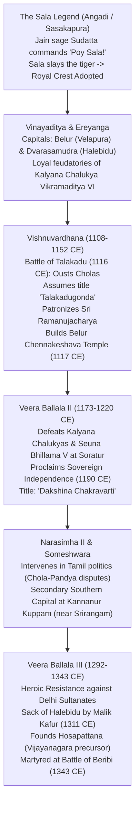
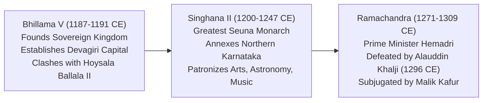

# The Hoysalas of Dvarasamudra, UNESCO Sacred Ensembles and the Seunas of Devagiri (ದ್ವಾರಸಮುದ್ರದ ಹೊಯ್ಸಳರು, ಯುನೆಸ್ಕೋ ಪವಿತ್ರ ಸ್ಮಾರಕಗಳು ಮತ್ತು ದೇವಗಿರಿಯ ಸೇವುಣರು)

> [!exam-focus]
> **KPSC High-Yield Examination Focus**:
> - **Dynastic Myth and Royal Crest**: Sala striking down a leaping tiger with an iron rod upon the order of Jain ascetic Sudatta Muni (*"Poy, Sala!"* - ಹೊಯ್, ಸಳ - Strike Sala!). Royal emblem of the Hoysalas depicts Sala slaying the tiger.
> - **King Vishnuvardhana (ಬಿಟ್ಟಿದೇವ / ವಿಷ್ಣುವರ್ಧನ, 1108-1152 CE)**: Liberated southern Karnataka by defeating the Cholas at the Battle of Talakadu (1116 CE), assuming the glorious title **Talakadugonda (ತಲಕಾಡುಗೊಂಡ)**; consecrated the **Kirtinarayana Temple** at Talakadu and **Chennakeshava Temple** at Belur.
> - **Sri Ramanujacharya's Asylum**: The Vaishnava Acharya took refuge in Karnataka (Thondanur/Melukote) to escape persecution by Chola King Kulothunga I. Vishnuvardhana embraced Srivaishnavism while his chief queen **Shantala Devi** remained a devoted Jain and accomplished classical dancer (*Natya Saraswati*).
> - **UNESCO World Heritage Inscription (September 2023)**: The **"Sacred Ensembles of the Hoysalas"** inscribed as India's 42nd World Heritage Site, comprising three serial masterpieces:
>   1. **Chennakeshava Temple at Belur** (commissioned by Vishnuvardhana in 1117 CE).
>   2. **Hoysaleshwara Temple at Halebidu** (commissioned by officer Ketamalla in 1121 CE).
>   3. **Keshava Temple at Somanathapura** (commissioned by commander Somanatha Dandanayaka in 1268 CE).
> - **Hoysala Architectural Idiom**: Carved from Chloritic Schist (Greenish-Grey Soapstone - ಬಳಪದ ಕಲ್ಲು); raised platform (**Jagati - ಜಗತಿ**); **Stellate / Star-shaped (ನಕ್ಷತ್ರಾಕಾರದ)** sanctum plan; multi-tiered animal friezes; exquisite bracket figures (**Madanikas / Salabhanjikas**); proud stone signatures of master sculptors (**Ruvari Mallitamma, Dasoja of Balligavi**).
> - **Veera Ballala III (1292-1343 CE)**: Stood as the solitary shield of South India during the invasions of the Delhi Sultanate (Malik Kafur and Muhammad bin Tughlaq); laid the foundation for the fortified sentinel city of *Hosapattana*, which blossomed into the **Vijayanagara Empire**.
> - **Seunas / Yadavas of Devagiri (1187-1317 CE)**: Singhana II; Sharangadeva's music treatise **Sangita Ratnakara**; Hemadri's encyclopedia *Chaturvarga Chintamani* and *Hemadpanthi* architectural style.

---

## 1. Dynastic Origins and Evolution

The Hoysalas emerged as hill chieftains (*Malepar*) in the dense Malnad forests of the Western Ghats, initially based at **Sasakapura (Angadi)** in Mudigere taluk, Chikkamagaluru district. They served as loyal feudatories to the Kalyana Chalukyas before establishing sovereign dominion across peninsular India.



---

## 2. Vishnuvardhana: The Architect of Hoysala Greatness (1108–1152 CE)

Originally known as **Bittideva (ಬಿಟ್ಟಿದೇವ)**, he was the true founder of Hoysala imperial majesty:
- **Military Conquests**:
  - **Conquest of Talakadu (1116 CE)**: Southern Karnataka had been ruled for over a century by the Imperial Cholas as *Nikarilichola-mandalam*. Vishnuvardhana, spearheaded by his brilliant commander **Gangaraja**, stormed the Chola garrison at Talakadu, expelled the Cholas across the border, and assumed the triumphant royal title **Talakadugonda (ತಲಕಾಡುಗೊಂಡ - He who captured Talakadu)**.
  - Conquered Gangavadi, Nolambavadi (Ballari), Banavasi, and marched north to the Krishna river, clashing with his suzerain Vikramaditya VI at Kanambadi.
- **Ramanujacharya and Religious Synthesis**:
  - In c. 1098 CE, the great philosopher-saint **Sri Ramanujacharya (ಶ್ರೀ ರಾಮಾನುಜಾಚಾರ್ಯ)**, founder of the Vishishtadvaita philosophy, fled Chola territory due to religious persecution by Shaiva Chola king Kulothunga I.
  - Ramanujacharya found asylum in Hoysala territory at **Thondanur (Tonnur)** near Pandavapura.
  - Bittideva came under Ramanujacharya's spiritual grace, converted to Srivaishnavism, and assumed the auspicious name **Vishnuvardhana**.
  - Consecrated the famous **Pancha Narayana Temples (ಪಂಚ ನಾರಾಯಣ ಕ್ಷೇತ್ರಗಳು)**:
    1. *Chennakeshava Temple* at Belur.
    2. *Kirtinarayana Temple* at Talakadu.
    3. *Veeranarayana Temple* at Gadag.
    4. *Nambinarayana Temple* at Thondanur.
    5. *Cheluvanarayana Temple* at Melukote.
- **Queen Shantala Devi (ಶಾಂತಲಾದೇವಿ)**:
  - Daughter of general Marasingha and a devout follower of Jainism.
  - Master of music, instrumental performance, and classical dance; celebrated in stone inscriptions as **Vichitra Nartaki** and **Natya Saraswati**.
  - Commissioned the celebrated Savati Gandhavarana Basadi at Shravanabelagola; performed the sacred Jain vow of *Sallekhana* at Shivagange in 1131 CE.

---

## 3. The UNESCO Sacred Ensembles of the Hoysalas (Inscribed Sept 2023)

In September 2023, during its 45th session in Riyadh, Saudi Arabia, the **World Heritage Committee of UNESCO inscribed the "Sacred Ensembles of the Hoysalas" as India's 42nd World Heritage Site**. The inscription encompasses three serial monuments representing the zenith of South Indian temple art:

```
UNESCO World Heritage: Sacred Ensembles of the Hoysalas (2023)
├── 1. Chennakeshava Temple at Belur (ಬೇಲೂರು ಚೆನ್ನಕೇಶವ ದೇವಾಲಯ)
│   ├── Commissioned: 1117 CE by King Vishnuvardhana (Vijayanarayana Temple).
│   ├── Theme: Dedicated to Vishnu (Chennakeshava - Handsome Keshava).
│   └── Distinctive: 42 Madanika bracket figures; gravure stone jali screens.
├── 2. Hoysaleshwara Temple at Halebidu (ಹಳೇಬೀಡು ಹೊಯ್ಸಳೇಶ್ವರ ದೇವಾಲಯ)
│   ├── Commissioned: 1121 CE by royal officer Ketamalla (Dvarasamudra capital).
│   ├── Type: Dvikuta (Twin-temple dedicated to Hoysaleshwara and Shantaleshwara).
│   └── Distinctive: Largest Hoysala shrine; 8-layered continuous exterior narrative friezes.
└── 3. Keshava Temple at Somanathapura (ಸೋಮನಾಥಪುರ ಕೇಶವ ದೇವಾಲಯ)
    ├── Commissioned: 1268 CE by Commander Somanatha Dandanayaka (under Narasimha III).
    ├── Type: Trikuta (Triple sanctum housing Keshava, Janardhana, and Venugopala).
    └── Distinctive: Perfectly preserved complete star-shaped vimana and stone shikhara towers.
```

### 3.1 Architectural Anatomy of a Hoysala Temple
1. **Building Medium**: Carved exclusively from **Chloritic Schist (Soapstone - ಬಳಪದ ಕಲ್ಲು)**, which enabled micro-sculptural filigree carving unseen in granite or sandstone.
2. **The Raised Platform (Jagati - ಜಗತಿ)**:
   - Elevated platform rising 3 to 6 feet above ground level, leaving a wide terrace that functions as the open circumambulatory path (*Pradakshinapatha*).
3. **The Stellate Ground Plan (ನಕ್ಷತ್ರಾಕಾರದ ತಳಪಾಯ)**:
   - The sanctum walls project outward in alternating angles like a symmetrical star (8, 16, or 32 points), maximizing surface area for relief carvings and casting dramatic shadow patterns.
4. **The Horizontal Tiered Friezes (ಭಾಗಗಳು / ಪಟ್ಟಿಗಳು)**:
   - The outer lower walls of the temple are wrapped in an unbroken sequence of horizontal sculpted bands:
     - *Band 1 (Bottom)*: Elephants (symbolizing imperial strength, stability, and endurance).
     - *Band 2*: Lions and Yalis (symbolizing royal courage and valor).
     - *Band 3*: Floral scrollwork and creepers (nature and artistic fertility).
     - *Band 4*: Cavalry / Charging Horses (military swiftness and dynamic energy).
     - *Band 5*: Frieze of miniature lions.
     - *Band 6*: Narrative mythological panels depicting continuous episodes from the *Ramayana*, *Mahabharata*, and *Bhagavata Purana*.
     - *Band 7*: Hamsas / Swans (discretion and spiritual purity).
     - *Band 8*: Mythical Makaras (aquatic beasts symbolizing life-giving waters).
5. **Madanika / Salabhanjika Figures (ಮದನಿಕಾ ವಿಗ್ರಹಗಳು)**:
   - Angled bracket figures positioned between outer pillars and eaves, depicting celestial nymphs in complex anatomical dance postures.
   - At Belur, 38 exterior and 4 interior bracket figures survive, including *Darpana Sundari* (beauty admiring herself in a mirror), *Shuka Bhashini* (damsel speaking to a parrot), and *Tribhangi Natya Sundari*.
6. **Individual Artist Signatures (ಶಿಲ್ಪಿಗಳ ಹೆಸರುಗಳು)**:
   - Unlike anonymous ancient Indian craftsmen, Hoysala master sculptors proudly carved their names and titles on pedestals:
     - **Ruvari Mallitamma (ಮಲ್ಲಿತಮ್ಮ)**: Prolific master who sculpted and signed over 40 images at Somanathapura, Nuggehalli, and Javagal.
     - **Dasoja of Balligavi** and his son **Chavana**: Chief sculptors at Belur, honored as *Biruda-Rupavari* (Master of Titles).

---

## 4. Veera Ballala III: Resistance Against the Delhi Sultanate (1292–1343 CE)

When the Khaljis and Tughlaqs of the Delhi Sultanate invaded South India, pulverizing the Yadavas of Devagiri, Kakatiyas of Warangal, and Pandyas of Madurai, **Veera Ballala III** emerged as the sole surviving Hindu sovereign in peninsular India:
- **Invasions of Malik Kafur (1311 CE)**: Halebidu was besieged, pillaged, and Ballala III forced to pay tribute.
- **Relocation of Capital**: When Halebidu was devastated a second time by Muhammad bin Tughlaq's forces in 1327 CE, Ballala shifted his headquarters north to **Thiruvannamalai** and established a strategic fortified outpost on the Tungabhadra River:
  - This military encampment, titled **Virupaksha Vasanapattana / Hosapattana (ಹೊಸಪಟ್ಟಣ)**, was entrusted to his trusted commanders **Harihara and Bukka**, forming the genesis of **Vijayanagara (Hampi)**.
- **Martyrdom at Beribi (1343 CE)**: At the age of over 80, while besieging the Kannanur fort held by the tyrannical Sultan of Madurai (Ghiyas-ud-din), Ballala III was captured through treachery, murdered, flayed, and his stuffed skin displayed on the walls of Madurai. His tragic martyrdom directly catalyzed Harihara and Bukka to proclaim the founding of the Vijayanagara Empire in 1336/1346 CE.

---

## 5. The Seunas / Yadavas of Devagiri (c. 1187 – 1317 CE)

The Seunas (Yadavas) established their power in northern Karnataka and Maharashtra, operating from the impregnable rock fortress of **Devagiri (ದೇವಗಿರಿ / Daulatabad)**.



### 5.1 Cultural and Intellectual Monuments of the Seunas:
1. **Sharangadeva and the *Sangita Ratnakara* (ಸಂಗೀತ ರತ್ನಾಕರ)**:
   - Sharangadeva lived at the court of King Singhana II at Devagiri.
   - Authored the **Sangita Ratnakara** in Sanskrit, the most authoritative foundational treatise in Indian music history.
   - It systematically defined *Raga*, *Tala*, *Prabandha*, and *Vadyas*, and is hailed as the **common fountainhead of both the Carnatic and Hindustani classical music systems**.
2. **Hemadri and the *Chaturvarga Chintamani* (ಹೇಮಾದ್ರಿ)**:
   - Served as Chief Minister (*Karanadhipa*) under Seuna kings Mahadeva and Ramachandra.
   - Authored the **Chaturvarga Chintamani**, an encyclopedic Sanskrit work of four volumes (*Vrata, Dana, Tirtha, Moksha*) compiling ancient socio-religious injunctions.
   - **Hemadpanthi Architecture (ಹೇಮಾದ್‌ಪಂಥಿ ಶೈಲಿ)**: Formulated an indigenous construction method using heavy interlocking basalt blocks without mortar, seen in numerous medieval temples across northern Karnataka and Maharashtra.
   - Introduced the cursive **Modi Script** for commercial and administrative record-keeping in Marathi and border Kannada.
3. **Bhaskaracharya II and Mathematics**:
   - The great astronomer-mathematician Bhaskaracharya II (author of *Siddhanta Shiromani* and *Lilavati*) belonged to this region, and his grandson Changadeva was appointed royal chief astrologer at Singhana II's court, establishing an astronomical academy at Patan.

---

## 6. Comparative Synoptic Matrix

| Feature | The Hoysalas of Dvarasamudra | The Seunas of Devagiri |
|---|---|---|
| **Capital City** | Dvarasamudra (Halebidu) & Belur | Devagiri (Daulatabad) |
| **Royal Emblem** | Sala slaying a tiger (*Poy Sala*) | Golden Garuda (ಗರುಡ) |
| **Stone Medium** | Chloritic Schist (Soft Soapstone) | Hard Basalt / Sandstone |
| **Architectural Style** | **Hoysala Stellate (UNESCO 2023)** | **Hemadpanthi Style** (Mortarless interlocking) |
| **Supreme Musical Text** | Devotional Vachana/Keertana traditions | **Sangita Ratnakara** by Sharangadeva |
| **Primary Religious Shift** | Jainism to Srivaishnavism (Ramanuja) | Shaivism, Mahanubhava, Varkari panth |
| **Ultimate Fate** | Merged into Vijayanagara Empire | Annexed directly by Delhi Sultanate (1317 CE) |

---

## 7. Prelims Traps & Mains Answer Blueprint

### 7.1 Prelims Traps
> [!caution]
> - **Trap 1**: Believing Somanathapura was built by Vishnuvardhana. *Fact*: Belur was built by Vishnuvardhana (1117 CE). Somanathapura was built over 150 years later (1268 CE) by commander **Somanatha Dandanayaka** under King Narasimha III.
> - **Trap 2**: Confusing the UNESCO serial components of Hoysala architecture. *Fact*: The UNESCO inscription includes exactly **three** sites: Belur Chennakeshava, Halebidu Hoysaleshwara, and Somanathapura Keshava. It does not include Melukote or Talakadu.
> - **Trap 3**: Believing the Seunas were purely a North Indian dynasty. *Fact*: The Seunas (Yadavas) ruled large parts of Northern Karnataka (Bijapur, Dharwad, Raichur), left dozens of Kannada inscriptions, and fought bitter border wars against the Hoysalas.

### 7.2 Mains Model Question & Answer Blueprint
**Question**: *Discuss the salient architectural features of Hoysala temples with special reference to the UNESCO World Heritage monuments of Belur, Halebidu, and Somanathapura.* (Marks: 15 / 250 Words)

**Model Answer Outline**:
1. **Introduction (35 words)**:
   - Identify the Hoysala architectural school (11th-14th century CE) as the glorious climax of the Vesara tradition, inscribed in 2023 as India's 42nd UNESCO World Heritage Site ("Sacred Ensembles of the Hoysalas").
2. **Body 1: Structural Innovations & Artistic Medium (80 words)**:
   - *Chloritic Schist*: Utilization of soapstone enabled intricate micro-sculptural filigree and deep undercutting impossible in granite.
   - *Jagati (Raised Terrace)*: Wide plinth functioning as an open circumambulatory path elevating the shrine above the landscape.
   - *Stellate Plan*: Star-shaped polygonal configuration of the garbhagriha projecting angular wall surfaces that multiply light and shadow effects.
   - *Lathe-turned Pillars*: Lustrous bell-shaped columns produced using water-powered lathes.
3. **Body 2: The Three UNESCO Masterpieces (85 words)**:
   - *Belur Chennakeshava (1117 CE)*: Celebrated for its 42 Madanika bracket figures capturing classical dance expressions, pierced jali windows, and Vishnuvardhana's historical victory commemoration.
   - *Halebidu Hoysaleshwara (1121 CE)*: Double-shrine (Dvikuta) featuring eight continuous narrative animal friezes wrapping the entire foundation, and monumental Nandi pavilions.
   - *Somanathapura Keshava (1268 CE)*: Perfect triple-shrine (Trikuta) star-shaped monument preserving intact tiered stone shikhara spires and signed masterpieces by Ruvari Mallitamma.
4. **Conclusion (25 words)**:
   - Conclude that Hoysala temple art transformed devotional worship into a permanent museum of classical dance, epic literature, and architectural virtuosity, leaving an indelible imprint on world heritage.

---

## 8. Sources and Verification
- **Verified On**: 2026-10-13 (Tuesday)
- **Primary Source 1**: UNESCO World Heritage Committee Nomination Dossier, *Sacred Ensembles of the Hoysalas*, 2023.
- **Primary Source 2**: Dr. Suryanath Kamath, *A Concise History of Karnataka*, MCC, Bengaluru.
- **Primary Source 3**: Gerard Foekema, *A Complete Guide to Hoysala Temples*, Abhinav Publications, New Delhi.
