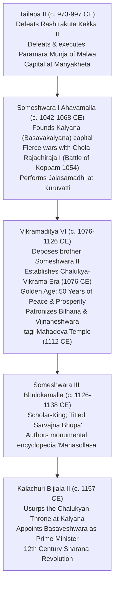
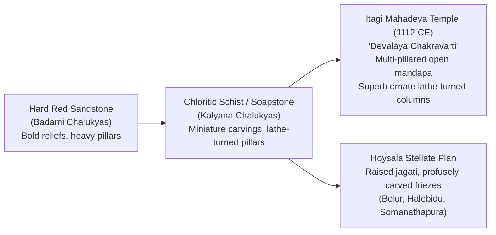
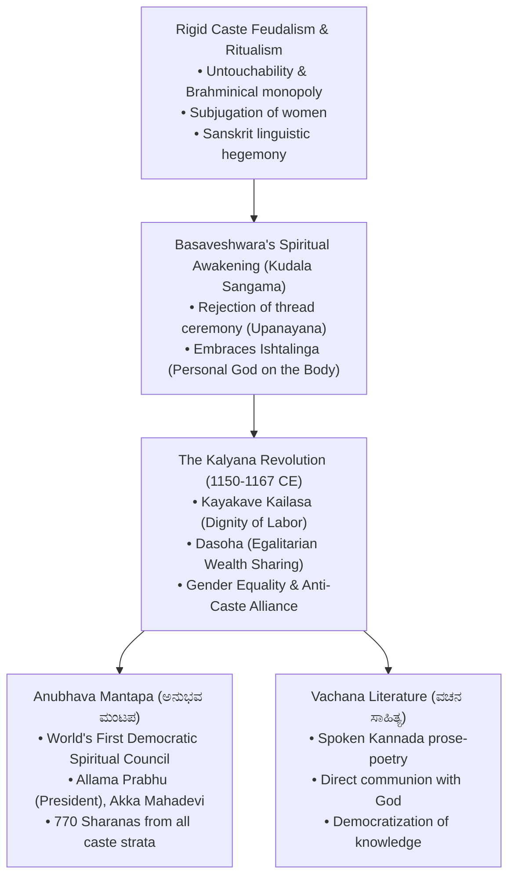

# The Chalukyas of Kalyana, Kalachuris and the 12th Century Vachana Movement (ಕಲ್ಯಾಣ ಚಾಲುಕ್ಯರು, ಕಲಚುರಿಗಳು ಮತ್ತು ೧೨ನೇ ಶತಮಾನದ ವಚನ ಚಳುವಳಿ)

> [!exam-focus]
> **KPSC High-Yield Examination Focus**:
> - **Restoration & Capital**: Tailapa II overthrew Rashtrakuta Kakka II in 973 CE; Someshwara I founded **Kalyana (Basavakalyana in Bidar)** as imperial capital c. 1042 CE.
> - **Vikramaditya VI (ವಿಕ್ರಮಾದಿತ್ಯ VI, 1076-1126 CE)**: Greatest ruler; inaugurated the **Chalukya-Vikrama Era (ಚಾಲುಕ್ಯ ವಿಕ್ರಮ ಶಕ, 1076 CE)** discarding the Shaka era; ruled peacefully for 50 years; patronized Bilhana and Vijnaneshwara.
> - **Legal & Literary Masterpieces**:
>   - **Mitakshara (ಮಿತಾಕ್ಷರಾ)** by jurist **Vijnaneshwara**: Landmark legal commentary on the *Yajnavalkya Smriti* establishing the foundational Hindu law of civil property and inheritance by birth (*Janmasvatvavada*), governing legal inheritance across India (except Bengal/Assam) until the Hindu Succession Act.
>   - **Vikramankadevacharita (ವಿಕ್ರಮಾಂಕದೇವಚರಿತ)** by Kashmiri poet **Bilhana**: Sanskrit court epic celebrating Vikramaditya VI's life and military triumphs.
>   - **Manasollasa (ಮಾನಸೋಲ್ಲಾಸ / ಅಭಿಲಷಿತಾರ್ಥ ಚಿಂತಾಮಣಿ)** by King **Someshwara III**: First encyclopedic work in Sanskrit comprising 100 chapters covering statecraft, medicine, architecture, music, food (*Paka-shastra*), and painting.
> - **Architectural Climax**: **Itagi Mahadeva Temple (ಇಟಗಿಯ ಮಹಾದೇವ ದೇವಾಲಯ, 1112 CE)** in Koppal district, proudly hailed in its foundation inscription as **"Devalaya Chakravarti" (ದೇವಾಲಯ ಚಕ್ರವರ್ತಿ - Emperor of Temples)**.
> - **The 12th-Century Vachana Revolution**:
>   - **Basaveshwara (ಬಸವೇಶ್ವರ, 1134-1196 CE)**: Prime Minister/Finance Minister (*Bhandari*) to Kalachuri King Bijjala II; propagated **Kayakave Kailasa (ಕಾಯಕವೇ ಕೈಲಾಸ - Work is Worship)** and **Dasoha (ದಾಸೋಹ - Selfless Redistribution)**.
>   - **Anubhava Mantapa (ಅನುಭವ ಮಂಟಪ)**: World's first socio-religious, spiritual, and egalitarian parliament at Basavakalyana, presided over by mystic **Allama Prabhu (ಅಲ್ಲಮ ಪ್ರಭು)**.
>   - **Vachana Literature (ವಚನ ಸಾಹಿತ್ಯ)**: Radical democratization of literature using simple spoken Kannada, dismantling caste, gender, ritualism, and Sanskrit hegemony.

---

## 1. Political Resurgence: The Chalukyas of Kalyana (c. 973 – 1189 CE)

Following the decline of the Rashtrakutas, **Tailapa II** (a descendant of the Badami Chalukya collateral branch) overthrew Kakka II in 973 CE and re-established the Western Chalukya dynasty.

### 1.1 Vikramaditya VI (Permadideva: 1076–1126 CE)
- **Ascension and New Era**: Having dethroned his tyrannical elder brother Someshwara II with the assistance of Chola King Virarajendra, Vikramaditya VI was crowned in 1076 CE. He immediately abolished the traditional Shaka era and proclaimed his own calendar: the **Chalukya-Vikrama Era (ಚಾಲುಕ್ಯ ವಿಕ್ರಮ ಶಕ)**.
- **Imperial Peace**: For five decades, he maintained unbroken political stability over the Deccan, repulsing Hoysala incursions under Vishnuvardhana and retaining supremacy from the Narmada to the Tungabhadra.
- **Epigraphical Legacy**: Left more stone inscriptions than any other ruler in Karnataka's history (over 1,000 inscriptions bearing his name exist across Karnataka, Maharashtra, and Andhra Pradesh).

---

## 2. Juridical, Encyclopedic and Literary Luminaries

The court of the Kalyana Chalukyas became the intellectual capital of peninsular India:

### 2.1 Vijnaneshwara and the *Mitakshara*
- **Author**: Jurist **Vijnaneshwara (ವಿಜ್ಞಾನೇಶ್ವರ)** lived in the capital city of Kalyana during the reign of Vikramaditya VI.
- **Nature of Work**: Authored the **Mitakshara (ಮಿತಾಕ್ಷರಾ)**, an exhaustive judicial commentary on the *Yajnavalkya Smriti*.
- **Legal Doctrines Established**:
  1. **Coparcenary by Birth (*Janmasvatvavada*)**: A son acquires an inherent legal right in ancestral coparcenary property from the very moment of his birth, rather than upon the demise of the father (contrasting sharply with the *Dayabhaga* school of Jimutavahana prevalent in Bengal).
  2. **Women's Property Rights (*Stridhana*)**: Recognized expansive inheritance rights for women over gifts, stridhana, and widowed shares.
- The *Mitakshara* remained the supreme standard of Hindu civil civil and property law enforced by British High Courts and the Supreme Court of India across the entire subcontinent (except Bengal and Assam).
- Vijnaneshwara famously wrote about his patron and capital:
  > *"There was not, there is not, and there never will be on earth a city like Kalyana; nor was there ever seen or heard of a monarch like the prosperous Vikramaditya!"*

### 2.2 Bilhana and the *Vikramankadevacharita*
- **Author**: Kashmiri Sanskrit poet **Bilhana (ಬಿಲ್ಹಣ)** traveled across India from Srinagar to Kalyana. Vikramaditya VI received him with extraordinary honors, appointing him to the coveted post of **Vidyapati (Chief Court Poet)**.
- **Work**: Bilhana expressed his gratitude by authoring the epic **Vikramankadevacharita (ವಿಕ್ರಮಾಂಕದೇವಚರಿತ)**, recounting Vikramaditya VI's divine election by Lord Shiva, his heroic deeds, and his romantic marriage to Karahata princess Chandralekha.

### 2.3 King Someshwara III and the *Manasollasa* (1129 CE)
- Succeeded Vikramaditya VI in 1126 CE; assumed the epithet **Sarvajna Bhupa (The Omniscient King)**.
- Authored the **Manasollasa (ಮಾನಸೋಲ್ಲಾಸ - Delight of the Mind)**, also titled **Abhilashitartha Chintamani (ಅಭಿಲಷಿತಾರ್ಥ ಚಿಂತಾಮಣಿ - The Wish-Fulfilling Gem)**.
- Structurally divided into **5 Vimsatis (books) of 20 chapters each (100 chapters in total)**:
  1. *Rajya-prapti* (Attainment of Kingdom and Ethics of Kingship).
  2. *Rajyasya Sthirikarana* (Consolidation of the State, Ministry, Forts, War).
  3. *Upabhoga* (Royal Enjoyments: Architecture, Gardens, Bathing, Attire, Perfumes).
  4. *Vinoda* (Royal Amusements: Elephant fights, Polo, Falconry, Hunting, Music, Dancing).
  5. *Kridavimshati* (Sports, Games, Chess, and Recreations).
- It contains the **earliest documented treatise on Indian Culinary Science (*Paka-shastra*)**, veterinary science on elephants and horses, and the theory of classical Indian music (*Sangita*).

---

## 3. Kalyana Chalukya Architecture: The Pinnacle of Soapstone Craftsmanship

The Kalyana Chalukyas transitioned from the hard red sandstone of Badami to **Chloritic Schist (Greenish-Grey Soapstone - ಬಳಪದ ಕಲ್ಲು)**, which is soft when quarried and hardens upon exposure to air, permitting intricate lacework carving.

### 3.1 Architectural Innovations:
1. **Lathe-Turned Pillars (ಕಡೆದ ಕಂಬಗಳು)**: Monolithic soapstone shafts turned on mechanical vertical water-driven lathes, producing mirror-like lustrous, multi-grooved cylindrical bell-shaped pillars.
2. **Kirtimukha (Face of Glory) Pediments**: Elaborate decorative arches framing outer niches.
3. **Miniature Shikhara Niches**: Outer walls adorned with dozens of decorative stepped shrine models.
4. **Stellar Ground Plan Prototype**: Introduction of stepped-star polygonal sanctum foundations.

### 3.2 Masterpiece Monuments:
- **Itagi Mahadeva Temple (ಇಟಗಿ ಮಹಾದೇವ ದೇವಾಲಯ)**: Located in Yelburga taluk, Koppal district. Built in **1112 CE** by Mahadeva, a high-ranking military commander (*Dandanayaka*) of Vikramaditya VI. Celebrated as **Devalaya Chakravarti (ದೇವಾಲಯ ಚಕ್ರವರ್ತಿ)**; features a magnificent open hall with 64 intricately carved pillars.
- **Kalleshwara Temple at Bagali** and **Amruteshwara Temple at Annigeri**: Annigeri (Dharwad district) served as the primary architectural nucleus from which the Kalyana Chalukyan idiom spread.
- **Kuruvatti Mallikarjuna Temple** and **Lakkundi Kashi Vishveshwara Temple**: Lakkundi (Gadag district) contains over 50 ancient temples, famous for ornate doorframes (*Dwarabandha*) with five to seven receding carved bands.

---

## 4. The 12th Century Sharana / Vachana Revolution

The mid-12th century witnessed one of the most radical socio-cultural, religious, and egalitarian reform movements in human history, spearheaded by **Basaveshwara** in the city of Basavakalyana under the Kalachuri reign of King Bijjala II.

### 4.1 Basaveshwara (ಬಸವಣ್ಣ / ಬಸವೇಶ್ವರ, 1134–1196 CE)
- **Early Life**: Born to Brahmin parents Madarasa and Madalambike at **Ingaleshwara-Bagewadi (ಬಾಗೇವಾಡಿ)** in modern Vijayapura district. At age eight, he tore off his sacred thread (*Yajnopavita*), declaring that formal birth-based rituals could not determine spiritual purity.
- **Spiritual Maturation at Kudala Sangama**: Traveled to the confluence of Krishna and Malaprabha rivers (**Kudala Sangama - ಕೂಡಲಸಂಗಮ**), studying under sage Ishanya Guru; embraced Lord Shiva as **Koodalasangamadeva (ಕೂಡಲಸಂಗಮದೇವ)**.
- **Statesmanship at Kalyana**: Entered the service of Kalachuri King **Bijjala II (ಬಿಜ್ಜಳ II)** at Basavakalyana, rising by sheer competence and financial probity to the highest rank of **Bhandari (ಭಂಡಾರಿ - Prime Minister and Master of the Royal Treasury)**.
- **Core Philosophical Pillars**:
  1. **Kayakave Kailasa (ಕಾಯಕವೇ ಕೈಲಾಸ - Work is Worship)**:
     - No labor is superior or inferior. Physical work performed with dedication, honesty, and spiritual consciousness is itself the divine realm of Shiva (*Kailasa*).
     - Every individual—from prime minister to cobbler, washerman, and weaver—must earn their livelihood through honest labor (*Kayaka*). Begging or parasitic monasticism was strictly forbidden.
  2. **Dasoha (ದಾಸೋಹ - Selfless Charity and Resource Sharing)**:
     - Accumulation of surplus private wealth was regarded as spiritual theft.
     - Income earned through *Kayaka* must be redistributed selflessly to society, the destitute, and the wandering ascetics (*Jangamas*).
  3. **Ishtalinga (ಇಷ್ಟಲಿಂಗ)**:
     - Shifted divinity from static, exclusionary stone temples (*Sthavara*) to a personal miniature spherical icon of Shiva worn directly around the neck on the body (*Jangama*), making worship personal, portable, and accessible to every human being regardless of caste or sex.
  4. **The Famous Vachana on Temples vs The Human Body**:
     > *"ಉಳ್ಳವರು ಶಿವಾಲಯ ಮಾಡುವರು ನಾನೇನು ಮಾಡಲಿ ಬಡವನಯ್ಯಾ?*
     > *ಎನ್ನ ಕಾಲೇ ಕಂಬ, ದೇಹವೇ ದೇಗುಲ, ಶಿರವೇ ಹೊನ್ನ ಕಳಶವಯ್ಯಾ!*
     > *ಕೂಡಲಸಂಗಮದೇವ ಕೇಳಯ್ಯಾ, ಸ್ಥಾವರಕ್ಕಳಿವುಂಟು ಜಂಗಮಕ್ಕಳಿವಿಲ್ಲ!"*
     > *(The rich may build temples for Shiva; what can I, a poor man, do?*
     > *My legs are pillars, the body itself is the temple, my head is the golden kalasha!*
     > *Hear me, O Lord of the meeting rivers, things standing shall fall, but the moving shall ever endure!)*

### 4.2 Anubhava Mantapa (ಅನುಭವ ಮಂಟಪ) — The First Religious Parliament
- Established by Basaveshwara at Basavakalyana as an open academy of spiritual exploration and socio-religious discourse.
- **President (*Shoonya Simhasana*)**: **Allama Prabhu (ಅಲ್ಲಮ ಪ್ರಭು)**, the great ascetic mystic whose Vachanas (*Ankita*: *Guhyeshwara*) embody deep non-dualistic spiritual insight.
- **Egalitarian Membership**: Included over **770 Sharanas** drawn from all social strata:
  - *Madivala Machideva* (a washerman - valiant defender of the movement).
  - *Ambigara Chowdayya* (a ferryman / boatman - fiery social critic).
  - *Samagara Haralayya* (a leather cobbler / untouchable).
  - *Hadapada Appanna* (a barber - personal secretary of Basavanna).
  - *Madara Dhoolayya* (a sweeper).
  - *Nuliya Chandayya* (a rope-maker who famously prioritized his rope-making work over listening to god).
  - *Kinnari Bommayya* (a folk goldsmith).
- **Women Sharanas (ಶರಣೆಯರು)**: Over 30 women actively participated as intellectual equals, discussing theology, philosophy, and social justice:
  - **Akka Mahadevi (ಅಕ್ಕಮಹಾದೇವಿ)**: Supreme female mystic; rejected forced marriage to King Kaushika; shed worldly clothes and walked naked covered only by her long hair, treating Lord Shiva (**Chennamallikarjuna - ಚೆನ್ನಮಲ್ಲಿಕಾರ್ಜುನ**) as her only divine spouse; performed ultimate dissolution (*Aykya*) at Kadali Vana in Srisailam.
  - *Muktayakka* (engaged in profound philosophical debates with Allama Prabhu).
  - *Ayidakki Lakkamma* (preached the purity of honest labor to her husband Marayya).
  - *Gangambike* and *Neelambike* (wives of Basavanna).

### 4.3 The Vachana Movement as a Linguistic Revolution
- **Sanskrit Monopolies Broken**: Prior to the 12th century, religious scripture and philosophical debate were locked in Sanskrit, inaccessible to the working masses.
- **Spoken Kannada as Divine Medium**: The Sharanas used **Desi (ದೆಸಿ - Vernacular) Kannada**, producing thousands of *Vachanas*—concise, poetic, rhythmically phrased prose aphorisms ending with their distinctive signature (*Ankita Nama*).
- **Major Vachana Signatures (ಅಂಕಿತನಾಮಗಳು)**:
  - Basaveshwara -> *Koodalasangamadeva* (ಕೂಡಲಸಂಗಮದೇವ)
  - Allama Prabhu -> *Guhyeshwara* (ಗುಹೇಶ್ವರ)
  - Akka Mahadevi -> *Chennamallikarjuna* (ಚೆನ್ನಮಲ್ಲಿಕಾರ್ಜುನ)
  - Chennabasavanna -> *Koodalachennasangamadeva* (ಕೂಡಲಚೆನ್ನಸಂಗಮದೇವ)
  - Madivala Machideva -> *Kalidevaradeva* (ಕಲಿದೇವರದೇವ)
  - Ambigara Chowdayya -> *Ambigara Chowdayya* (ಅಂಬಿಗರ ಚೌಡಯ್ಯ)

### 4.4 The Kalyana Revolution and Aftermath (1167 CE)
- **The Trigger**: To break the back of the caste system, Basaveshwara and the Sharanas solemnized a historic **inter-caste marriage (ಅಂತರ್ಜಾತೀಯ ವಿವಾಹ)** between the daughter of **Samagara Haralayya** (a cobbler / former untouchable) and the son of **Madhuvarasa** (a Brahmin convert to Sharana faith).
- **Reaction of Orthodox Feudal Nobility**: Orthodox ministers persuaded King Bijjala II that this violation of traditional *Varnashrama Dharma* was treason.
- **Martyrdom**: Bijjala ordered Madhuvarasa and Haralayya to be executed by being dragged through the city streets tied to the legs of royal elephants.
- **Civil Unrest & Dispersal**: Outraged disciples assassinated King Bijjala. Facing royal military retaliation, the Sharanas dispersed in all directions carrying the precious bundles of Vachana palm-leaf manuscripts (*Vachana Kattu*), led by Madivala Machideva and Chennabasavanna to **Ulavi (ಉಳವಿ)** in the dense Western Ghats of Uttara Kannada. Basavanna departed to Kudala Sangama and attained *Aykya* (merger with the divine) in 1196 CE.

---

## 5. Comparative Synoptic Matrix

| Dimension | The Chalukyas of Kalyana | The Kalachuris of Kalyana |
|---|---|---|
| **Capital** | Kalyana (Basavakalyana in Bidar) | Kalyana (usurped from Chalukyas) |
| **Era / Calendar** | **Chalukya-Vikrama Era (1076 CE)** | Shaka Era / Kalachuri Era |
| **Supreme Juridical Text** | **Mitakshara** by Vijnaneshwara | Vachana social philosophy |
| **Sanskrit Masterpiece** | **Manasollasa** by Someshwara III | *Vikramankadevacharita* traditions |
| **Architectural Masterpiece** | **Itagi Mahadeva Temple (1112 CE)** | Fortifications of Basavakalyana |
| **Socio-Religious Benchmark**| High temple ritualism & agraharas | **Vachana Revolution & Anubhava Mantapa** |

---

## 6. Prelims Traps & Mains Answer Blueprint

### 6.1 Prelims Traps
> [!caution]
> - **Trap 1**: Believing the Chalukya-Vikrama Era began in 78 CE. *Fact*: 78 CE is the **Shaka Era**. The Chalukya-Vikrama Era began in **1076 CE** upon the accession of Vikramaditya VI.
> - **Trap 2**: Confusing the author of *Mitakshara* with *Dayabhaga*. *Fact*: **Vijnaneshwara** authored *Mitakshara* at Kalyana. Jimutavahana authored *Dayabhaga* in Bengal.
> - **Trap 3**: Believing Basaveshwara presided over the *Anubhava Mantapa*. *Fact*: **Allama Prabhu** occupied the Shoonya Simhasana (Presidential Chair). Basaveshwara was the organizer, patron, and prime minister.

### 6.2 Mains Model Question & Answer Blueprint
**Question**: *Evaluate the socio-economic and literary revolution initiated by the 12th-century Vachana Movement in Karnataka. How did the concepts of 'Kayaka' and 'Dasoha' challenge feudal social stratification?* (Marks: 15 / 250 Words)

**Model Answer Outline**:
1. **Introduction (35 words)**:
   - Introduce the 12th-century Sharana Movement led by Basaveshwara at Basavakalyana as a revolutionary socio-religious movement that dismantled feudal caste hierarchy, patriarchal exclusion, and Sanskrit ritual dominance through vernacular literature and labor dignity.
2. **Body 1: Socio-Economic Radicalism — 'Kayaka' and 'Dasoha' (90 words)**:
   - **Kayaka (Work as Divine Worship)**: Transformed labor into a spiritual sacrament. Abolished ritual notions of purity and pollution attached to manual occupations. Every profession (leather tanning, weaving, washing, farming) was rendered equally sacred.
   - **Dasoha (Egalitarian Wealth Redistribution)**: Commanded that surplus wealth must not be hoarded or converted into private capital, but dedicated to the community. Subverted feudal exploitation and temple monopolies.
   - **Anubhava Mantapa**: Institutionalized deliberative democracy where cobblers and prime ministers engaged in egalitarian theological discourse.
3. **Body 2: Gender Equality and Caste Annihilation (60 words)**:
   - Rejected child marriage, purdah, and widow ostracization. Elevated women like Akka Mahadevi and Ayidakki Lakkamma to supreme intellectual authorities.
   - The historic inter-caste marriage between the children of Haralayya and Madhuvarasa struck at the fundamental core of caste endogamy.
4. **Body 3: Linguistic Democratization via Vachana Literature (45 words)**:
   - Replaced elitist Sanskrit with spoken Kannada prose (*Vachanas*). Made profound spiritual truths accessible to the ordinary peasant, laying the bedrock of modern Kannada prose.
5. **Conclusion (20 words)**:
   - Conclude that the Sharana movement was centuries ahead of the European Protestant Reformation and the Enlightenment, bequeathing an enduring legacy of social justice to modern Indian democracy.

---

## 7. Sources and Verification
- **Verified On**: 2026-10-13 (Tuesday)
- **Primary Source 1**: Dr. M. Chidananda Murthy, *Basavanna*, National Book Trust, New Delhi.
- **Primary Source 2**: Dr. Suryanath Kamath, *A Concise History of Karnataka*, MCC, Bengaluru.
- **Primary Source 3**: A.K. Ramanujan, *Speaking of Siva*, Penguin Classics, 1973.
