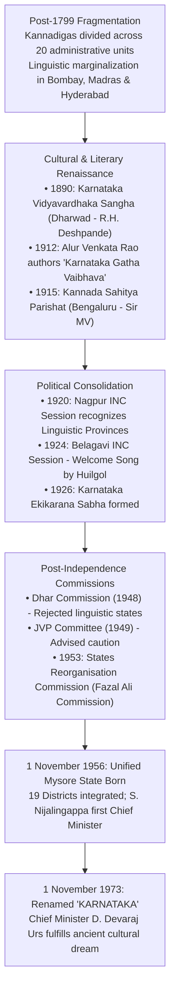

# The Karnataka Unification Movement, Social Reforms, Peasant-Dalit Movements and Cultural Heritage (ಕರ್ನಾಟಕ ಏಕೀಕರಣ ಚಳುವಳಿ, ಸಾಮಾಜಿಕ ಸುಧಾರಣೆಗಳು, ರೈತ-ದಲಿತ ಚಳುವಳಿಗಳು ಮತ್ತು ಸಾಂಸ್ಕೃತಿಕ ಪರಂಪರೆ)

> [!exam-focus]
> **KPSC High-Yield Examination Focus**:
> - **Fragmentation of Karnataka**: Before 1956, Kannada-speaking populations were fractured across **twenty distinct administrative jurisdictions** (Bombay Presidency, Madras Presidency, Hyderabad State, Mysore State, Kodagu, and 15 minor princely states).
> - **Pioneers of Unification (ಏಕೀಕರಣದ ನೇತಾರರು)**:
>   - **Alur Venkata Rao (ಆಲೂರು ವೆಂಕಟರಾವ್)**: Hailed as **"Kannadada Kulapurohita" (ಕನ್ನಡದ ಕುಲಪುರೋಹಿತ - High Priest of Kannada)**; published **Karnataka Gatha Vaibhava (ಕರ್ನಾಟಕ ಗತವೈಭವ, 1912)**, awakening historical pride.
>   - **Karnataka Vidyavardhaka Sangha (Dharwad, 1890)**: Founded by R.H. Deshpande.
>   - **Kannada Sahitya Parishat (Bengaluru, 1915)**: Founded under Dewan Sir M. Visvesvaraya.
> - **States Reorganisation Commission (SRC, 1953)**: Comprising Justice **Fazal Ali**, H.N. Kunzru, and K.M. Panikkar; recommended the creation of a unified Mysore State; integrated on **1 November 1956** (19 districts; S. Nijalingappa first CM).
> - **Renaming as Karnataka (1 November 1973)**: Enacted under Chief Minister **D. Devaraj Urs**, realizing the ancient cultural identity from *Kavirajamarga*.
> - **Social Justice and Backward Classes**:
>   - **Miller Committee (1919 CE)**: First systemic affirmative reservation policy in princely Mysore.
>   - **L.G. Havanur Commission (1975 CE)**: Comprehensive backward classes report upheld by the Supreme Court of India.
>   - **Devaraj Urs Land Reforms (1974 CE)**: Enacted *"Uluvanige Bhoomi"* (Land to the Tiller), abolishing tenancy and inams.
> - **Subaltern Movements**:
>   - **Kagodu Satyagraha (1951 CE)**: First socialist agrarian agitation in independent India led by Shanthaveri Gopala Gowda and Dr. Rammanohar Lohia.
>   - **Karnataka Rajya Raitha Sangha (KRRS, 1980)**: Led by **Prof. M.D. Nanjundaswamy**; green shawl (*Hasiru Shalu*) movement.
>   - **Dalit Sangharsha Samiti (DSS, 1974)**: Founded by **B. Krishnappa**, Siddalingaiah, and Devanura Mahadeva.
>   - **Gokak Chaluvali (1982 CE)**: Historic mass language agitation led by cinematic icon **Dr. Rajkumar** securing sole first-language status for Kannada.
> - **Cultural Masterpieces**: **Eight Jnanpith Awardees (ಜ್ಞಾನಪೀಠ ಪ್ರಶಸ್ತಿ ಪುರಸ್ಕೃತರು)**; Yakshagana; The Haridasa Movement (Purandara Dasa and Kanaka Dasa).

---

## 1. The Karnataka Unification Movement (ಏಕೀಕರಣ ಚಳುವಳಿ)

Following the fall of Tipu Sultan in 1799, British colonial cartography carved the Kannada-speaking regions into twenty disparate administrative fragments, reducing Kannadigas to marginalized linguistic minorities in the Bombay (Marathi), Madras (Tamil/Telugu), and Hyderabad (Urdu) presidencies.



### 1.1 Pioneers of the Unification Movement:
1. **Alur Venkata Rao (1880–1964 CE) — "Kannadada Kulapurohita"**:
   - Shocked by the sight of Hampi's ruins in 1905, he realized that political disunity had destroyed Kannada cultural memory.
   - Published **Karnataka Gatha Vaibhava (ಕರ್ನಾಟಕ ಗತವೈಭವ - The Past Glory of Karnataka)** in 1912:
     - Recounted the imperial glories of the Kadambas, Chalukyas, Rashtrakutas, and Vijayanagara.
     - Struck like a lightning bolt across the youth of Karnataka, declaring: *"Karnataka is my mother, my goddess; to unite her severed limbs is my life's sole mission."*
   - Founded the *Jaya Karnataka* journal in 1922 and the *Karnataka Ekikarana Sabha*.
2. **Key Institutions**:
   - **Karnataka Vidyavardhaka Sangha (Dharwad, 1890)**: Founded by R.H. Deshpande to publish Kannada textbooks, counter Marathi linguistic hegemony in Bombay Karnataka, and advocate for native schools.
   - **Kannada Sahitya Parishat (Bengaluru, 1915)**: Established under the patronship of Maharaja Krishnaraja Wodeyar IV and Dewan Sir M. Visvesvaraya; acted as the supreme cultural umbrella linking Kannadigas across all twenty jurisdictions.
3. **Political Resolutions**:
   - At the **1920 Nagpur Congress Session**, the Indian National Congress formally accepted the principle of linguistic state reorganization and recognized the unified **Karnataka Provincial Congress Committee (KPCC)**, overriding colonial administrative borders.

### 1.2 The States Reorganisation Commission (Fazal Ali Commission, 1953–1955)
- Appointed by Prime Minister Jawaharlal Nehru in December 1953, comprising:
  - **Justice Fazal Ali (Chairman)**
  - **H.N. Kunzru (Member)**
  - **K.M. Panikkar (Member)**
- The KPCC, led by S. Nijalingappa and Kengal Hanumanthaiah, submitted massive evidence demonstrating the geographic, riverine, and cultural continuity of the Kannada territory.
- **Historic Birth on 1 November 1956**:
  - The Parliament passed the States Reorganisation Act 1956.
  - On **1 November 1956**, the unified **Mysore State (ವಿಶಾಲ ಮೈಸೂರು ರಾಜ್ಯ)** was inaugurated at the Bangalore Palace by Maharaja Jayachamarajendra Wodeyar (appointed *Rajpramukh*).
  - Merged: Old Mysore State (9 districts) + Bombay Karnataka (Belagavi, Dharwad, Bijapur, Karwar) + Hyderabad Karnataka (Bidar, Gulbarga, Raichur) + Madras Karnataka (South Canara, Bellary) + Kodagu (Coorg). Total of **19 districts**.
  - **S. Nijalingappa** was sworn in as the first Chief Minister.

### 1.3 Renaming as "Karnataka" (1 November 1973)
- The name "Mysore State" created resentment in the newly integrated northern districts, who felt it represented only the old princely kingdom.
- On **1 November 1973**, visionary Chief Minister **D. Devaraj Urs** officially renamed the state as **KARNATAKA (ಕರ್ನಾಟಕ)**, invoking the classical identity established in the 9th-century *Kavirajamarga* and Mahabharata, amidst statewide celebration.

---

## 2. Social Justice and Backward Classes Movements

Karnataka pioneered constitutional affirmative action and social justice long before the national Mandal Commission:

```
Evolution of Backward Classes Reservations in Karnataka
├── 1. The Miller Committee (1918-1919 CE):
│   ├── Appointed by Maharaja Krishnaraja Wodeyar IV under Justice Sir Leslie Miller.
│   ├── Identified that Brahmins held 70% of gazetted posts despite constituting <4% of population.
│   └── Recommended 50% reservation in government recruitment for non-Brahmin backward communities.
├── 2. The L.G. Havanur Commission (1972-1975 CE):
│   ├── Appointed by Chief Minister D. Devaraj Urs under legal scholar L.G. Havanur.
│   ├── Submitted landmark report in 1975 classifying backward classes based on empirical socio-educational criteria.
│   └── Created Category A (Backward Communities), Category B (Backward Castes), and Category C (Backward Tribes).
│       Hailed by the Supreme Court in the K.C. Vasanth Kumar case as a "monumental testament to social justice".
├── 3. Subsequent Backward Classes Commissions:
│   ├── Venkataswamy Commission (1983-1986).
│   └── Justice O. Chinnappa Reddy Commission (1990) -> Established modern Category 1, 2A, 2B, 3A, 3B matrix.
└── 4. Justice A.J. Sadashiva Commission (2005-2012):
    └── Recommended internal sub-classification (ಒಳಮೀಸಲಾತಿ) of Scheduled Caste quotas into Left (Madiga),
        Right (Holeya), Touchables (Lambani, Bhovi, Koracha), and others to ensure equitable distributive justice.
```

---

## 3. Agrarian Reforms and Peasant Movements

### 3.1 Kagodu Satyagraha (1951 CE) — The Agrarian Spark
- **Location**: Kagodu village in Sagar taluk, Shivamogga district.
- **The Conflict**: Feudal landlords (*Jammadaararu*) forced tenant farmers to measure paddy rent using an illegally enlarged measuring vessel called the **Baddi Kolaga (ಬಡ್ಡಿ ಕೊಳಗ)**, cheating peasants of 25% of their harvest.
- **The Movement**: Led by legendary socialist leader **Shanthaveri Gopala Gowda**, H. Ganapathiyappa, and national socialist leader **Dr. Rammanohar Lohia** (who visited Kagodu and was arrested by Mysore police).
- **Historic Impact**: It was the **first organized peasant socialist movement in independent India**, inspiring a young D. Devaraj Urs and seeding modern land reform legislation.

### 3.2 Devaraj Urs and the Historic Land Reforms Act (1974 CE)
- In 1974, Chief Minister **D. Devaraj Urs** enacted the revolutionary **Karnataka Land Reforms (Amendment) Act 1974**:
  - Motto: **"Uluvanige Bhoomi" (ಉಳುವವನಿಗೆ ಭೂಮಿ - Land to the Tiller)**.
  - Completely abolished agricultural tenancy; prohibited absentee landlordism; granted absolute ownership rights to over **5 lakh tenant farming families** across 20 lakh acres of agricultural land.
  - Abolished the centuries-old feudal religious land grants (*Inams*) without compensation.
  - Constituted decentralized **Taluk Land Tribunals (ತಾಲ್ಲೂಕು ಭೂನ್ಯಾಯ ಮಂಡಳಿಗಳು)** with non-official public representatives to adjudicate tenancy claims on-site, bypassing corrupt civil courts.

### 3.3 Karnataka Rajya Raitha Sangha (KRRS) and Prof. M.D. Nanjundaswamy
- Founded in **1980** following the Malaprabha farmers' agitation (police firing on farmers at Naragund and Navalgund over betterment levies).
- Led by charismatic socialist intellectual **Prof. M.D. Nanjundaswamy**, H.S. Rudrappa, and N.D. Sundaresh.
- **The Green Shawl (*Hasiru Shalu* - ಹಸಿರು ಶಾಲು)**: Adopted the green shawl as the badge of peasant pride.
- **Agitations**: Campaigned against corrupt village debt collectors (*Japthi*); led direct-action protests against multinational seed monopolies (Monsanto/Cargill); opposed the Dunkel Draft and WTO intellectual property patenting of indigenous seeds.

---

## 4. The Dalit and Language Movements

### 4.1 Dalit Sangharsha Samiti (DSS - ದಲಿತ ಸಂಘರ್ಷ ಸಮಿತಿ)
- Founded in **1974** at Bhadravati under the leadership of **B. Krishnappa**, alongside revolutionary poets **Siddalingaiah** (*Holemadigara Hadu*) and **Devanura Mahadeva** (*Kusumabale*).
- **The Boosa Controversy (1973)**: Minister B. Basavalingappa declared that traditional Kannada literature had largely fed the masses cattle fodder (*Boosa*), failing to represent the lived agony of the oppressed castes. Orthodox reactions triggered violent clashes, catalyzing the formal birth of the Dalit movement.
- DSS launched iconic struggles against untouchability, the *Bitti Chakarigalu* (unpaid bonded labor) system, Devadasi dedications, and temple entry barriers across rural Karnataka.

### 4.2 The Gokak Chaluvali (ಗೋಕಾಕ್ ಚಳುವಳಿ, 1982 CE)
- **Background**: In 1980, the Karnataka government formed a committee headed by distinguished scholar **Dr. J.W. Gokak** to determine the status of Kannada in state secondary education.
- **The Gokak Report (1982)**: Recommended that **Kannada must be made the sole compulsory first language** in all schools within Karnataka, carrying 150 marks.
- **The Impasse**: When the state government hesitated to implement the report due to minority linguistic pressures, a massive cultural agitation erupted.
- **Dr. Rajkumar's Leadership**: Legendary cultural icon **Dr. Rajkumar** entered the movement, touring the entire length and breadth of Karnataka. Hundreds of thousands filled the streets in peaceful mass marches.
- **Outcome**: The Gundu Rao government capitulated and accepted the Gokak Committee recommendations in toto, establishing the primacy of Kannada in state administration and education.

---

## 5. Cultural Grandeur: Literature and Performing Arts

### 5.1 The Eight Jnanpith Awardees of Karnataka (ಜ್ಞಾನಪೀಠ ಪ್ರಶಸ್ತಿ ಪುರಸ್ಕೃತರು)
Karnataka stands second among all linguistic states in India, having been honored with **Eight Jnanpith Awards** (the highest literary honor in India):

| No | Laureate | Year | Masterpiece / Basis | Historic Significance |
|---|---|---|---|---|
| 1 | **Kuppali Venkatappa Puttappa (Kuvempu)** | 1967 | **Sri Ramayana Darshanam** | First Jnanpith recipient in Kannada; Rashtrakavi; Mahachhandas epic. |
| 2 | **Dattatreya Ramachandra Bendre** | 1973 | **Naku Tanti (ನಾಕು ತಂತಿ)** | Mystical lyrical poetry of Dharwad; pen-name *Ambikatanayadatta*. |
| 3 | **Kota Shivaram Karanth** | 1977 | **Mookajjiya Kanasugalu (ಮೂಕಜ್ಜಿಯ ಕನಸುಗಳು)** | Encyclopedic Renaissance man (*Kadalatheerada Bhargava*); Yakshagana revivalist. |
| 4 | **Masti Venkatesha Iyengar** | 1983 | **Chikkavira Rajendra (ಚಿಕ್ಕವೀರ ರಾಜೇಂದ್ರ)** | Father of the Kannada Short Story (*Kannadada Aasti*); historical novel on Kodagu. |
| 5 | **Vinayaka Krishna Gokak (V.K. Gokak)** | 1990 | **Bharatha Sindhu Rashmi (ಭಾರತ ಸಿಂಧು ರಶ್ಮಿ)** | Monumental epic on Vedic civilization; led Gokak Language Committee. |
| 6 | **U.R. Ananthamurthy** | 1994 | Lifetime Contribution (*Samskara*, *Bharathipura*) | Navya modernist intellectual pioneer; probed caste orthodoxy and modernity. |
| 7 | **Girish Karnad** | 1998 | Lifetime Contribution (*Yayati*, *Tughlaq*, *Taledanda*) | World-renowned playwright, actor, and cultural public intellectual. |
| 8 | **Chandrashekhara Kambara** | 2010 | Lifetime Contribution (*Karimayi*, *Singaravva*) | Folk theater maestro; President of Sahitya Akademi; pioneer of North Karnataka dialect. |

### 5.2 The Haridasa Movement (ಹರಿದಾಸ ಚಳುವಳಿ)
Flourished between the 14th and 18th centuries in the Tungabhadra basin, disseminating Dvaita Vedanta philosophy of Sri Madhvacharya through musical compositions called **Devaranamas (ದೇವರನಾಮಗಳು / ಕೀರ್ತನೆಗಳು)**:
1. **Purandara Dasa (ಪುರಂದರದಾಸರು, 1484–1564 CE)**:
   - Born as rich merchant Srinivasa Nayaka at Kshemapura; surrendered his immense wealth and became a mendicant Haridasa under guru Vyasatheertha.
   - Hailed as the **"Carnatic Sangita Pitamaha" (ಕರ್ನಾಟಕ ಸಂಗೀತ ಪಿತಾಮಹ - Father of Carnatic Music)**:
     - Formulated the fundamental pedagogical curriculum of Carnatic music still followed today (*Sarale Varase, Janti Varase, Alankara, Pillari Geethegalu*).
     - Standardized the foundational pedagogical raga **Mayamalavagowla**.
     - Composed an estimated 4,75,000 Keertanas (*Ankita*: *Purandara Vittala*).
2. **Kanaka Dasa (ಕನಕದಾಸರು, 1509–1609 CE)**:
   - Born Thimmappa Nayaka to a Kuruba warrior chieftain family at Bada village in Haveri.
   - Disciple of Vyasatheertha; composed profound philosophical works:
     - **Ramadhanya Charitre (ರಾಮಧಾನ್ಯ ಚರಿತ್ರೆ)**: An allegorical socio-economic epic wherein Lord Rama adjudicates a dispute between high-caste rice (*Vrihi*) and subaltern humble millet (*Ragi*), declaring Ragi (*Raghava-dhanya*) as spiritually superior due to its resilience and nourishment of the poor.
     - *Nalacharitre*, *Haribhaktisara*, *Mohanatarangini*.
     - **Kanakana Kindi (ಕನಕನ ಕಿಂಡಿ)**: At the Krishna temple in Udupi, when orthodox priests barred Kanakadasa from temple entry due to his caste, Lord Krishna's idol miraculously turned westward and cracked the stone wall to grant divine darshan through a window.

### 5.3 Performing Folk Traditions of Karnataka
- **Yakshagana (ಯಕ್ಷಗಾನ)**: Traditional coastal folk theatre blending classical music (*Bhagavatike*), rhythmic footwork, impromptu spoken dialogue, and elaborate headdresses (*Muguta*); divided into **Tenkutittu** (Southern style - Dakshina Kannada) and **Badagutittu** (Northern style - Uttara Kannada and Udupi).
- **Dollu Kunitha (ಡೊಳ್ಳು ಕುಣಿತ)**: Powerful devotional drum dance performed by the Kuruba community dedicated to Lord Beereshwara.
- **Veeragase (ವೀರಗಾಸೆ)**: Intense martial Shaivite ritual dance performed by Jangama dancers holding swords, depicting the destruction of Daksha's sacrifice by Veerabhadra.
- **Kamsale (ಕಂಸಾಳೆ)**: Rhythmic brass cymbal dance performed by male devotees of Male Mahadeshwara in Chamarajanagar and Mysuru.

---

## 6. Comparative Synoptic Matrix of Post-Independence Milestones

| Event / Act | Year | Principal Architect | Historic Transformation |
|---|---|---|---|
| **Karnataka Unification** | 1956 | Alur Venkata Rao, Nijalingappa | Merged 20 fragments into 19 districts; fulfilled linguistic destiny. |
| **State Renaming** | 1973 | D. Devaraj Urs | Officially adopted the historic cultural name **KARNATAKA**. |
| **Land Reforms Act** | 1974 | D. Devaraj Urs | Conferment of ownership on 5 lakh tenant families (*Uluvanige Bhoomi*). |
| **Havanur Commission** | 1975 | L.G. Havanur, Devaraj Urs | Empirical classification of OBC quotas; upheld by Supreme Court. |
| **Gokak Chaluvali** | 1982 | Dr. Rajkumar, V.K. Gokak | Compulsory sole first-language status for Kannada in schools. |
| **8th Jnanpith Award** | 2010 | Chandrashekhara Kambara | Karnataka solidified rank 2 nationally with 8 Jnanpith honors. |

---

## 7. Prelims Traps & Mains Answer Blueprint

### 7.1 Prelims Traps
> [!caution]
> - **Trap 1**: Believing the state was named Karnataka in 1956. *Fact*: On 1 November 1956, the state was created as **Mysore State**. It was renamed **Karnataka on 1 November 1973** under D. Devaraj Urs.
> - **Trap 2**: Confusing the author of *Karnataka Gatha Vaibhava*. *Fact*: Authored by **Alur Venkata Rao** in 1912, not Huilgol Narayana Rao (who wrote the welcome song).
> - **Trap 3**: Believing Purandara Dasa founded Hindustani music. *Fact*: Purandara Dasa is the **Father of Carnatic Music** (*Carnatic Sangita Pitamaha*).

### 7.2 Mains Model Question & Answer Blueprint
**Question**: *Discuss the socio-economic impact of the Land Reforms (Amendment) Act of 1974 enacted under Chief Minister D. Devaraj Urs in Karnataka.* (Marks: 15 / 250 Words)

**Model Answer Outline**:
1. **Introduction (35 words)**:
   - Identify the Karnataka Land Reforms (Amendment) Act 1974 under D. Devaraj Urs as the most radical and successful peaceful agrarian transformation in peninsular India, giving structural reality to the slogan *"Uluvanige Bhoomi"* (Land to the Tiller).
2. **Body 1: Radical Provisions of the 1974 Act (75 words)**:
   - *Complete Abolition of Tenancy*: Prohibited all leases and tenancy agreements, declaring tenant farmers absolute legal owners of their leased lands.
   - *Taluk Land Tribunals*: Replaced slow judicial courts with decentralized tribunals containing public non-official representatives, resolving claims with high speed.
   - *Abolition of Inams*: Extinguished hereditary feudal inams, transferring temple and royal lands directly to cultivating peasants.
3. **Body 2: Socio-Economic Transformations (100 words)**:
   - *Eradication of Feudal Serfdom*: Conferred land titles on over 5 lakh tenant families across 20 lakh acres, liberating backward classes, Kurubas, Idigas, and Dalit laborers from debt bondage.
   - *Dismantling Hegemonic Land Monopolies*: Shattered the traditional political monopoly of dominant landed castes in regional electoral politics, enabling the democratic rise of backward classes.
   - *Agrarian Investment*: Ownership security incentivized farmers to invest in irrigation wells, fertilizers, and cash crops, accelerating the state's agricultural productivity.
4. **Conclusion (40 words)**:
   - Conclude that Devaraj Urs' reforms linked economic redistribution with political democratization, transforming Karnataka into a national exemplar of progressive social justice and inclusive development.

---

## 8. Sources and Verification
- **Verified On**: 2026-10-13 (Tuesday)
- **Primary Source 1**: Dr. Suryanath Kamath, *A Concise History of Karnataka*, MCC, Bengaluru.
- **Primary Source 2**: Dr. Muzaffar Assadi, *Peasant Movement in Karnataka*, Rawat Publications.
- **Primary Source 3**: Alur Venkata Rao, *Karnataka Gatha Vaibhava*, Dharwad, 1912.
