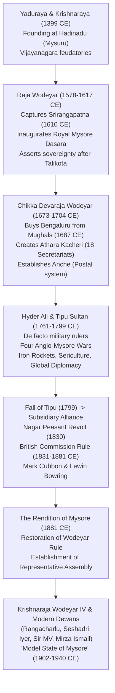

# The Mysore Kingdom, Wodeyars, Hyder-Tipu Era and the Modern Dewans (ಮೈಸೂರು ಸಂಸ್ಥಾನ, ಒಡೆಯರು, ಹೈದರ್-ಟಿಪ್ಪು ಯುಗ ಮತ್ತು ಆಧುನಿಕ ದಿವಾನರು)

> [!exam-focus]
> **KPSC High-Yield Examination Focus**:
> - **Foundation of Wodeyar Dynasty**: Yaduraya and Krishnaraya in **1399 CE** at Hadinadu (Mysuru).
> - **Raja Wodeyar (1578-1617 CE)**: Acquired Srirangapatna in 1610 CE; inaugurated the historic **Mysore Dasara (ಮೈಸೂರು ದಸರಾ)** festival.
> - **Chikka Devaraja Wodeyar (1673-1704 CE)**: Established **Athara Kacheri (ಅಠಾರಾ ಕಛೇರಿ - 18 Administrative Secretariats)**; created postal network (*Anche*); bought Bengaluru from Mughals in 1687 CE for 3 lakh rupees.
> - **Hyder Ali and Tipu Sultan (1761-1799 CE)**: Four Anglo-Mysore Wars; invention of iron-cased Mysorean war rockets (*Baan*); state commercial board (*Mulk-ut-Tujjar*); promotion of sericulture; Treaty of Srirangapatna (1792); Fall of Srirangapatna (4 May 1799).
> - **British Commission Rule (1831-1881 CE)**: Nagar Peasant Revolt of 1830 led by Budi Basappa; William Bentinck deposes Krishnaraja Wodeyar III; Commissioners Sir Mark Cubbon (1834-1861) and Lewin Bowring (1862-1870).
> - **The Rendition of Mysore (1881 CE)**: Restoration of princely power to Maharaja Chamarajendra Wodeyar X.
> - **Krishnaraja Wodeyar IV (1902-1940 CE)**: Hailed as **Rajarshi (ರಾಜರ್ಷಿ)** by Mahatma Gandhi; pioneered the **Model State of Mysore (ಮಾದರಿ ಮೈಸೂರು)**.
> - **The Great Dewans of Mysore**:
>   - **C.V. Rangacharlu (1881-1883 CE)**: Founded **Mysore Representative Assembly (1881 CE)** — India's first democratic legislative house.
>   - **Sir K. Seshadri Iyer (1883-1901 CE)**: Commissioned **Shivanasamudra Hydroelectric Project (1902 CE)** — Asia's first long-distance commercial hydel station, powering KGF; founded Vani Vilasa Sagara (Marikanive) dam.
>   - **Sir M. Visvesvaraya (1912-1918 CE)**: "Industrialize or Perish"; Krishna Raja Sagara (KRS) Dam; Mysore Iron & Steel Works at Bhadravati; Mysore University (1916); State Bank of Mysore (1913); Sandalwood Oil Factory.
>   - **Sir Mirza Ismail (1926-1941 CE)**: Brindavan Gardens, HAL (1940), Mandya Sugar Factory, Glass and Porcelain factories.

---

## 1. Dynastic Origins and Early Consolidation

The Wodeyars (Odeyar / ಒಡೆಯರು - meaning Lord or Master) established their principality in 1399 CE as feudatories of the Vijayanagara Empire.



### 1.1 Raja Wodeyar: The Acquisition of Srirangapatna (1610 CE)
- Following the disintegration of Vijayanagara, Raja Wodeyar acquired the strategic island fortress of **Srirangapatna (ಶ್ರೀರಂಗಪಟ್ಟಣ)** from the retreating Vijayanagara viceroy Tirumala II.
- Established Srirangapatna as the new capital of the realm.
- **The Mysore Dasara Tradition**: In September 1610 CE, he issued a royal proclamation commanding that the 10-day festival of *Navaratri / Dasara* be celebrated with state pomp, military processions, and public durbar, establishing the unbroken tradition of **Mysore Dasara (ನಾಡಹಬ್ಬ ಮೈಸೂರು ದಸರಾ)**.

### 1.2 Chikka Devaraja Wodeyar (1673–1704 CE) — Administrative Pioneer
- **Territorial Expansion**: In 1687 CE, when the Mughal armies under Qasim Khan overran the Deccan, Chikka Devaraja skillfully negotiated and **purchased the city of Bengaluru for 3 lakh rupees**, building the Bangalore Fort and Venkataramana Temple.
- **Athara Kacheri (ಅಠಾರಾ ಕಛೇರಿ)**: Reorganized the chaotic feudal government into **18 distinct modern administrative departments (Kacheris)**, including treasury (*Khadana*), military (*Kandachara*), revenue, and judiciary.
- **Anche (ಅಂಚೆ)**: Established India's first state-run postal and intelligence transmission network using designated runners.
- Known as *Navakoti Narayana* (Master of Nine Crores) due to his fiscal discipline and treasury surplus.

---

## 2. The Era of Hyder Ali and Tipu Sultan (1761–1799 CE)

During the reign of weak puppet king Chikka Krishnaraja Wodeyar II, military commander **Hyder Ali** seized power in 1761 CE, styling himself as *Sarvadhikari* (Regent) and *Nawab*. He and his son **Tipu Sultan** transformed Mysore into the primary military adversary of the British East India Company.

```
The Four Anglo-Mysore Wars (ಆಂಗ್ಲೋ-ಮೈಸೂರು ಯುದ್ಧಗಳು)
├── 1. First Anglo-Mysore War (1767-1769 CE):
│   └── Hyder Ali outmaneuvers British cavalry; dictates Treaty of Madras (1769) under the walls of Fort St. George.
├── 2. Second Anglo-Mysore War (1780-1784 CE):
│   ├── Hyder Ali routs Colonel Baillie at Battle of Pollilur (1780); Battle of Porto Novo (1781).
│   ├── Death of Hyder Ali from cancer (1782); Tipu Sultan assumes command.
│   └── Concluded by the Treaty of Mangalore (1784) on terms of mutual restoration of territories.
├── 3. Third Anglo-Mysore War (1790-1792 CE):
│   ├── British Governor-General Lord Cornwallis forms Triple Alliance with Marathas and Nizam.
│   ├── Siege of Srirangapatna; Tipu signs crushing Treaty of Srirangapatna (1792).
│   └── Surrenders half his kingdom and gives his two young sons as hostages along with Rs. 3.3 crore indemnity.
└── 4. Fourth Anglo-Mysore War (1799 CE):
    ├── Governor-General Lord Wellesley launches pre-emptive strike over Tipu's alliance with Revolutionary France & Napoleon.
    ├── Srirangapatna breached; Tipu refuses to flee ("Better to live one day as a tiger than a thousand years as a sheep").
    └── Tipu Sultan dies heroically fighting at the Water Gate on 4 May 1799.
```

### 2.1 Tipu Sultan's Technological and Modernizing Innovations:
1. **Mysorean War Rockets (*Baan* - ರಾಕೆಟ್ ತಂತ್ರಜ್ಞಾನ)**:
   - First military use of **iron-cased cylindrical rocket tubes** packed with gunpowder, fastened to 10-foot bamboo poles, firing projectiles over 1.5 km with devastating concussive and incendiary effect against British infantry and cavalry.
   - Captured Mysorean rockets directly inspired British scientist William Congreve to develop the British *Congreve Rocket* used in the Napoleonic Wars.
2. **Sericulture and Silk Industry**: Imported silkworm eggs from Muscat and mulberry cultivation techniques from China in 1785 CE, establishing the first royal sericulture nurseries at Channapatna and Bangalore, laying the foundation for Karnataka's modern silk monopoly.
3. **State Commercial Board (*Mulk-ut-Tujjar*)**: Established a state trading corporation with overseas commercial factories at Muscat, Hormuz, and Jeddah; promoted state monopolies in sandalwood, spices, and betelnut.
4. **Calendar and Currency**: Introduced the *Mauludi* solar-lunar calendar, decimal weights and measures, and established state mints at Srirangapatna, Bangalore, Bednore, and Calicut minting exquisite gold coins (*Pagodas / Ahmadi*).
5. **Horticulture**: Expanded the **Lalbagh Botanical Garden** in Bangalore, importing exotic botanical specimens from Mauritius, France, and Turkey.

---

## 3. British Commission Rule in Mysore (1831–1881 CE)

Following Tipu's fall, the British placed 5-year-old **Krishnaraja Wodeyar III** on the throne under a Subsidiary Alliance, with **Diwan Purnaiah** as regent.
- **The Nagar Peasant Revolt (1830 CE)**: Extortionate tax exactions by Faujdar Rama Rao in the Nagar (Bednore) district triggered a widespread agrarian peasant uprising led by **Budi Basappa** (claiming to be the rightful Keladi prince) and Sardar Mallappa.
- **British Annexation (1831 CE)**: British Governor-General Lord William Bentinck used the breakdown of law and order as a pretext to strip Krishnaraja Wodeyar III of administrative powers in 1831 CE, placing Mysore under direct British Commission rule for 50 years.

### 3.1 Commissioners Mark Cubbon and Lewin Bowring:
1. **Sir Mark Cubbon (Chief Commissioner, 1834–1861 CE)**:
   - Shifted the administrative headquarters of Mysore State from Mysore to **Bengaluru**.
   - Constructed the majestic red stone **Athara Kacheri building (modern Karnataka High Court)** in Cubbon Park in 1868 CE.
   - Constructed over 2,500 miles of paved roads, 300 bridges, and the first railway line connecting Bengaluru to Jolarpettai (1864 CE).
2. **Lewin Bowring (Chief Commissioner, 1862–1870 CE)**:
   - Reorganized the state into 3 Divisions (Bangalore, Mysore, Nagar) and 8 Districts.
   - Introduced the Indian Penal Code, Criminal Procedure Code, and established modern revenue survey and settlement departments.
   - Founded the Central Jail and Bowring Hospital in Bengaluru.

---

## 4. The Rendition of Mysore (1881 CE) and Representative Democracy

After decades of persistent legal appeals by Krishnaraja Wodeyar III and his adopted heir **Chamarajendra Wodeyar X**, the British Parliament passed the **Rendition Act**, restoring royal administrative power to the Wodeyar dynasty on **25 March 1881 CE**.

### 4.1 C.V. Rangacharlu and the Mysore Representative Assembly (1881 CE)
- Appointed first Dewan of restored Mysore under Chamarajendra Wodeyar X.
- **The Historic Innovation**: On **25 August 1881 CE**, Rangacharlu established the **Mysore Representative Assembly (ಮೈಸೂರು ಪ್ರಜಾ ಪ್ರತಿನಿಧಿ ಸಭೆ)**:
  - Consisted of 144 elected/nominated representatives drawn from landowners, agriculturalists, and merchants across every taluk.
  - Met annually during the Dasara festival in Mysore to review the state budget, question ministers on public expenditure, and articulate local grievances.
  - This was the **very first experiment in democratic legislative representation in the history of modern India**, preceding the establishment of the Indian National Congress (1885) by four years!

---

## 5. Sir K. Seshadri Iyer: Industrial Infrastructure Pioneer (1883–1901 CE)

Serving as Dewan for eighteen continuous years, Sir K. Seshadri Iyer built the physical and economic infrastructure of modern Mysore:
1. **Shivanasamudra Hydroelectric Project (1902 CE)**:
   - Conceived and initiated by Seshadri Iyer across the Cauvery River at Shivanasamudra Falls.
   - Built to transmit electrical energy across **147 kilometers** to the deep mines of the **Kolar Gold Fields (KGF)**.
   - **Historical Significance**: It was the **first major commercial hydroelectric project in Asia**, and the longest high-voltage transmission line in the world at the time of its commissioning.
2. **Vani Vilasa Sagara Dam (ವಾರಿ ವಿಲಾಸ ಸಾಗರ / ಮಾರಿಕಣಿವೆ ಜಲಾಶಯ)**:
   - Constructed across the Vedavathi River at Hiriyur in Chitradurga district (1898-1907 CE).
   - Oldest major modern masonry dam in Karnataka, named after Maharani Regent Kempananjammanni (Vani Vilasa Sannidhana).
3. **Bangalore Extensions**: Developed the planned modern residential layouts of **Malleswaram** and **Basavanagudi** in Bangalore following the plague epidemic of 1898.
4. **Mysore Civil Services (MCS)**: Introduced competitive merit examinations for administrative recruitment in 1891 CE.

---

## 6. Krishnaraja Wodeyar IV & Sir M. Visvesvaraya: The Model State (1902–1940 CE)

Maharaja **Krishnaraja Wodeyar IV (1902-1940 CE)**, guided by his saintly character, progressive ideals, and brilliant Dewans, transformed Mysore into the most advanced and socially enlightened princely state in India:
- **Rajarshi**: Mahatma Gandhi hailed Krishnaraja Wodeyar IV as a **Rajarshi (ರಾಜರ್ಷಿ - Philosopher King)** and described Mysore as **"Rama Rajya"**.
- **Social Reforms**:
  - Abolished the Devadasi system in temple establishments.
  - Passed legislation raising the age of marriage and banning child marriage.
  - Established the historic **Miller Committee (1919 CE)** under Justice Leslie Miller to provide affirmative reservations in government employment for backward communities.
  - Donated **371 acres of prime land** in Bangalore and massive financial subsidies to establish the **Indian Institute of Science (IISc)** in 1909 CE, realizing the vision of J.N. Tata and Swami Vivekananda.

### 6.1 Sir M. Visvesvaraya (Dewan 1912–1918 CE) — "Industrialize or Perish"
Born at Muddenahalli (Chikkaballapura) on 15 September 1861, Sir Mokshagundam Visvesvaraya brought world-class engineering precision and visionary economic planning to governance:

```
Monumental Achievements of Sir M. Visvesvaraya as Dewan
├── 1. Water Engineering & Irrigation:
│   └── Engineered Krishna Raja Sagara (KRS) Dam at Kannambadi across Cauvery (1911-1932);
│       created 124-foot reservoir transforming Mandya and Mysore into fertile sugarcane belts.
├── 2. Industrial Enterprises ("Industrialize or Perish"):
│   ├── Mysore Iron and Steel Works at Bhadravati (1918 - later VISL).
│   ├── Government Sandalwood Oil Factory at Mysore (1916).
│   ├── Government Soap Factory at Bangalore (1918 - makers of Mysore Sandal Soap).
│   └── Mysore Chrome Tanning Company.
├── 3. Banking, Commerce and Education:
│   ├── Founded State Bank of Mysore (originally The Bank of Mysore Ltd, 1913).
│   ├── Founded Mysore Chamber of Commerce and Industry (FKCCI, 1916).
│   ├── Founded University of Mysore (1916 - first university in any Indian princely state).
│   ├── Founded Government Engineering College at Bangalore (1917 - now UVCE).
│   ├── Introduced Compulsory Primary Education Regulation (1913).
│   └── Established Sri Jayachamarajendra Occupational Institute (SJVP polytechnic).
└── 4. Civic & Cultural Foundations:
    ├── Established the Century Club at Bangalore (1917).
    └── Founded the Kannada Sahitya Parishat at Bangalore (1915).
```

### 6.2 Sir Mirza Ismail (Dewan 1926–1941 CE) — Urban Aesthetics and Modern Industry
- Lifelong friend and schoolmate of Krishnaraja Wodeyar IV; emphasized urban beauty, rural sanitation, and industrial diversification.
- **Industrial Foundations**:
  - Established **Hindustan Aeronautics Limited (HAL)** in Bangalore in December 1940 (with industrialist Walchand Hirachand).
  - Established **Mysore Paper Mills** and **Mysore Sugar Company (Mysugar)** at Mandya.
  - Glass and Porcelain factories; Chemical and Fertilizer plant at Belagola.
- **Urban Landscapes**: Conceived and designed the world-famous **Brindavan Gardens** at the foot of the KRS Dam with musical fountains; beautified Mysore into the "City of Palaces" and Bengaluru into the "Garden City".

---

## 7. Synoptic Matrix: Prominent Dewans of Modern Mysore

| Dewan | Tenure | Defining Modern Institutions Established |
|---|---|---|
| **C.V. Rangacharlu** | 1881 – 1883 | **Mysore Representative Assembly (1881)**; Bangalore-Jolarpettai railway line. |
| **Sir K. Seshadri Iyer** | 1883 – 1901 | **Shivanasamudra Hydel Project (1902)**; Vani Vilasa Sagara Dam; Malleswaram & Basavanagudi layouts; MCS exam. |
| **P.N. Krishnamurti** | 1901 – 1906 | Expanded primary education; instituted electrical supply to Bangalore (1905). |
| **V.P. Madhava Rao** | 1906 – 1909 | Established **Mysore Legislative Council (1907)**; Central Cooperative Bank. |
| **T. Ananda Rao** | 1909 – 1912 | Initiated KRS dam project; finalized IISc land grant; Economic Conference. |
| **Sir M. Visvesvaraya**| 1912 – 1918 | **KRS Dam, Bhadravati Iron Works, Mysore University (1916), State Bank of Mysore (1913), UVCE (1917), Sandal Soap (1918)**. |
| **Sir M. Kantaraj Urs** | 1918 – 1922 | First non-Brahmin Dewan; implemented **Miller Committee Report (1919)** reservations. |
| **Sir Albion Banerji** | 1922 – 1926 | Passed Mysore Village Panchayats Act; women granted right to vote. |
| **Sir Mirza Ismail** | 1926 – 1941 | **HAL (1940), Brindavan Gardens, Mandya Sugar Mills, Mysore Paper Mills, Glass & Porcelain works**. |

---

## 8. Prelims Traps & Mains Answer Blueprint

### 8.1 Prelims Traps
> [!caution]
> - **Trap 1**: Believing the Mysore Representative Assembly was established after the Indian National Congress. *Fact*: The Assembly was founded in **1881 CE** by C.V. Rangacharlu, **four years before** the INC was founded in 1885 CE!
> - **Trap 2**: Confusing the author of the Shivanasamudra project. *Fact*: It was conceived and executed by **Sir K. Seshadri Iyer** in 1902 CE, not Sir M. Visvesvaraya (who became Dewan in 1912 CE).
> - **Trap 3**: Believing the Mysore University was the first university in India. *Fact*: It was the **first university in an Indian princely state** (1916 CE), though Calcutta, Bombay, and Madras (1857) were older British presidency universities.

### 8.2 Mains Model Question & Answer Blueprint
**Question**: *Explain why modern Mysore was acclaimed as a 'Model State' across the British Empire. Highlight the institutional and industrial contributions of Sir M. Visvesvaraya.* (Marks: 15 / 250 Words)

**Model Answer Outline**:
1. **Introduction (35 words)**:
   - Identify the Princely State of Mysore under Maharaja Krishnaraja Wodeyar IV and his visionary Dewans as an oasis of administrative enlightenment, industrialization, and democratic representation, acclaimed by Mahatma Gandhi as "Rama Rajya".
2. **Body 1: The Institutional Architecture of a Model State (75 words)**:
   - *Pioneering Democracy*: Established India's first elected legislative house (Representative Assembly 1881) and Legislative Council (1907).
   - *Social Justice Benchmark*: Implemented the landmark Miller Committee Report (1919), establishing the first systemic caste-based affirmative reservations in public employment.
   - *Universal Welfare*: Made primary education compulsory and free; established modern medical infrastructure (Victoria, Minto Eye Hospital).
3. **Body 2: Sir M. Visvesvaraya's Technocratic Renaissance (100 words)**:
   - *Motto*: "Industrialize or Perish" — Shifted policy from agrarian dependence to state-led industrial capitalism.
   - *Irrigation & Power*: Engineered the Krishna Raja Sagara (KRS) Dam, transforming the Cauvery basin into an agro-industrial heartland.
   - *Heavy Industry*: Founded Mysore Iron and Steel Works (Bhadravati), Sandalwood Oil Factory, and Government Soap Factory.
   - *Financial & Human Capital*: Established the Bank of Mysore (1913) to finance domestic commerce; founded the University of Mysore (1916) and UVCE (1917) to create native scientific and engineering talent.
4. **Conclusion (40 words)**:
   - Conclude that Visvesvaraya's state-directed modernization combined technocratic engineering with ethical public administration, creating the institutional foundations that positioned Karnataka as India's premier hub of industry, science, and innovation.

---

## 9. Sources and Verification
- **Verified On**: 2026-10-13 (Tuesday)
- **Primary Source 1**: Sir M. Visvesvaraya, *Memoirs of My Working Life*, National Book Trust, New Delhi.
- **Primary Source 2**: Dr. Suryanath Kamath, *A Concise History of Karnataka*, MCC, Bengaluru.
- **Primary Source 3**: B.L. Rice, *Mysore Gazetteer: Historical and Administrative*, Government Press.
