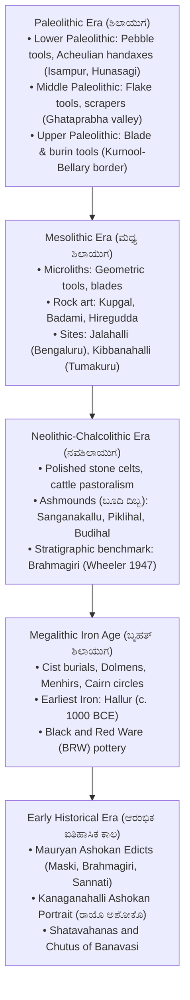

# Prehistory, Protohistory and Early Historical Period in Karnataka (ಕರ್ನಾಟಕದ ಪ್ರಾಗೈತಿಹಾಸ, ಪ್ರೋಟೋ-ಇತಿಹಾಸ ಮತ್ತು ಆರಂಭಿಕ ಐತಿಹಾಸಿಕ ಕಾಲ)

> [!exam-focus]
> **KPSC High-Yield Examination Focus**:
> - **Prehistoric Sites & Excavators**: Robert Bruce Foote (Father of Indian Prehistory) discovering Paleolithic tools in Malaprabha-Ghataprabha basin; Mortimer Wheeler's stratigraphic excavations at Brahmagiri (Chitradurga) in 1947 establishing South Indian cultural sequence.
> - **Neolithic-Chalcolithic Ashmounds**: Origin, distribution, and pastoral significance of Ashmounds (*Boodi Dibba* - ಬೂದಿ ದಿಬ್ಬ) at Sanganakallu, Kupgal, Maski, Piklihal, Budihal, and Kudatini.
> - **Earliest Iron Age Evidence**: Hallur (Haveri district) on Tungabhadra river yielding earliest iron implements in South India (calibrated to c. 1000 BCE).
> - **Ashokan Inscriptions**: Karnataka possesses the largest cluster of Ashokan rock edicts outside Magadha (17+ edicts across 9 sites in Kalaburagi, Raichur, Koppal, Ballari, and Chitradurga). Maski is the milestone edict explicitly mentioning the personal name *"Devanampriya Ashoka"*.
> - **Sannati / Kanaganahalli**: World's only inscribed stone portrait sculpture of Emperor Ashoka (*Rayo Ashoko*) excavated in the stupa complex on Bhima river bank in Chitradurga/Kalaburagi.

---

## 1. Geographical and Archaeological Setting

Karnataka's unique geology—featuring the Archaean granitic tors and greenstone belts of the Dharwar Craton, flanked by the river valleys of the Krishna, Tungabhadra, Malaprabha, Ghataprabha, Cauvery, and Bhima—provided an ideal ecological haven for prehistoric human settlement.



---

## 2. The Stone Age Sequence in Karnataka

### 2.1 Paleolithic Culture (ಹಳೆಯ ಶಿಲಾಯುಗ)
1. **Lower Paleolithic (Early Acheulian)**:
   - Found extensively in the **Hunasagi (ಹೂಣಸಗಿ)** and **Baichbal (ಬೈಚಬಾಳ)** valleys of Yadgir district.
   - Excavations by Prof. K. Paddayya at **Isampur (ಇಸಾಮ್‌ಪುರ)** proved it to be a localized quarry-cum-workshop site where limestone handaxes, cleavers, and chopping tools were systematically manufactured c. 1.2 million years ago.
   - Malaprabha and Ghataprabha valleys in Bagalkote (Anagawadi, Bagalkote, Khyad) yielded quartzite tools discovered initially by Robert Bruce Foote.
2. **Middle Paleolithic (Nevasan Culture equivalent)**:
   - Characterized by specialized flake tools made of jasper, chert, and agate. Key sites include Salvadgi (Bijapur), Kovalli (Bagalkote), and Taminahal.
3. **Upper Paleolithic**:
   - Flake-blade industries found in Shorapur Doab (Yadgir) and Meralbhavi. Bone tools discovered in cave formations near the Karnataka-Andhra border.

### 2.2 Mesolithic Culture (ಮಧ್ಯ ಶಿಲಾಯುಗ)
- Characterized by tiny geometric stone tools called **Microliths (ಸೂಕ್ಷ್ಮ ಶಿಲಾಯುಧಗಳು)**: triangles, crescents, trapezes, and points, fixed to wooden or bone handles as sickles and spears.
- Key sites: **Jalahalli (ಜಾಲಹಳ್ಳಿ)** near Bengaluru, **Kibbanahalli (ಕಿಬ್ಬನಹಳ್ಳಿ)** in Tumakuru district, and caves around Badami and Bagalkote.
- Rock paintings from this epoch showing animal chases, hunting dancers, and geometric symbols are preserved at **Kupgal (ಕುಪ್ಗಲ್)** in Ballari and Hiregudda.

---

## 3. The Neolithic-Chalcolithic Transformation & Ashmounds

The Neolithic revolution in Karnataka represents the transition from nomadic foraging to settled agro-pastoralism between 3000 BCE and 1000 BCE.

### 3.1 The Phenomenon of Ashmounds (ಬೂದಿ ದಿಬ್ಬಗಳು)
- **Nature and Discovery**: Discovered by Robert Bruce Foote, who first identified them as vitrified cow-dung mounds burned at high temperatures (c. 800°C to 1000°C).
- **Function**: Pastoral communities constructed wooden palisades for cattle penning. During seasonal pastoral festivals (analogous to modern *Gorehabba* or *Makar Sankranti* bonfires), accumulated cow dung was ritually burnt, producing slag-like vitrified cinder mounds.
- **Key Ashmound Sites**:
  1. **Sanganakallu (ಸಂಗನಕಲ್ಲು)** in Ballari district: Extensive Neolithic settlement and factory site excavated by Subbarao and Raymond Allchin.
  2. **Budihal (ಬುದಿಹಾಳ್)** in Surapur taluk, Yadgir: Excavated by Paddayya; revealed a butchering floor, community dining area, and residential units around the mound.
  3. **Piklihal (ಪಿಕ್ಲಿಹಾಳ್)** in Raichur: Proved selective breeding of zebu humped cattle (*Bos indicus*).
  4. **Kudatini (ಕುಡತಿನಿ)** in Ballari and **Maski (ಮಸ್ಕಿ)** in Raichur.

### 3.2 Mortimer Wheeler's Excavation at Brahmagiri (1947)
Sir Mortimer Wheeler established the definitive stratigraphical archaeological chronology of South India at Brahmagiri (Chitradurga):
- **Period I (Neolithic-Chalcolithic)**: Polished stone axes (celts), handmade coarse grey ware pottery, copper chisels.
- **Period II (Megalithic)**: Iron tools, Black-and-Red Ware (BRW) pottery, port-holed cist burial chambers.
- **Period III (Andhra / Early Historic)**: Russet-coated painted pottery (Kaolin ware), rouletted ware, coins of Shatavahanas.

---

## 4. The Megalithic Iron Age (ಬೃಹತ್ ಶಿಲಾಯುಗ - c. 1200 BCE - 300 BCE)

The emergence of iron metallurgy coincided with monumental stone funerary structures known as **Megaliths (ಬೃಹತ್ ಶಿಲಾ ಸಮಾಧಿಗಳು)**.

### 4.1 Chronology & Key Sites Table:
| Site | District | Monument Typology | Major Archaeological Finds |
|---|---|---|---|
| **Hallur (ಹಳ್ಳೂರು)** | Haveri | Habitation-cum-burial | Earliest iron implements (arrowheads, spears c. 1000 BCE); horse bones; finger-millet (ragi). |
| **Brahmagiri (ಬ್ರಹ್ಮಗಿರಿ)** | Chitradurga | Port-holed Cist & Dolmens | Skeletons in crouching posture, iron sickles, weapons, Black-and-Red ware pottery. |
| **Hirebenakal (ಹಿರೆಬೆಣಕಲ್)** | Koppal | Dolmens (*Moriyara Mane* - ಮೋರಿಯರ ಮನೆ) | Largest megalithic cemetery in Karnataka (over 400 dolmens); UNESCO tentative list; rich rock art. |
| **Savandurga (ಸಾವನದುರ್ಗ)** | Ramanagara | Cairn circles & Stone cists | Extensive urn burials and sarcophagi. |
| **Konnur (ಕೊಣ್ಣೂರು)** | Belagavi | Dolmenoid cists | Megaliths situated along Ghataprabha basin. |

---

## 5. The Mauryan Epoch & Ashokan Rock Edicts in Karnataka

During the reign of Emperor Ashoka (c. 268-232 BCE), Karnataka formed the southernmost administrative province of the Mauryan Empire (*Suvarnagiri* - ಸುವರ್ಣಗಿರಿ, near Kanakagiri in Koppal, was the viceregal capital of the Mauryan prince *Aryaputra*).

```
Ashokan Inscriptions in Karnataka (17 Edicts across 9 Distinct Locations)
├── Raichur District:
│   ├── Maski (ಮಸ್ಕಿ) -> Minor Rock Edict (Discovered 1915 by C. Beadon; named "Devanampriya Ashoka")
├── Koppal District:
│   ├── Gavimath (ಗವಿಮಠ) -> Minor Rock Edict (Palkigundu & Gavimath hills)
│   └── Palkigundu (ಪಾಲ್ಕಿಗುಂಡು) -> Minor Rock Edict
├── Kalaburagi District:
│   └── Sannati / Kanaganahalli (ಸನ್ನತಿ / ಕಣಗನಹಳ್ಳಿ) -> Major Rock Edicts (XII, XIV) & Special Edicts I & II
├── Ballari / Vijayanagara District:
│   ├── Nittur (ನಿಟ್ಟೂರು) -> Minor Rock Edict (Contains name "Raja Ashoka")
│   └── Udegolam (ಉದೆಗೋಳಂ) -> Minor Rock Edict (Contains name "Raja Ashoka, Devanampriya")
└── Chitradurga District (Excavated by B.L. Rice 1892):
    ├── Brahmagiri (ಬ್ರಹ್ಮಗಿರಿ) -> Minor Rock Edict I & II (Written by scribe Chapada in Kharosthi script at end)
    ├── Siddapura (ಸಿದ್ಧಾಪುರ) -> Minor Rock Edict
    └── Jatinga Rameshwara (ಜಟಿಂಗ ರಾಮೇಶ್ವರ) -> Minor Rock Edict
```

### 5.1 The Significance of the Maski Edict (1915)
Prior to 1915, all Ashokan edicts in North India and the Rock Edicts of Girnar and Dhauli referred to the emperor merely by his imperial epithets: *Devanampriya* (Beloved of the Gods) and *Priyadarshin* (Pleasant to Behold). On 26 January 1915, mining engineer **C. Beadon** discovered the Maski Minor Rock Edict:
> *"Devanampriyasa Ashokasa"* (ದೇವಾನಾಂಪ್ರಿಯಸ ಅಶೋಕಸ)
This unequivocally confirmed that the great Buddhist patron was Emperor Ashoka Maurya, matching the Mahavamsa and Dipavamsa chronicles of Sri Lanka.

### 5.2 Kanaganahalli (Sannati) Stupa & Inscribed Ashokan Portrait
- **Location**: On the left bank of the Bhima river in Chitrapur/Wadi taluk, Kalaburagi.
- **Discovery**: In 1986, the collapse of the roof of the Chandralamba temple sanctum revealed an Ashokan edict slab. Subsequent ASI excavations between 1994 and 2002 uncovered the **Maha Stupa (Adholoka Maha Chaitya)** dating from 1st century BCE to 3rd century CE.
- **The Ashokan Portrait Slab**: A limestone relief slab depicts Emperor Ashoka standing flanked by his queens and female attendants carrying umbrellas (*chhatra*), with the Brahmi label:
  > **"Rayo Ashoko" (ರಾಯೊ ಅಶೋಕೊ - King Ashoka)**
- It remains the **only verified physical portrait depiction of Emperor Ashoka** found anywhere in the world.

---

## 6. Shatavahanas and Chutus in Karnataka (c. 1st Century BCE - 3rd Century CE)

Following the decline of the Mauryas, the Deccan fell under the hegemony of the **Shatavahanas (ಶಾತವಾಹನರು)** and their feudatories:
- **Administrative Presence**: Ruled Northern Karnataka from capitals at Paithan (Pratishthana) and Amaravati (Dhanyakataka). Key Karnataka provincial centers included Banavasi (Sanjayanti/Vaijayanti), Vadagaon-Madhavpur (Belagavi), and Sannati.
- **Numismatic Evidence**: Coins of Gautamiputra Satakarni, Vashishtiputra Pulumavi, and Yajna Sri Satakarni discovered at Chandravalli (Chitradurga) and Vadagaon-Madhavpur.
- **Chutus of Banavasi (ಬನವಾಸಿಯ ಚುಟುಗಳು)**: Succeeded the Shatavahanas in Karwar-Shimoga-Dharwad region. Replaced by the Kadambas of Banavasi in the mid-4th century CE.

---

## 7. Comparative Synoptic Tables

### Table 7.1: Prehistoric Stages in Karnataka
| Period | Technology / Raw Material | Dominant Economic Mode | Representative Sites in Karnataka |
|---|---|---|---|
| **Lower Paleolithic** | Limestone, Quartzite handaxes, cleavers | Big game hunting, scavenging | Isampur, Hunasagi, Anagawadi, Kibbanahalli |
| **Middle Paleolithic**| Flakes, Scrapers (Chert, Jasper) | Small game hunting, gathering | Salvadgi, Kovalli, Bagalkote |
| **Upper Paleolithic**| Blades, Burins, Bone points | Specialized hunting, foraging | Shorapur Doab, Meralbhavi |
| **Mesolithic** | Microliths (composite tools) | Hunting, fishing, gathering | Jalahalli, Kupgal, Sanganakallu |
| **Neolithic** | Polished stone celts, pottery | Pastoral cattle breeding, millets | Sanganakallu, Piklihal, Budihal, Maski |
| **Megalithic** | Iron metallurgy, Black & Red ware | Agriculture, rice, iron technology | Hallur, Hirebenakal, Brahmagiri, Savandurga |

### Table 7.2: Ashokan Inscriptions in Karnataka — Summary Matrix
| Inscription Site | Current District | Script & Language | Historical Benchmark / Key Content |
|---|---|---|---|
| **Maski** | Raichur | Prakrit in Ashokan Brahmi | First edict to reveal the personal name *"Ashoka"*. |
| **Kanaganahalli (Sannati)** | Kalaburagi | Prakrit in Brahmi | Sculptural relief portrait labeled *"Rayo Ashoko"*; Major Rock Edicts XII & XIV. |
| **Nittur** | Bellary / Vijayanagara | Prakrit in Brahmi | Mentions *"Raja Ashoka"*. |
| **Udegolam** | Bellary / Vijayanagara | Prakrit in Brahmi | Mentions *"Raja Ashoka, Devanampriya"*. |
| **Brahmagiri** | Chitradurga | Prakrit; Scribe signature in Kharosthi | Mentions Prince (*Aryaputra*) at Suvarnagiri; Chapada scribe signed in Kharosthi: *"Chapradena likhitam"*. |
| **Siddapura** | Chitradurga | Prakrit in Brahmi | Moral exhortation to obey parents and respect teachers. |
| **Jatinga Rameshwara** | Chitradurga | Prakrit in Brahmi | Adjacent to ancient Ashokan trade route. |
| **Gavimath** | Koppal | Prakrit in Brahmi | Minor Rock Edict detailing moral conduct (*Dhamma*). |
| **Palkigundu** | Koppal | Prakrit in Brahmi | Situated on a canopy-shaped rock near Gavimath. |

---

## 8. Prelims Traps & Mains Answer Blueprint

### 8.1 Prelims Traps (KPSC Traps)
> [!caution]
> - **Trap 1**: Believing Maski was discovered by Mortimer Wheeler or B.L. Rice. *Fact*: Maski was discovered by gold mining engineer **C. Beadon** in 1915. B.L. Rice discovered the three Chitradurga edicts (Brahmagiri, Siddapura, Jatinga Rameshwara) in 1892. Mortimer Wheeler excavated Brahmagiri in 1947.
> - **Trap 2**: Confusing Ashmounds with cremation grounds. *Fact*: Ashmounds are vitrified cattle dung heaps from seasonal pastoral penning rituals, not human cremation ashes.
> - **Trap 3**: Assuming all 17 Ashokan edicts in Karnataka carry the name "Ashoka". *Fact*: Only **four** edicts in India explicitly name him: Maski, Gujarra (MP), Nittur, and Udegolam. Three of these four are in Karnataka!

### 8.2 Mains Model Question & Answer Structure
**Question**: *Examine the archaeological and historical significance of Ashokan inscriptions in Karnataka. How did the discovery of Kanaganahalli alter our understanding of Mauryan art and administration in the Deccan?* (Marks: 12.5 / 150 Words)

**Model Answer Outline**:
1. **Introduction (25 words)**:
   - State that Karnataka holds 17 Ashokan edicts across 9 locations, reflecting deep Mauryan imperial presence governed through the viceregal capital *Suvarnagiri* (Koppal).
2. **Body Paragraph 1: Epigraphical Significance (45 words)**:
   - **Resolution of Identity**: Maski (1915) solved the mystery of *Devanampriya Priyadarshin* by explicitly recording *"Devanampriyasa Ashokasa"*. Nittur and Udegolam corroborated this.
   - **Administrative Reach**: Brahmagiri edict proves governance by *Aryaputra* (Mauryan royal prince) and *Mahamatras*, using local Prakrit and the inclusion of the Kharosthi signature of scribe Chapada.
3. **Body Paragraph 2: The Kanaganahalli Paradigm Shift (50 words)**:
   - Sannati/Kanaganahalli excavation (1994-2002) yielded the *Adholoka Maha Chaitya* stupa.
   - Unveiled the world's only contemporary stone relief portrait of Ashoka labeled *"Rayo Ashoko"*, proving that Buddhist sculptural relief representation of the emperor existed in the Deccan.
   - Highlighted trade networks connecting the Krishna-Bhima basin with coastal Andhra and North Indian Buddhist pilgrimage routes.
4. **Conclusion (30 words)**:
   - Conclude that Karnataka was not merely a peripheral territory but an administrative and spiritual nexus of the Mauryan Deccan, providing the bedrock for subsequent dynasties like the Shatavahanas and Kadambas.

---

## 9. Linked Previous-Year Questions (PYQs) & Memory Aids

### 9.1 Previous Year Questions
- **KPSC KAS Prelims 2017**: *"In which of the following Ashokan edicts does the emperor's personal name 'Ashoka' appear for the first time?"*
  - **Answer**: Maski (Minor Rock Edict, Raichur district).
- **KPSC KAS Prelims 2020**: *"The archaeological site of Hallur, famous for the earliest iron implements in South India, is situated on the banks of which river?"*
  - **Answer**: Tungabhadra River (Haveri district).
- **KPSC KAS Mains 2014**: *"Discuss the features of the Neolithic culture of South India with special reference to ashmounds."*

### 9.2 High-Yield Mnemonics
- **Four Edicts Bearing the Name Ashoka**: **M-G-N-U**
  - **M**: Maski (Karnataka)
  - **G**: Gujarra (Madhya Pradesh)
  - **N**: Nittur (Karnataka)
  - **U**: Udegolam (Karnataka)
  *(Three out of four are in Karnataka!)*

---

## 10. In the News & Recent Archaeological Developments

- **Kanaganahalli Conservation Project (ASI 2024-2026)**: The Archaeological Survey of India initiated a comprehensive Rs. 3.5 crore conservation and canopy shelter project for the Kanaganahalli Maha Stupa and the *Rayo Ashoko* panel to protect the soft limestone sculptures from monsoon weathering.
- **Hirebenakal Megalithic Site UNESCO Nomination**: Included in India's Tentative List of World Heritage Sites under the category of Megalithic Landscapes of Karnataka.
- **New Microlithic Discoveries**: Recent exploration by Karnataka State Archaeology Dept in the Cauvery basin near Talakadu identified Upper Paleolithic to Mesolithic tool assemblages.

---

## 11. Sources and Verification
- **Verified On**: 2026-10-13 (Tuesday)
- **Primary Source 1**: Archaeological Survey of India (ASI) Memoir No. 106, *Excavations at Kanaganahalli (Sannati)*, New Delhi.
- **Primary Source 2**: Dr. Suryanath Kamath, *A Concise History of Karnataka*, MCC, Bengaluru.
- **Primary Source 3**: Mortimer Wheeler, *Brahmagiri and Chandravalli 1947: Megalithic and other Cultures in Mysore State*, Ancient India, Vol. 4.
