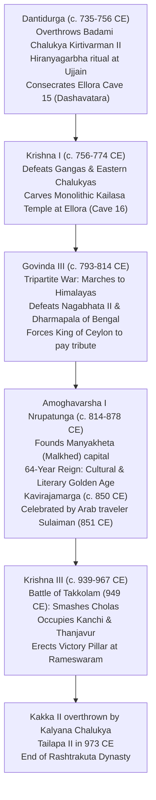

# The Rashtrakutas of Manyakheta, Pan-Indian Imperial Power and Kavirajamarga (ಮಾನ್ಯಖೇಟದ ರಾಷ್ಟ್ರಕೂಟರು, ಅಖಿಲ ಭಾರತ ಸಾಮ್ರಾಜ್ಯ ಮತ್ತು ಕವಿರಾಜಮಾರ್ಗ)

> [!exam-focus]
> **KPSC High-Yield Examination Focus**:
> - **Imperial Magnitude**: The Rashtrakutas were the only South Indian dynasty that marched repeatedly to the Gangetic plains, capturing Kannauj and dictating the politics of North India during the **Tripartite Struggle (ತ್ರಿಪಕ್ಷೀಯ ಹೋರಾಟ)** against the Gurjara-Pratiharas and Palas.
> - **Arab Traveler Sulaiman's Testimony (851 CE)**: Merchant Sulaiman recorded that the *Balhara* (Vallabharaja / Rashtrakuta Emperor) was **one of the four greatest imperial monarchs of the world**, on equal standing with the Emperor of China, the Caliph of Baghdad, and the Emperor of Constantinople (Byzantine Roman Empire).
> - **Monolithic Kailasa Temple at Ellora (Cave 16)**: Consecrated under King **Krishna I (ಕೃಷ್ಣ I, c. 756-774 CE)**; excavated vertically downwards from a single solid basalt cliff; architectural wonder of the world.
> - **Amoghavarsha I Nrupatunga (ಅಮೋಘವರ್ಷ ನೃಪತುಂಗ, c. 814-878 CE)**: Ruled for 64 years; established **Manyakheta (ಮಾನ್ಯಖೇಟ / Malkhed)** in Kalaburagi as imperial capital; patronized **Kavirajamarga (ಕವಿರಾಜಮಾರ್ಗ, c. 850 CE)**, the earliest available literary work and poetics text in Kannada; authored *Prashnottara Ratnamalika* in Sanskrit; titled the "Ashoka of the South".
> - **Adikavi Pampa (ಆದಿಕವಿ ಪಂಪ)**: Court poet of Rashtrakuta feudatory Arikesari II of Vemulawada; authored *Adipurana* (first Jain Champu epic in Kannada) and *Vikramarjuna Vijaya* (*Pampa Bharata*) in 941 CE.
> - **Battle of Takkolam (949 CE)**: Crown Prince Butuga II (Western Ganga) and Emperor Krishna III decisively defeated Chola Crown Prince Rajaditya at Takkolam, leading to Rashtrakuta occupation of Thanjavur and Kanchi, and the erection of a victory pillar at Rameswaram.

---

## 1. Rise of the Rashtrakuta Empire

The Rashtrakutas (c. 753 – 973 CE) traced their origin to the ancient *Rathikas / Rashtrikas* mentioned in Ashokan inscriptions. Originally feudatory governors under the Badami Chalukyas, they overthrew their suzerains during the mid-8th century CE.



### 1.1 Dantidurga: The Founding Sovereign
- Served as a Chalukyan governor in Berar and Maharashtra.
- Following the repulse of the Arab Umayyad incursions into Gujarat by Pulakeshin of Navsari, Dantidurga expanded his military strength.
- Captured Malwa and performed the sacred **Hiranyagarbha (ಮಹಾದಾನ ಹಿರಣ್ಯಗರ್ಭ - Golden Womb)** imperial consecration ceremony at Ujjain, compelling the Gurjara-Pratihara king to serve as his royal door-keeper (*Pratihara*).
- In 753 CE, he marched into Karnataka, routed Chalukya Kirtivarman II, and proclaimed imperial sovereignty (*Rajadhiraja Parameshwara*).

---

## 2. Monolithic Wonder: Kailasa Temple at Ellora (Cave 16)

Commissioned by **Krishna I (c. 756-774 CE)**, the monolithic **Kailasa Temple (ಕೈಲಾಸನಾಥ ದೇವಾಲಯ)** at Ellora (Verul, Maharashtra) is one of the supreme sculptural feats in global human history:
- **Top-Down Excavation (*Petrifaction*)**: Unlike conventional masonry assembled block-by-block, Kailasa was carved **vertically downward from the crown of a single basalt mountain cliff**. Over 200,000 tonnes of solid rock were chipped away over several decades.
- **Scale and Architecture**:
  - The courtyard measures 276 feet long, 154 feet wide, and 107 feet deep.
  - The central temple (*Vimana*) rises to 96 feet, featuring a multi-tiered Dravidian tower influenced by the Virupaksha temple of Pattadakal.
  - Comprises a two-storied entrance gateway (*Gopuram*), an independent *Nandi Mandapa*, two 50-foot monumental monolithic victory pillars (*Dhvajastambhas*), life-sized guardian elephants, and a pillared assembly hall with 16 sculpted columns.
- **Masterpiece Relief Sculpture**:
  - **Ravana Shaking Mount Kailasa (ರಾವಣಾನುಗ್ರಹ ಮೂರ್ತಿ)**: Depicts the multi-headed demon king Ravana trapped beneath Kailasa straining with his twenty arms to shake the mountain, while Parvati clings fearfully to Shiva, who effortlessly stabilizes the mountain by pressing down his right big toe.
- An ancient inscription records the awe of the master architect himself:
  > *"Katham-aho mayakritam iti aashcharya-chakitah shilpi"* (Oh, how was it that I built this! The architect was himself astonished).

---

## 3. Amoghavarsha I Nrupatunga & Kavirajamarga (c. 850 CE)

Ascending the throne at an early age in 814 CE, **Amoghavarsha I Nrupatunga** ruled for 64 years. He shifted the imperial capital from Mayurakhandi (Nasik) to **Manyakheta (ಮಾನ್ಯಖೇಟ - modern Malkhed in Kalaburagi)**, transforming it into a cosmopolitan metropolis that rivaled the city of Indra (*Indrapuri*).

### 3.1 Kavirajamarga: The Earliest Literary Work in Kannada
- **Authorship**: Composed c. **850 CE**; attributed to court poet **Sri Vijaya (ಶ್ರೀವಿಜಯ)** under the direct patronage and philosophical guidance of Emperor Amoghavarsha Nrupatunga.
- **Nature of the Work**: An authoritative guide on Kannada poetics, rhetoric, grammar, and literary criticism, based loosely on Dandin's Sanskrit *Kavyadarsha*.
- **Territorial Definition of Karnataka**:
  In a celebrated stanza, *Kavirajamarga* defines the geographical expanse within which the Kannada language was spoken:
  > *"ಕಾವೇರಿಯಿಂದಮಾ ಗೋದಾವರಿವರಮಿರ್ಪ ನಾಡದಾ ಕನ್ನಡದೊಳ್"*
  > *(Kaveriyindam aa Godavari-varamirpa naadadaa Kannadadol)*
  > — **"The land that extends from the Cauvery River in the south to the Godavari River in the north is the domain of Kannada."**
- **Celebration of the Kannada People**:
  > *"ಪದನರಿದು ನುಡಿಯಲುಂ ನುಡಿದುದನರಿದಾರಯಲುಮಾರ್ಪರಾ ನಾಡವರ್ಗಳ್; ಚದುರರ್ ನಿಜದಿಂ ಕುಳಿತೋದದೆಯುಂ ಕಾವ್ಯಪ್ರಯೋಗ ಪರಿಣತಮತಿಗಳ್"*
  > — "The people of that country are adept at speaking with linguistic discretion and comprehending deep speech; they are innately wise and skilled in the poetic arts even without formal academic tutelage."
- **Earliest Canon of Kannada Writers**: Mentioned earlier prose masters (*Gadyada Pravararu*) including Vimala, Udaya, Nagarjuna, and Durvinita; and poets (*Kavyada Pravararu*) including Ravikirti, Kaviswara, Pandita, and Chandra.

### 3.2 Arab Traveler Sulaiman's Ranking (851 CE)
Merchant Sulaiman from the Persian Gulf visited India during Amoghavarsha's reign. In his chronicle *Salsilat-ut-Tawarikh*, he wrote:
> "The King of the Balhara (Vallabharaja) is among the **four great kings of the world**. The four great sovereigns are:
> 1. The Emperor of Baghdad (The Abbasid Caliph).
> 2. The Emperor of China.
> 3. The Emperor of the Romans (Constantinople / Byzantium).
> 4. The **Balhara, King of the Kings of India**."
Sulaiman added that the Balhara was celebrated for his immense armies, hundreds of battle elephants, generous patronage to subjects, and friendly treatment of Arab Muslim traders, permitting them to build mosques and practice Islamic prayers freely within his ports and cities.

---

## 4. The Golden Age of Classical Kannada Literature

The Rashtrakuta epoch witnessed the flowering of the **Champu (ಚಂಪೂ)** style—a mixed poetic genre blending rhythmic prose and classical verse.

### Table 4.1: Literary Luminaries of the Rashtrakuta Period
| Author | Patron King / Court | Major Works | Language | Literary Benchmark |
|---|---|---|---|---|
| **Sri Vijaya (ಶ್ರೀವಿಜಯ)** | Amoghavarsha I | **Kavirajamarga (ಕವಿರಾಜಮಾರ್ಗ)** | Kannada | Earliest poetics and literary theory treatise in Kannada (c. 850 CE). |
| **Amoghavarsha I** | Self-authored | **Prashnottara Ratnamalika** | Sanskrit | Philosophical catechism on ethics; later translated into Tibetan. |
| **Adikavi Pampa (ಪಂಪ)** | Arikesari II (feudatory) | **Adipurana (ಆದಿಪುರಾಣ)** & **Vikramarjuna Vijaya (ವಿಕ್ರಮಾರ್ಜುನ ವಿಜಯ)** | Kannada | *Adipurana* details 1st Tirthankara Rishabanatha; *Vikramarjuna Vijaya* identifies patron Arikesari with Arjuna in Mahabharata (941 CE). First *Kavichakravarti*. |
| **Sri Ponna (ಪೊನ್ನ)** | Krishna III | **Santipurana (ಶಾಂತಿಪುರಾಣ)** & *Bhuvanaika-ramabhyudaya* | Kannada | Biography of 16th Tirthankara Shantinatha; honored with the title *Ubhaya-kavi-chakravarti* (Emperor of poets in two languages: Kannada & Sanskrit). |
| **Jinasena Acharya** | Amoghavarsha I | *Mahapurana* (co-authored) & *Parshvabhyudaya* | Sanskrit | Royal preceptor (*Guru*) of Amoghavarsha; adapted Meghaduta verses to narrate Parshvanatha's life. |
| **Gunabhadra** | Krishna II | *Uttarapurana* | Sanskrit | Completed the unfinished *Mahapurana* of his teacher Jinasena. |
| **Mahaviracharya** | Amoghavarsha I | **Ganita Sara Sangraha (ಗಣಿತ ಸಾರ ಸಂಗ್ರಹ)** | Sanskrit | Foundational treatise on mathematics; dealt with algebra, fractions, area, and zero. |
| **Halayudha** | Krishna III | *Kavirahasya* & *Mritasanjeevani* | Sanskrit | Etymological and prosodic lexicon. |

---

## 5. Military Triumphs in North and South

### 5.1 The Tripartite Struggle (ತ್ರಿಪಕ್ಷೀಯ ಸಂಘರ್ಷ)
For nearly two centuries, three imperial powers clashed for dominion over Kannauj (the symbolic seat of imperial supremacy in northern India):
1. **The Rashtrakutas of Manyakheta** (Deccan).
2. **The Gurjara-Pratiharas** (Rajasthan/Gujarat).
3. **The Palas of Bengal**.
- **Dhruva Dharavarsha (780-793 CE)**: Crossed the Vindhyas, routed Vatsaraja (Pratihara) in the Marwar desert, shattered Dharmapala (Pala) near the Doab, and returned with the sacred river emblems of Ganga and Yamuna.
- **Govinda III (793-814 CE)**: Achieved the most spectacular northern campaign in South Indian history; crushed Nagabhata II of Kannauj, forced Dharmapala and Chakrayudha to submit at the Himalayan foothills, and watered his horses in the holy waters of the Ganges.
- **Indra III (914-929 CE)**: Marched across Malwa, crossed the Yamuna, and completely sacked and leveled the city of Kannauj in 916 CE.

### 5.2 Krishna III and the Battle of Takkolam (949 CE)
- **Context**: The rising imperial Cholas under Parantaka I threatened southern Rashtrakuta frontiers.
- **The Battle**: In 949 CE, at **Takkolam (ತಕ್ಕೋಲಂ)** in North Arcot district (Tamil Nadu), Krishna III, assisted by his valiant brother-in-law **Ganga King Butuga II (ಬೂತುಗ II)**, engaged the Chola imperial army.
- **Outcome**: Butuga II shot Chola Crown Prince **Rajaditya** with an arrow while atop his royal war elephant (*Anai-mel-thunjina Devar*). The Chola army broke in disarray.
- Krishna III annexed northern Tamil territory (Tondaimandalam), assumed the title *Kanchiyum Tanjaiyum Konda* (Conqueror of Kanchi and Thanjavur), marched down to Rameswaram, and erected a monumental pillar of victory (*Jayastambha*).

---

## 6. Administrative Structure of the Rashtrakutas

```
Rashtrakuta Imperial Administrative Hierarchy
├── Imperial Centre:
│   ├── Paramabhattaraka Maharajadhiraja Parameshwara (The Emperor)
│   ├── Mahapradhana (Prime Minister)
│   ├── Sandhivigrahika (Minister for Foreign Affairs & Alliances)
│   ├── Mahabaladhikrita (Commander-in-Chief of the Army)
│   └── Dandanayaka (Chief of Judicial Administration)
├── Provincial Administration:
│   ├── Rashtrapati (Governor of a Rashtra / Province)
│   └── Vishayapati (Governor of a Vishaya / District)
├── Sub-District Administration:
│   ├── Nadagavunda / Deshadhikari (Head of a Nadu, composed of groups of villages)
│   └── Nalagavunda (Assistant territorial administrative officer)
└── Village Administration:
    ├── Gramakuta / Prabhu / Gauda (Village Headman, maintained law and order)
    ├── Yuktaka / Karana (Village Accountant / Record-keeper)
    └── Mahajanas (Assembly of village elders managing local disputes, irrigation, and temples)
```

---

## 7. Prelims Traps & Mains Answer Blueprint

### 7.1 Prelims Traps
> [!caution]
> - **Trap 1**: Believing Amoghavarsha I was an aggressive warmonger who led the Tripartite struggle into the Himalayas. *Fact*: It was **Govinda III** and **Dhruva** who conquered North India. Amoghavarsha I was a deeply religious, peace-loving scholar-monarch who prioritized literature, Jain philosophy, and civic welfare.
> - **Trap 2**: Assuming *Kavirajamarga* was the first Kannada inscription. *Fact*: *Kavirajamarga* is the **first available literary text (ಗ್ರಂಥ)** in Kannada (c. 850 CE). The first stone inscription is **Halmidi** (c. 450 CE).
> - **Trap 3**: Confusing Pampa's patron. *Fact*: Adikavi Pampa was patronized by **Arikesari II** of Vemulawada (a Rashtrakuta feudatory), whereas Ponna was patronized by Emperor **Krishna III**.

### 7.2 Mains Model Question & Answer Blueprint
**Question**: *Examine the political and cultural significance of the Rashtrakuta Empire in Indian history. On what historical grounds did contemporary Arab travelers rank them among the four greatest empires of the world?* (Marks: 15 / 250 Words)

**Model Answer Outline**:
1. **Introduction (35 words)**:
   - Identify the Rashtrakutas of Manyakheta (753-973 CE) as the pre-eminent pan-Indian empire of the early medieval era, bridging the Deccan, Gangetic plains, and Tamil realm.
2. **Body 1: Political Hegemony & Military Reach (75 words)**:
   - *Tripartite Hegemony*: Under Dhruva, Govinda III, and Indra III, Rashtrakuta armies repeatedly marched to Kannauj, subordinating both the Gurjara-Pratiharas and Palas.
   - *Southern Supremacy*: The Battle of Takkolam (949 CE) shattered Chola power for decades, extending hegemony to Rameswaram.
   - Provided political stability across Western and Central India for over two centuries.
3. **Body 2: Basis of Arab Traveler Sulaiman's Ranking (851 CE) (70 words)**:
   - Evaluated the *Balhara* as equal to China, Baghdad, and Constantinople.
   - Grounds: Unmatched military strength (elephant divisions, veteran cavalry); massive territorial extent from the Malwa plateau to Tanjore; vibrant Indian Ocean maritime commerce through Gujarat and Konkan ports.
   - Exemplary secular statecraft: Unprecedented religious tolerance granting Arab Muslim traders full freedom of faith, mosques, and commercial self-governance.
4. **Body 3: Cultural & Literary Renaissance (50 words)**:
   - *Ellora Kailasa Temple*: Pinnacle of rock-cut monolithic architectural engineering under Krishna I.
   - *Kannada Literature*: *Kavirajamarga* established the definitive territorial and linguistic boundaries of Karnataka; emergence of Adikavi Pampa and Ponna.
5. **Conclusion (20 words)**:
   - Conclude that the Rashtrakutas raised Karnataka to the status of a prime political arbiter of the subcontinent and a cradle of classical Indian art and literature.

---

## 8. Sources and Verification
- **Verified On**: 2026-10-13 (Tuesday)
- **Primary Source 1**: A.S. Altekar, *The Rashtrakutas and Their Times*, Oriental Book Agency, Poona.
- **Primary Source 2**: Dr. Suryanath Kamath, *A Concise History of Karnataka*, MCC, Bengaluru.
- **Primary Source 3**: K.A. Nilakanta Sastri, *A History of South India*, Oxford University Press.
