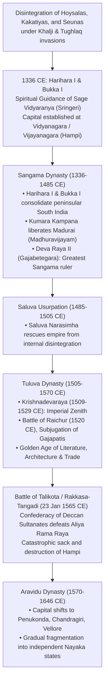
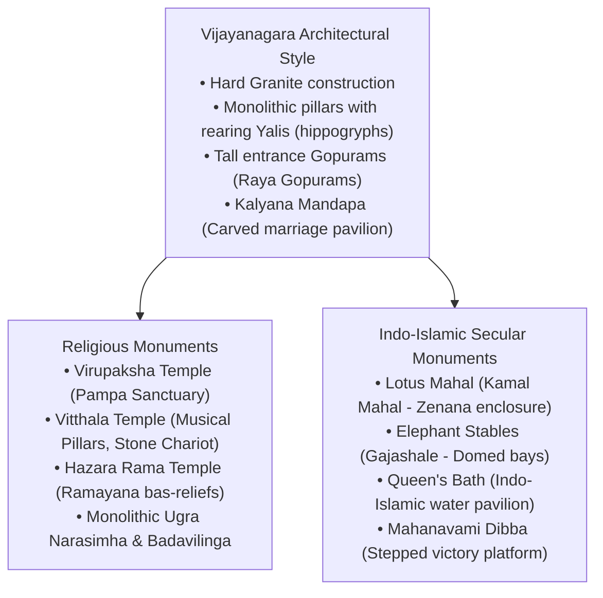

# The Vijayanagara Empire, Imperial Polity, Society and Hampi Renaissance (ವಿಜಯನಗರ ಸಾಮ್ರಾಜ್ಯ, ಸಾಮ್ರಾಜ್ಯಶಾಹಿ ರಾಜನೀತಿ, ಸಮಾಜ ಮತ್ತು ಹಂಪಿಯ ಸಾಂಸ್ಕೃತಿಕ ನವೋದಯ)

> [!exam-focus]
> **KPSC High-Yield Examination Focus**:
> - **Foundation**: Established on the southern bank of the Tungabhadra River in **1336 CE** by brothers **Harihara I (Hakka)** and **Bukka I** of the Sangama dynasty, under the spiritual guidance of **Sage Vidyaranya** of Sringeri Sharada Peetham.
> - **Four Imperial Dynasties**:
>   1. *Sangama Dynasty* (1336-1485 CE): Harihara I, Bukka I, Deva Raya II (*Gajabetegara*).
>   2. *Saluva Dynasty* (1485-1505 CE): Saluva Narasimha (usurpation to save the state).
>   3. *Tuluva Dynasty* (1505-1570 CE): Vira Narasimha, **Krishnadevaraya (1509-1529 CE)**, Achyuta Deva Raya, Sadashiva Raya.
>   4. *Aravidu Dynasty* (1570-1646 CE): Tirumala Raya, Venkata II (capital shifted to Penukonda, Chandragiri, Vellore).
> - **Krishnadevaraya's Sovereign Zenith**: Victorious campaigns against Gajapatis of Odisha (Udayagiri, Kondavidu) and Sultan of Bijapur (Battle of Raichur 1520); titles *Andhra Bhoja*, *Kannada Rajya Rama Ramana*; authored **Amuktamalyada** (Telugu statecraft masterpiece) and *Jambavati Kalyanam* (Sanskrit); patronized the *Ashtadiggajas*.
> - **Foreign Travelers' Accounts**: Nicolo de Conti (Italian, 1420), Abdur Razzaq (Persian, 1443), Duarte Barbosa (Portuguese, 1518), Domingos Paes (Portuguese, 1520), and Fernao Nuniz (Portuguese, 1535).
> - **Battle of Talikota / Rakkasa-Tangadi (23 January 1565 CE)**: Decisive defeat of Vijayanagara under regent Aliya Rama Raya by the confederacy of four Deccan Sultanates (Bijapur, Golconda, Ahmadnagar, Bidar).
> - **Administrative Machinery**: **Nayankara System (ನಾಯಂಕರ ಪದ್ಧತಿ)** (military feudal land assignment); **Ayagar System (ಆಯಗಾರ ಪದ್ಧತಿ)** (12 hereditary village officers); Gold currency **Varaha / Pagoda**.
> - **Hampi UNESCO World Heritage (1986)**: Virupaksha Temple, Vitthala Temple (monolithic stone chariot, 56 musical pillars), Hazara Rama Temple, Mahanavami Dibba, Lotus Mahal, Elephant Stables.

---

## 1. Imperial Founding and the Four Dynasties

The Vijayanagara Empire (1336–1646 CE) arose as a bulwark to protect and nurture traditional South Indian culture, institutions, and religious autonomy against the destructive incursions of the Delhi Sultanate.



### 1.1 Liberation of the South: Kumara Kampana's Expedition
- **Historical Event**: In 1371 CE, Crown Prince **Kumara Kampana** (son of Bukka I), assisted by general Gopana, marched south, shattered the Madurai Sultanate, restored the desecrated shrine of Ranganathaswamy at Srirangam, and reopened the sacred temples of Tamil Nadu.
- **Literary Chronicle**: His royal wife **Gangadevi** accompanied him on the military march and documented the campaign in the epic Sanskrit poem **Madhuravijayam (ಮಧುರಾವಿಜಯಂ / ವೀರಕಂಪಣರಾಯ ಚರಿತಂ)**.

### 1.2 Deva Raya II (Proudha Devaraya, 1422–1446 CE)
- Greatest sovereign of the Sangama dynasty; assumed the title **Gajabetegara (ಗಜಬೇಟೆಗಾರ - The Hunter of Elephants)**.
- **Military Innovations**: Recognizing the superiority of Turkish and Persian cavalry, Deva Raya II enlisted 10,000 skilled Muslim archers and cavalrymen into his imperial forces, granted them lands, and placed a copy of the Quran beside his throne so they could salute without religious offense.
- **Literary Stature**: Authored Sanskrit works *Mahanataka Sudhanidhi* and a commentary on the *Brahmasutras*; court poet **Chamarasa** authored the celebrated Kannada work **Prabhulingaleele** in 1430 CE; poet **Srinatha** was bathed in gold coins (*Kanakabhisheka*) in the *Pearl Hall* (*Muthina Mantapa*).
- **Abdur Razzaq's Account (1443 CE)**: The ambassador sent by Timurid ruler Shah Rukh of Persia wrote:
  > *"The city of Vijayanagara is such that pupil of the eye has never seen a place like it, and the ear of intelligence has never been informed that there existed anything to equal it in the world. It is built in such a manner that seven concentric walls encircle each other. Between the first, second, and third walls, there are cultivated fields, gardens, and houses."*

---

## 2. Krishnadevaraya: The Imperial Zenith (1509–1529 CE)

Ascending the throne on the auspicious day of Krishna Janmashtami in **1509 CE**, Krishnadevaraya raised the Vijayanagara Empire to the summit of military invincibility, administrative excellence, and cultural splendor.

```
Military Campaigns of Emperor Krishnadevaraya
├── 1. Internal Pacification (1509-1510 CE):
│   └── Subjugated the rebellious Chieftain Gangaraja of Ummattur; captured island fort of Shivanasamudra.
├── 2. War with the Bahmani / Bijapur Sultans (1509-1512 CE):
│   └── Defeated Sultan Mahmud Shah of Bidar; captured Raichur Doab and restored Mahmud Shah as "Yavana-rajya-sthapaka".
├── 3. The Kalinga / Gajapati War (1513-1518 CE):
│   ├── Captured mountain fortress of Udayagiri (Nellore) after an 18-month siege.
│   ├── Stormed hill forts of Kondavidu, Bellamkonda, and Kondapalli.
│   ├── Reached Simhachalam; erected Pillar of Victory; married Gajapati Princess Jaganmohini (Tukkaram).
└── 4. Battle of Raichur (19 May 1520 CE):
    └── Clashed with Ismail Adil Shah of Bijapur; utilized Portuguese artillery and mercenary horsemen;
        inflicted crushing defeat on Adil Shah and permanently annexed Raichur.
```

### 2.1 Foreign Relations and Portuguese Accounts
- **Alliance with the Portuguese**: Fostered amicable diplomatic and commercial ties with Portuguese Governor **Afonso de Albuquerque** at Goa. In exchange for the exclusive monopoly on imported Persian and Arabian war horses, Albuquerque was granted permission to construct a factory and fort at Bhatkal.
- **Domingos Paes' Vivid Portrait (1520 CE)**:
  > *"The King is of medium height, and of fair complexion and good figure, rather fat than thin; he has on his face signs of smallpox. He is the most feared and perfect king that could possibly be, cheerful of disposition and very merry; he is one that seeks to honor foreigners and receives them kindly... He is a great ruler and a man of much justice."*
- **Duarte Barbosa's Economic Description (1518 CE)**: Described Vijayanagara as a grand commercial bazaar overflowing with diamonds from Kollur, pearls from the Gulf of Mannar, silk from China, and horses from Hormuz, where gold coins (*Varahas*) circulated freely.

### 2.2 Literary Brilliance and the Ashtadiggajas
- **Krishnadevaraya as Author**:
  - **Amuktamalyada (ಆಮುಕ್ತಮಾಲ್ಯದ)**: Composed in classical Telugu; details the life of Vaishnava saint Andal (Goda Devi), but contains celebrated political chapters on **Rajaneeti (ರಾಜನೀತಿ - Royal Statecraft)**:
    - *A King must rule with justice, protect agriculture, encourage foreign trade by welcoming merchant fleets with tax reliefs, maintain strong intelligence networks, and realize that state security rests entirely upon a contented populace.*
  - Authored the Sanskrit plays **Jambavati Kalyanam** and *Usha Parinayam*.
- **The Ashtadiggajas (ಅಷ್ಟದಿಗ್ಗಜರು - Eight Pillars of the Royal Court)**:
  - *Allasani Peddana* (*Andhra Kavita Pitamaha*, author of *Manucharitam*).
  - *Tenali Ramakrishna* (*Panduranga Mahatmyam*).
  - *Nandi Timmana* (*Parijatapaharanam*).
  - *Madayyagari Mallana*, *Dhurjati*, *Ayyalaraju Ramabhadrudu*, *Pingali Surana*, and *Ramarajabhushanudu*.
- **Kannada Literary Patronage**: Court poet **Timmana Kavi** completed the remaining portions of Kumaravyasa's *Karnata Bharata Kathamanjari*; Lingayat scholar **Kumara Valmiki** composed the *Torave Ramayana*.

---

## 3. The Disaster of Talikota / Rakkasa-Tangadi (23 January 1565 CE)

Following the death of Krishnadevaraya in 1529 CE and his brother Achyuta Deva Raya in 1542 CE, the de facto governance of the empire fell into the hands of **Aliya Rama Raya (ಅಳಿಯ ರಾಮರಾಯ)**, the powerful son-in-law of Krishnadevaraya, who kept puppet king Sadashiva Raya under house arrest.

### 3.1 Causes of the War:
- **Divisive Deccan Diplomacy**: Rama Raya pursued a cynical foreign policy of playing the rival Deccan Sultanates against one another, intervening repeatedly in their civil wars.
- **The Grand Confederacy**: Humiliated by Rama Raya's arrogance, the four rival Deccan Sultanates—**Bijapur, Golconda, Ahmadnagar, and Bidar**—suspended their mutual enmities, sealed matrimonial alliances (Chand Bibi of Ahmadnagar married Ali Adil Shah I of Bijapur), and formed a unified grand coalition to destroy Vijayanagara. Berar remained neutral.

### 3.2 The Battle and Destruction:
- **The Clash**: On **23 January 1565 CE**, the armies met on the plains between the villages of **Rakkasagi and Tangadagi (ರಕ್ಕಸಗಿ-ತಂಗಡಗಿ)** on the northern banks of the Krishna River (in modern Vijayapura-Bagalkote border).
- **The Treachery**: Despite early Vijayanagara successes, two Muslim commanders in Rama Raya's service (**the Gilani brothers**), commanding over 70,000 troops, defected to the Sultanate forces during the heat of battle.
- **The Slaughter**: Rama Raya, aged 79, was surrounded, thrown from his royal litter, captured, and immediately beheaded by Sultan Nizam Hussain Shah of Ahmadnagar, who mounted his severed head on a lance.
- **The Sack of Hampi**: The defeated army fled in terror. Regent Tirumala Raya packed 550 elephants with the imperial jewels and fled south to Penukonda. The victorious Sultanate armies occupied the defenseless metropolis of Hampi and carried out systematic plundering, burning, and sledgehammer destruction for over five months. Historian Robert Sewell wrote:
  > *"With fire and sword, with crowbars and axes, they day after day went on with their work of destruction. Never perhaps in the history of the world has such havoc been wrought, and wrought so suddenly, on so splendid a city."*

---

## 4. Administrative and Economic Machinery

```
Administrative Hierarchy of the Vijayanagara Empire
├── Central Government:
│   ├── Maharajadhiraja (Sovereign Emperor)
│   ├── Mahapradhana / Pradhani (Prime Minister)
│   ├── Dandanayaka (Military Commander / General)
│   ├── Rayasam (Secretary who wrote royal orders)
│   └── Karnikam (Chief Imperial Accountant)
├── Provincial Government (Nayankara System):
│   ├── Rajya / Mandala (Provinces headed by Royal Princes or Amaranayakas)
│   └── Amaranayakas: Feudal governors granted lands (Amara / Manyam) in return
│       for maintaining fixed quotas of troops, elephants, and remitting annual tribute.
├── District Administration:
│   ├── Vishaya / Kottam / Venthe (Districts)
│   └── Nadu / Sthala (Sub-districts)
└── Village Administration (The Ayagar System - ಆಯಗಾರ ಪದ್ಧತಿ):
    └── 12 Hereditary Village Functionaries (Ayagars):
        1. Gauda (Headman / Police)
        2. Shanbhoga (Accountant)
        3. Talavara (Village Watchman / Constable)
        4. Kamara (Blacksmith)
        5. Badagi (Carpenter)
        6. Agasa (Washerman)
        7. Nayinda (Barber)
        8. Kumbhara (Potter)
        9. Akkasale (Goldsmith)
        10. Jyotishi (Astrologer)
        11. Madiga (Cobbler)
        12. Nirganti (Water Regulator for Irrigation)
```

### 4.1 Fiscal and Monetary System:
- **Land Revenue (*Shist*)**: The state collected one-sixth (*Shadbhaga*) to one-third of the gross agricultural yield, assessed through systematic land surveys.
- **Currency System**:
  - Primary gold currency was the **Varaha (ವರಹಾ)** (also known as *Gadyana*, *Pon*, or *Pagoda* by Europeans), weighing ~52 grains, stamped with images of Shiva-Parvati, Lakshmi-Narayana, or the sacred Boar (*Varaha*).
  - Subsidiary silver coin: *Tara*; Copper coin: *Jital* / *Kasu*.

---

## 5. Architectural Heritage of Hampi (UNESCO Site 1986)

Vijayanagara architecture represents the grand culmination of South Indian Dravidian art, synthesizing elements of Chalukya, Chola, Hoysala, and Islamic arches.



### 5.1 Iconic Monuments of Hampi:
1. **Virupaksha Temple (ವಿರೂಪಾಕ್ಷ ದೇವಾಲಯ)**: The oldest living temple in Hampi, dedicated to Lord Shiva as Virupaksha (Pampapati); Krishnadevaraya added the grand 50-meter eastern entrance tower (**Raya Gopuram**) and the ornate inner pillared hall (*Ranga Mandapa*) in 1509 CE to commemorate his coronation.
2. **Vitthala Temple Complex (ವಿಠ್ಠಲ ದೇವಾಲಯ)**:
   - Built under Deva Raya II and expanded by Krishnadevaraya.
   - **Monolithic Stone Chariot (ಶಿಲಾರಥ)**: An architectural jewel dedicated to Garuda; wheels were originally functional and could rotate on stone axles; depicted on the modern Indian **Rs. 50 Currency Note**.
   - **Saptasvara Musical Pillars (ಸಪ್ತಸ್ವರ ಕಂಬಗಳು)**: The massive hall contains 56 monolithic granite pillars that emit distinct musical notes (*Sa-Re-Ga-Ma-Pa-Dha-Ni*) when tapped.
3. **Hazara Rama Temple (ಹಜಾರ ರಾಮ ದೇವಾಲಯ)**: The private royal chapel of the kings; outer and inner walls carved with thousands of continuous relief panels depicting the entire narrative of the *Ramayana*.
4. **Mahanavami Dibba (ಮಹಾನವಮಿ ದಿಬ್ಬ)**: A monumental 3-tiered granite platform rising 12 meters; used by emperors during the 9-day *Navaratri / Dasara* festival to review military parades, wrestling matches, and receive tribute from the Amaranayakas, as witnessed by Domingo Paes.
5. **Monolithic Colossi**:
   - **Ugra Narasimha (ಉಗ್ರ ನರಸಿಂಹ)**: 6.7-meter-high monolith carved from a single boulder in 1528 CE, depicting Lakshmi-Narasimha seated beneath a seven-hooded serpent.
   - **Sasivekalu Ganesha** and **Kadalekalu Ganesha** on Hemakuta hill.
   - **Badavilinga (ಬಡವಿಲಿಂಗ)**: 3-meter monolith Shiva Linga permanently submerged in canal waters.

---

## 6. Comparative Synoptic Matrix

| Feature | Sangama Dynasty | Tuluva Dynasty (Krishnadevaraya) |
|---|---|---|
| **Span** | 1336 – 1485 CE | 1505 – 1570 CE |
| **Founders / Key Ruler**| Harihara I, Bukka I, Deva Raya II | Vira Narasimha, Krishnadevaraya |
| **Primary Rivalries** | Bahmani Sultanate, Reddis of Kondavidu | Deccan Sultanates (Bijapur), Gajapatis |
| **Literary Language** | Sanskrit, Kannada (*Prabhulingaleele*) | Telugu (*Amuktamalyada*), Kannada, Sanskrit |
| **Key Chronicler** | Nicolo de Conti (1420), Abdur Razzaq (1443) | Duarte Barbosa (1518), Domingos Paes (1520) |
| **Major Monuments** | Vidyashankara (Sringeri), Hazara Rama start | Vitthala Stone Chariot, Mahanavami Dibba, Raya Gopurams |

---

## 7. Prelims Traps & Mains Answer Blueprint

### 7.1 Prelims Traps
> [!caution]
> - **Trap 1**: Believing the Battle of Talikota took place in Talikota town. *Fact*: The actual battle was fought on the plains between **Rakkasagi and Tangadagi (ರಕ್ಕಸಗಿ-ತಂಗಡಗಿ)** on the Krishna river, over 30 km from Talikota.
> - **Trap 2**: Confusing the currency portrayed on the Rs. 50 note. *Fact*: The modern Indian Rs. 50 note features the **Stone Chariot of Hampi (Vitthala Temple)**.
> - **Trap 3**: Believing the Vijayanagara Empire ended in 1565 CE. *Fact*: The empire continued for another 80 years under the **Aravidu dynasty** from Penukonda, Chandragiri, and Vellore until c. 1646 CE.

### 7.2 Mains Model Question & Answer Blueprint
**Question**: *Critically examine the Nayankara system of administration under the Vijayanagara Empire. How did it contribute to both the strength and the ultimate fragmentation of the state?* (Marks: 15 / 250 Words)

**Model Answer Outline**:
1. **Introduction (35 words)**:
   - Define the Nayankara system as the cornerstone of Vijayanagara military-feudal provincial administration, where territories (*Amara*) were assigned to military commanders (*Amaranayakas*) in exchange for military service and financial tribute.
2. **Body 1: Structural Contributions to Imperial Strength (80 words)**:
   - *Instant Military Mobilization*: Allowed the central authority to field vast standing armies (over 100,000 infantry and cavalry) during crises without direct payroll maintenance costs.
   - *Frontier Defense & Reclamation*: Nayakas actively cleared dense forests, constructed irrigation tanks, founded new townships (*Petes*), and defended far-flung provincial frontiers against Sultanate raids.
   - *Cultural Expansion*: Nayakas replicated Vijayanagara temple architecture and institutions in Madurai, Tanjore, Keladi, and Gingee.
3. **Body 2: Weaknesses & Long-Term Decentralization (85 words)**:
   - *Centrifugal Tendencies*: As hereditary control solidified, Nayakas withheld tribute during periods of central weakness at Hampi.
   - *Oppressive Taxation*: To remit mandated central revenues, Nayakas frequently imposed crushing exactions on peasants and artisans, triggering rural distress documented in inscriptions.
   - *Fragmentation post-1565*: Following the Talikota debacle, powerful Nayakas (Keladi, Madurai, Thanjavur, Mysore Wodeyars) asserted full sovereignty, transforming the empire into fractured regional principalities.
4. **Conclusion (25 words)**:
   - Conclude that while the Nayankara system provided the kinetic military muscle that sustained the empire against external aggression for two centuries, its inherent feudal decentralization ultimately accelerated its political disintegration.

---

## 8. Sources and Verification
- **Verified On**: 2026-10-13 (Tuesday)
- **Primary Source 1**: Robert Sewell, *A Forgotten Empire (Vijayanagar)*, London, 1900.
- **Primary Source 2**: Dr. Suryanath Kamath, *A Concise History of Karnataka*, MCC, Bengaluru.
- **Primary Source 3**: Archaeological Survey of India (ASI), *World Heritage Series: Hampi*, New Delhi.
