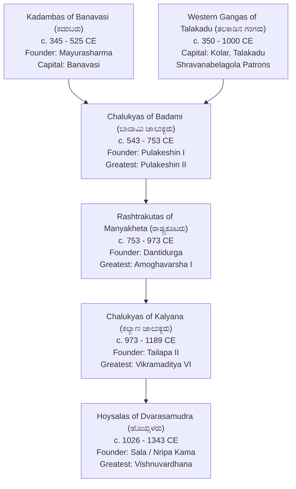

# Early Karnataka Dynasties: Kadambas to Hoysalas (ಕದಂಬರಿಂದ ಹೊಯ್ಸಳರವರೆಗೆ)

> [!exam-focus]
> **Exam Weightage & Testing Patterns**: This topic is among the highest-scoring areas in KPSC KAS Prelims (Paper 1 Humanities: 4-6 questions consistently) and Mains GS-1 Section 1 (typically one 12.5-mark or 15-mark question).
> - **Prelims Traps**: Confusing Badami Chalukya rock-cut cave temples with Rashtrakuta monolithic temples (Ellora Kailashanatha); mixing up titles of rulers (e.g., Pulakeshin II as *Parameshwara* vs Amoghavarsha I as *Nrupathunga*); misattributing literary patronages (e.g., Pampa under Arikesari II of Vemulawada vs Ponna under Krishna III).
> - **Mains Dimensions**: Administrative decentralization, temple architectural evolution from Vesara (ವೇಸರ ಶೈಲಿ) to Hoysala star-shaped stellate plans, epigraphical milestones (Halmidi, Aihole, Belagavi inscriptions).

---

## 1. Chronological Overview & Dynasty Lineage

The diagram above details the chronological succession of the foundational empires that shaped classical Kannada culture, political boundaries, and monumental architecture over a millennium. Notice that the Kadambas and Western Gangas provided indigenous self-rule, the Badami Chalukyas unified the Deccan and created the Vesara style, the Rashtrakutas expanded pan-India during the Tripartite Struggle, and the Kalyana Chalukyas and Hoysalas perfected temple embellishment and local governance.

---

## 2. Exhaustive Dynasty-Wise Analysis

### 2.1 Kadambas of Banavasi (ಕದಂಬರು: c. 345–525 CE)
- **Foundational Context**: Mayurasharma (ಮಯೂರಶರ್ಮ), a Brahmin scholar from Talagunda (ತಾಳಗುಂದ), was humiliated at the Pallava capital of Kanchi by Pallava guards. Renouncing priestly duties, he took up the sword, transformed into Mayuravarma, established the first indigenous Kannada kingdom at Banavasi (ವನವಾಸಿ / ವೈಜಯಂತಿ) in Uttara Kannada district.
- **Epigraphical Milestone**: **Halmidi Inscription (ಹಾಲ್ಮಿಡಿ ಶಾಸನ)**:
  - *Date*: c. 450 CE during the reign of King Kakusthavarma (ಕಾಕುಸ್ಥವರ್ಮ).
  - *Location*: Halmidi village, Hassan district.
  - *Significance*: Oldest discovered stone inscription containing classical Kannada prose (*Purvada Halagannada*). Mentions administrative grants to a warrior named Vijarasa.
- **Talagunda Pillar Inscription (ತಾಳಗುಂದ ಸ್ತಂಭ ಶಾಸನ)**: Composed by poet Kubja under Shantivarma, tracing Mayurasharma's genealogy and the sacred Kadamba tree origin.
- **Architecture**: Simple tiered pyramid *shikhara* (Kadamba Nagara style), visible at the Madhukeshwara temple in Banavasi.

### 2.2 Western Gangas of Talakadu (ಪಶ್ಚಿಮ ಗಂಗರು: c. 350–1000 CE)
- **Founders**: Didiga and Madhava at Kolar (Kuvalala), later shifting to Talakadu (ತಲಕಾಡು) on the banks of the Cauvery.
- **Religion & Patronage**: Staunch patrons of Jainism. Prime Minister and Commander Chavundaraya (ಚಾವುಂಡರಾಯ) commissioned the monolithic 57-foot statue of **Bhagavan Bahubali / Gommateshwara (ಗೊಮ್ಮಟೇಶ್ವರ)** atop Vindhyagiri at Shravanabelagola in **981 CE**.
- **Literature**: Chavundaraya authored *Chavundaraya Purana* (Tri-shashti-lakshana Mahapurana) in Kannada. King Durvinita (ದುರ್ವಿನೀತ) was a Sanskrit scholar who translated Gunadhya's *Brihatkatha* from Prakrit and wrote a commentary on Bharavi's *Kiratarjuniya*.

### 2.3 Chalukyas of Badami (ಬಾದಾಮಿ ಚಾಲುಕ್ಯರು: c. 543–753 CE)
- **Founder**: Pulakeshin I (ಪುಲಕೇಶಿ I) fortified the Vatapi (Badami) cliff and performed the Ashvamedha sacrifice.
- **Pulakeshin II (ಪುಲಕೇಶಿ II, 609–642 CE)**:
  - Greatest ruler. Defeated Harsha of Kannauj on the banks of the Narmada River (c. 618 CE), assuming the title **Parameshwara (ಪರಮೇಶ್ವರ)** and *Dakshinapatheshwara*.
  - **Aihole Inscription (ಐಹೊಳೆ ಶಾಸನ, 634 CE)**: Composed in Sanskrit poetry by court poet **Ravikirti (ರವಿಕೀರ್ತಿ)** on the Meguti Jain temple. Declares Ravikirti's poetic brilliance as equal to Kalidasa and Bharavi.
  - Visited by Chinese Buddhist pilgrim **Hiuen Tsang (Xuanzang)** in 640 CE, who described the courage, loyalty, and prosperity of the Maharashtrians/Karnatas.
- **Architectural Contribution: The Vesara Style (ವೇಸರ ಶೈಲಿ)**:
  - Synthesis of Nagara (North Indian) and Dravida (South Indian) styles.
  - *Badami*: Rock-cut cave temples (Cave 1 Shiva, Cave 2 & 3 Vishnu, Cave 4 Jain Tirthankaras).
  - *Aihole ("Cradle of Indian Temple Architecture")*: Lad Khan temple, Durga temple (apsidal plan derived from Buddhist chaitya hall), Huchimalli Gudi.
  - *Pattadakal (UNESCO World Heritage Site)*: Virupaksha Temple (Lokeshwara temple, built by Queen Lokamahadevi to commemorate Vikramaditya II's victory over Kanchi) and Mallikarjuna Temple (Trailokyeshwara temple, built by Queen Trailokyamahadevi).

### 2.4 Rashtrakutas of Manyakheta (ಮಾನ್ಯಖೇಟದ ರಾಷ್ಟ್ರಕೂಟರು: c. 753–973 CE)
- **Founder**: Dantidurga (ದಂತಿದುರ್ಗ) overthrew the Badami Chalukya king Kirtivarman II after performing the *Hiranyagarbha* ritual at Ujjain.
- **Krishna I (ಕೃಷ್ಣ I)**: Excavated the monolithic rock-cut **Kailashanatha Temple (Cave 16) at Ellora (ಎಲ್ಲೋರಾ)** out of a single basalt cliff from top to bottom—an unparalleled engineering marvel.
- **Amoghavarsha I Nrupathunga (ಅಮೋಘವರ್ಷ ನೃಪತುಂಗ, 814–878 CE)**:
  - Ruled for 64 peaceful years from his capital Manyakheta (ಮಾನ್ಯಖೇಟ, modern Malkhed in Kalaburagi).
  - Arab merchant **Sulaiman (ಸುಲೈಮಾನ್)** ranked Amoghavarsha as one of the four great empires of the world, alongside the Roman, Chinese, and Baghdad Caliphates.
  - Authored or patronized **Kavirajamarga (ಕವಿರಾಜಮಾರ್ಗ, c. 850 CE)**, authored with court poet Sri Vijaya. It is the earliest extant work on poetics in Kannada. Famously defined Karnataka: *"ಕಾವೇರಿಯಿಂದಮಾ ಗೋದಾವರಿವರಮಿರ್ಪ ನಾಡದಾ ಕನ್ನಡದೊಳ್"* (From the Cauvery to the Godavari is the land of Kannada).
- **Literary Renaissance**:
  - **Adikavi Pampa (ಆದಿಕವಿ ಪಂಪ)**: Authored *Adipurana* (spiritual Jain narrative) and *Vikramarjuna Vijaya / Pampa Bharata* (secular epic casting his patron Arikesari II as Arjuna).
  - **Sri Ponna (ಶ್ರೀ ಪೊನ್ನ)**: Authored *Shantipurana* under Krishna III, who gave him the title *Ubhaya Kavichakravarti*.
  - **Ranna (ರನ್ನ)**: Authored *Ajitapurana* and the fiery dramatic masterpiece *Gadayuddha (Sahasa Bhima Vijaya)* under Tailapa II and Satyashraya. Together, Pampa, Ponna, and Ranna form the **Three Gems of Classical Kannada Literature (ರತ್ನತ್ರಯರು)**.

### 2.5 Chalukyas of Kalyana (ಕಲ್ಯಾಣ ಚಾಲುಕ್ಯರು: c. 973–1189 CE)
- **Founder**: Tailapa II overthrew the Rashtrakuta king Karka II in 973 CE.
- **Vikramaditya VI (ವಿಕ್ರಮಾದಿತ್ಯ VI, 1076–1126 CE)**:
  - Inaugurated the **Chalukya-Vikrama Era (ಚಾಲುಕ್ಯ ವಿಕ್ರಮ ಶಕ)** in 1076 CE, discarding the Shaka era.
  - Court was adorned by Kashmiri poet **Bilhana (ಬಿಲ್ಹಣ)**, who wrote *Vikramankadeva Charita*, and legal jurist **Vijnaneshwara (ವಿಜ್ಞಾನೇಶ್ವರ)**, who authored *Mitakshara* (ಮಿತಾಕ್ಷರ), the celebrated legal treatise on Hindu inheritance law based on the Yajnavalkya Smriti.
- **Social Upheaval**: Reign of Bijjala II (Kalachuri usurper) witnessed the rise of the **Sharana / Vachana Movement (ವಚನ ಚಳವಳಿ)** led by **Bhakti Bhandari Basaveshwara (ಬಸವೇಶ್ವರ)**, establishing the spiritual parliament *Anubhava Mantapa* at Basavakalyana.

### 2.6 Hoysalas of Dvarasamudra (ಹೊಯ್ಸಳರು: c. 1026–1343 CE)
- **Origin Legend**: King Sala striking a tiger at Angadi (Sosevuru) on the instruction of his Jain guru Sudatta ("Poy, Sala!" / ಹೊಯ್, ಸಳ!), forming the royal emblem of the dynasty.
- **Vishnuvardhana (ವಿಷ್ಣುವರ್ಧನ / ಬಿಟ್ಟಿದೇವ, 1108–1152 CE)**:
  - Converted from Jainism to Sri Vaishnavism under the influence of philosopher-saint **Ramanujacharya (ರಾಮಾನುಜಾಚಾರ್ಯ)**, who had taken refuge in Melukote (ಮೇಲುಕೋಟೆ) from Chola persecution.
  - Captured Talakadu from the Cholas in 1116 CE, earning the title *Talakadugonda* and building the Kirti Narayana temple at Talakadu and the monumental **Vijayanarayana (Chennakeshava) Temple at Belur (ಬೇಲೂರು)**.
  - Queen **Shantala Devi (ಶಾಂತಲಾದೇವಿ)**, an accomplished dancer (*Natya Saraswati*), remained a devout Jain and built the Savati Gandhavarana Basadi at Shravanabelagola.
- **Ballala III (ಬಲ್ಲಾಳ III, 1292–1343 CE)**: Heroically resisted the Delhi Sultanate invasions of Malik Kafur and Muhammad bin Tughlaq. Laid the defensive foundation that gave birth to the Vijayanagara Empire.
- **Architecture: Stellate Hoysala Temples (UNESCO World Heritage Site inscribed 2023)**:
  - *Material*: Soft soapstone (chloritic schist), enabling intricate lace-like carving.
  - *Key Structural Elements*: Built on a raised platform (*jagati*); star-shaped (*stellate*) ground plan; horizontal friezes running around the base depicting elephants (strength), horses (speed), lions (courage), floral vines, and episodes from the Ramayana, Mahabharata, and Bhagavata.
  - *Master Architects & Sculptors*: **Jakanachari (ಜಕಣಾಚಾರಿ)**, Dankanachari, Ruvari Mallitamma, Dasoja of Balligavi.
  - *Crown Jewels*:
    1. Chennakeshava Temple, Belur (1117 CE).
    2. Hoysaleshwara Temple, Halebidu (commissioned by Ketamalla).
    3. Keshava Temple, Somanathapura (1268 CE, built by Soma under Narasimha III).

---

## 3. Comparative Synthesis of Architectural Evolution

| Dynasty | Primary Stone Medium | Defining Architectural Innovations | Exemplar Monuments | UNESCO Status |
|---|---|---|---|---|
| **Kadambas** | Granite & Laterite | Stepped pyramid shikhara (Kadamba Nagara) | Madhukeshwara Temple, Banavasi | State Protected |
| **Badami Chalukyas** | Red Sandstone | Vesara hybrid style; rock-cut cave temples & structural masonry | Cave temples (Badami), Durga & Lad Khan (Aihole), Virupaksha (Pattadakal) | Pattadakal (UNESCO 1987) |
| **Rashtrakutas** | Basalt Rock | Monolithic rock-cut excavation carved top-to-bottom | Kailashanatha Temple (Ellora Cave 16) | Ellora Caves (UNESCO 1983) |
| **Kalyana Chalukyas** | Chloritic Schist (Soapstone) | Miniaturized decorative shrines; lathe-turned polished pillars | Kasi Vishveshwara (Lakkundi), Mallikarjuna (Kuruvatti) | Tentative List |
| **Hoysalas** | Chloritic Schist (Soapstone) | Stellate (star-shaped) plinth; raised jagati; ornate narrative friezes | Belur, Halebidu, Somanathapura | **Inscribed UNESCO World Heritage Site (2023)** |

---

## 4. Mnemonics for Fast Recall

- **Three Gems of Kannada Literature (ರತ್ನತ್ರಯರು)**: **P-P-R**
  - **P**ampa (*Adipurana*, *Pampa Bharata*)
  - **P**onna (*Shantipurana*)
  - **R**anna (*Gadayuddha*, *Ajitapurana*)
- **Hoysala UNESCO Triad**: **B-H-S**
  - **B**elur (Chennakeshava)
  - **H**alebidu (Hoysaleshwara)
  - **S**omanathapura (Keshava)
- **Badami Chalukya Four Caves**: **S-V-V-J** (Shiva -> Vishnu -> Vishnu/Narasimha -> Jain)

---

## 5. Related Vault Notes
- [[Vijayanagara_and_Mysore_Kingdom]] — The medieval successors and imperial revival.
- [[Freedom_Struggle_in_Karnataka]] — Colonial resistance rooted in historical regional pride.
- [[Karnataka_Physiography_and_Rivers]] — How river basins (Tungabhadra, Malaprabha) defined kingdom capitals.

---

## 6. Likely Questions & Verbatim PYQs

### Prelims Multiple-Choice Questions
- **PYQ (KPSC KAS 2017 Prelims P1)**: The Halmidi inscription, which is the earliest available Kannada stone inscription, belongs to which of the following dynasties?
  - (A) Western Gangas
  - (B) Kadambas of Banavasi [Correct]
  - (C) Badami Chalukyas
  - (D) Rashtrakutas
- **PYQ (KPSC KAS 2020 Prelims P1)**: Who among the following Arab travelers visited Manyakheta and described the Rashtrakuta king Amoghavarsha I as one of the four greatest rulers in the world?
  - (A) Al-Masudi
  - (B) Sulaiman [Correct]
  - (C) Ibn Battuta
  - (D) Al-Biruni
- **Expected Question (Prelims 2026)**: The sacred ensembles of the Hoysalas recently inscribed as a UNESCO World Heritage Site comprise which of the following three temple complexes?
  - *Answer*: Chennakeshava temple at Belur, Hoysaleshwara temple at Halebidu, and Keshava temple at Somanathapura.

### Mains Analytical Question & Answer Outline
- **Mains GS-1 Question**: *"Trace the evolution of temple architecture in Karnataka from the Badami Chalukyas to the Hoysalas, highlighting the distinct stylistic and structural advancements." (15 Marks / 250 Words)*
  - **Introduction**: Define the Vesara school of architecture as Karnataka's unique contribution bridging Dravidian and Nagara styles, originating under Badami Chalukyas and culminating in Hoysala stellate temples.
  - **Body Paragraph 1 (Badami Chalukyas)**: Rock-cut cave temples at Badami; experimentation at Aihole (Durga temple apsidal plan); culmination at Pattadakal (Virupaksha temple Dravida influence, Papanatha Nagara influence). Medium: Red sandstone.
  - **Body Paragraph 2 (Rashtrakuta & Kalyana Chalukya Intermediaries)**: Monolithic excavation of Kailashanatha (Ellora); shift to soft soapstone and lathe-turned circular pillars under Kalyana Chalukyas (Lakkundi, Gadag).
  - **Body Paragraph 3 (Hoysala Climax)**: Stellate star-shaped plinth (*jagati*); dense multi-tiered narrative friezes (elephants, makaras, epics); sign-off inscriptions by master sculptors like Mallitamma and Dasoja.
  - **Conclusion**: Emphasize how UNESCO's 2023 inscription acknowledges this thousand-year unbroken continuum of stone craftsmanship.

---

> [!summary] Quick Revision Box (10 Non-Negotiable Facts)
> 1. **Mayurasharma**: Founded Kadamba dynasty at Banavasi after humiliation at Kanchi Pallava court.
> 2. **Halmidi Inscription (c. 450 CE)**: First Kannada stone inscription; Kakusthavarma's reign.
> 3. **Bahubali Monolith (981 CE)**: Commissioned by Chavundaraya at Shravanabelagola.
> 4. **Aihole Inscription (634 CE)**: Composed by Ravikirti; celebrates Pulakeshin II defeating Harsha.
> 5. **Kailashanatha Temple, Ellora**: Monolithic rock-cut marvel excavated by Rashtrakuta Krishna I.
> 6. **Kavirajamarga (c. 850 CE)**: Earliest Kannada treatise on poetics; reign of Amoghavarsha I.
> 7. **Sulaiman**: Arab merchant who ranked Amoghavarsha among world's 4 greatest monarchs.
> 8. **Mitakshara**: Hindu inheritance legal code composed by Vijnaneshwara at Kalyana.
> 9. **Ramanujacharya**: Converted Hoysala Bittideva into Vishnuvardhana at Melukote.
> 10. **Hoysala UNESCO Triad**: Belur, Halebidu, and Somanathapura temples inscribed in 2023.
