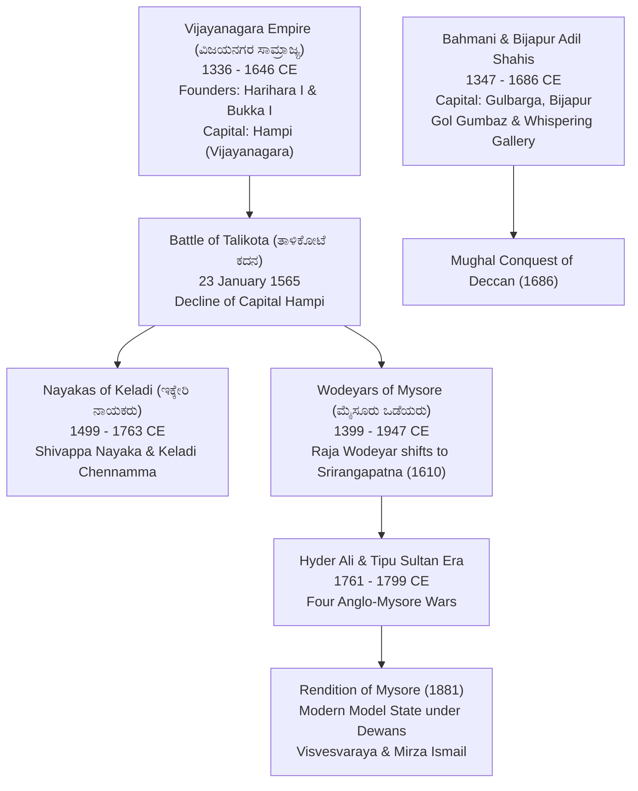
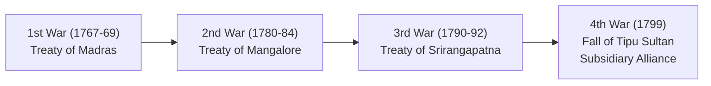

# Vijayanagara Empire, Deccan Sultanates and the Mysore Kingdom (ವಿಜಯನಗರ, ದಖನ್ ಸುಲ್ತಾನರು ಮತ್ತು ಮೈಸೂರು ಸಂಸ್ಥಾನ)

> [!exam-focus]
> **Exam Weightage & Testing Patterns**: Highly tested across Prelims (3-5 MCQs) and Mains GS-1 Section 1 (mandatory question on Krishnadevaraya, Mysore modernization under Dewans, or revenue systems).
> - **Prelims Traps**: Confusing foreign travelers and the kings they visited (e.g., Nicolo de Conti & Abdur Razzaq under Deva Raya II vs Domingo Paes & Duarte Barbosa under Krishnadevaraya vs Fernao Nuniz under Achyuta Deva Raya); mixing up Shivappa Nayaka's *Shist* (ಶಿಸ್ತು) with Todar Mal's *Bandobast*; misidentifying treaties of the four Anglo-Mysore Wars (Madras 1769, Mangalore 1784, Srirangapatna 1792).
> - **Mains Dimensions**: Administrative structure of the Nayankara system (ನಾಯಂಕರ ಪದ್ಧತಿ); Deccan Sultanate architectural engineering (acoustics of Gol Gumbaz); socio-economic modernization of Princely Mysore under Commissioners and Dewans (Model State / ಮಾದರಿ ಮೈಸೂರು).

---

## 1. Imperial Progression & Transition Timeline

The diagram above captures the transition of power in Karnataka from the medieval imperial defense established at Vijayanagara to regional successor principalities (Keladi Nayakas and Wodeyars) and the subsequent transformation of Mysore into India's premier progressive state ("Model State") in the modern era.

---

## 2. The Vijayanagara Empire (1336–1646 CE)

### 2.1 Foundation and Dynastic Sequence
- **Founders**: Brothers **Harihara I (ಹರಿಹರ I)** and **Bukka Raya I (ಬುಕ್ಕ ರಾಯ I)** of the Sangama dynasty founded the empire on the banks of the Tungabhadra in **1336 CE**, under the spiritual inspiration of **Saint Vidyaranya (ವಿದ್ಯಾರಣ್ಯ)** of the Sringeri Sharada Peetham.
- **Four Ruling Dynasties**:
  1. *Sangama Dynasty (1336–1485 CE)*: Greatest king was **Deva Raya II (Proudha Deva Raya)**, who enlisted Muslim archers, assumed the title *Gajabetegara* (hunter of elephants), and received Persian envoy Abdur Razzaq.
  2. *Saluva Dynasty (1485–1505 CE)*: Usurped by Saluva Narasimha to protect the empire from disintegration.
  3. *Tuluva Dynasty (1505–1570 CE)*: Founded by Vira Narasimha; golden age of the empire under **Krishnadevaraya**.
  4. *Aravidu Dynasty (1570–1646 CE)*: Founded by Tirumala Raya after the sack of Hampi, ruling from Penukonda and Chandragiri.

### 2.2 Golden Age: Sri Krishnadevaraya (ಶ್ರೀ ಕೃಷ್ಣದೇವರಾಯ, 1509–1529 CE)
- **Military Campaigns**: Recaptured Udayagiri (1514) and Kondavidu from the Gajapatis of Odisha; defeated Sultan Ismail Adil Shah of Bijapur in the Battle of Raichur (1520), recovering the rich Raichur Doab.
- **Titles**: *Abhinava Bhoja*, *Andhra Bhoja*, *Kannada Rajya Rama Ramana* (ಕರ್ನಾಟಕ ರತ್ನ ಸಿಂಹಾಸನಾಧೀಶ್ವರ).
- **Literature & Patronage**:
  - Authored Telugu epic poem **Amuktamalyada (ಆಮುಕ್ತಮಾಲ್ಯದ)** on the life of Andal, containing a renowned chapter on *Rajaneeti* (political philosophy of governance).
  - Authored Sanskrit plays: *Jambavati Kalyanam* and *Madalasa Charita*.
  - Royal court known as the **Bhuvanavijaya**, adorned by the eight celebrated Telugu poets (**Ashtadiggajas**), including Allasani Peddana and Tenali Ramakrishna.
- **Foreign Accounts**: Portuguese horse merchant **Domingo Paes** recorded: *"He is the most feared and perfect king that could exist... He is cheerful and of a gentle disposition, gallant and dignified."* Duarte Barbosa praised the absolute religious freedom and flourishing international trade at Hampi.
- **Monuments Commissioned**: The massive *Mahanavami Dibba*, the monolithic *Sasivekalu Ganesha* and *Kadalekalu Ganesha*, the *Ugra Narasimha* monolith, and the Hazara Rama temple.

### 2.3 Administration: The Nayankara System (ನಾಯಂಕರ ಪದ್ಧತಿ)
- Feudal military administrative framework: The empire was divided into provinces (*rajyas*), which were granted as military fiefs (*amaram*) to warrior chiefs called **Amaranayakas (ಅಮರನಾಯಕರು)**.
- Amaranayakas maintained fixed quotas of infantry, cavalry, and elephants for the emperor's army and paid an annual tribute (*peshkash*) into the royal treasury while administering local justice and irrigation works.

### 2.4 The Battle of Talikota (Rakkasa-Tangadi: 23 January 1565)
- **Combatants**: Imperial army under de facto regent **Aliya Rama Raya (ಅಳಿಯ ರಾಮರಾಯ)** versus the allied confederacy of four Deccan Sultanates (Bijapur, Golconda, Ahmadnagar, Bidar).
- **Outcome**: Treachery of two Muslim commanders in the Vijayanagara lines led to Rama Raya's capture and beheading by Husain Nizam Shah. The imperial capital Hampi was plundered and destroyed over five months. Italian traveler Cesare Federici visited Hampi in 1567 and wrote: *"The city is not altogether destroyed, yet the houses stand empty, there is nothing in them but tigers and other wild beasts."*

---

## 3. The Adil Shahis of Bijapur (1490–1686 CE)

- **Founder**: Yusuf Adil Shah, asserting independence from the disintegrating Bahmani kingdom.
- **Ibrahim Adil Shah II (1580–1627 CE)**:
  - Known as **Jagadguru Badshah (ಜಗದ್ಗುರು ಬಾದ್‌ಶಾಹ)** for his religious tolerance and devotion to Goddess Saraswati and Hindu music.
  - Authored the celebrated musical treatise **Kitab-i-Navras (ಕಿತಾಬ್-ಎ-ನವರಸ್)** in Dakhani Urdu.
  - Built the magnificent architectural tomb **Ibrahim Rauza (ಇಬ್ರಾಹಿಂ ರೌಜಾ)**, often termed the "Taj Mahal of South India."
- **Mohammed Adil Shah (1627–1656 CE) & Gol Gumbaz (ಗೋಲ್ ಗುಂಬಜ್)**:
  - Commissioned the **Gol Gumbaz** at Vijayapura (Bijapur), designed by master architect Yaqut of Dabul.
  - Features the **second largest unsupported dome in the world** (diameter 44 meters).
  - Contains the world-famous **Whispering Gallery (ಪಿಸುಗುಟ್ಟುವ ಗ್ಯಾಲರಿ)**, where a whisper echoes more than 11 times across the acoustic hall.

---

## 4. The Nayakas of Keladi / Ikkeri (1499–1763 CE)

- **Capital Shifts**: Keladi -> Ikkeri -> Bidanoor (Nagar).
- **Shivappa Nayaka (ಶಿವಪ್ಪ ನಾಯಕ, 1645–1660 CE)**:
  - Formulated the celebrated **Shist (ಶಿಸ್ತು)** land revenue settlement: Classified land scientifically into five types based on soil fertility, water availability, and historical crop yield, fixing the state share at one-third to one-sixth of gross produce.
- **Rani Keladi Chennamma (ರಾಣಿ ಕೆಳದಿ ಚೆನ್ನಮ್ಮ, 1671–1696 CE)**:
  - Heroically granted political asylum and protection to **Rajaram (ರಾಜಾರಾಮ್)**, the son of Chhatrapati Shivaji, who was fleeing the pursuing Mughal armies of Emperor Aurangzeb. Defeated the Mughal army led by Jan Nisar Khan, forcing Aurangzeb to recognize her sovereignty.

---

## 5. The Kingdom of Mysore (ಮೈಸೂರು ಸಂಸ್ಥಾನ)

### 5.1 Early Wodeyars
- Founded by Yaduraya and Krishnaraya in 1399 CE.
- **Raja Wodeyar (1578–1617 CE)**: Captured Srirangapatna from Vijayanagara viceroy Tirumala in 1610 CE, shifting his capital there and inaugurating the celebrated **Mysore Dasara (ಮೈಸೂರು ದಸರಾ)** festival.
- **Chikka Devaraja Wodeyar (1673–1704 CE)**:
  - Instituted the centralized administrative system of **Athara Kacheri (ಅಠಾರ ಕಛೇರಿ / 18 Administrative Departments)**.
  - Purchased Bangalore (Bengaluru) from Mughal general Qasim Khan in 1687 for three lakh rupees.
  - Earned titles *Navakoti Narayana* (wealth) and *Aprathima Vira*.

### 5.2 The Era of Hyder Ali and Tipu Sultan (1761–1799 CE)
- **Hyder Ali (ಹೈದರ್ ಅಲಿ)**: Usurped de facto authority in 1761 from prime minister Nanjarajiah; modernized Mysore infantry with French assistance at Dindigul arsenal.
- **Tipu Sultan (ಟಿಪ್ಪು ಸುಲ್ತಾನ್: 1782–1799 CE)**:
  - *Tiger of Mysore (ಮೈಸೂರು ಹುಲಿ)*. Pioneer in military rocketry (**Mysorean Iron-cased Rockets**), successfully deployed against Colonel Baillie in the Battle of Pollilur (1780).
  - Founded the naval board, introduced a new calendar (*Mauludi*), new coinage, and established state-directed commercial silk sericulture across Karnataka.
  - Placed a Liberty Tree at Srirangapatna and joined the French Jacobin Club (*Citizen Tipu*).
- **The Four Anglo-Mysore Wars (ಆಂಗ್ಲೋ-ಮೈಸೂರು ಯುದ್ಧಗಳು)**:
  1. *First War (1767–1769)*: Hyder Ali dictated peace on British at Madras gates (**Treaty of Madras, 1769**).
  2. *Second War (1780–1784)*: Hyder died (1782); ended in status quo ante bellum (**Treaty of Mangalore, 1784**).
  3. *Third War (1790–1792)*: Lord Cornwallis besieged Srirangapatna. Ended with humiliating **Treaty of Srirangapatna (1792)**, ceding half of Mysore territories and surrendering two sons as hostages.
  4. *Fourth War (1799)*: Lord Wellesley launched subsidiary alliance invasion. Tipu died fighting heroically at the breach of the water-gate of Srirangapatna fort on **4 May 1799**.

The sequence above outlines the escalation of British colonial subjugation of Mysore over 32 years, ending indigenous resistance and leading to the subsidiary alliance.

### 5.3 Commissioners' Rule (1831–1881 CE)
- Post-1799, child prince Mummadi Krishnaraja Wodeyar was placed on the throne under Dewan Purnaiah's regency. Following the **Nagar Revolt of 1830–31 (ನಗರ ರೈತ ಬಂಡಾಯ)** led by Budi Basappa, Lord William Bentinck took over direct British administration.
- **Sir Mark Cubbon (1834–1861)**: Longest serving Commissioner. Shifted capital to Bangalore; laid 1,500 miles of telegraph and macadamized roadways; built the public office building *Athara Kacheri* (now High Court of Karnataka).
- **L.B. Bowring (1862–1870)**: Reorganized state into divisions and districts, codified revenue rules, established Bowring Hospital.

### 5.4 Rendition of Mysore (1881) & The Maker-Dewans of Modern Mysore
On **25 March 1881**, the British Crown retroceded administrative powers to Maharaja Chamaraja Wodeyar X (**Rendition of Mysore / ಮೈಸೂರು ಪುನರ್ ಸ್ಥಾಪನೆ**). Mysore pioneered participatory governance and modern industrialization:
1. **C. Rangacharlu (1881–1883)**: Established the **Mysore Representative Assembly (ಮೈಸೂರು ಪ್ರಜಾ ಪ್ರತಿನಿಧಿ ಸಭೆ) in 1881**—the first democratic representative legislative body in any Indian princely state.
2. **Sir K. Seshadri Iyer (1883–1901)**:
   - Commissioned the **Shivanasamudra Hydro-electric Project (ಶಿವನಸಮುದ್ರ ವಿದ್ಯುತ್ ಯೋಜನೆ) in 1902** on the Cauvery—the first major hydro-electric power plant in Asia.
   - Supplied electricity to Kolar Gold Fields (KGF) in 1902 and Bangalore in 1905 (Bangalore became the first electrified city in India).
3. **Nalvadi Krishnaraja Wodeyar (ನಾಲ್ವಡಿ ಕೃಷ್ಣರಾಜ ಒಡೆಯರು: 1902–1940 CE)**:
   - Celebrated by Mahatma Gandhi as the philosopher-king **Rajarshi (ರಾಜರ್ಷಿ)**.
   - Introduced **First Reservation Policy (1921)** in Mysore civil services based on the **Miller Committee Report (ಲೆಸ್ಲಿ ಮಿಲ್ಲರ್ ಸಮಿತಿ)** to ensure proportional representation for non-Brahmin backward classes.
4. **Sir M. Visvesvaraya (ಸರ್ ಎಂ. ವಿಶ್ವೇಶ್ವರಯ್ಯ: Dewan 1912–1918)**:
   - Philosophy: *"Industrialize or Perish"* (ಕೈಗಾರಿಕೀಕರಣ ಇಲ್ಲವೇ ಸರ್ವನಾಶ).
   - Landmark Achievements:
     - Construction of **Krishna Raja Sagara (KRS) Dam** across Cauvery at Kannambadi with automatic sluice gates.
     - Founded the **University of Mysore (1916)**—first university in a princely state.
     - Founded **Bhadravati Iron & Steel Works (1923)** (now VISL).
     - Established **State Bank of Mysore (1913)**, Mysore Chamber of Commerce (FKCCI), Government Engineering College (UVCE, 1917), and Kannada Sahitya Parishat (1915).
5. **Sir Mirza Ismail (ಮಿರ್ಜಾ ಇಸ್ಮಾಯಿಲ್: Dewan 1926–1941)**:
   - Industrial expansion: Hindustan Aeronautics Limited (HAL, 1940, with Walchand Hirachand), Glass and Porcelain factories, Mysore Paper Mills, Mandya Sugar Factory, and beautiful Brindavan Gardens at KRS.

---

## 3. Related Vault Notes
- [[Early_Karnataka_Dynasties]] — Foundations of Kannada culture and architecture.
- [[Freedom_Struggle_in_Karnataka]] — The national movement and the Mysore Chalo agitation for responsible government.
- [[Karnataka_Physiography_and_Rivers]] — River Cauvery, Shivanasamudra, and KRS Dam geography.

---

## 4. Likely Questions & Verbatim PYQs

### Prelims Multiple-Choice Questions
- **PYQ (KPSC KAS 2014 Prelims P1)**: The Mysore Representative Assembly (Praja Pratinidhi Sabhe), the first democratic representative institution in princely India, was established in 1881 by which of the following Dewans?
  - (A) Sir M. Visvesvaraya
  - (B) Sir K. Seshadri Iyer
  - (C) C. Rangacharlu [Correct]
  - (D) Purnaiah
- **PYQ (KPSC KAS 2020 Prelims P1)**: In 1610 CE, the famous Mysore Dasara festival was inaugurated at Srirangapatna by which Wodeyar king?
  - (A) Chikka Devaraja Wodeyar
  - (B) Raja Wodeyar [Correct]
  - (C) Kanteerava Narasaraja Wodeyar
  - (D) Mummadi Krishnaraja Wodeyar
- **Expected Question (Prelims 2026)**: The *Shist* land revenue assessment system, known for its scientific soil-fertility and crop-yield classification, was instituted in Karnataka by which ruler?
  - *Answer*: Shivappa Nayaka of Keladi (Ikkeri).

### Mains Analytical Question & Answer Outline
- **Mains GS-1 Question**: *"Critically analyze the role of Nalvadi Krishnaraja Wodeyar and his Dewans in transforming Princely Mysore into a 'Model State' (ಮಾದರಿ ಮೈಸೂರು)." (15 Marks / 250 Words)*
  - **Introduction**: Define Nalvadi Krishnaraja Wodeyar's reign (1902–1940) as the golden epoch of institutional modernization, blending democratic decentralization, affirmative action, and visionary industrial infrastructure.
  - **Dimension 1: Social Justice & Education**: Implementation of Leslie Miller Committee Report (1921) granting quotas to backward classes; free primary education act; founding of Mysore University (1916).
  - **Dimension 2: Industrialization & Economic Infrastructure**: M. Visvesvaraya's mantra "Industrialize or Perish"; KRS Dam ( Kannambadi); Bhadravati Iron Works; State Bank of Mysore; Shivanasamudra hydro power.
  - **Dimension 3: Democratic Institutions**: Bicameral legislature (Representative Assembly + Legislative Council in 1907); urban municipal reforms.
  - **Conclusion**: Reiterate Mahatma Gandhi's description of Mysore as *Rama Rajya* and Nalvadi as *Rajarshi*, providing an indigenous governance template for modern post-colonial India.

---

> [!summary] Quick Revision Box (10 Non-Negotiable Facts)
> 1. **Harihara I & Bukka I (1336 CE)**: Founded Vijayanagara with Saint Vidyaranya's guidance.
> 2. **Krishnadevaraya (1509–1529 CE)**: Authored *Amuktamalyada*; court of *Ashtadiggajas*.
> 3. **Nayankara System**: Vijayanagara feudal-military revenue and administrative model.
> 4. **Battle of Talikota (1565 CE)**: Confederacy of Sultanates sacked imperial Hampi.
> 5. **Gol Gumbaz (Bijapur)**: Second largest unsupported dome; Whispering Gallery.
> 6. **Shivappa Nayaka (Keladi)**: Formulated *Shist* scientific land revenue settlement.
> 7. **Tipu's Rockets & Treaties**: Treaty of Madras (1769), Mangalore (1784), Srirangapatna (1792); Fall on 4 May 1799.
> 8. **Rendition of Mysore (1881)**: Crown restored power; Rangacharlu founded Representative Assembly.
> 9. **Miller Committee (1921)**: First official backward-class reservation order in India.
> 10. **Sir M. Visvesvaraya**: KRS Dam, Mysore University (1916), Bhadravati Steel, Bank of Mysore (1913).
