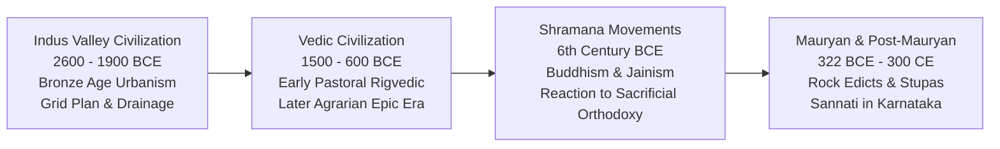

# Ancient Indian Culture: Indus Valley, Vedic Society and Heterodox Movements (ಪ್ರಾಚೀನ ಭಾರತೀಯ ಸಂಸ್ಕೃತಿ: ಸಿಂಧೂ ನಾಗರಿಕತೆ, ವೈದಿಕ ಮತ್ತು ಶ್ರಮಣ ಧರ್ಮಗಳು)

> [!exam-focus]
> **Exam Weightage & Testing Patterns**: Prelims Paper 1 Humanities (2-3 questions) and Mains GS-1 Section 1 (short or medium analytical question on art, Vedic philosophical transition, or Buddhist monastic architecture).
> - **Prelims Traps**: Confusing Harappan sites with their defining artifacts (e.g., Dockyard at Lothal vs Ploughed field at Kalibangan vs Water reservoirs at Dholavira); misattributing Buddhist councils and their patrons/presidents (Ajatashatru/Mahakassapa vs Ashoka/Moggaliputta Tissa).
> - **Mains Dimensions**: Urban planning contrast between Harappa and later Gangetic urbanization; philosophical shift from Vedic ritualism to Upanishadic monism; social democratization driven by Jainism and Buddhism in Deccan and Karnataka.

---

## 1. Cultural Evolution Timeline

The timeline above details the foundational millennia of Indian civilizational history, transitioning from the bronze-age urbanism of the Indus to the agro-pastoral Vedic society, followed by the intellectual and spiritual revolution of the Shramana traditions that spread into Karnataka.

---

## 2. The Indus Valley Civilization (ಹರಪ್ಪಾ / ಸಿಂಧೂ ನಾಗರಿಕತೆ: 2600–1900 BCE)

### 2.1 Urban Planning & Civic Infrastructure
- **Grid Layout**: Towns planned on a strict cardinal grid with streets cutting at right angles (*Hippodamian plan*).
- **Dual Town Division**:
  - *Citadel (ಮೇಲ್ಮಟ್ಟದ ಕೋಟೆ)*: Elevated western mound for administrative and ceremonial functions.
  - *Lower Town (ಕೆಳ ಪಟ್ಟಣ)*: Residential quarters arranged in blocks made of standardized burnt bricks (ratio 1:2:4).
- **Sanitary Engineering**: Underground covered drainage network with soak pits and inspection manholes at regular intervals—unmatched in the ancient bronze age world.
- **Great Bath (ಮಹಾ ಸ್ನಾನಗೃಹ at Mohenjo-daro)**: Waterproofed with natural bitumen (asphalt), surrounded by porticos and changing rooms, used for ritual purification.
- **Granaries (ಧಾನ್ಯದ ಉಗ್ರಾಣಗಳು)**: Massive granaries at Harappa (six in a row) and Mohenjo-daro with raised platforms for air circulation.

### 2.2 Major Harappan Sites & Diagnostic Finds
| Site | Location | Excavator / River | Diagnostic Archaeological Finds |
|---|---|---|---|
| **Harappa** | Punjab (Pakistan) | Daya Ram Sahni (1921) / Ravi | 6 Granaries, stone dancing Nataraja torso, cemetery R-37 |
| **Mohenjo-daro** | Sindh (Pakistan) | R. D. Banerji (1922) / Indus | Great Bath, Great Granary, Bronze Dancing Girl, Bearded Priest bust |
| **Lothal** | Gujarat | S. R. Rao / Bhogava | World's earliest tidal **Dockyard**, rice husk, bead factory, fire altars |
| **Kalibangan** | Rajasthan | A. Ghosh, B. B. Lal / Ghaggar | **Ploughed field surface**, camel bones, seven fire altars (*Yajna kundas*) |
| **Dholavira** | Gujarat (Rann of Kutch) | R. S. Bisht / Luni | **Tripartite city plan**, giant rock-cut water reservoirs, 10-symbol signboard (UNESCO 2021) |
| **Rakhigarhi** | Haryana | Amarendra Nath / Ghaggar | Largest Harappan site in Indian territory; ancient DNA extraction site |

---

## 3. The Vedic Period (ವೈದಿಕ ಯುಗ: c. 1500–600 BCE)

### 3.1 Early Vedic / Rigvedic Society (c. 1500–1000 BCE)
- **Geography**: Settled in the *Sapta Sindhu* (Land of Seven Rivers: Indus, Jhelum, Chenab, Ravi, Beas, Sutlej, Saraswati).
- **Economy**: Primarily pastoral; cow (*Gau*) was the supreme economic measure of wealth; conflicts termed *Gavishti* (search for cows).
- **Polity**: Tribal assembly councils:
  - *Sabha*: Council of elders and elites (women could attend).
  - *Samiti*: General popular assembly of the entire clan.
  - *Vidatha*: Earliest folk assembly for spiritual and secular deliberations.
  - *Rajan* (king) was a tribal war leader (*Gopati*), not an absolute territorial ruler.
- **Social Structure**: Flexible occupational classification; women enjoyed high status (scholars like Lopamudra, Gargi, Maitreyi participated in philosophical debates; no child marriage; widow remarriage allowed).

### 3.2 Later Vedic Society (c. 1000–600 BCE)
- **Transition**: Migration eastward into the Gangetic plains (*Kuru-Panchala* realm); adoption of iron technology (*Shyama Ayas*).
- **Socio-Religious Rigidity**: Solidification of the fourfold Varna system (*Brahmana, Kshatriya, Vaishya, Shudra*); birth-based hierarchy; decline in the status of women; exclusion of women and Shudras from *Upanayana* (sacred thread) rites.
- **Ritualism & Sacrifices**: Rise of costly royal sacrifices: *Ashvamedha* (horse sacrifice for territorial sovereignty), *Rajasuya* (consecration sacrifice), and *Vajapeya* (chariot race rejuvenation).

---

## 4. The Heterodox Shramana Movements: Buddhism and Jainism

### 4.1 Jainism (ಜೈನ ಧರ್ಮ)
- **Tirthankaras**: 24 Tirthankaras; first was Rishabhanatha (Adinatha); 23rd was Parshvanatha; 24th was **Vardhamana Mahavira (ವರ್ಧಮಾನ ಮಹಾವೀರ: 599–527 BCE)** born at Kundagrama near Vaishali.
- **Core Philosophy**:
  - *Ahimsa* (Extreme non-violence toward all living beings).
  - *Anekantavada* (ಅನೇಕಾಂತವಾದ): Pluralistic doctrine that reality is complex and multifaceted.
  - *Syadvada* (ಸ್ಯಾದ್ವಾದ): Theory of conditioned predication ("maybe" or relativity of truth).
  - *Triratnas (ರತ್ನತ್ರಯ)*: Right Faith (*Samyak Darshana*), Right Knowledge (*Samyak Jnana*), Right Conduct (*Samyak Charitra*).
- **Spread to Karnataka**:
  - Acharya **Bhadrabahu (ಭದ್ರಬಾಹು)** led a massive Jain migration southward during a 12-year Magadhan famine during Chandragupta Maurya's reign (c. 300 BCE).
  - Settled at Chandragiri hill, **Shravanabelagola (ಶ್ರವಣಬೆಳಗೊಳ)**. Emperor **Chandragupta Maurya** embraced Jain monasticism and ended his life through the voluntary vow of fasting unto death (**Sallekhana / ಸಲ್ಲೇಖನ ವ್ರತ**).

### 4.2 Buddhism (ಬೌದ್ಧ ಧರ್ಮ)
- **Gautama Buddha (ಗೌತಮ ಬುದ್ಧ: 563–483 BCE)**: Born at Lumbini, attained enlightenment at Bodh Gaya, delivered first sermon (*Dharmachakrapravartana*) at Sarnath, attained Mahaparinirvana at Kushinagar.
- **Four Noble Truths (ಆರ್ಯ ಸತ್ಯಗಳು)**:
  1. *Dukkha*: The world is full of suffering.
  2. *Samudaya*: Desire (*Tanha*) is the root cause of suffering.
  3. *Nirodha*: Suffering can be extinguished by conquering desire.
  4. *Magga*: The path to end suffering is the **Eightfold Noble Path (ಅಷ್ಟಾಂಗ ಮಾರ್ಗ)** (Right view, resolve, speech, action, livelihood, effort, mindfulness, concentration).
- **Four Buddhist Councils (ಬೌದ್ಧ ಸಮ್ಮೇಳನಗಳು)**:
  1. *First Council (483 BCE, Rajgriha)*: Patron Ajatashatru, Chairman Mahakassapa. Codified *Vinaya Pitaka* (Upali) and *Sutta Pitaka* (Ananda).
  2. *Second Council (383 BCE, Vaishali)*: Patron Kalashoka, Chairman Sabakami. Schism into Theravada (Sthaviravadins) and Mahasanghikas.
  3. *Third Council (250 BCE, Pataliputra)*: Patron Ashoka, Chairman Moggaliputta Tissa. Codified *Abhidhamma Pitaka*. Dispatched Buddhist missionaries across the world, including **Mahadeva Thera to Mahishamandala (Mysore)** and **Rakkhita to Vanavasi (Banavasi)**.
  4. *Fourth Council (72 CE, Kundalvana/Kashmir)*: Patron Kanishka, Chairman Vasumitra. Formal split into **Hinayana** and **Mahayana**.
- **Buddhism in Karnataka**:
  - **Sannati (ಸನ್ನತಿ, Kalaburagi district)**: Major Buddhist archaeological site on the Bhima River. Excavations revealed the Kanaganahalli stupa with a stone portrait sculpture of Emperor Ashoka inscribed with the label ***"Ranyo Ashoko" (ರಾಯ ಅಶೋಕ)***—the only sculpted stone portrait of Ashoka found anywhere in the world!

---

## 5. Related Vault Notes
- [[Early_Karnataka_Dynasties]] — Shravanabelagola and Jain patronage under Western Gangas.
- [[Indian_Constitutional_System]] — Fundamental values of tolerance rooted in ancient philosophy.
- [[World_Physical_Geography]] — Indus and Gangetic river plains geomorphology.

---

## 6. Likely Questions & Verbatim PYQs

### Prelims Multiple-Choice Questions
- **PYQ (KPSC KAS 2017 Prelims P1)**: The unique inscribed stone relief portrait of Emperor Ashoka bearing the title "Ranyo Ashoko" was discovered at which ancient Buddhist site in Karnataka?
  - (A) Maski
  - (B) Brahmagiri
  - (C) Sannati (Kanaganahalli) [Correct]
  - (D) Koppal
- **PYQ (KPSC KAS 2014 Prelims P1)**: The Jain philosophical doctrine of "Anekantavada" represents which of the following core concepts?
  - (A) Strict non-violence in physical action
  - (B) Plurality of truth and multifaceted nature of reality [Correct]
  - (C) Total renunciation of worldly possessions
  - (D) The cycle of rebirth governed by karma
- **Expected Question (Prelims 2026)**: At which Harappan archaeological site was the world's earliest known tidal dockyard discovered?
  - *Answer*: Lothal (Gujarat).

---

> [!summary] Quick Revision Box (10 Non-Negotiable Facts)
> 1. **Dholavira**: UNESCO site; 3-tier city division; sophisticated stone water reservoirs.
> 2. **Lothal**: Oldest tidal dockyard, rice husk, bead factory.
> 3. **Kalibangan**: Ploughed field evidence; fire altars.
> 4. **Rigvedic Assemblies**: *Sabha* (elders/women), *Samiti* (general), *Vidatha* (oldest tribal).
> 5. **Sallekhana at Shravanabelagola**: Performed by Chandragupta Maurya with Acharya Bhadrabahu.
> 6. **Anekantavada & Syadvada**: Core Jain epistemological theories of truth relativity.
> 7. **Sannati (Kanaganahalli)**: Only sculpted portrait of Emperor Ashoka inscribed *"Ranyo Ashoko"*.
> 8. **Third Buddhist Council**: Under Ashoka; sent Mahadeva Thera to Mysore and Rakkhita to Banavasi.
> 9. **Ashtanga Marga**: Buddhist Eightfold Path for ending sorrow through the middle path (*Madhyama Marga*).
> 10. **Standard Harappan Brick Ratio**: 1:2:4 (thickness:width:length).
