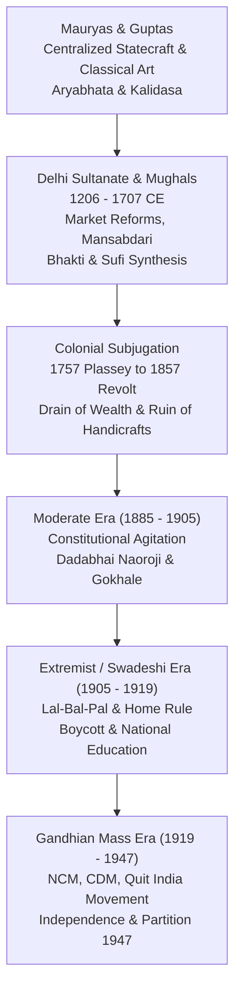

# Indian History and National Movement: Ancient to Modern (ಭಾರತದ ಇತಿಹಾಸ ಮತ್ತು ರಾಷ್ಟ್ರೀಯ ಚಳವಳಿ)

> [!exam-focus]
> **Exam Weightage & Testing Patterns**: Constitutes the backbone of Prelims Paper 1 (6-8 questions) and provides critical cross-disciplinary depth for Mains GS-1 Section 1 and Section 2.
> - **Prelims Traps**: Confusing land revenue settlements (Zamindari/Permanent Settlement under Cornwallis vs Ryotwari under Thomas Munro vs Mahalwari under Holt Mackenzie); mixing up reform movement founders (Prarthana Samaj under Atmaram Pandurang vs Arya Samaj under Dayananda Saraswati vs Satyashodhak Samaj under Jyotirao Phule).
> - **Mains Dimensions**: Economic drain theory (Dadabhai Naoroji); structural shift in the national movement post-1919 with Gandhian mass mobilization; communal award and the Poona Pact (1932).

---

## 1. Imperial and Nationalist Timeline

The diagram above summarizes the broad historical arcs of Indian history: from classical imperial consolidation to Islamic medieval synthesis, British colonial economic exploitation, and the multi-phased nationalist struggle leading to independence.

---

## 2. Medieval Synthesis: Sultanates and Mughals

### 2.1 The Delhi Sultanate (1206–1526 CE)
- **Mamluk / Slave Dynasty (1206–1290)**: Qutb-ud-din Aibak founded; Iltutmish introduced the **Iqta system (ಇಕ್ತಾ ಪದ್ಧತಿ)** and organized the *Turkan-i-Chahalgani* (The Forty); Sultana Razia was the first female Muslim monarch of India.
- **Khalji Dynasty (1290–1320)**:
  - **Alauddin Khalji (ಅಲಾವುದ್ದೀನ್ ಖಿಲ್ಜಿ)**: Instituted strict **Market Regulations (ಅಂಗಡಿ ಮಾರುಕಟ್ಟೆ ನಿಯಂತ್ರಣ)** in Delhi with fixed prices (*Shahna-i-Mandi*); introduced the military branding of horses (*Dagh*) and descriptive roll of soldiers (*Huliya*); dispatched general **Malik Kafur** on south Indian campaigns reaching Madurai.
- **Tughlaq Dynasty (1320–1414)**:
  - **Muhammad bin Tughlaq (ಮಹಮ್ಮದ್ ಬಿನ್ ತುಘಲಕ್)**: Brilliant but erratic scholar; experiments included shifting capital from Delhi to Daulatabad (Devagiri, 1327), introducing token bronze/copper currency, and agricultural loans (*Sondhar*).

### 2.2 The Mughal Empire (1526–1707 CE)
- **Akbar (ಅಕ್ಬರ್: 1556–1605 CE)**:
  - *Mansabdari System (ಮನ್ಸಬ್ದಾರಿ ಪದ್ಧತಿ)*: Dual ranking framework—*Zat* (personal status and salary) and *Sawar* (number of mounted cavalry to maintain).
  - *Revenue Administration*: **Zabt / Dahsala System (ದಹಸಾಲ ಪದ್ಧತಿ)** formulated by finance minister Raja Todar Mal, assessing tax on 10-year rolling average crop yields and prices.
  - *Religious Policy*: Abolished *Jizya* (1564) and pilgrimage tax; established *Ibadat Khana* at Fatehpur Sikri for inter-faith dialogues; promulgated universal peace (**Sulh-i-Kul / ಸುಲ್ಹ್-ಎ-ಕುಲ್**) and spiritual fellowship *Din-i-Ilahi* (1582).
- **The Maratha Swarajya: Chhatrapati Shivaji (ಛತ್ರಪತಿ ಶಿವಾಜಿ, 1627–1680 CE)**:
  - Coronation at Raigad (1674). Created the administrative council **Ashtapradhan (ಅಷ್ಟಪ್ರಧಾನ)** headed by the *Peshwa* (Prime Minister).
  - Revenue taxes in conquered non-Swarajya territories:
    - **Chauth (ಚೌತ್)**: One-fourth (25%) of revenue collected for protection against raids.
    - **Sardeshmukhi (ಸರ್ದೇಶಮುಖಿ)**: Additional 10% levy claimed as hereditary overlord.

---

## 3. British Colonial Rule & Socio-Religious Reforms

### 3.1 Colonial Economic Exploitation
- **Three Land Revenue Systems**:
  1. *Permanent Settlement / Zamindari (ಶಾಶ್ವತ ಭೂಕಂದಾಯ ಪದ್ಧತಿ, 1793)*: Lord Cornwallis in Bengal, Bihar, Odisha. Zamindars recognized as permanent owners; state revenue fixed at 10/11th, zamindar retained 1/11th. Ruined peasantry.
  2. *Ryotwari System (ರೈತವಾರಿ ಪದ್ಧತಿ, 1820)*: Thomas Munro and Captain Read in Madras and Bombay Presidencies. State dealt directly with the cultivating peasant (*ryot*); revenue periodically revised upwards (50–60%).
  3. *Mahalwari System (ಮಹಲ್ವಾರಿ ಪದ್ಧತಿ, 1822/1833)*: Holt Mackenzie and William Bentinck in Northwestern Provinces and Punjab. Revenue assessed on the village community (*Mahal*) collectively.
- **Economic Drain Theory (ಸಂಪತ್ತಿನ ಸೋರಿಕೆ ಸಿದ್ಧಾಂತ)**:
  - Formulated by **Dadabhai Naoroji (ದಾದಾಬಾಯಿ ನೌರೋಜೀ)** in his classic 1901 work ***"Poverty and Un-British Rule in India"***.
  - Highlighted unrequited export surplus, home charges (salaries, pensions, railway guarantees), and imperial defense costs draining India's wealth to Britain. R. C. Dutt complemented this in *Economic History of India*.

### 3.2 19th Century Socio-Religious Reform Movements
| Movement | Founder / Year | Core Reforms & Agitations | Key Publications |
|---|---|---|---|
| **Brahmo Samaj** | Raja Ram Mohan Roy (1828) | Abolition of Sati (Regulation XVII of 1829 under Bentinck); anti-idolatry, monotheism | *Samvad Kaumudi*, *Mirat-ul-Akhbar* |
| **Arya Samaj** | Swami Dayananda Saraswati (1875) | *"Go Back to the Vedas"*; Shuddhi movement; rejected puranic idolatry and caste rigidity | *Satyarth Prakash* |
| **Ramakrishna Mission** | Swami Vivekananda (1897) | Neo-Vedanta; service to mankind as service to God; Speech at Chicago World Parliament (1893) | *Prabuddha Bharata*, *Udbodhan* |
| **Satyashodhak Samaj** | Jyotirao Phule (1873) | Anti-Brahminical tyranny; opened girls' schools; upliftment of Shudras and Ati-Shudras | *Gulamgiri* (Slavery) |
| **Self-Respect Movement** | E. V. Ramasamy Naicker 'Periyar' (1925) | Anti-caste rationalism; self-respect marriages without priests; temple entry agitations | *Kudi Arasu* |

---

## 4. The Indian National Movement (1885–1947)

### 4.1 The Moderate Phase (1885–1905)
- **Founding of INC (1885)**: Formed at Gokuldas Tejpal Sanskrit College in Bombay by 72 delegates; presided over by **W. C. Bonnerjee**; conceptualized by retired civil servant A. O. Hume.
- **Key Leaders**: Dadabhai Naoroji, Gopal Krishna Gokhale, Pherozeshah Mehta, Dinshaw Wacha.
- **Methods**: "3 P's" (Prayer, Petition, Protest); demanded legislative council expansion, civil service examination in India, reduction of military expenditure.

### 4.2 The Extremist / Swadeshi Phase (1905–1919)
- **Partition of Bengal (1905)**: Announced by Lord Curzon to divide Bengali nationalists along religious lines. Triggered the **Swadeshi & Boycott Movement (ಸ್ವದೇಶಿ ಚಳವಳಿ)**.
- **Lal-Bal-Pal**: Lala Lajpat Rai, Bal Gangadhar Tilak, Bipin Chandra Pal, and Aurobindo Ghosh demanded **Swaraj (Self-rule)** as a birthright.
- **Surat Split (1907)**: INC split into Moderates and Extremists; reunited in the **Lucknow Pact (1916)** under the mediation of Annie Besant and Tilak.

### 4.3 The Gandhian Era (1919–1947)
- **Non-Cooperation Movement (ಅಸಹಕಾರ ಚಳವಳಿ: 1920–1922)**:
  - Launched in response to the Rowlatt Act, Jallianwala Bagh Massacre (13 April 1919), and the Khilafat injustice.
  - Boycott of government schools, courts, titles, foreign cloth; promotion of Khadi and Charkha.
  - Suspended by Gandhi on **12 February 1922** following the violent **Chauri Chaura incident** (Gorakhpur, UP), where 22 policemen were burnt alive in a police station.
- **Civil Disobedience Movement (ಶಾಸನಭಂಗ ಚಳವಳಿ: 1930–1934)**:
  - Launched with the historic **Dandi March (ದಂಡಿ ಯಾತ್ರೆ)** from Sabarmati Ashram to Dandi coast (12 March – 6 April 1930, 240 miles) to defy the salt tax.
  - **Gandhi-Irwin Pact (March 1931)**: Suspended CDM; Gandhi attended the Second Round Table Conference in London as sole INC representative.
  - **Poona Pact (ಪುನಾ ಒಪ್ಪಂದ: 24 September 1932)**:
    - Signed between **Mahatma Gandhi** and **Dr. B. R. Ambedkar** at Yerwada Central Jail.
    - Replaced the British Ramsay MacDonald **Communal Award's** separate electorates for Depressed Classes with **reserved seats in general electorates** (increasing seats from 71 to 148 in provincial legislatures).
- **Quit India Movement (ಕ್ವಿಟ್ ಇಂಡಿಯಾ ಚಳವಳಿ: August 1942)**:
  - Launched on 8 August 1942 at Gowalia Tank Maidan (August Kranti Maidan) in Bombay.
  - Gandhi gave the clarion call: ***"Do or Die" (ಮಾಡು ಇಲ್ಲವೇ ಮಡಿ)***.
  - Top leadership arrested on 9 August under Operation Zero Hour; spontaneous leaderless mass uprising erupted with parallel governments (*Prati Sarkar*) formed at Satara (Nana Patil), Ballia (Chittu Pandey), and Tamluk (*Jatiya Sarkar*).
- **Mountbatten Plan & Independence (June 1947)**:
  - Lord Mountbatten announced the 3 June Plan partitioning British India into India and Pakistan.
  - **Indian Independence Act, 1947** enacted by British Parliament, creating independent dominions on 15 August 1947.

---

## 5. Related Vault Notes
- [[Early_Karnataka_Dynasties]] — Classical ancient foundations.
- [[Freedom_Struggle_in_Karnataka]] — Parallel nationalist events in Karnataka.
- [[Post_Independence_India]] — The aftermath of partition, nation-building, and integration.

---

## 6. Likely Questions & Verbatim PYQs

### Prelims Multiple-Choice Questions
- **PYQ (KPSC KAS 2017 Prelims P1)**: The historic Poona Pact of September 1932 was signed between Mahatma Gandhi and Dr. B. R. Ambedkar to resolve which of the following issues?
  - (A) Dominion status timeline
  - (B) Separate electorates for Depressed Classes [Correct]
  - (C) Participation in the Second Round Table Conference
  - (D) Formation of interim national government
- **PYQ (KPSC KAS 2014 Prelims P1)**: Who among the following pioneered the "Drain of Wealth" theory exposing the systematic economic exploitation of India under British rule?
  - (A) Gopal Krishna Gokhale
  - (B) Dadabhai Naoroji [Correct]
  - (C) Bal Gangadhar Tilak
  - (D) Surendranath Banerjee
- **Expected Question (Prelims 2026)**: In which year and under whose tenure was the Ryotwari land revenue system officially introduced in the Madras Presidency?
  - *Answer*: 1820, under Sir Thomas Munro.

---

> [!summary] Quick Revision Box (10 Non-Negotiable Facts)
> 1. **Alauddin Khalji**: First Delhi Sultan to regulate markets (*Shahna-i-Mandi*) and brand horses (*Dagh*).
> 2. **Akbar's Dahsala (1580)**: 10-year revenue assessment system formulated by Todar Mal.
> 3. **Shivaji's Ashtapradhan**: 8-minister administrative council; *Chauth* (25%) & *Sardeshmukhi* (10%).
> 4. **Permanent Settlement (1793)**: Cornwallis fixed revenue with Zamindars (10/11th to state).
> 5. **Dadabhai Naoroji (1901)**: *Poverty and Un-British Rule in India*; Drain of Wealth theory.
> 6. **Brahmo Samaj (1828)**: Raja Ram Mohan Roy; Sati abolished via Regulation XVII of 1829.
> 7. **Jyotirao Phule (1873)**: Founded Satyashodhak Samaj; authored *Gulamgiri*.
> 8. **Chauri Chaura (1922)**: Violent police station burning led Gandhi to suspend Non-Cooperation.
> 9. **Poona Pact (1932)**: Gandhi & Ambedkar agreed on reserved seats instead of separate electorates.
> 10. **Quit India (1942)**: *"Do or Die"* slogan; parallel governments formed at Satara and Ballia.
