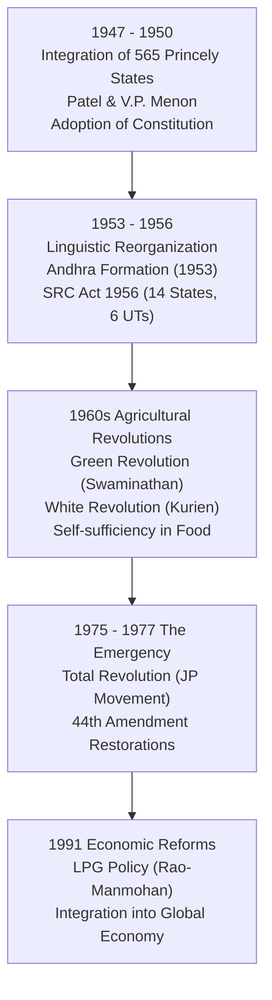

# Post-Independence India: Nation-Building, Integration and Consolidation (ಸ್ವಾತಂತ್ರ್ಯೋತ್ತರ ಭಾರತ: ರಾಷ್ಟ್ರ ನಿರ್ಮಾಣ, ಏಕೀಕರಣ ಮತ್ತು ಸುಧಾರಣೆಗಳು)

> [!exam-focus]
> **Exam Weightage & Testing Patterns**: A prominent area in Mains GS-1 Section 2 (Social & Political Perspective) and GS-2 Section 3 (International Relations). Yields 1-2 analytical questions in Mains and 2-3 MCQs in Prelims.
> - **Prelims Traps**: Confusing the instruments of accession/integration of the three reluctant princely states (Junagadh via Plebiscite vs Hyderabad via Police Action 'Operation Polo' vs J&K via Instrument of Accession); mixing up Tashkent Agreement (1966) with Simla Agreement (1972).
> - **Mains Dimensions**: Sardar Patel's diplomatic realism vs Nehru's internationalism; institutional foundation of India's mixed economy and Five-Year Plans; constitutional resilience through the 1975–77 Emergency.

---

## 1. Post-Independence Consolidation Timeline

The flowchart above maps the major institutional challenges overcome by the young Indian Republic over its first half-century: sovereign territorial consolidation, linguistic balancing, food security, democratic revival, and economic liberalization.

---

## 2. Territorial Integration & Nation-Building (1947–1950)

### 2.1 The Integration of Princely States
At independence, British India consisted of 11 provinces alongside **565 Princely States** covering 48% of the area and 28% of the population. The Indian Independence Act gave rulers the choice to join India, Pakistan, or remain independent.
- **The Architect of Integration**: Deputy Prime Minister & Home Minister **Sardar Vallabhbhai Patel (ಸರ್ದಾರ್ ವಲ್ಲಭಭಾಯಿ ಪಟೇಲ್)**, assisted by Home Secretary **V. P. Menon**, utilized diplomacy, patriotic appeals, and the realistic threat of force, offering princes the *Privy Purse* (constitutional financial allowances, later abolished by the 26th Amendment in 1971).
- **The Three Reluctant States**:
  1. **Junagadh (ಜುನಾಗಢ್)**: Nawab Mahabat Khan opted for Pakistan despite an overwhelmingly Hindu population and territorial encirclement by India. The population revolted, the Nawab fled to Karachi, and a **democratic plebiscite (ಜನಮತ ಸಂಗ್ರಹ)** held in February 1948 voted 99% in favor of joining India.
  2. **Hyderabad (ಹೈದರಾಬಾದ್)**: Nizam Mir Osman Ali Khan declared independence, aided by the fanatical communal militia **Razakars (ರಜಾಕಾರರು)** led by Kasim Razvi, who terrorized the population. Following border raids, Indian forces launched **Operation Polo (ಆಪರೇಷನ್ ಪೋಲೋ / ಪೊಲೀಸ್ ಕಾರ್ಯಾಚರಣೆ)** on 13 September 1948. The Nizam surrendered on 17 September 1948 and signed the Instrument of Accession.
  3. **Jammu & Kashmir (ಜಮ್ಮು ಮತ್ತು ಕಾಶ್ಮೀರ)**: Maharaja Hari Singh signed a standstill agreement hoping to remain independent. In October 1947, Pakistani armed tribal raiders (*Afridis and Pashtuns*) invaded Kashmir, reaching Baramulla. Hari Singh appealed to India and signed the **Instrument of Accession (ವಿಲೀನ ಪತ್ರ)** on **26 October 1947**, after which Indian troops were airlifted to Srinagar.

### 2.2 Linguistic Reorganization of States
- Following independence, the demand for linguistic states gained momentum in non-Hindi speaking regions.
- **Potti Sreeramulu (ಪೊಟ್ಟಿ ಶ್ರೀರಾಮುಲು)** undertook a fast-unto-death demanding a separate Telugu state from Madras Presidency. His death on the 58th day (15 December 1952) sparked widespread unrest.
- Prime Minister Nehru announced the creation of the first linguistic state: **Andhra State (ಆಂಧ್ರ ರಾಜ್ಯ)** on **1 October 1953**.
- **States Reorganisation Act, 1956**: Enacted based on the Fazal Ali Commission report; abolished the old Part A, B, C, D classification and carved India into **14 States and 6 Union Territories**.

---

## 3. Foreign Policy & Geopolitics: Nehruvian Era to 1971

### 3.1 Non-Aligned Movement (NAM / ಅಲಿಪ್ತ ನೀತಿ)
- In the bipolar Cold War era, India refused to align with either the US-led NATO bloc or the Soviet-led Warsaw Pact.
- Formulated through the **Panchsheel (ಪಂಚಶೀಲ ತತ್ವಗಳು, 1954)**: Five Principles of Peaceful Coexistence signed between Prime Minister Jawaharlal Nehru and Chinese Premier Zhou Enlai:
  1. Mutual respect for each other's territorial integrity and sovereignty.
  2. Mutual non-aggression.
  3. Mutual non-interference in each other's internal affairs.
  4. Equality and mutual benefit.
  5. Peaceful coexistence.
- Founding leaders of NAM (Belgrade Conference, 1961): **Nehru (India), Josip Broz Tito (Yugoslavia), Gamal Abdel Nasser (Egypt), Sukarno (Indonesia), Kwame Nkrumah (Ghana)**.

### 3.2 Major Conflicts & Turning Points
- **1962 Sino-Indian War**: Chinese aggression across Aksai Chin and the McMahon Line in Arunachal Pradesh (NEFA); exposed Indian military vulnerabilities and led to the resignation of Defense Minister V. K. Krishna Menon.
- **1965 Indo-Pak War**: Pakistan's *Operation Gibraltar* infiltrated J&K. Prime Minister **Lal Bahadur Shastri** gave the immortal slogan ***"Jai Jawan, Jai Kisan" (ಜೈ ಜವಾನ್, ಜೈ ಕಿಸಾನ್)*** and authorized Indian troops to cross the international border toward Lahore. Ended in the Soviet-brokered **Tashkent Agreement (1966)**, where Shastri passed away mysteriously.
- **1971 Indo-Pak War & Liberation of Bangladesh**:
  - Pakistani military cracked down (*Operation Searchlight*) on Bengali dissidents in East Pakistan, driving 10 million refugees into India.
  - Prime Minister Indira Gandhi backed the **Mukti Bahini**. War lasted 13 days (3–16 December 1971), culminating in the historic surrender of 93,000 Pakistani soldiers under General A. A. K. Niazi to Lieutenant General J. S. Aurora in Dhaka.
  - **Simla Agreement (ಶಿಮ್ಲಾ ಒಪ್ಪಂದ, 1972)**: Signed between Indira Gandhi and Zulfikar Ali Bhutto, committing both nations to settle all bilateral disputes, including Jammu & Kashmir, strictly through bilateral negotiations without third-party mediation.

---

## 4. Socio-Economic Transformations & The Emergency

### 4.1 Green and White Revolutions
- **The Green Revolution (ಹಸಿರು ಕ್ರಾಂತಿ, mid-1960s)**:
  - Spearheaded by agricultural scientist **Dr. M. S. Swaminathan (ಡಾ. ಎಂ. ಎಸ್. ಸ್ವಾಮಿನಾಥನ್)** and Union Agriculture Minister C. Subramaniam, utilizing High Yielding Variety (HYV) semi-dwarf seeds developed by Nobel laureate Norman Borlaug.
  - Transformed India from a "ship-to-mouth" nation dependent on US PL-480 wheat aid into a self-sufficient grain exporter.
- **The White Revolution / Operation Flood (ಶ್ವೇತ ಕ್ರಾಂತಿ, 1970)**:
  - Spearheaded by **Dr. Verghese Kurien (ವರ್ಘೀಸ್ ಕುರಿಯನ್ - "Milkman of India")** through the National Dairy Development Board (NDDB) and the Anand Milk Union Limited (AMUL) cooperative model, making India the world's largest milk producer.

### 4.2 The Emergency & Democratic Restoration (1975–1977)
- **Imposition**: On **25 June 1975**, President Fakhruddin Ali Ahmed declared an **Internal Emergency under Article 352** on the advice of Prime Minister Indira Gandhi, following the Allahabad High Court verdict (Justice Jagmohan Lal Sinha) invalidating her election, and the nationwide **Total Revolution (ಸಂಪೂರ್ಣ ಕ್ರಾಂತಿ)** launched by **Jayaprakash Narayan (JP)**.
- **Repression**: Fundamental Rights under Articles 14, 19, and 21 were suspended; opposition leaders (Morarji Desai, Atal Bihari Vajpayee, L. K. Advani) were jailed; press censorship was enforced.
- **42nd Amendment Act, 1976 ("Mini-Constitution")**: Inserted the words *"Socialist, Secular, and Integrity"* into the Preamble; added Fundamental Duties (Article 51A).
- **Restoration**: Elections in March 1977 swept the Congress out of power, inaugurating India's first non-Congress government under Morarji Desai (Janata Party). The **44th Amendment Act, 1978** safeguarded democracy by ensuring that Articles 20 and 21 could never be suspended even during an emergency, and replaced "internal disturbance" with "armed rebellion" in Article 352.

### 4.3 Economic Liberalization (1991)
- Triggered by a severe Balance of Payments (BoP) crisis in 1991, with foreign exchange reserves depleted to less than two weeks of imports.
- Prime Minister **P. V. Narasimha Rao** and Finance Minister **Dr. Manmohan Singh** dismantled the *License-Permit-Quota Raj*, ushering in **LPG reforms (ಉದಾರೀಕರಣ, ಖಾಸಗೀಕರಣ, ಜಾಗತೀಕರಣ - Liberalization, Privatization, Globalization)**, devaluing the rupee, abolishing industrial licensing, and welcoming foreign direct investment (FDI).

---

## 5. Related Vault Notes
- [[Indian_History_Overview]] — The preceding colonial and nationalist struggles.
- [[Indian_Constitutional_System]] — Detailed constitutional structures and emergency articles.
- [[Indian_Economic_Planning_and_Reforms]] — The economic dimensions of Five-Year Plans and 1991 reforms.

---

## 6. Likely Questions & Verbatim PYQs

### Prelims Multiple-Choice Questions
- **PYQ (KPSC KAS 2017 Prelims P1)**: The police action code-named "Operation Polo" was launched by the Government of India in September 1948 to integrate which of the following Princely States into the Indian Union?
  - (A) Junagadh
  - (B) Kashmir
  - (C) Hyderabad [Correct]
  - (D) Travancore
- **PYQ (KPSC KAS 2020 Prelims P1)**: Which constitutional amendment is famously known as the "Mini-Constitution" due to its sweeping structural changes made during the Emergency period in 1976?
  - (A) 24th Amendment
  - (B) 42nd Amendment [Correct]
  - (C) 44th Amendment
  - (D) 73rd Amendment
- **Expected Question (Prelims 2026)**: The historic Simla Agreement of 1972, mandating bilateral resolution of all disputes without third-party intervention, was signed between:
  - *Answer*: Prime Minister Indira Gandhi and Pakistan Prime Minister Zulfikar Ali Bhutto.

---

> [!summary] Quick Revision Box (10 Non-Negotiable Facts)
> 1. **Operation Polo (Sept 1948)**: Military integration of Hyderabad Nizam's state.
> 2. **Junagadh**: Joined Indian Union via democratic plebiscite in Feb 1948.
> 3. **Panchsheel (1954)**: 5 Principles of Peaceful Coexistence signed between Nehru & Zhou Enlai.
> 4. **Potti Sreeramulu**: 58-day fast led to formation of first linguistic state, Andhra (1953).
> 5. **States Reorganisation Act (1956)**: Created 14 States and 6 Union Territories.
> 6. **Green Revolution**: Dr. M. S. Swaminathan introduced HYV semi-dwarf wheat seeds.
> 7. **Operation Flood (1970)**: Dr. Verghese Kurien built the national dairy cooperative model.
> 8. **Simla Agreement (1972)**: Bilateral conflict resolution framework post-1971 Bangladesh war.
> 9. **44th Amendment Act (1978)**: Ensured Articles 20 and 21 can never be suspended during Emergency.
> 10. **LPG Reforms (1991)**: Rao-Manmohan structural reforms dismantling the License Raj.
