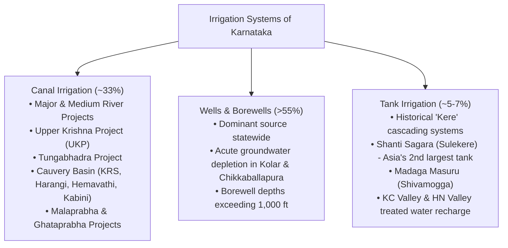

# Karnataka Agro-Climatic Zones, Cropping Patterns, Irrigation and Agriculture Policy (ಕರ್ನಾಟಕದ ಕೃಷಿ-ವಾಯುಗುಣ ವಲಯಗಳು, ಬೆಳೆ ಪದ್ಧತಿ, ನೀರಾವರಿ ಮತ್ತು ಕೃಷಿ ನೀತಿ)

> [!exam-focus]
> **KPSC High-Yield Examination Focus**:
> - **Ten Agro-Climatic Zones (ಕೃಷಿ-ವಾಯುಗುಣ ವಲಯಗಳು)**: Karnataka is scientifically divided into **10 distinct agro-climatic zones** based on rainfall, soil types, elevation, and cropping patterns.
> - **Leading Crops & National Rankings**:
>   - **Coffee (ಕಾಫಿ)**: Karnataka produces **~70% of India's total coffee** (Chikkamagaluru, Kodagu, Hassan).
>   - **Raw Silk / Sericulture (ರೇಷ್ಮೆ)**: Karnataka produces **~45-50% of India's mulberry silk** (Ramanagara is Asia's largest cocoon market).
>   - **Ragi (ರಾಗಿ / Finger Millet)**: Karnataka is India's leading producer; staple diet of Southern Karnataka.
>   - **Sunflower & Safflower**: Major producer in peninsular India.
>   - **Tur / Red Gram (ತೊಗರಿ)**: **Kalaburagi (ಗುಲ್ಬರ್ಗ)** is known as the *"Dal Bowl of Karnataka (ತೊಗರಿ ಕಣಜ)"*; holds GI tag for *Kalaburagi Red Gram*.
>   - **Arecanut (ಅಡಿಕೆ)**: Karnataka accounts for **over 40-45% of India's arecanut** (Shivamogga, Channagiri, Uttara Kannada).
> - **Irrigation Status**:
>   - Net Sown Area under irrigation is ~34-36%; remaining ~65% is rainfed dryland farming.
>   - Wells and Tube-wells/Borewells constitute the single largest source of irrigation (>50%), followed by canals (~33%) and tanks (~5-7%).
> - **Pioneering State Agricultural Schemes**: *Krishi Bhagya*, *Raitha Siri*, *Siri Dhanya (Millet Mission)*, *Bhoomi Project*, *K-Kisan portal*.

---

## 1. The Ten Agro-Climatic Zones of Karnataka

The University of Agricultural Sciences (UAS), Bengaluru and Dharwad, in collaboration with the Department of Agriculture, classified Karnataka into **10 Agro-Climatic Zones**:

```mermaid
flowchart TD
    ZONES["10 Agro-Climatic Zones of Karnataka"]
    ZONES --> D1["1. North-Eastern Transition Zone (Bidar, parts of Kalaburagi)"]
    ZONES --> D2["2. North-Eastern Dry Zone (Kalaburagi, Yadgir, Raichur)"]
    ZONES --> D3["3. Northern Dry Zone (Vijayapura, Bagalkote, Koppal, Gadag, Ballari)"]
    ZONES --> D4["4. Central Dry Zone (Chitradurga, Davanagere, parts of Tumakuru)"]
    ZONES --> D5["5. Eastern Dry Zone (Bengaluru Urban/Rural, Kolar, Chikkaballapura)"]
    ZONES --> D6["6. Southern Dry Zone (Mandya, Mysuru, parts of Tumakuru & Hassan)"]
    ZONES --> D7["7. Southern Transition Zone (parts of Hassan, Mysuru, Chamarajanagar)"]
    ZONES --> D8["8. Northern Transition Zone (Belagavi, Dharwad, Haveri)"]
    ZONES --> D9["9. Hilly / Malnad Zone (Kodagu, Chikkamagaluru, Shivamogga, Uttara Kannada)"]
    ZONES --> D10["10. Coastal Zone (Dakshina Kannada, Udupi, Coastal Uttara Kannada)"]
```

### Comprehensive Zone-by-Zone Matrix

| Zone No. & Name | Districts Covered | Annual Rainfall (mm) | Dominant Soils | Major Crops Cultivated |
| :--- | :--- | :--- | :--- | :--- |
| **Zone 1: North-Eastern Transition (ಈಶಾನ್ಯ ಪರಿವರ್ತನಾ ವಲಯ)** | Bidar, parts of Kalaburagi | 800 - 900 mm | Deep black clayey & lateritic soils | Tur (Pigeon pea), jowar, green gram, soybean, sugarcane |
| **Zone 2: North-Eastern Dry (ಈಶಾನ್ಯ ಶುಷ್ಕ ವಲಯ)** | Kalaburagi, Yadgir, Raichur | 650 - 750 mm | Deep to medium black soils (*Vertisols*) | Tur (*Dal Bowl*), rabi jowar, sunflower, cotton, bajra |
| **Zone 3: Northern Dry (ಉತ್ತರ ಶುಷ್ಕ ವಲಯ)** | Vijayapura, Bagalkote, Gadag, Koppal, Ballari, Vijayanagara | 450 - 600 mm | Medium black soils, saline soils | Rabi jowar, cotton, groundnut, onion, grapes, pomegranate |
| **Zone 4: Central Dry (ಮಧ್ಯ ಶುಷ್ಕ ವಲಯ)** | Chitradurga, Davanagere, Chikkanayakanahalli/Sira (Tumakuru) | 450 - 650 mm | Red sandy loams, shallow black soils | Maize, groundnut, ragi, jowar, arecanut, pomegranate |
| **Zone 5: Eastern Dry (ಪೂರ್ವ ಶುಷ್ಕ ವಲಯ)** | Bengaluru Urban, Bengaluru Rural, Ramanagara, Kolar, Chikkaballapura | 700 - 850 mm | Red loams, lateritic gravelly soils | Ragi, mulberry (sericulture), red gram, mango, grapes, vegetables |
| **Zone 6: Southern Dry (ದಕ್ಷಿಣ ಶುಷ್ಕ ವಲಯ)** | Mandya, Mysuru, parts of Tumakuru, Hassan plains | 650 - 800 mm | Red sandy loams, red sandy soils | Ragi, sugarcane (Cauvery basin), paddy, pulses, coconut |
| **Zone 7: Southern Transition (ದಕ್ಷಿಣ ಪರಿವರ್ತನಾ ವಲಯ)** | Parts of Hassan, Mysuru, Chamarajanagar | 800 - 1,000 mm | Red sandy loams, clayey loams | Ragi, tobacco, maize, paddy, cotton, banana, ginger |
| **Zone 8: Northern Transition (ಉತ್ತರ ಪರಿವರ್ತನಾ ವಲಯ)** | Belagavi, Dharwad, Haveri | 750 - 1,000 mm | Medium black, transitional clay loams | Cotton, soybean, wheat, jowar, chillies (Byadgi), groundnut |
| **Zone 9: Hilly / Malnad (ಮಲೆನಾಡು ವಲಯ)** | Kodagu, Chikkamagaluru, Shivamogga, interior Uttara Kannada | 1,500 - 4,000 mm | Red laterite, humic mountain forest soils | Coffee, arecanut, cardamom, pepper, rubber, paddy |
| **Zone 10: Coastal (ಕರಾವಳಿ ವಲಯ)** | Dakshina Kannada, Udupi, Coastal Uttara Kannada | 3,000 - 4,500 mm | Coastal alluvium, coastal laterite soils | Paddy, coconut, arecanut, cashew nut, spices, betel leaf |

---

## 2. Major Cropping Systems and Commodity Profiles

### 2.1 Food Grains and Cereals
1. **Ragi / Finger Millet (ರಾಗಿ - *Eleusine coracana*)**:
   - *Dominance*: Staple grain of South Karnataka. Karnataka contributes **over 55% of India's total ragi production**.
   - *Key Districts*: Tumakuru, Hassan, Ramanagara, Kolar, Bengaluru Rural, Mandya.
   - *Agronomic Features*: Drought-hardy C4 crop; requires only 500-750 mm rainfall; thrives on nutrient-poor red soils; highly nutritious (calcium and dietary fibre).
2. **Jowar / Sorghum (ಜೋಳ - *Sorghum bicolor*)**:
   - *Dominance*: Staple grain of North Karnataka ("Rotti" culture).
   - *Key Districts*: Vijayapura, Kalaburagi, Raichur, Bagalkote, Belagavi, Dharwad.
   - *Seasons*: Cultivated both as *Mungaru* (Kharif) and *Hingaru* (Rabi). The Rabi *Maldandi* jowar of Vijayapura is prized for taste and storage quality.
3. **Paddy / Rice (ಭತ್ತ - *Oryza sativa*)**:
   - *Key Districts*: Raichur (Tungabhadra command area - "Rice Bowl of Karnataka"), Bellary, Davanagere (Bhadra canal), Mandya (Cauvery canal), Shivamogga, Udupi.
   - *GI Tags*: *Mugad Sugandhi* (Dharwad).
4. **Maize (ಮೆಕ್ಕೆಜೋಳ)**:
   - Spectacular acreage expansion over the last two decades.
   - *Key Districts*: Davanagere, Haveri, Chitradurga, Belagavi, Ballari; drives poultry feed and industrial starch production.

### 2.2 Pulses: The Dal Bowl of Karnataka
- **Tur / Red Gram (ತೊಗರಿ - *Cajanus cajan*)**:
  - Karnataka is the second largest producer of red gram in India.
  - **Kalaburagi** district is universally designated the **Dal Bowl of Karnataka (ತೊಗರಿ ಕಣಜ)**, accounting for over 40% of the state's tur output.
  - *GI Tag*: **Kalaburagi Red Gram (ಗುಲ್ಬರ್ಗ ತೊಗರಿ)**, granted in 2019 for its distinct sweet flavour, high protein content, and cooking qualities attributed to the calcium-rich black soils.

### 2.3 Commercial Cash Crops and Horticulture
1. **Coffee (ಕಾಫಿ)**:
   - *Historical Origin*: Sufi saint **Baba Budan** brought 7 raw coffee seeds from Yemen in 1670 and planted them in the Chandradrona Parvatha (now Bababudan Giri, Chikkamagaluru).
   - *Production*: Karnataka produces **~70% of India's coffee** (approx. 2.4 to 2.6 lakh metric tonnes annually).
   - *Varieties*: **Arabica** (grown at higher elevations >1,000 m, delicate flavor, Chikkamagaluru/Kodagu) and **Robusta** (grown at lower elevations 500-1,000 m, hardy, higher caffeine).
   - *GI Tags*: *Coorg Arabica Coffee*, *Chikmagalur Arabica Coffee*, *Bababudangiris Arabica Coffee*.
2. **Sericulture and Silk (ರೇಷ್ಮೆ ಕೃಷಿ)**:
   - *National Pre-eminence*: Karnataka produces **~45-50% of India's total mulberry raw silk**.
   - *Historical Impetus*: Introduced and promoted scientifically by **Tipu Sultan**, who established silk cocoons from Bengal and Oman.
   - *Key Centers*: Ramanagara ("Silk Town" / Asia's largest cocoon market), Kolar, Chikkaballapura, Mysuru, Mandya.
   - *GI Tags*: *Mysore Silk* (renowned KSIC gold zari sarees).
3. **Arecanut (ಅಡಿಕೆ)**:
   - Karnataka produces ~45% of India's arecanut.
   - *Key Centers*: Shivamogga, Davanagere (Channagiri - major arecanut market), Chikkamagaluru, Uttara Kannada.
   - *GI Tag*: *Sirsi Supari* (Uttara Kannada).
4. **Cotton and Sugarcane**:
   - *Cotton*: Thrives on black soils in Haveri, Dharwad, Belagavi, Ballari, Raichur.
   - *Sugarcane*: Heavy water-demanding crop concentrated in the command areas of Belagavi (Ghataprabha/Malaprabha), Mandya (Cauvery/Visvesvaraya canal), Bagalkote, and Vijayapura (Krishna). Belagavi is the "Sugar Bowl of Karnataka".
5. **Spices & Condiments**:
   - **Byadgi Chilli (ಬ್ಯಾಡಗಿ ಮೆಣಸಿನಕಾಯಿ)** (Haveri): GI tagged, internationally renowned for deep red colour (*capsanthin*) and mild pungency; indispensable for oleoresin extraction.

---

## 3. Irrigation Infrastructure and Water Systems

Karnataka's net irrigated area stands at approximately **34-36%** of net sown area. Sources of irrigation are categorized into three main engineering classes:

### 3.1 Major Canal Irrigation Projects
1. **Upper Krishna Project (UKP / ಕೃಷ್ಣಾ ಮೇಲ್ದಂಡೆ ಯೋಜನೆ)**:
   - Largest irrigation project in Karnataka, designed to irrigate over 6 lakh hectares in the drought-prone Northern Maidan (Vijayapura, Bagalkote, Kalaburagi, Yadgir, Raichur).
   - Major dams: **Almatti Dam (Lal Bahadur Shastri Reservoir)** and **Narayanpur Dam (Basava Sagara Reservoir)**.
   - Stage III aims to raise the Almatti full reservoir level (FRL) from 519.60 m to 524.256 m to utilize 130 TMC of Krishna waters.
2. **Tungabhadra Project (ತುಂಗಭದ್ರಾ ಯೋಜನೆ)**:
   - Joint venture between Karnataka and Andhra Pradesh at Mallapuram near Hosapete.
   - Irrigates Ballari, Vijayanagara, Koppal, and Raichur.
   - Faces critical storage loss (>30 TMC) due to massive **siltation (ಹೂಳು ತುಂಬುವಿಕೆ)** in the reservoir bed.
3. **Cauvery Basin Projects**:
   - **Krishna Raja Sagara (KRS)**: Conceived and engineered by Sir M. Visvesvaraya (1911-1932); Visvesvaraya Canal network irrigates Mandya and Mysuru.
   - **Kabini, Hemavathi, and Harangi Reservoirs**: Form the lifeline of Southern Karnataka agriculture.
4. **Malaprabha and Ghataprabha Projects**:
   - Renuka Sagara Dam (Navilatirtha) on Malaprabha; Hidkal Dam (Raja Lakhamagouda) on Ghataprabha; irrigates Belagavi, Bagalkote, and Gadag.

### 3.2 The Historical Tank (*Kere*) System
- Karnataka's landscape was historically engineered into thousands of inter-connected cascading tank networks by dynasties like Kadambas, Gangas, Hoysalas, and Keladi Nayakas.
- **Shanti Sagara / Sulekere (ಶಾಂತಿ ಸಾಗರ / ಸೂಳೆಕೆರೆ)**:
  - Located in Channagiri taluk, Davanagere district.
  - Constructed in the 12th century; water spread area of over 6,550 acres and circumference of ~30 km.
  - **Second largest ancient man-made irrigation tank in Asia**.
- **Treated Wastewater Aquifer Recharge Initiatives**:
  - **K.C. Valley Project (Koramanagala-Challaghatta)**: Pumping secondary treated sewage water from Bengaluru to fill 126 dry irrigation tanks in Kolar and Chikkaballapura to raise groundwater tables.
  - **H.N. Valley Project (Hebbal-Nagawara)**: Recharging tanks in Bengaluru Rural and Chikkaballapura.

---

## 4. Key Agriculture Policies and Flagship Schemes

1. **Krishi Bhagya Scheme (ಕೃಷಿ ಭಾಗ್ಯ ಯೋಜನೆ)**:
   - Designed for dryland farmers in rainfed agro-climatic zones.
   - Components: Rainwater harvesting through farm ponds (*Krishi Honda*), polythene lining to prevent seepage, diesel pump sets, and micro-irrigation (drip/sprinkler) equipment.
2. **Raitha Siri & Siri Dhanya (Millet Mission / ಸಿರಿ ಧಾನ್ಯ)**:
   - Direct cash incentives per hectare for farmers cultivating minor millets (Navane, Same, Haraka, Korale, Baragu, Oodalu).
   - Promotion of millets as nutritious "Smart Food" suited to climate-resilient dryland farming.
3. **Karnataka Organic Farming Policy (ಸಾವಯವ ಕೃಷಿ ನೀತಿ)**:
   - First state in India to notify a dedicated State Organic Farming Policy (2004, updated 2017).
   - Establishes district organic farmer federations and Jaivik Krishik Society marketing channels.
4. **K-Kisan Portal & FRUITS (Farmer Registration and Unified Beneficiary Information System)**:
   - Unified digital land and farmer identification database integrating land records (Bhoomi) with direct benefit transfers (DBT) for seeds, fertilizers, and crop loss insurance (PMFBY).

---

## 5. Comparative Synthesis: Commercial Crops of Karnataka

| Crop | Leading Districts | State Share in India | Ideal Agro-Climatic Zone | Key Challenges |
| :--- | :--- | :--- | :--- | :--- |
| **Coffee** | Kodagu, Chikkamagaluru, Hassan | **~70%** | Hilly / Malnad Zone | White stem borer pest, blossom shower delays, labor shortage |
| **Raw Silk** | Ramanagara, Kolar, Mandya, Mysuru | **~45-50%** | Eastern & Southern Dry Zones | Pebrine disease, cocoon price volatility, Chinese silk imports |
| **Ragi** | Tumakuru, Hassan, Ramanagara | **>55%** | Eastern & Southern Dry Zones | Shift to cash crops, low processing industrialisation |
| **Tur (Red Gram)** | Kalaburagi, Yadgir, Bidar | **~18-20%** | North-Eastern Dry Zone | Wilt disease, unseasonal rainfall during harvest, price crash |
| **Arecanut** | Shivamogga, Davanagere, Chikkamagaluru | **~45%** | Malnad & Transition Zones | Yellow Leaf Disease (YLD), fruit rot (*Koleroga*), illegal imports |
| **Sugarcane** | Belagavi, Bagalkote, Mandya | **~10-12%** | Northern Transition & Canal belts | FRP payment disputes, heavy water logging, soil salinisation |

---

## 6. Prelims Traps & Mains Answer Blueprint

### 6.1 Prelims Traps
> [!caution]
> - **Trap 1**: Believing Raichur is the Dal Bowl of Karnataka.
>   - *Fact*: **Kalaburagi (ಗುಲ್ಬರ್ಗ)** is the "Dal Bowl of Karnataka" (*Togari Kanaja*), not Raichur. Raichur is renowned as the "Rice Bowl" due to the Tungabhadra canal command.
> - **Trap 2**: Confusing the largest artificial tank in Asia.
>   - *Fact*: **Shanti Sagara (Sulekere)** in Davanagere district is Asia's *second largest* ancient artificial tank (Bhojpur lake in MP or Jaisamand in Rajasthan being considered first). It is NOT a natural lake.
> - **Trap 3**: Believing tank irrigation is the largest source of irrigation in Karnataka.
>   - *Fact*: **Tube-wells / Borewells** constitute over 50% of net irrigated area. Tanks contribute less than 7% due to siltation and neglect.
> - **Trap 4**: Misattributing India's leading coffee-growing district.
>   - *Fact*: **Kodagu (ಕೊಡಗು)** produces more coffee than Chikkamagaluru, though Chikkamagaluru is the historical birthplace where Baba Budan first planted coffee.

### 6.2 Mains Model Question & Answer Blueprint
**Question**: *Critically examine the regional imbalances in Karnataka's agricultural economy. What policy interventions are required to enhance the climate resilience of dryland farming in the Northern Maidan?* (Marks: 15 / 250 Words)

**Model Answer Outline**:
1. **Introduction (35 words)**:
   - Highlight Karnataka's agrarian dichotomy: the water-abundant, capital-intensive canal/plantation belts of Southern Karnataka and Coastal/Malnad zones versus the chronically drought-prone, rainfed mono-cropping tracts of the Northern Maidan.
2. **Body 1: Structural Drivers of Regional Agrarian Imbalance (75 words)**:
   - *Irrigation Disparity*: Southern Maidan (Cauvery basin) enjoys 50-60% canal assured irrigation; Northern Maidan has vast tracts (<25% irrigation) dependent on erratic monsoons.
   - *Crop High-Value Disparity*: Malnad yields high-value export cash crops (coffee, spices, arecanut), while Northern Maidan relies on low-margin food grains and pulses prone to pest attacks and price volatility.
   - *Groundwater Depletion*: Excessive borewell exploitation in hard-rock cratons without aquifer recharge leads to farm indebtedness.
3. **Body 2: Policy Interventions for Climate Resilience in Northern Maidan (75 words)**:
   - *Micro-Irrigation & UKP III Acceleration*: Expedite Almatti height enhancement to operationalize canal distribution; mandate drip irrigation in water-guzzling sugarcane belts.
   - *Millet & Pulse Diversification*: Scale up the *Siri Dhanya* mission and establish processing/milling clusters for Kalaburagi Red Gram to capture value-addition locally.
   - *Watershed Development*: Implement REWARD digital land resource inventories to guide site-specific soil conservation, farm pond construction (*Krishi Honda*), and desiltation of cascading tanks.
4. **Conclusion (25 words)**:
   - Conclude that bridging Karnataka's agrarian regional divide requires transforming dryland agriculture from a risk-ridden subsistence occupation into a climate-smart, tech-enabled enterprise supported by minimum support prices and FPO aggregation.

---

## 7. Sources and Verification
- **Verified On**: 2026-10-13 (Tuesday)
- **Primary Source 1**: Karnataka State Department of Agriculture (KSDA), *Annual Administrative Report 2024-2026*.
- **Primary Source 2**: Planning, Programme Monitoring and Statistics Department, Government of Karnataka, *Karnataka Economic Survey 2024-25 & 2025-26*.
- **Primary Source 3**: University of Agricultural Sciences (UAS), Bengaluru, *Agro-Climatic Zone Compendium of Karnataka*.
