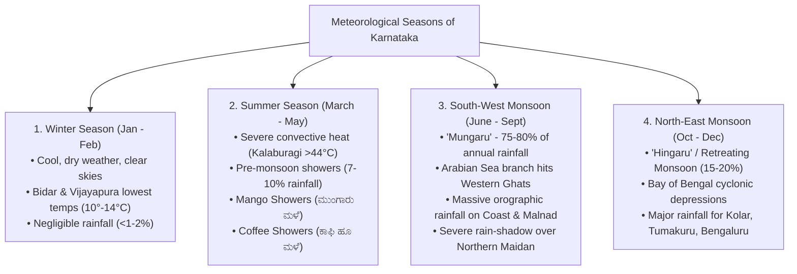

# Karnataka Climate, Rainfall Patterns, Monsoons and Drought Vulnerability (ಕರ್ನಾಟಕದ ವಾಯುಗುಣ, ಮಳೆಯ ಹಂಚಿಕೆ, ಮುಂಗಾರು-ಹಿಂಗಾರು ಮತ್ತು ಬರಪೀಡಿತ ಪ್ರದೇಶಗಳು)

> [!exam-focus]
> **KPSC High-Yield Examination Focus**:
> - **Climatic Regime**: Tropical Monsoon climate; marked by sharp transitional contrasts between the hyper-humid maritime coast, the rainy Western Ghats ridge, and the hyper-arid rain-shadow plateau (*Vrishti Chaya Pradesha*).
> - **Four Meteorological Seasons (IMD Classification)**:
>   1. *Winter / Cold Weather* (Jan-Feb): Dry, clear skies, pleasant days; Bidar records coldest winter temperatures (down to 10°-12°C).
>   2. *Summer / Hot Weather* (March-May): Scorching heat in Northern Maidan (up to 44°-45°C in Kalaburagi/Raichur); pre-monsoon convective thunderstorms known as **Mango Showers (ಮಾವಿನ ಮಳೆ / ಮುಂಗಾರು ಮಳೆ)** aiding mango maturation and **Coffee Showers (ಕಾಫಿ ಹೂ ಮಳೆ / Cherry Blossom Showers)** vital for blossoming in Kodagu and Chikkamagaluru.
>   3. *South-West Monsoon (ನೈಋತ್ಯ ಮಾನ್ಸೂನ್ / ಮುಂಗಾರು)* (June-Sept): Primary rainy season contributing **75-80% of state's annual rainfall**; intense orographic precipitation along Coastal Karnataka and Western Ghats.
>   4. *North-East / Retreating Monsoon (ಈಶಾನ್ಯ ಮಾನ್ಸೂನ್ / ಹಿಂಗಾರು)* (Oct-Dec): Contributes 15-20% of rainfall, primarily benefiting Southern Maidan (Kolar, Chikkaballapura, Bengaluru, Chamarajanagar).
> - **Rainfall Extremes**:
>   - Wettest Spot: **Agumbe (ಆಗುಂಬೆ, ~7,600 mm)** in Thirthahalli taluk ("Cherrapunji of South India") and **Hulikal (ಹುಲಿಕಲ್, >8,000 mm)** in Hosanagara taluk.
>   - Driest Spot: **Challakere (ಚಳ್ಳಕೆರೆ, <450 mm)** in Chitradurga district ("Oil City / Science City").
> - **Chronic Drought Status**: Karnataka has the **second largest drought-prone arid land area in India after Rajasthan**; 18-20 out of 31 districts are chronically vulnerable to agricultural and hydrological drought.
> - **Köppen's Classification for Karnataka**:
>   - *Amw* (Tropical Monsoon): Coastal belt and western slopes of Western Ghats.
>   - *Aw* (Tropical Savanna with dry winter): Malnad and parts of Southern Maidan.
>   - *BSh* (Subtropical / Tropical Semi-arid Steppe): Extensive Northern Maidan and eastern plateau.

---

## 1. Climatic Controls and General Characteristics

Karnataka enjoys a tropical monsoon climate governed by four primary geographic factors:
1. **Latitudinal Position**: Located between 11°30' N and 18°30' N, placing the entire state within the tropical belt. Solar radiation is intense throughout the year, with insolation peaking in April and May.
2. **The Western Ghats Relief Barrier (ಪಶ್ಚಿಮ ಘಟ್ಟಗಳ ತಡೆಗೋಡೆ)**: Acts as an unyielding wall against moisture-laden Arabian Sea monsoon winds, producing intense orographic rainfall on the coastal windward side and a severe **rain-shadow effect (ವೃಷ್ಟಿ ಛಾಯಾ ಪ್ರದೇಶ)** over the interior plateau.
3. **Distance from the Sea (Continentality / ಭೂಖಂಡೀಯತೆ)**: Coastal districts experience maritime equable climate, whereas the Northern Maidan suffers extreme continentality (scorching summers above 44°C and dry cold winters).
4. **Elevation (ಎತ್ತರ)**: High elevation in the Southern Maidan (600-900 m) and Malnad (1,000-1,900 m) moderates summer heat, giving Bengaluru and Madikeri their famous salubrious weather.

---

## 2. The Four Meteorological Seasons



### 2.1 Cold Weather / Winter Season (ಚಳಿಗಾಲ: ಜನವರಿ - ಫೆಬ್ರವರಿ)
- **Temperature Distribution**: January is the coldest month. Clear blue skies, low relative humidity (30-40%), and gentle continental winds from the north-east prevail.
- **Regional Variations**:
  - Northern Maidan records the lowest temperatures: **Bidar (10.0°C)**, Vijayapura, and Belagavi experience cold-wave conditions when western disturbances drag dry continental winds across central India.
  - Bengaluru records mean winter minimums of 15°-16°C.
  - Coastal belt remains warm and humid with minimums rarely dropping below 20°-22°C.
- **Precipitation**: Negligible (<10-15 mm across the entire state), representing less than 2% of annual precipitation.

### 2.2 Hot Weather / Summer Season (ಬೇಸಿಗೆ ಕಾಲ: ಮಾರ್ಚ್ - ಮೇ)
- **Temperature Distribution**: March marks rapid northward migration of the sun. Temperatures peak in late April and May.
  - **Kalaburagi (ಗುಲ್ಬರ್ಗ)** is known as the "Hottest District" of Karnataka, frequently clocking 44°-45°C. Raichur, Ballari, Koppal, and Yadgir regularly exceed 42°C.
  - Southern Maidan experiences moderate heat: Bengaluru averages 34°-36°C, though urban heat island (UHI) effects have pushed recent extremes higher.
  - Malnad stations (Madikeri, Sakleshpura, Kemmangundi) serve as summer sanatoriums.
- **Atmospheric Instability & Pre-Monsoon Showers (ಮುಂಗಾರು ಪೂರ್ವ ಮಳೆ)**:
  - Localised convective heating creates low-pressure troughs, sparking intense evening thunderstorms with lightning and hail.
  - **Local Names and Agronomic Significance**:
    - **Mango Showers (ಮಾವಿನ ಮಳೆ)**: Widespread in South Interior Karnataka; prevents premature fruit drop and accelerates ripening of mangoes.
    - **Coffee Showers / Cherry Blossom Showers (ಕಾಫಿ ಹೂ ಮಳೆ)**: Crucial in Kodagu, Hassan, and Chikkamagaluru; trigger uniform flowering of coffee buds. Failure of these showers severely degrades yield.
    - **Kala Baisakhi equivalents**: Locally termed *Bisarigali* or *Aalemane male*.

### 2.3 South-West Monsoon Season (ನೈಋತ್ಯ ಮಾನ್ಸೂನ್ ಕಾಲ / ಮುಂಗಾರು: ಜೂನ್ - ಸೆಪ್ಟೆಂಬರ್)
- **Arrival**: Strikes Coastal Karnataka between June 1st and June 5th at Mangaluru and Karwar. By June 10th-15th, it envelops the entire state.
- **Orographic Precipitation (ಪರ್ವತೀಯ ಮಳೆ)**:
  - The Arabian Sea branch meets the perpendicular Western Ghats escarpment. Air parcels undergo forced adiabatic ascent, creating dense cumulonimbus clouds and torrential downpours.
  - The coastal plain (Dakshina Kannada, Udupi, Uttara Kannada) receives **3,000 to 4,500 mm**.
  - Ghat crests receive colossal rainfall: **Agumbe (7,600 mm)**, **Hulikal (>8,000 mm)**, Bhagamandala (5,500 mm), Kottigehara (4,800 mm).
- **The Rain-Shadow Effect (ವೃಷ್ಟಿ ಛಾಯಾ ಪ್ರದೇಶ)**:
  - After cresting the Ghats, descending air warms adiabatically, cloud condensation ceases, and humidity drops precipitously.
  - Just 50 to 80 km east of the Ghats, rainfall plummets to 600-700 mm (Hassan, Mysuru, Belagavi plains).
  - Further east into the Northern Maidan (Bagalkote, Vijayapura, Koppal, Gadag, Chitradurga), rainfall drops to **450 - 600 mm**.
- **Contribution**: Provides **75% to 80%** of Karnataka's total annual rainfall. It dictates the fortunes of the *Kharif* cropping season.

### 2.4 North-East / Retreating Monsoon Season (ಈಶಾನ್ಯ ಮಾನ್ಸೂನ್ ಕಾಲ / ಹಿಂಗಾರು: ಅಕ್ಟೋಬರ್ - ಡಿಸೆಂಬರ್)
- **Synoptic Transition**: By late September, the ITCZ retreats southward. High pressure develops over Central Asia and Northern India. Winds reverse direction, blowing from North-East to South-West.
- **Bay of Bengal Cyclonic Influence**:
  - Winds pick up moisture over the warm Bay of Bengal and deposit it over Tamil Nadu, Andhra Pradesh, and Eastern/Southern Karnataka.
  - Tropical cyclones and depressions in the Bay of Bengal cross the Coromandel coast, causing torrential rains in **Kolar, Chikkaballapura, Bengaluru Urban and Rural, Tumakuru, and Chamarajanagar**.
- **Agronomic Role**: Forms the backbone of the *Rabi* sowing season in Southern Karnataka, filling thousands of traditional irrigation tanks (*Kere*).
- **Contribution**: Accounts for **15% to 20%** of the state's annual rainfall.

---

## 3. Spatial Distribution of Rainfall in Karnataka

Karnataka exhibits the steepest spatial rainfall gradient in peninsular India: rainfall drops from >8,000 mm on the crestline to <500 mm within a horizontal distance of just 120 km.

| Rainfall Zone | Annual Rainfall (mm) | Geographic Extent & Districts | Major Climatic Features |
| :--- | :--- | :--- | :--- |
| **Zone 1: Very Heavy Rainfall (ಅತ್ಯಧಿಕ ಮಳೆ ವಲಯ)** | **>2,500 mm** (Up to 8,000 mm) | Coastal Plains & Western Ghats: Dakshina Kannada, Udupi, Uttara Kannada, Kodagu, Western parts of Chikkamagaluru, Shivamogga, Hassan | Hyper-humid, dense evergreen rainforests, soil leaching, heavy soil erosion |
| **Zone 2: Heavy Rainfall (ಅಧಿಕ ಮಳೆ ವಲಯ)** | **1,000 - 2,500 mm** | Malnad transition zone: Belagavi west, Dharwad west, Haveri west, parts of Mysuru and Chamarajanagar | Semi-evergreen to moist deciduous forests, intensive plantation agriculture |
| **Zone 3: Moderate Rainfall (ಮಧ್ಯಮ ಮಳೆ ವಲಯ)** | **700 - 1,000 mm** | Southern Maidan: Bengaluru Urban & Rural, Ramanagara, Mandya, Tumakuru south, Hassan plains | Aw savanna type, tank irrigation, Ragi, sugarcane, horticulture |
| **Zone 4: Low Rainfall / Rain-Shadow (ಕಡಿಮೆ ಮಳೆ ವಲಯ)** | **500 - 700 mm** | Northern Maidan & parts of Central Maidan: Belagavi east, Kalaburagi, Raichur, Koppal, Yadgir, Davanagere | Semi-arid steppe (BSh), vertisols, jowar, pulses, cotton, high evaporation |
| **Zone 5: Scanty Rainfall / Arid Core (ಅತೀ ಕಡಿಮೆ ಮಳೆ ವಲಯ)** | **<500 mm** | Core rain-shadow belt: **Challakere** (Chitradurga), parts of Ballari, Vijayanagara, Bagalkote | Severe aridity, xerophytic vegetation, chronic agrarian crisis, frequent droughts |

---

## 4. Climatic Teleconnections: El Niño, La Niña, and Indian Ocean Dipole (IOD)

The year-to-year variation of Karnataka's monsoons is profoundly influenced by global macro-climatic atmospheric-oceanic teleconnections:

```
[El Niño (Warm Pacific Phase)]
       │
       ▼ (Weakens Walker Circulation & Monsoon Trough)
[Suppressed Arabian Sea Monsoon Winds]
       │
       ▼
[Deficient SW Monsoon in Karnataka (e.g., 2023 Drought)]
       │
[Severe Reservoir Depletion (KRS, Almatti, Tungabhadra)]
```

1. **El Niño (ಎಲ್ ನಿನೊ)**:
   - Warming of the eastern equatorial Pacific Ocean suppresses the convective upward branch of the Walker circulation over the Indian subcontinent.
   - Historically, strong El Niño years (e.g., 2015, 2023) result in catastrophic deficits (25-40% below normal) in Karnataka's South-West monsoon, triggering statewide agricultural droughts and dry taps in Bengaluru.
2. **La Niña (ಲಾ ನಿನಾ)**:
   - Cooling of the eastern equatorial Pacific strengthens the Indian monsoon trough.
   - Typically delivers normal to above-normal rainfall, but can cause destructive flash floods in the Krishna, Bhima, and Cauvery river basins.
3. **Indian Ocean Dipole (IOD / ಹಿಂದೂ ಮಹಾಸಾಗರದ ದ್ವಿಧ್ರುವಿ)**:
   - **Positive IOD**: Warmer western Indian Ocean relative to eastern Indian Ocean. Acts as a booster, compensating for El Niño's suppressing effects and enhancing rainfall over coastal Karnataka and Western Ghats.
   - **Negative IOD**: Colder western Indian Ocean; exacerbates drought conditions when co-occurring with El Niño.

---

## 5. Drought Vulnerability in Karnataka (ಕರ್ನಾಟಕದ ಬರಪೀಡಿತತೆ)

### 5.1 Magnitude of the Problem
- Karnataka ranks **second only to Rajasthan** in total geographical area under arid and semi-arid conditions (~68% of the state's total area).
- Out of 236 taluks, over 190 taluks are declared drought-affected during severe deficit years.
- Northern Karnataka constitutes the drought epicentre: Kalaburagi, Yadgir, Raichur, Koppal, Ballari, Vijayanagara, Gadag, Bagalkote, and Vijayapura suffer from recurring moisture deficits, high ambient evapotranspiration, and erratic rainfall timing.

### 5.2 Types of Drought Experienced
1. **Meteorological Drought (ಹವಾಮಾನ ಬರ)**: Rainfall deficit exceeding 25% (moderate) or 50% (severe) from long-term normals over an extended season.
2. **Agricultural Drought (ಕೃಷಿ ಬರ)**: Soil moisture deficit during the critical reproductive phonological stages of crops (sowing, flowering, pod-formation), leading to wilting and crop failure.
3. **Hydrological Drought (ಜಲವಿಜ್ಞಾನ ಬರ)**: Surface reservoirs (KRS, Linganamakki, Almatti, Tungabhadra) drop below dead storage, and river baseflows dry up.
4. **Socio-Economic Drought**: Scarcity of water, fodder, and food causing rural distress, distress cattle sales, and seasonal out-migration to urban metropolises.

### 5.3 Institutional Architecture: KSNDMC & Mitigation Programmes
- **Karnataka State Natural Disaster Monitoring Centre (KSNDMC / ಕರ್ನಾಟಕ ರಾಜ್ಯ ನೈಸರ್ಗಿಕ ವಿಕೋಪ ಉಸ್ತುವಾರಿ ಕೇಂದ್ರ)**:
  - Pioneer institution in India for scientific disaster monitoring.
  - Operates a statewide **Telemetric Weather Stations (TWS)** and **Telemetric Rain Gauge (TRG)** network installed at every Gram Panchayat level (~6,000+ stations), providing hyper-local, real-time meteorological observations.
  - Implements **Varuna Mitra (ವರುಣ ಮಿತ್ರ)**: 24x7 help-desk providing interactive voice response (IVRS) advisories on weather, rainfall, and drought to farmers.
- **State Watershed Interventions**:
  - **Sujala Watershed Project (ಸುಜಲ ಜಲಾನಯನ ಯೋಜನೆ)**: World Bank-assisted watershed development programme combining satellite imagery, GIS mapping, and community-led watershed committees to recharge groundwater and arrest soil erosion.
  - **REWARD (Rejuvenating Watersheds for Agricultural Resilience through Innovative Development)**: Multi-state institutional project scaling up science-led land resource inventories (LRI) for drought resilience.
  - **Krishi Bhagya (ಕೃಷಿ ಭಾಗ್ಯ)**: State scheme financing polyhouse farming, farm ponds (*Krishi Honda*), and diesel pump sets in dryland agro-ecological zones.

---

## 6. Extreme Weather Events: Floods and Cyclones

Despite chronic drought dominance, Karnataka is paradoxically vulnerable to severe hydrometeorological disasters:
1. **Krishna Basin Floods (ಕೃಷ್ಣಾ ಜಲಾನಯನ ಪ್ರವಾಹಗಳು)**:
   - Phenomenon: Extreme localized precipitation in the Mahabaleshwar/Koyna catchment in Maharashtra produces massive inflows into Karnataka via the Krishna, Ghataprabha, Malaprabha, and Dudhganga rivers.
   - Impacts: Submergence of riverine villages in Belagavi (Athani, Chikkodi), Bagalkote (Jamkhandi), and Vijayapura.
   - Dam Inter-State Coordination: The crucial flood-routing protocol between Koyna Dam (Maharashtra) and Almatti Dam (Karnataka).
2. **Cauvery Basin Floods**:
   - Heavy downpours in Kodagu (Harangi, Bhagamandala) lead to rapid filling and overflowing of KRS and Kabini reservoirs, causing inundation of heritage monuments and low-lying agricultural plains in Srirangapatna and Nanjangud.
3. **Urban Flooding in Bengaluru**:
   - Rapid concretization, loss of valley zones, encroachment of storm-water drains (*Rajakaluve*), and disconnection of the cascading tank system convert moderate rains (50-70 mm/hr) into crippling urban flash floods.

---

## 7. Comparative Synthesis Table

| Parameter | Coastal Zone | Malnad Zone | Northern Maidan | Southern Maidan |
| :--- | :--- | :--- | :--- | :--- |
| **Mean Annual Rainfall** | 3,000 - 4,500 mm | 1,500 - 8,000 mm | 450 - 650 mm | 650 - 900 mm |
| **Primary Rainy Season** | SW Monsoon (>85%) | SW Monsoon (>80%) | SW Monsoon (60-70%) | SW (55%) & NE (35%) |
| **Summer Temperatures** | 32° - 35°C (Humid) | 28° - 32°C (Pleasant) | 40° - 45°C (Extreme) | 34° - 37°C (Moderate) |
| **Winter Temperatures** | 22° - 25°C | 14° - 18°C | 10° - 14°C (Cold) | 15° - 18°C |
| **Köppen Classification** | *Amw* | *Amw* / *Aw* | *BSh* | *Aw* |
| **Drought Risk** | Negligible | Low (Micro-scale) | Very High (Chronic) | Moderate to High |
| **Key Climatic Stations** | Mangaluru, Karwar | Agumbe, Madikeri | Kalaburagi, Challakere | Bengaluru, Mysuru |

---

## 8. Prelims Traps & Mains Answer Blueprint

### 8.1 Prelims Traps
> [!caution]
> - **Trap 1**: Believing Agumbe is the only rainfall record-holder in Karnataka.
>   - *Fact*: In recent decades, **Hulikal (ಹುಲಿಕಲ್)** in Hosanagara taluk has frequently recorded higher seasonal rainfall (>8,000 mm) than Agumbe. Both stations are in Shivamogga district.
> - **Trap 2**: Confusing the driest place in Karnataka.
>   - *Fact*: The driest place is **Challakere (ಚಳ್ಳಕೆರೆ)** in Chitradurga district (<450 mm), not Kalaburagi, Raichur, or Bagalkote.
> - **Trap 3**: Believing North-East Monsoon rains affect the coast.
>   - *Fact*: The coast receives almost zero rain from the North-East Monsoon. The primary beneficiary of *Hingaru* is the **Southern Maidan** (Kolar, Tumakuru, Bengaluru, Chamarajanagar).
> - **Trap 4**: Misattributing pre-monsoon convective showers.
>   - *Fact*: **Coffee Showers** (*Cherry Blossom*) occur in Kodagu/Chikkamagaluru in March-April, whereas **Mango Showers** occur in the plains of South Interior Karnataka in April-May.

### 8.2 Mains Model Questions & Answer Blueprints

#### Model Question 1
**Question**: *Explain the phenomenon of the rain-shadow effect in Karnataka. How has climate vulnerability shaped the state's agrarian distress and disaster preparedness mechanisms?* (Marks: 15 / 250 Words)

**Model Answer Outline**:
1. **Introduction (35 words)**:
   - Identify the Western Ghats as an asymmetrical orographic barrier causing Karnataka's severe climatic polarity: hyper-humid coastal precipitation versus extensive semi-arid rain-shadow plateau, ranking Karnataka second only to Rajasthan in drought vulnerability.
2. **Body 1: The Rain-Shadow Mechanism (70 words)**:
   - *Ascending Moisture*: Arabian Sea winds undergo adiabatic cooling upon hitting the 1,500 m Western Ghats wall, unloading 3,000-8,000 mm on coastal windward slopes (Agumbe/Hulikal).
   - *Descending Dry Air*: Crossing the crestline, the air descends, warms adiabatically, and loses moisture capacity, creating a vast rain-shadow zone over the Northern Maidan where rainfall plummets below 500-600 mm (Challakere <450 mm).
3. **Body 2: Agrarian Distress & Socio-Economic Impact (75 words)**:
   - *Rainfed Vulnerability*: Over 70% of cultivated area in Northern Maidan is rainfed; monsoon breaks during critical vegetative phases cause catastrophic crop failures of pulses (tur), jowar, and oilseeds.
   - *Groundwater Depletion*: Hard rock Archaean basalt/granite cratons have poor storage; borewells drilled to 1,000+ feet in Kolar/Chikkaballapura trigger fluoride and arsenic contamination.
4. **Body 3: Institutional Mitigation Architecture (45 words)**:
   - *KSNDMC Telemetry*: Established automated weather stations (AWS) at all Gram Panchayats providing real-time drought advisory and Varuna Mitra services.
   - *Watershed Development*: Sujala and REWARD projects promoting micro-watershed bunding, trenching, and Krishi Bhagya farm ponds.
5. **Conclusion (25 words)**:
   - Conclude that climate resilience in Karnataka requires moving from reactive relief distribution toward proactive micro-irrigation, climate-smart millet promotion (*Sri Anna*), and scientific watershed replenishment.

#### Model Question 2
**Question**: *Analyse the role of teleconnections like El Niño and the Indian Ocean Dipole (IOD) on Karnataka's monsoon dynamics, citing recent hydro-climatic events.* (Marks: 10 / 150 Words)

**Model Answer Outline**:
1. **Introduction (25 words)**:
   - Define atmospheric-oceanic teleconnections as coupled ocean-atmosphere interactions thousands of miles away that dictate seasonal monsoon vitality across Karnataka.
2. **Body 1: Teleconnection Impact Pathways (65 words)**:
   - *El Niño Mechanism*: Weakens Walker circulation, shifts equatorial convection eastward, starving peninsular India of moisture-laden low-pressure troughs. Exemplified by the severe 2023 drought across 190+ taluks in Karnataka.
   - *Positive IOD Modulation*: Warmer western Indian Ocean acts as an antagonistic countervailing force, injecting supplementary moisture into the Arabian Sea branch.
3. **Body 2: Policy Implications for Water Resource Management (40 words)**:
   - Demand-side water rationing in major reservoirs (KRS, Almatti); staggered power scheduling for rural lift irrigation; aggressive implementation of artificial aquifer recharge.
4. **Conclusion (20 words)**:
   - Urge integration of long-range ECMWF/IMD teleconnection forecasts into KPSC disaster management protocols and district disaster mitigation action plans.

---

## 9. Sources and Verification
- **Verified On**: 2026-10-13 (Tuesday)
- **Primary Source 1**: India Meteorological Department (IMD), *State Climatological Report: Karnataka*, Pune.
- **Primary Source 2**: Karnataka State Natural Disaster Monitoring Centre (KSNDMC), *Monsoon and Drought Vulnerability Report 2024-2026*.
- **Primary Source 3**: Dr. M.B. Patil, *Geography of Karnataka*, Vidyanidhi Prakashana.
