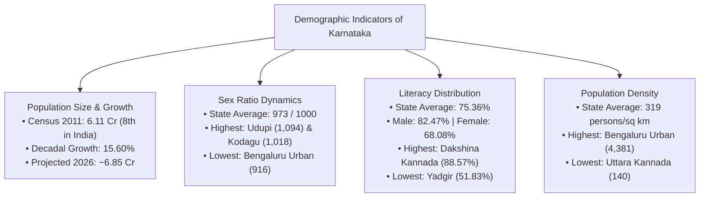
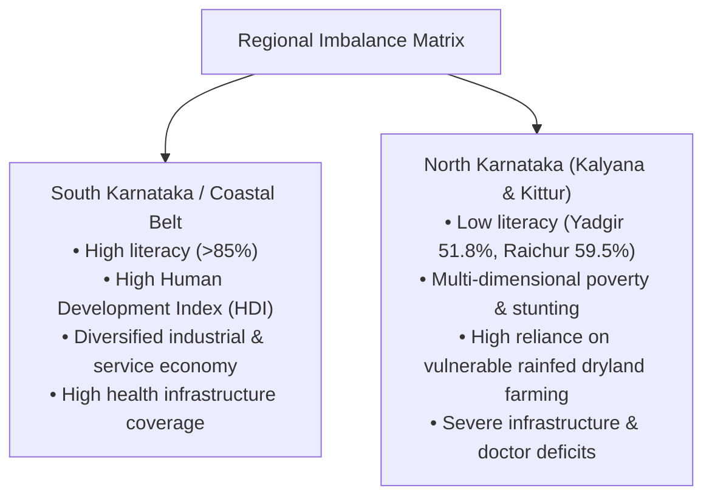
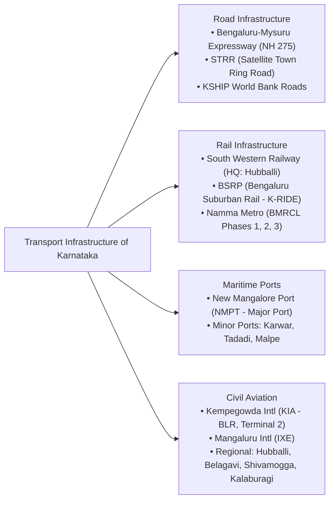

# Karnataka Demography, Urbanisation, Regional Disparities and Infrastructure (ಕರ್ನಾಟಕದ ಜನಸಂಖ್ಯಾಶಾಸ್ತ್ರ, ನಗರೀಕರಣ, ಪ್ರಾದೇಶಿಕ ಅಸಮಾನತೆ ಮತ್ತು ಮೂಲಸೌಕರ್ಯ)

> [!exam-focus]
> **KPSC High-Yield Examination Focus**:
> - **Demographic Snapshot (Census 2011 & Projections)**:
>   - Total Population: **6,10,95,297 (~6.11 Crore)**, ranking 8th in India; projected population in 2026 is ~6.85 Crore.
>   - Decadal Growth Rate: **15.60%** (2001-2011), down from 17.51% (1991-2001).
>   - Sex Ratio: **973 females per 1,000 males** (higher than national average of 943). Highest: **Udupi (1,094)**; Lowest: **Bengaluru Urban (916)**.
>   - Literacy Rate: **75.36%** (National: 74.04%). Highest: **Dakshina Kannada (88.57%)**; Lowest: **Yadgir (51.83%)**.
>   - Density of Population: **319 persons/sq km**. Highest: **Bengaluru Urban (4,381)**; Lowest: **Uttara Kannada (140)**.
> - **Urbanisation Dynamics**:
>   - Urban Population: **38.67%** (significantly above the national average of ~31.16%).
>   - **Bengaluru Primate City Phenomenon**: Bengaluru Urban houses >1.3 crore people, generates >35% of GSDP, and accounts for over 60% of state tax revenues, creating extreme monocentric spatial distortion.
> - **Regional Disparities & Constitutional Remedies**:
>   - **Dr. D.M. Nanjundappa Committee Report (2002)**: Comprehensive Deprivation Index identifying **114 backward taluks** (39 most backward, 40 more backward, 35 backward), predominantly in Northern Karnataka.
>   - **Article 371J of the Constitution (98th Amendment Act, 2012)**: Special constitutional provisions for the **Kalyana Karnataka (Hyderabad-Karnataka)** region: 6 districts (now 7 with Vijayanagara) guaranteeing 80% local cadre employment reservation and 70% educational quota.
> - **Strategic Transport Infrastructure**:
>   - **New Mangalore Port (NMPT)**: Karnataka's only Major Port at Panambur.
>   - **Bengaluru Suburban Rail Project (BSRP / K-RIDE)** & **Namma Metro (BMRCL)**.
>   - **Bengaluru-Mysuru Expressway (NH 275)** & Satellite Town Ring Road (STRR).

---

## 1. Demographic Profile of Karnataka

The demographic evolution of Karnataka reflects a mature demographic transition characterized by falling birth rates, declining infant mortality, and increasing urbanization.

### 1.1 District-Level Demographic Variations (Census 2011 Matrix)

| Indicator | Karnataka State Average | Top 3 Districts | Bottom 3 Districts |
| :--- | :--- | :--- | :--- |
| **Total Population** | 6,10,95,297 | 1. Bengaluru Urban (96.2 Lakh) 2. Belagavi (47.8 Lakh) 3. Mysuru (30.0 Lakh) | 1. Kodagu (5.54 Lakh) 2. Bengaluru Rural (9.91 Lakh) 3. Gadag (10.64 Lakh) |
| **Decadal Growth Rate** | 15.60% | 1. Bengaluru Urban (47.18%) 2. Yadgir (22.81%) 3. Kalaburagi (18.16%) | 1. Chikkamagaluru (-0.26% - negative) 2. Kodagu (1.09%) 3. Hassan (3.44%) |
| **Sex Ratio** | 973 females / 1,000 males | 1. Udupi (1,094) 2. Kodagu (1,018) 3. Dakshina Kannada (1,018) | 1. Bengaluru Urban (916) 2. Dharwad (967) 3. Bengaluru Rural (945) |
| **Child Sex Ratio (0-6)**| 948 girls / 1,000 boys | 1. Kodagu (977) 2. Dakshina Kannada (967) 3. Udupi (958) | 1. Belagavi (931) 2. Bagalkote (935) 3. Mandya (939) |
| **Overall Literacy Rate**| 75.36% | 1. Dakshina Kannada (88.57%) 2. Bengaluru Urban (87.67%) 3. Udupi (86.24%) | 1. Yadgir (51.83%) 2. Raichur (59.56%) 3. Chamarajanagar (61.43%) |
| **Female Literacy Rate** | 68.08% | 1. Dakshina Kannada (83.70%) 2. Bengaluru Urban (84.01%) 3. Udupi (81.59%) | 1. Yadgir (41.38%) 2. Raichur (48.73%) 3. Kalaburagi (55.09%) |
| **Population Density** | 319 / sq km | 1. Bengaluru Urban (4,381) 2. Dakshina Kannada (430) 3. Mysuru (476) | 1. Uttara Kannada (140) 2. Kodagu (135) 3. Chikkamagaluru (158) |

---

## 2. Regional Disparities: North vs. South Karnataka

The socio-economic landscape of Karnataka is fractured by a historical and structural development deficit between North Karnataka (*Kalyana Karnataka & Kittur Karnataka*) and South Karnataka (*Old Mysore & Coastal belt*).

### 2.1 The Dr. D.M. Nanjundappa Committee Report (2002)
- **High Power Committee for Redressal of Regional Imbalances**: Appointed under eminent economist Dr. D.M. Nanjundappa to scientifically evaluate interstate developmental asymmetry.
- **Methodology**: Formulated a **Comprehensive Composite Development Index (CCDI)** comprising 35 socio-economic indicators spanning agriculture, industry, infrastructure, education, and health.
- **Categorization of Taluks**: Out of 175 taluks analyzed:
  - **Most Backward Taluks (39 taluks)**: 26 taluks in North Karnataka (Kalaburagi, Yadgir, Raichur, Bidar, Bagalkote).
  - **More Backward Taluks (40 taluks)**: 21 taluks in North Karnataka.
  - **Backward Taluks (35 taluks)**.
  - **Relatively Developed Taluks (61 taluks)**: Concentrated heavily in Southern Karnataka and Coastal belt.
- **Key Recommendations**:
  - Implementation of a **Special Economic Package** of ₹31,000 crore spread over 8 years.
  - De-concentration of government offices to North Karnataka (e.g., establishing the **Suvarna Vidhana Soudha at Belagavi**).
  - Massive capital infusion in tertiary irrigation (UKP), regional universities, and healthcare facilities.

### 2.2 Article 371J and Kalyana Karnataka Autonomy
- **Constitutional Provision**: Inserted via the **98th Constitutional Amendment Act, 2012**, coming into effect in 2013.
- **Jurisdiction**: Encompasses the 7 districts of **Kalyana Karnataka** (formerly Hyderabad-Karnataka): Kalaburagi, Yadgir, Raichur, Bidar, Koppal, Ballari, and Vijayanagara.
- **Core Provisions**:
  1. **Kalyana Karnataka Regional Development Board (KKRDB / ಕಲ್ಯಾಣ ಕರ್ನಾಟಕ ಪ್ರಾದೇಶಿಕ ಅಭಿವೃದ್ಧಿ ಮಂಡಳಿ)**: Statutory board endowed with dedicated annual budgetary allocations (over ₹5,000 crore annually) for regional infrastructure development.
  2. **Job Reservation (ಸ್ಥಳೀಯ ಕೇಡರ್ ಮೀಸಲಾತಿ)**: **80% reservation** in Group A, B, C, and D government posts within the Kalyana Karnataka region for local candidates, and **8% quota** in state-level apex cadres.
  3. **Educational Quota (ಶಿಕ್ಷಣ ಮೀಸಲಾತಿ)**: **70% of seats** in universities, medical colleges, engineering colleges, and technical institutions within the region, and **8% statewide quota**.

---

## 3. Urbanisation Dynamics and the Bengaluru Dilemma

### 3.1 The Primate City Syndrome
- **Urban Concentration**: Karnataka's urban population stands at **38.67%**, making it one of the most urbanized large states in India.
- However, urban growth is hyper-monocentric: **Bengaluru Urban district alone accounts for nearly half of the state's total urban population**.
- **Economic Powerhouse**:
  - "Silicon Valley of India" / Global Tech Hub.
  - Generates >35% of Karnataka's Gross State Domestic Product (GSDP).
  - Accounts for over **60% of Karnataka's total state commercial tax collections**.
  - Ranks 1st globally in tech venture capital absorption in multiple years.
- **Urban Dysfunctions & Carrying Capacity Crisis**:
  - *Traffic Gridlock*: Average vehicular speeds drop below 10-15 km/h during peak hours.
  - *Water Scarcity*: Heavy dependency on the Cauvery river pumped over 100 km and lifted 500 metres; severe depletion of urban borewells (>1,500 ft depth); commissioning of **Cauvery Water Supply Scheme Stage V (CWSS Stage V)** to supply 775 MLD to 110 peripheral villages.
  - *Ecological Degradation*: Concretization has reduced natural lakes from >260 in 1960 to fewer than 80 functional water bodies, leading to urban flash floods during intense localized convective rainfall.

### 3.2 "Beyond Bengaluru" and Tier-2 / Tier-3 Growth Nodes
To de-congest Bengaluru and stimulate balanced regional growth, the state is implementing the **"Beyond Bengaluru" Policy**:
1. **Hubballi - Dharwad**: Second largest urban agglomeration in Karnataka; designated as the educational, commercial, and industrial hub of North Karnataka.
2. **Mysuru**: Knowledge hub, IT/BT satellite centre, tourism and heritage capital.
3. **Mangaluru**: Port-based logistics, petrochemical refining (MRPL), education, and marine exports.
4. **Belagavi**: Precision aerospace machining, foundry cluster, sugar industry hub.
5. **Kalaburagi**: Cement cluster, regional healthcare hub, solar energy, pulse processing.

---

## 4. Physical Transport and Economic Infrastructure

### 4.1 Road Transport Network
- **National Highways (NH)**: Over 7,000 km crossing Karnataka (NH 44, NH 48, NH 66, NH 75, NH 50, NH 150A).
- **Expressways and Corridors**:
  - **Bengaluru-Mysuru Expressway (NH 275)**: 10-lane access-controlled 118 km expressway slashing travel time between Bengaluru and Mysuru from 3.5 hours to 75 minutes.
  - **Satellite Town Ring Road (STRR / NH 948A)**: 280 km ring road bypassing Bengaluru city to divert heavy commercial freight traffic.
  - **Industrial Corridors**:
    - **Chennai-Bengaluru Industrial Corridor (CBIC)**: Nodal development at Tumakuru (Vasanthanarasapura node).
    - **Bengaluru-Mumbai Economic Corridor (BMEC)**: Key nodes at Dharwad and Belagavi.

### 4.2 Railways and Urban Transit
- **South Western Railway (SWR / ನೈಋತ್ಯ ರೈಲ್ವೆ)**: Formed in 2003 with headquarters at **Hubballi (ಹುಬ್ಬಳ್ಳಿ)**; comprises Hubballi, Mysuru, and Bengaluru divisions.
  - *World Record*: **Shree Siddharoodha Swamiji Hubballi Railway Station** holds the Guinness World Record for the **World's Longest Railway Platform (1,507 metres)**.
- **Namma Metro (BMRCL / ನಮ್ಮ ಮೆಟ್ರೋ)**:
  - Rapid transit network in Bengaluru; Phase 1 (42.3 km) operational; Phase 2 (72 km), Phase 2A/2B (Outer Ring Road and Airport Line connecting to KIA), Phase 3 under active execution.
- **Bengaluru Suburban Rail Project (BSRP)**:
  - Implemented by **K-RIDE** (Rail Infrastructure Development Company - Karnataka, joint venture with Ministry of Railways); spans 148 km across 4 corridors (Sampige, Mallige, Parijaata, Kanaka).

### 4.3 Maritime Infrastructure: Ports of Karnataka
- **Coastline**: 320 km coastline along the Arabian Sea ("Karavali").
- **New Mangalore Port (NMPT / ನವ ಮಂಗಳೂರು ಬಂದರು)**:
  - Located at Panambur, Dakshina Kannada.
  - **Karnataka's ONLY Major Port** (administered by the Major Port Authorities Act, 2021).
  - Deep-water all-weather port handling petroleum crude, LPG, POL products, iron ore pellets, coal, coffee, cashew nuts, and container traffic.
- **Minor Ports**:
  - 10 declared minor ports administered by the Karnataka Maritime Board (KMB): **Karwar** (premier minor commercial port with captive handling capacity), Tadadi, Belekeri, Honnavar, Bhatkal, Kundapura, Hangarkatta, Malpe, Padubidri, and Old Mangalore.

### 4.4 Civil Aviation Infrastructure
- **Kempegowda International Airport (KIA / Bengaluru)**:
  - Third busiest airport in India (handling >37 million passengers annually).
  - Renowned for Terminal 2 ("Terminal in a Garden"), awarded the UNESCO Prix Versailles for interior architecture.
- **Mangaluru International Airport (IXE)**: Second international airport of Karnataka, situated on a tabletop runway at Bajpe.
- **Regional Inland Airports (UDAN Scheme / ಪ್ರಾದೇಶಿಕ ವಿಮಾನ ನಿಲ್ದಾಣಗಳು)**:
  - Hubballi, Belagavi (Sambre), Kalaburagi, Mysuru (Mandakalli).
  - **Kuvempu Airport, Shivamogga (ಸೊಗಾನೆ)**: Inaugurated 2023 with a lotus-shaped terminal.
  - **Vijayapura Airport (ವಿಜಯಪುರ)**: Newly operational commercial airport catering to Northern Karnataka tourism and trade.

---

## 5. Comparative Synthesis: Regional Infrastructure Index

| Parameter | Bengaluru Urban / South | Coastal Karnataka | Kalyana Karnataka | Kittur Karnataka |
| :--- | :--- | :--- | :--- | :--- |
| **Literacy Level** | Very High (>85%) | Exceptionally High (>88%) | Critical Deficit (51-65%) | Moderate to High (72-80%) |
| **Industrial Engines** | IT/BT, Aerospace, Auto, Startups | Petrochemicals, Logistics, Food Processing | Cement, Thermal Power, Agro-processing | Foundries, Sugar, Textiles, Auto ancillaries |
| **Transit Connectivity** | Metro, Suburban Rail, KIA, Expressways | Major Port (NMPT), NH 66 Coastal corridor, Airport | Broad-gauge rail, Kalaburagi airport, NH 50 | SWR HQ Hubballi, Belagavi airport, NH 48 |
| **Constitutional Status**| General Governance | General Governance | **Article 371J Special Status** | General Governance |
| **Development Board** | BDA / BMRDA | Coastal Development Authority | **KKRDB** | Malaprabha-Ghataprabha development |

---

## 6. Prelims Traps & Mains Answer Blueprint

### 6.1 Prelims Traps
> [!caution]
> - **Trap 1**: Believing Bengaluru Urban has the highest sex ratio.
>   - *Fact*: Bengaluru Urban has the **LOWEST sex ratio (916)** in Karnataka due to male migrant influx. The highest sex ratio is in **Udupi (1,094)**, followed by Kodagu and Dakshina Kannada.
> - **Trap 2**: Confusing the lowest literacy district.
>   - *Fact*: The district with the lowest literacy rate is **Yadgir (51.83%)**, NOT Raichur or Kalaburagi.
> - **Trap 3**: Believing Karwar is a Major Port of India.
>   - *Fact*: Karwar is a **Minor Port** under the Karnataka Maritime Board. The **ONLY Major Port** in Karnataka is **New Mangalore Port (NMPT)** at Panambur.
> - **Trap 4**: Misattributing the World's Longest Railway Platform.
>   - *Fact*: The world's longest railway platform (1,507 m) is at **Shree Siddharoodha Swamiji Hubballi Railway Station**, surpassing Gorakhpur.

### 6.2 Mains Model Question & Answer Blueprint
**Question**: *Critically evaluate the efficacy of Article 371J in mitigating regional imbalances in the Kalyana Karnataka region. What complementary economic measures are required to bridge the socio-economic deficit?* (Marks: 15 / 250 Words)

**Model Answer Outline**:
1. **Introduction (35 words)**:
   - Introduce Article 371J (enacted via the 98th Constitutional Amendment Act, 2012) as a landmark affirmative action instrument aimed at rectifying decades of developmental disparity across the 7 districts of Kalyana Karnataka.
2. **Body 1: Evaluation of Article 371J Gains (70 words)**:
   - *Public Sector Employment Guarantee*: 80% local cadre reservation has democratized access to government jobs, recruited over 50,000 local youth, and retained native bureaucratic talent.
   - *Educational Democratization*: 70% regional quota in medical and engineering colleges dramatically expanded access for students from economically impoverished backgrounds.
   - *Capital Inflow via KKRDB*: Channeled thousands of crores into village roads, school classrooms, and primary healthcare centers.
3. **Body 2: Structural Limitations and Persisting Challenges (75 words)**:
   - *Job Absorption Limits*: Public sector jobs account for <2% of total regional employment; inability to attract private industrial capital leaves agrarian youth underemployed.
   - *Governance & Execution Bottlenecks*: KKRDB funds frequently suffer from slow absorption, piecemeal contractor-driven civil works, and lack of outcome-based social audits.
   - *Human Development Deficits*: Yadgir (51.8% literacy) and Raichur still lag on maternal health, infant malnutrition, and female literacy.
4. **Body 3: Complementary Strategic Roadmap (45 words)**:
   - Transition from civil works spending to Human Capital Investment (world-class residential schools, skill centers); establish dedicated Agro-Industrial and Pharma parks around Kalaburagi and Raichur; accelerate UKP Stage III canal completion.
5. **Conclusion (25 words)**:
   - Conclude that constitutional safeguards under Article 371J provide the legal scaffolding, but true regional convergence demands targeted industrialization, quality education, and robust political decentralization.

---

## 7. Sources and Verification
- **Verified On**: 2026-10-13 (Tuesday)
- **Primary Source 1**: Census of India, *Primary Census Abstract: Karnataka (2011)*, Office of the Registrar General & Census Commissioner.
- **Primary Source 2**: Government of Karnataka, *High Power Committee for Redressal of Regional Imbalances (Dr. D.M. Nanjundappa Committee)*.
- **Primary Source 3**: Planning, Programme Monitoring and Statistics Department, *Karnataka Economic Survey 2024-25 & 2025-26*.
