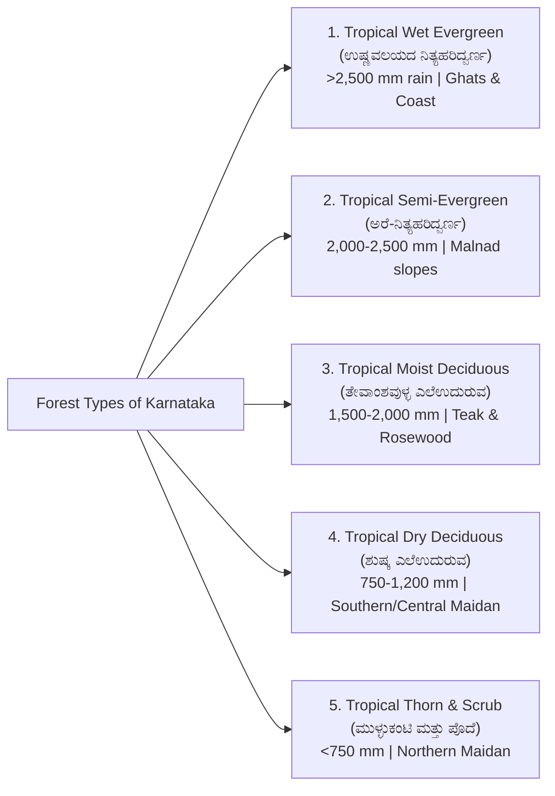
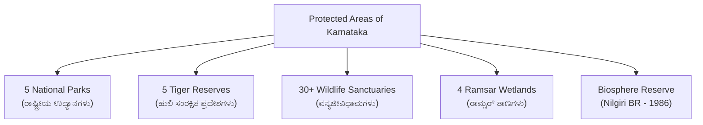
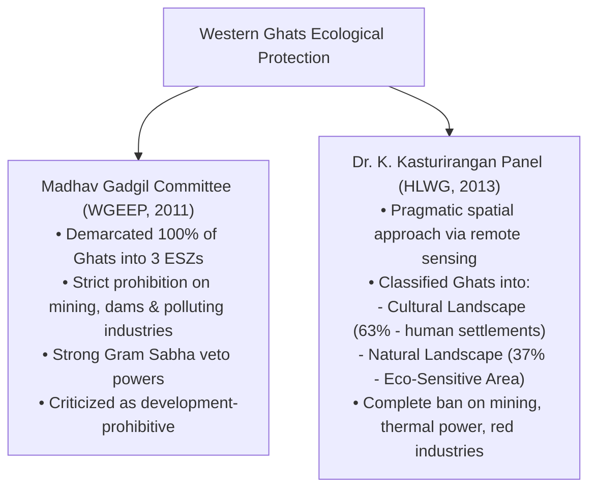

# Karnataka Forests, Wildlife Sanctuaries, National Parks and Biodiversity (ಕರ್ನಾಟಕದ ಅರಣ್ಯಗಳು, ವನ್ಯಜೀವಿಧಾಮಗಳು, ರಾಷ್ಟ್ರೀಯ ಉದ್ಯಾನಗಳು ಮತ್ತು ಜೀವವೈವಿಧ್ಯತೆ)

> [!exam-focus]
> **KPSC High-Yield Examination Focus**:
> - **Forest Cover Overview (ISFR)**:
>   - Recorded Forest Area (RFA): ~38,284 sq km (~19.96% of state's geographical area), lower than the National Forest Policy target of 33%.
>   - District with Largest Forest Area: **Uttara Kannada (ಉತ್ತರ ಕನ್ನಡ)** (>80% forest cover); followed by Shivamogga, Belagavi, Chamarajanagar.
>   - District with Lowest Forest Area: **Vijayapura (ವಿಜಯಪುರ)** (<0.2%), followed by Bidar and Raichur.
> - **Five National Parks (ರಾಷ್ಟ್ರೀಯ ಉದ್ಯಾನಗಳು)**:
>   1. **Bandipur (ಬಂಡೀಪುರ)** (Chamarajanagar): Project Tiger pioneer (1973), Nilgiri Biosphere Reserve.
>   2. **Nagarahole / Rajiv Gandhi (ನಾಗರಹೊಳೆ)** (Kodagu & Mysuru): Kabini river backwaters, Asian elephant stronghold.
>   3. **Bannerghatta (ಬನ್ನೇರುಘಟ್ಟ)** (Bengaluru Urban/Ramanagara): Biological park, India's first Butterfly Park (2006).
>   4. **Kudremukh (ಕುದುರೆಮುಖ)** (Chikkamagaluru, Udupi, Dakshina Kannada): Shola-grassland ecosystem, Lion-tailed Macaque.
>   5. **Anshi / Kali (ಅಣಶಿ / ಕಾಳಿ)** (Uttara Kannada): Kali river basin, Black Panther corridor.
> - **Five Tiger Reserves (ಹುಲಿ ಸಂರಕ್ಷಿತ ಪ್ರದೇಶಗಳು)**: Bandipur, Nagarahole, Bhadra, Anshi-Dandeli (Kali), and Biligiriranganatha Temple (BRT). Karnataka has India's second highest tiger population.
> - **Four Ramsar Sites (ರಾಮ್ಸರ್ ತಾಣಗಳು)**:
>   1. **Ranganathittu Bird Sanctuary** (Mandya, 2022) - First Ramsar site of Karnataka.
>   2. **Aghanashini Estuary** (Uttara Kannada, 2024).
>   3. **Magadi Kere Conservation Reserve** (Gadag, 2024) - Bar-headed goose habitat.
>   4. **Ankasamudra Bird Conservation Reserve** (Vijayanagara, 2024).
> - **Western Ghats Conservation Committees**: **Madhav Gadgil Panel** (WGEEP, 2011) vs. **Dr. K. Kasturirangan High-Level Working Group** (HLWG, 2013) on Ecologically Sensitive Areas (ESA).

---

## 1. Champion & Seth Forest Classification in Karnataka

The diverse relief and rainfall gradients give rise to five distinct ecological forest formations across Karnataka:

### 1.1 Tropical Wet Evergreen Forests (ಉಷ್ಣವಲಯದ ನಿತ್ಯಹರಿದ್ವರ್ಣ ಅರಣ್ಯಗಳು)
- **Rainfall & Environment**: Rainfall exceeding 2,500 mm to 8,000 mm; high humidity (>80%) and temperatures between 24°-30°C.
- **Geographic Distribution**: Deep valleys and windward slopes of the Western Ghats: Uttara Kannada, Udupi, Dakshina Kannada, Kodagu, Chikkamagaluru (Agumbe, Hulikal, Bhagamandala).
- **Vegetative Structure**: Multi-layered dense canopy exceeding 40-50 metres in height. Tree trunks are wrapped in epiphytes, orchids, and woody lianas.
- **Characteristic Tree Species**:
  - Rosewood (*Dalbergia latifolia* - ಬೀಟೆ ಮರ)
  - Ebony (*Diospyros ebenum* - ಕರಿಮರ)
  - White Cedar (*Dysoxylum malabaricum* - ಬಿಳಿ ಧೂಪ)
  - Poonsparr (*Calophyllum tomentosum* - ಸುರಹೊನ್ನೆ)
  - Ironwood (*Mesua ferrea* - ನಾಗಸಂಪಿಗೆ)
  - Cinnamon, wild nutmeg, bamboo (*Bambusa arundinacea*).

### 1.2 Tropical Semi-Evergreen Forests (ಉಷ್ಣವಲಯದ ಅರೆ-ನಿತ್ಯಹರಿದ್ವರ್ಣ ಅರಣ್ಯಗಳು)
- **Rainfall & Environment**: 2,000 to 2,500 mm rainfall. Forms a transitional buffer strip between the wet evergreen and moist deciduous zones.
- **Geographic Distribution**: Eastern slopes of Western Ghats in Belagavi, Uttara Kannada, Shivamogga, Hassan, Kodagu.
- **Characteristic Species**:
  - Halmaddi (*Ailanthus malabarica* - ಧೂಪ / ಧೂಪದ ಮರ)
  - Kindal (*Terminalia paniculata* - ಹುನಾಲು ಮರ)
  - Mango (*Mangifera indica*), jackfruit, and champak.

### 1.3 Tropical Moist Deciduous Forests (ಉಷ್ಣವಲಯದ ತೇವಾಂಶವುಳ್ಳ ಎಲೆಉದುರುವ ಅರಣ್ಯಗಳು)
- **Rainfall & Environment**: 1,200 to 2,000 mm rainfall. Trees shed leaves for 6 to 8 weeks during late winter/early summer (March-April) to prevent excessive transpiration.
- **Geographic Distribution**: The core Malnad-Maidan transition belt: Hunsur, H.D. Kote, Gundlupet, Sagar, Soraba, Dandeli, Londa, Khanapur.
- **Economic Value**: The most commercially lucrative timber forests in peninsular India.
- **Characteristic Species**:
  - **Teak (ತೇಗದ ಮರ - *Tectona grandis*)**: Premier structural timber.
  - **Honne / Indian Kino (ಹೊನ್ನೆ - *Pterocarpus marsupium*)**.
  - **Mathi / Laurel (ಮತ್ತಿ - *Terminalia tomentosa*)**: Tough railway sleeper timber.
  - **Nandi (ನಂದಿ - *Lagerstroemia lanceolata*)**.
  - **Sandalwood (ಶ್ರೀಗಂಧ - *Santalum album*)**: Karnataka's state tree, naturally occurring in dry-moist transitional zones.

### 1.4 Tropical Dry Deciduous Forests (ಉಷ್ಣವಲಯದ ಶುಷ್ಕ ಎಲೆಉದುರುವ ಅರಣ್ಯಗಳು)
- **Rainfall & Environment**: 750 to 1,200 mm rainfall. Canopy is open (10-20 m height), with dense undergrowth of grasses and bushes.
- **Geographic Distribution**: Southern Maidan and transitional tracts of Central Maidan: Mysuru, Chamarajanagar, Tumakuru, Mandya, Bengaluru Rural, Davanagere.
- **Characteristic Species**:
  - Dindiga / Axlewood (*Anogeissus latifolia* - ದಿಂಡಿಗ)
  - Bevu / Neem (*Azadirachta indica* - ಬೇವು)
  - Honge / Indian Beech (*Pongamia pinnata* - ಹೊಂಗೆ)
  - Alale / Myrobalan (*Terminalia chebula* - ಅಳಲೆಕಾಯಿ)
  - Banyan (*Ficus benghalensis*), Peepal (*Ficus religiosa*).

### 1.5 Tropical Thorn and Scrub Forests (ಉಷ್ಣವಲಯದ ಮುಳ್ಳುಕಂಟಿ ಮತ್ತು ಪೊದೆ ಅರಣ್ಯಗಳು)
- **Rainfall & Environment**: Less than 750 mm rainfall (frequently <500 mm). Long dry periods of 7-9 months.
- **Geographic Distribution**: Northern Maidan: Vijayapura, Bagalkote, Raichur, Kalaburagi, Yadgir, Koppal, Ballari, Challakere (Chitradurga).
- **Adaptations**: Xerophytic modifications: deep taproots, stunted thorny growth, fleshy succulent stems, waxy cuticle to restrict transpiration.
- **Characteristic Species**:
  - Karijali / Gum Arabic (*Acacia nilotica* - ಕರಿಜಾಲಿ)
  - Bili Jaali (*Acacia leucophloea* - ಬಿಳಿಜಾಲಿ)
  - Euphorbia / Cactus species (*Kalli* - ಕಳ್ಳಿ)
  - Ziziphus / Indian Jujube (*Bore* - ಬೋರೆ ಮರ)
  - Prosopis juliflora (invasive exotic encroacher - ಬಳ್ಳಾರಿ ಜಾಲಿ).

### 1.6 Shola - Grassland Complex (ಶೋಲಾ - ಹುಲ್ಲುಗಾವಲು ಪರಿಸರ ವ್ಯವಸ್ಥೆ)
- **Unique Montane Ecosystem**: Confined to elevations above 1,500 m in the Western Ghats (Kudremukh, Bababudan Giri, Mullayanagiri, Brahmagiri).
- **Structure**: Dwarf montane stunted evergreen forests tucked into undulating, mist-covered mountain valleys (folds) surrounded by vast rolling grasslands.
- **Ecological Role**: Acts as natural sponges regulating perennial streams (Tunga, Bhadra, Netravati origins).

---

## 2. Protected Area Network in Karnataka

Karnataka possesses a well-demarcated Protected Area (PA) network spanning ~10% of its total forest area:

### 2.1 The Five National Parks (ರಾಷ್ಟ್ರೀಯ ಉದ್ಯಾನಗಳು)

1. **Bandipur National Park (ಬಂಡೀಪುರ)**:
   - *Location*: Chamarajanagar district (874 sq km).
   - *History*: Established in 1931 by the Maharaja of Mysore as *Venugopala Wildlife Park*; declared National Park and designated one of the original 9 Project Tiger reserves in **1973**.
   - *Geography*: Flanked by Kabini river (north) and Moyar river (south). Forms part of the Nilgiri Biosphere Reserve.
   - *Key Fauna*: Bengal tiger, Asian elephant, Indian gaur, dhole (wild dog), chital.
2. **Nagarahole / Rajiv Gandhi National Park (ನಾಗರಹೊಳೆ)**:
   - *Location*: Kodagu and Mysuru districts (643 sq km).
   - *Name Origin*: Derived from *Naga* (snake) and *Hole* (stream), referencing its winding forest streams.
   - *Ecological Highlight*: Kabini reservoir separates it from Bandipur; supports highest predator density (tiger and leopard) in peninsular India.
3. **Bannerghatta National Park (ಬನ್ನೇರುಘಟ್ಟ)**:
   - *Location*: Bengaluru Urban, Bengaluru Rural, and Ramanagara districts (102 sq km).
   - *Features*: Biological park with zoo, safari, rescue centre, and **India's First Butterfly Park (2006)**.
   - *Significance*: Crucial elephant corridor connecting Bannerghatta to Talli forest and Cauvery Wildlife Sanctuary.
4. **Kudremukh National Park (ಕುದುರೆಮುಖ)**:
   - *Location*: Chikkamagaluru, Udupi, and Dakshina Kannada (600 sq km).
   - *Ecosystem*: Shola-grassland mosaic; pristine origin of Tunga, Bhadra, and Netravati rivers.
   - *Historic Controversy*: Cessation of open-cast iron ore mining by KIOCL following landmark Supreme Court ruling in 2005.
   - *Flagship Fauna*: Lion-tailed Macaque (*Macaca silenus*), Malabar civet.
5. **Anshi / Kali National Park (ಅಣಶಿ / ಕಾಳಿ)**:
   - *Location*: Uttara Kannada district (417 sq km).
   - *Ecosystem*: Dense semi-evergreen/evergreen valley along Kali river; contiguous with Dandeli Wildlife Sanctuary.
   - *Flagship Fauna*: Black panther (melanistic leopard), Great Pied Hornbill.

### 2.2 The Five Tiger Reserves (ಹುಲಿ ಸಂರಕ್ಷಿತ ಪ್ರದೇಶಗಳು)

| Tiger Reserve | District | Year Declared | Key Ecological Features |
| :--- | :--- | :--- | :--- |
| **Bandipur Tiger Reserve** | Chamarajanagar | 1973 | Keystone Project Tiger pioneer, massive elephant & gaur herds |
| **Bhadra Tiger Reserve** | Chikkamagaluru & Shivamogga | 1998 | Encompasses Muthodi and Lakkavalli ranges; Bhadra reservoir backwaters |
| **Nagarahole Tiger Reserve** | Mysuru & Kodagu | 2000 | Highest tiger density; Kabini river eco-tourism zone |
| **Dandeli-Anshi / Kali Tiger Reserve** | Uttara Kannada | 2007 | Renamed Kali Tiger Reserve; Kali river watershed; black panther |
| **Biligiriranganatha Temple (BRT) TR** | Chamarajanagar | 2011 | Biogeographical bridge connecting Western Ghats and Eastern Ghats; indigenous Soliga tribal co-existence |

---

## 3. Ramsar Wetland Sites in Karnataka (ರಾಮ್ಸರ್ ಜೌಗು ತಾಣಗಳು)

Karnataka has secured international recognition for four premier wetland ecosystems under the Ramsar Convention:

1. **Ranganathittu Bird Sanctuary (ರಂಗನತಿಟ್ಟು ಪಕ್ಷಿಧಾಮ)**:
   - *Declared*: 2022 (First Ramsar site in Karnataka).
   - *Location*: Srirangapatna taluk, Mandya district.
   - *Ecosystem*: 6 islets on the Cauvery river, engineered historically by the Maharaja of Mysore following the construction of the Cauvery weir.
   - *Avifauna*: Spot-billed pelican, painted stork, black-headed ibis, mugger crocodile population.
2. **Aghanashini Estuary (ಅಘನಾಶಿನಿ ನದೀಮುಖ)**:
   - *Declared*: 2024.
   - *Location*: Kumta taluk, Uttara Kannada district.
   - *Ecosystem*: Pristine estuarine mangrove complex where the free-flowing Aghanashini river meets the Arabian Sea.
   - *Livelihood & Biodiversity*: Traditional *Gazni* salt-tolerant paddy farming, bivalve/edible clam harvesting, mudflats sheltering thousands of migratory waders.
3. **Magadi Kere Conservation Reserve (ಮಾಗಡಿ ಕೆರೆ ಸಂರಕ್ಷಣಾ ಮೀಸಲು ಪ್ರದೇಶ)**:
   - *Declared*: 2024.
   - *Location*: Shirahatti taluk, Gadag district.
   - *Significance*: Historic community-managed tank; wintering haven for high-altitude trans-Himalayan **Bar-headed Geese (*Anser indicus* - ಪಟ್ಟೆತಲೆ ಹೆಬ್ಬಾತು)** flying over Everest from Mongolia and Tibet.
4. **Ankasamudra Bird Conservation Reserve (ಅಂಕಸಮುದ್ರ ಪಕ್ಷಿ ಸಂರಕ್ಷಣಾ ಮೀಸಲು ಪ್ರದೇಶ)**:
   - *Declared*: 2024.
   - *Location*: Hagaribommanahalli taluk, Vijayanagara district.
   - *Significance*: Restored tank flourishing with acacia scrub, breeding colony for darters, cormorants, herons, and painted storks.

---

## 4. Western Ghats Ecology: Gadgil vs. Kasturirangan Reports

The Western Ghats (ಪಶ್ಚಿಮ ಘಟ್ಟಗಳು / ಸಹ್ಯಾದ್ರಿ) were declared a **UNESCO World Heritage Site** in 2012, encompassing 39 serial clusters across 4 states, including 10 clusters in Karnataka (e.g., Pushpagiri, Brahmagiri, Kudremukh, Someshwara, Talacauvery, Agumbe).

### 4.1 Comparative Analysis: Gadgil vs. Kasturirangan
- **Gadgil Report (WGEEP, 2011)**:
  - Treated the entire Western Ghats as ecologically sensitive, graded into **ESZ-1, ESZ-2, and ESZ-3**.
  - Recommended bottom-up governance through a statutory *Western Ghats Ecology Authority (WGEA)* and decentralised Gram Sabhas.
  - Recommended phase-out of chemical pesticides and complete ban on GMOs, dams, and large mining.
  - Rejected by Karnataka and other riparian states due to fears of halting infrastructure, road connectivity, and agricultural operations.
2. **Kasturirangan Report (HLWG, 2013)**:
  - Differentiated between *Natural Landscape* (37%) and *Cultural Landscape* (63%).
  - Demarcated **37% of the Western Ghats (approx. 60,000 sq km, including ~20,668 sq km in Karnataka)** as an **Ecologically Sensitive Area (ESA)**.
  - Prohibitions in ESA:
    - Complete ban on commercial mining, quarrying, and sand extraction.
    - Complete ban on thermal power projects; strict EIA regulation on hydro-projects.
    - Ban on "Red Category" polluting industries.
    - Strict moratorium on township expansions >20,000 sq m.
  - Permitted agriculture, plantation crops, and existing livelihoods without eviction.
- **Karnataka Government Stand**: Karnataka Legislative Assembly passed unanimous resolutions opposing the draft ESA notifications, arguing that declaring 1,576 villages across 10 districts as ESA would cripple agrarian livelihoods, road repairs, and housing for Malnad residents.

---

## 5. Human-Wildlife Conflict (HWC) and Conservation Challenges

### 5.1 The Elephant Corridor & Conflict Dynamics
- Karnataka harbours **over 6,000 Asian Elephants**, representing nearly 20% of India's elephant population.
- **Conflict Hotspots**: Kodagu, Hassan (Alur and Sakleshpura), Chamarajanagar (Gundlupet), Ramanagara, and Tumakuru.
- **Root Causes**:
  - Fragmented elephant migratory paths due to linear infrastructure (highways, railway lines, high-tension power lines, mini-hydel projects, canal networks).
  - Expansion of coffee plantations and encroachment of elephant corridors (*Aane Daari*).
  - Invasive weed proliferation (*Lantana camara*, *Senna spectabilis*, *Parthenium*) choking native browse species in forests.

### 5.2 State Mitigation Architecture
- **Railway Barricades (ರೈಲ್ವೆ ಬ್ಯಾರಿಕೇಡ್‌ಗಳು)**: Construction of robust perimeter fences using condemned railway rails along forest boundaries in Bandipur, Nagarahole, and Hassan; proven most effective in preventing elephant incursions into agricultural fields.
- **Elephant Task Forces (ETF / ಆನೆ ಕಾರ್ಯಪಡೆ)**: Specialised quick-response teams equipped with wireless telemetry, tranquilizers, and GPS collars to track and push elephant herds back into reserve forests.
- **Integrated Control Rooms & Solar Fencing**: Subsidies for community solar power fencing and high-resolution drone monitoring in conflict zones.
- **Ex-Gratia Enhancement**: Substantial state compensations for crop loss, human injury, and human fatality caused by wildlife attacks.

---

## 6. Sacred Groves of Karnataka: Devarakadu (ದೇವರಕಾಡು)

- **Cultural Ethno-Forestry**: Traditional community-protected virgin forest patches dedicated to local village deities (Aiyappa, Bhadrakali, Chamundi, Chaudeshwari, Nagadevatha).
- **Concentration**: Primarily found in **Kodagu (ಕೊಡಗು)**, where over 1,200 documented Devarakadus exist, representing one of the highest densities of sacred groves in the world. Also prominent in Uttara Kannada (*Kans* - ಕಾನು ಕಾಡುಗಳು) and Dakshina Kannada.
- **Ecological Value**:
  - Refugia for endangered micro-flora, medicinal plants, and endemic amphibians (*Ghate frogs*).
  - Vital micro-catchments recharging village springs and groundwater aquifers.
  - Religious taboos prohibit felling trees, lopping branches, or hunting fauna, preserving climax vegetation.

---

## 7. Comparative Synthesis: National Parks and Tiger Reserves

| Name | District | Area (sq km) | Major River / Watershed | Keystone Species |
| :--- | :--- | :--- | :--- | :--- |
| **Bandipur NP/TR** | Chamarajanagar | 874 | Moyar & Kabini rivers | Tiger, Elephant, Gaur |
| **Nagarahole NP/TR** | Mysuru & Kodagu | 643 | Kabini & Lakshmanatirtha | Tiger, Leopard, Asian Elephant |
| **Bhadra TR** | Chikkamagaluru & Shivamogga | 492 | Bhadra river | Tiger, Malabar Giant Squirrel |
| **Kudremukh NP** | Chikkamagaluru, Udupi, DK | 600 | Tunga, Bhadra, Netravati | Lion-tailed Macaque, Great Hornbill |
| **Bannerghatta NP** | Bengaluru & Ramanagara | 102 | Suvarnamukhi river | Elephant, Butterfly, Sloth Bear |
| **Kali TR / Anshi NP** | Uttara Kannada | 417 | Kali river | Black Panther, King Cobra |
| **BRT Tiger Reserve** | Chamarajanagar | 540 | Cauvery basin | Tiger, Soliga biocultural system |

---

## 8. Prelims Traps & Mains Answer Blueprint

### 8.1 Prelims Traps
> [!caution]
> - **Trap 1**: Believing Ranganathittu was declared a Ramsar site in the 1980s.
>   - *Fact*: Karnataka had zero Ramsar sites until **2022**, when **Ranganathittu** became its first. In 2024, three more were added (Aghanashini, Magadi Kere, Ankasamudra).
> - **Trap 2**: Confusing the location of Bar-headed geese in Karnataka.
>   - *Fact*: The primary trans-Himalayan wintering site for Bar-headed Geese is **Magadi Kere** in **Gadag** district, not Mandya or Mysuru.
> - **Trap 3**: Believing Kudremukh is still a commercial iron ore mining center.
>   - *Fact*: Mining by KIOCL was completely **halted in 2005** following a landmark Supreme Court environmental judgment to safeguard the Shola ecosystem.
> - **Trap 4**: Assuming Biligiriranganatha Temple (BRT) is an Eastern Ghats reserve only.
>   - *Fact*: BRT is a unique **biogeographic bridge linking the Western Ghats and Eastern Ghats**.

### 8.2 Mains Model Question & Answer Blueprint
**Question**: *Critically evaluate the conflicting imperatives of ecological preservation and socio-economic development in the Western Ghats of Karnataka, with special reference to the Kasturirangan Committee recommendations.* (Marks: 15 / 250 Words)

**Model Answer Outline**:
1. **Introduction (35 words)**:
   - Introduce the Western Ghats as one of the world's eight "hottest hotspots" of biological diversity, acting as Karnataka's water tower while supporting over 1.5 crore people dependent on plantations, agriculture, and smallholder farming.
2. **Body 1: The Kasturirangan Recommendations & Conservation Imperatives (75 words)**:
   - *Spatial Demarcation*: Identified 37% as Natural Landscape (ESA), covering ~20,668 sq km across 1,576 villages in 10 Karnataka districts.
   - *Ecological Defense*: Prohibits devastating open-cast mining, thermal energy, red-category industries, and reckless land-use changes that trigger catastrophic landslides (e.g., Shirur, Wayanad border, Sakleshpura).
3. **Body 2: Socio-Economic Friction & People's Resistance (75 words)**:
   - *Fear of Displacement & Disenfranchisement*: Smallholder coffee/arecanut planters fear denial of title deeds, bans on essential infrastructure (farm roads, power connections, hospitals), and arbitrary eviction.
   - *Democratic Deficit*: Lack of ground-truthing; remote-sensing data classified human habitations and agro-forestry as natural forest ESA without consulting Gram Sabhas.
4. **Body 3: The Path Forward (40 words)**:
   - Implement participatory GIS mapping with Gram Sabhas; incentive-based conservation through Payment for Ecosystem Services (PES); promote organic certification and eco-tourism revenue-sharing rather than blanket administrative bans.
5. **Conclusion (25 words)**:
   - Conclude that sustainable conservation cannot succeed by treating local communities as adversaries; ecological stewardship must align with social justice and livelihood security.

---

## 9. Sources and Verification
- **Verified On**: 2026-10-13 (Tuesday)
- **Primary Source 1**: Karnataka Forest Department (KFD), *Annual Administrative Report 2024-2026*.
- **Primary Source 2**: Forest Survey of India (FSI), *India State of Forest Report (ISFR)*, Ministry of Environment, Forest and Climate Change.
- **Primary Source 3**: High-Level Working Group (HLWG) Report on the Western Ghats (Dr. K. Kasturirangan Committee), MoEFCC.

---

## 10. Recent Developments & In the News (2026 Updates)
- **Addition of 3 New Ramsar Sites in Karnataka (Feb 2024 / 2026)**: Aghanashini Estuary (Uttara Kannada), Magadi Kere (Gadag), and Ankasamudra Bird Conservation Reserve (Vijayanagara) bring state total to 4 sites. (See [[2026-02_February#4-karnataka-environment-ecology-forests--water-resources|February 2026 Digest]]).
- **Western Ghats Landslide Vulnerability (July 2024 / 2026)**: Devastating landslides in Shirur (NH 66, Ankola) and Wayanad prompt GSI and KSDMA drone hazard micro-zonation across 10 Malnad districts. (See [[2026-07_July#3-karnataka-economy-industry-infrastructure--agriculture|July 2026 Digest]]).
