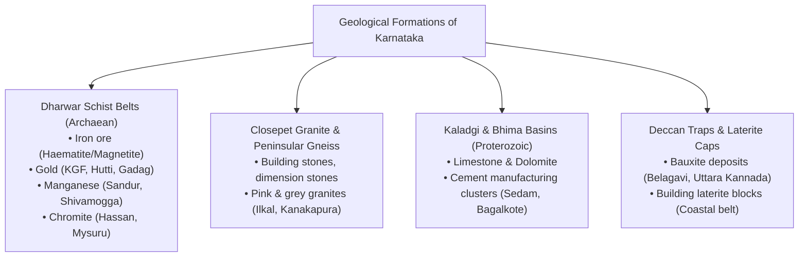
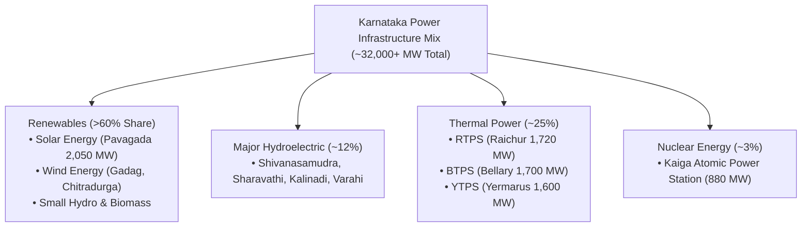

# Karnataka Mineral Resources, Mining Belts, Energy Sector and Power Infrastructure (ಕರ್ನಾಟಕದ ಖನಿಜ ಸಂಪನ್ಮೂಲಗಳು, ಗಣಿಗಾರಿಕೆ ವಲಯಗಳು, ಇಂಧನ ಕ್ಷೇತ್ರ ಮತ್ತು ವಿದ್ಯುತ್ ಮೂಲಸೌಕರ್ಯ)

> [!exam-focus]
> **KPSC High-Yield Examination Focus**:
> - **Geological Foundations**: The **Dharwar Craton / Dharwar Schist Belts** (Archaean Era) form one of the richest metallogenic provinces in the world, holding colossal deposits of iron ore, gold, manganese, and chromite.
> - **Gold Capital of India**:
>   - **Hutti Gold Mines (ಹಟ್ಟಿ ಚಿನ್ನದ ಗಣಿ)** in Raichur: Currently **India's only operational primary gold producer** (HGML).
>   - **Kolar Gold Fields (KGF / ಕೆ.ಜಿ.ಎಫ್)**: Historical deep underground gold mine (Champion Reef, >3,200 m depth); closed in 2001; tailing dumps contain extractable residual gold.
> - **Iron Ore Belts (ಕಬ್ಬಿಣದ ಅದಿರು)**:
>   - **Sandur Schist Belt (ಸಂಡೂರು)** in Ballari/Vijayanagara: Richest haematite reserves in South India.
>   - **Bababudan Hills & Kemmangundi** (Chikkamagaluru): High-grade haematite.
>   - **Kudremukh (ಕುದುರೆಮುಖ)**: Magnetite quartzites; commercial mining banned by Supreme Court in 2005.
> - **Limestone & Cement Hub**: Extensive limestone belts in the Bhima basin (Kalaburagi: Sedam, Wadi, Chittapur) and Kaladgi basin (Bagalkote: Lokapur, Mudhol) make Karnataka a leading cement producer.
> - **Pioneering Energy Landmarks**:
>   - **Shivanasamudra (ಶಿವನಸಮುದ್ರ, 1902)**: Asia's first major commercial hydroelectric power station; electrified KGF via the world's longest transmission line of its time.
>   - **Pavagada Solar Park (ಶಕ್ತಿ ಸ್ಥಳ - Shakti Sthala)** in Tumakuru: Capacity of **2,050 MW**, one of the world's largest operational solar installations.
>   - **Kaiga Nuclear Power Station (ಕೈಗಾ)** in Uttara Kannada: 880 MW (4x220 MW PHWR); Unit 1 holds the global world record for the longest continuous operation (962 days).
>   - **Renewable Energy Leader**: Over 60-65% of Karnataka's total installed power capacity is sourced from clean renewable energy (Solar, Wind, Hydro).

---

## 1. Geological Foundations and Metallogenic Belts

The distribution of minerals in Karnataka is strictly governed by its lithological and structural architecture:



### 1.1 The Dharwar Craton
- Named after Dharwar district by Robert Bruce Foote in 1886.
- Comprises greenstone schist belts embedded within Peninsular Gneissic Complex (PGC).
- Divided into two distinct provinces by the **Closepet Granite batholith**:
  - **Western Dharwar Craton (WDC)**: Older (3.0-3.4 Ga); includes Bababudan, Kudremukh, Shimoga, Chitradurga schist belts. Characterized by banded iron formations (BIF), manganese, and titaniferous magnetite.
  - **Eastern Dharwar Craton (EDC)**: Younger (2.7 Ga); includes Kolar, Hutti, Sandur, Ramagiri schist belts. Highly sheared auriferous (gold-bearing) quartz veins and major haematite iron ores.

---

## 2. Metallic Mineral Resources

### 2.1 Iron Ore (ಕಬ್ಬಿಣದ ಅದಿರು)
Karnataka possesses approximately **10-12% of India's total haematite reserves** and over **70% of its magnetite reserves**.

```
[Major Iron Ore Belts of Karnataka]
├── 1. Ballari - Hospet - Sandur Belt (Vijayanagara & Ballari)
│      └── High-grade Haematite (60-65% Fe); Donimalai, Kumaraswamy, Vyasankere.
├── 2. Bababudan Hills Belt (Chikkamagaluru)
│      └── Kemmangundi (historically fed VISL Bhadravati), Bababudan range.
├── 3. Kudremukh Belt (Chikkamagaluru / Western Ghats)
│      └── Weathered Magnetite (banned since 2005 for ecological preservation).
├── 4. Chitradurga - Tumakuru Belt
│      └── Hosadurga, Chikkanayakanahalli, Sasalu (medium to low-grade ore).
└── 5. Uttara Kannada Belt
       └── Bisgod, Kodachadri, Apsarakonda (lateritic iron ore).
```

- **The Lokayukta Report & Mining Ban Legacy**:
  - The landmark 2011 report by **Justice N. Santosh Hegde (Karnataka Lokayukta)** uncovered massive illegal mining and cross-border transport (*Belekeri port scam*).
  - The Supreme Court suspended mining across Ballari, Chitradurga, and Tumakuru, directing the **Central Empowered Committee (CEC)** to classify leases into:
    - *Category A*: Mines with negligible or no illegalities (cleared to resume).
    - *Category B*: Mines with minor boundary infringements (cleared after penalty & Reclamation & Rehabilitation / R&R plans).
    - *Category C*: Mines with massive illegalities (>15% encroachment); leases completely cancelled and re-auctioned.
  - Establishment of **District Mineral Foundation (DMF)** and Comprehensive Environment Pollution Abatement Strategy.

### 2.2 Gold (ಚಿನ್ನ / ಸುವರ್ಣ)
Karnataka is universally recognized as the **"Gold State of India"**, having produced over 90% of India's historic gold output.

1. **Hutti Gold Mines (ಹಟ್ಟಿ ಚಿನ್ನದ ಗಣಿ)**:
   - *Location*: Lingsugur taluk, Raichur district.
   - *Operating Agency*: The Hutti Gold Mines Company Limited (HGML), a Government of Karnataka enterprise.
   - *Status*: **India's only operational primary gold producer**.
   - *Geology*: Located in the Hutti-Maski greenstone schist belt; multiple auriferous quartz reefs (Village Reef, Strike Reef, Zone I).
   - *Mining & Extraction*: Modern underground operations reaching depths >800 m; ore undergoes crushing, ball-milling, froth flotation, and **cyanidation** to produce dore gold bullion.
2. **Kolar Gold Fields (ಕೆ.ಜಿ.ಎಫ್)**:
   - *Location*: Bangarapet / KGF taluk, Kolar district.
   - *Historic Significance*: Operated from 1880 to 2001 by British firm John Taylor & Sons and later Bharat Gold Mines Limited (BGML).
   - *Deepest Mine*: **Champion Reef mine** reached a staggering vertical depth of **3,211 metres (over 10,500 feet)**, ranking among the deepest underground excavations in human history.
   - *Closure*: Shut down in 2001 due to ore depletion at deep levels, prohibitive geothermal heat (>65°C rock temperatures), and high extraction costs.
   - *Residual Potential*: Over 33 million metric tonnes of gold-bearing mill tailing dumps (*Cyanide Mounds*) estimated to contain significant low-grade residual gold.
3. **Other Occurrences**:
   - Gadag Schist Belt (Kabuliyatkatti, Sangli mine).
   - Ajjanahalli (Tumakuru) and Kempinkote (Hassan).

### 2.3 Manganese (ಮ್ಯಾಂಗನೀಸ್)
- Karnataka ranks second in India in total manganese reserves.
- **Occurrence**: Associated with Dharwar schists and laterite cappings.
- **Key Belts**: Sandur belt (Ballari), Kumsi and Shankargudda (Shivamogga), Supa and Dandeli (Uttara Kannada), Chikkanayakanahalli (Tumakuru).
- **Industrial Use**: Essential alloy in steel production (ferro-manganese) and chemical batteries.

### 2.4 Bauxite (ಬಾಕ್ಸೈಟ್)
- Hydrated aluminium oxide formed by intense tropical lateritisation.
- **Key Districts**: **Belagavi** (Boknur-Navge, Khanapur plateau), Uttara Kannada (Bhatkal, Honnavar), Dakshina Kannada.
- **Industrial Linkage**: Feeds the historic Hindalco (INDAL) aluminium manufacturing and reduction works at Belagavi.

---

## 3. Non-Metallic and Industrial Minerals

### 3.1 Limestone and Dolomite (ಸುಣ್ಣದಕಲ್ಲು ಮತ್ತು ಡಾಲಮೈಟ್)
- **Sedimentary Basins**:
  - **Bhima Basin (ಭೀಮಾ ಜಲಾನಯನ)**: Sedam, Wadi, Chittapur, Malkhed in Kalaburagi district. Enormous deposits of high-grade Shahabad flaggy limestone.
  - **Kaladgi Basin (ಕಲಾದಗಿ ಜಲಾನಯನ)**: Lokapur, Bagalkote, Mudhol.
- **The Cement Hub of South India**:
  - Kalaburagi and Bagalkote host mega-cement plants: ACC Wadi, UltraTech, Vasavadatta, Rajashree Cement, Dalmia, JK Cement.
  - **Shahabad Stone (ಶಹಾಬಾದ್ ಕಲ್ಲು)**: Widely quarried flaggy limestone prized for flooring across South India.

### 3.2 Granites and Dimension Stones (ಗ್ರಾನೈಟ್ ಮತ್ತು ಅಲಂಕಾರಿಕ ಕಲ್ಲುಗಳು)
- **Ilkal Pink Granite (ಇಳಕಲ್ ಗ್ರಾನೈಟ್)**: Prized porphyritic red-pink granite from Bagalkote; heavily exported to China and Europe.
- **Kanakapura Multicolour Granite**: Ramanagara district; renowned wavy granites.
- **Chamarajanagar Black Granite**: Dense, high-grade dolerite dykes prized globally as "Indian Black" for memorial monuments.

---

## 4. Energy Profile and Power Infrastructure of Karnataka

Karnataka has engineered a revolutionary transformation from power deficit to a **power surplus state**, emerging as India's premier pioneer in **Renewable Energy (RE)**.



### 4.1 Hydroelectric Power (ಜಲವಿದ್ಯುತ್ ಶಕ್ತಿ)

1. **Shivanasamudra Hydroelectric Project (ಶಿವನಸಮುದ್ರ)**:
   - *Commissioned*: **1902** by the Maharaja of Mysore (Chamaraja Wodeyar IX regency / Nalvadi Krishnaraja Wodeyar) and Dewan K. Seshadri Iyer.
   - *Significance*: **Asia's first major commercial hydroelectric project** on the Cauvery river (Bluff power station, 4.5 MW initially).
   - *Transmission Feat*: 147 km high-voltage transmission line (78 kV) built across rugged terrain to power the Kolar Gold Fields, making KGF the first electrified town in India.
2. **Shimsha Project**: Added in 1940 upstream of Shivanasamudra.
3. **Sharavathi Hydroelectric Project (ಶರಾವತಿ ಯೋಜನೆ)**:
   - *Location*: Sagar taluk, Shivamogga district.
   - *Dam*: **Linganamakki Dam (ಲಿಂಗನಮಕ್ಕಿ)** built across the Sharavathi river.
   - *Powerhouses*:
     - **Mahatma Gandhi Hydroelectric Project** (Jog Falls, commissioned 1948).
     - **Sharavathi Generating Station (1,035 MW)** at Anebail.
     - **Gerusoppa Dam & Powerhouse**.
   - *Sharavathi Pumped Storage Project (PSP)*: 2,000 MW mega pumped-storage project under construction to provide grid balancing during peak hours.
4. **Kalinadi Hydroelectric Project (ಕಾಳಿ ನದಿ ಯೋಜನೆ)**:
   - *Location*: Uttara Kannada district.
   - *Dams*: **Supa Dam (ಸೂಪಾ ಜಲಾಶಯ)**, Bommanahalli pickup dam.
   - *Powerhouse*: Nagjhari Powerhouse (870 MW) and Kodasalli/Kadra dams.
5. **Varahi Hydroelectric Project (ವಾರಾಹಿ)**:
   - First **underground powerhouse** in Karnataka, situated at Hosangadi (Udupi district).

### 4.2 Solar and Wind Energy Revolution

1. **Pavagada Solar Park (ಶಕ್ತಿ ಸ್ಥಳ - Shakti Sthala)**:
   - *Location*: Pavagada taluk, Tumakuru district (spans 13,000 acres across 5 drought-prone villages: Thirumani, Rayacharlu, Kyataganacharlu, Vallur, Balaraddi).
   - *Installed Capacity*: **2,050 MW (2.05 GW)**.
   - *Innovative Land Model*: Government did not acquire agricultural land outright; instead, it leased drought-hit land from over 2,300 local farmers at an indexed annual lease rent, providing permanent agrarian livelihood security without displacement.
   - *Execution Agency*: Karnataka Solar Power Development Corporation Limited (KSPDCL), a joint venture between SECI and KREDL.
2. **Wind Energy (ವಾಯು ಶಕ್ತಿ)**:
   - High wind potential along the Kappatagudda hills (Gadag), Chitradurga, Ballari, Belagavi, and Davanagere.
   - Karnataka boasts over 6,000 MW of installed wind energy capacity.
3. **KREDL (Karnataka Renewable Energy Development Limited)**: State nodal agency coordinating non-conventional energy projects, PM-KUSUM implementation, and Green Hydrogen policies.

### 4.3 Thermal Power Stations (ಶಾಖೋತ್ಪನ್ನ ವಿದ್ಯುತ್ ಸ್ಥಾವರಗಳು)

| Power Station | Location | Installed Capacity | Operational Agency | Primary Fuel Source |
| :--- | :--- | :--- | :--- | :--- |
| **Raichur Thermal Power Station (RTPS)** | Shakthinagar, Raichur | **1,720 MW** (8 Units) | KPCL | Coal from Singareni (SCCL) & Mahanadi (MCL) |
| **Bellary Thermal Power Station (BTPS)** | Kudatini, Ballari | **1,700 MW** (3 Units) | KPCL | Coal from Western Coalfields / imported |
| **Yermarus Thermal Power Station (YTPS)** | Yermarus, Raichur | **1,600 MW** (2x800 MW Supercritical) | RPCL (KPCL JV) | Indigenous coal, Krishna river water |
| **Udupi Power Corporation Limited (UPCL)** | Yellur, Udupi | **1,200 MW** (2x600 MW) | Adani Power (Private) | Imported coal via New Mangalore Port |

### 4.4 Nuclear Energy: Kaiga Generating Station (ಕೈಗಾ ಅಣು ವಿದ್ಯುತ್ ಸ್ಥಾವರ)
- *Location*: Kaiga, Uttara Kannada district, nestled along the Kali river.
- *Operator*: Nuclear Power Corporation of India Limited (NPCIL).
- *Reactor Technology*: **Pressurised Heavy Water Reactors (PHWR)** using natural uranium fuel and heavy water ($D_2O$) as moderator and coolant.
- *Current Capacity*: **880 MWe (4 units of 220 MWe each)**.
- *Global Record*: **Kaiga Unit 1** set a historic world record among all nuclear power reactors globally by operating continuously without shutdown for **962 days** (completed December 2018), breaking the previous world record of 940 days held by the Heysham plant in the UK.
- *Expansion*: Proposed 2 units of 700 MWe each (Kaiga Units 5 & 6).

### 4.5 Power Transmission and Distribution Architecture
- **KPTCL (Karnataka Power Transmission Corporation Limited)**: State transmission utility overseeing the high-voltage transmission grid (400 kV, 220 kV, 110 kV, 66 kV).
- **Five Electricity Supply Companies (ESCOMs)**:
  1. **BESCOM** (Bangalore Electricity Supply Company): Bengaluru Urban/Rural, Ramanagara, Kolar, Chikkaballapura, Tumakuru, Chitradurga, Davanagere.
  2. **MESCOM** (Mangalore Electricity Supply Company): Dakshina Kannada, Udupi.
  3. **HESCOM** (Hubli Electricity Supply Company): Dharwad, Belagavi, Vijayapura, Bagalkote, Gadag, Haveri, Uttara Kannada.
  4. **GESCOM** (Gulbarga Electricity Supply Company): Kalaburagi, Yadgir, Raichur, Bidar, Koppal, Ballari, Vijayanagara.
  5. **CHESCOM** (Chamundeshwari Electricity Supply Company): Mysuru, Mandya, Chamarajanagar, Hassan, Kodagu.

---

## 5. Comparative Synthesis: Mineral Wealth & Power Infrastructure

| Resource / Facility | Premier Centers | National / Global Distinction | Economic & Strategic Significance |
| :--- | :--- | :--- | :--- |
| **Gold** | Hutti (Raichur) & KGF (Kolar) | Only active primary gold producer in India | High foreign exchange saver; indigenous precious metal supply |
| **Iron Ore** | Sandur (Ballari) & Kemmangundi | 10-12% Haematite, 70% Magnetite in India | Backbone of steel industry (JSW Vijayanagar, VISL Bhadravati) |
| **Limestone** | Sedam, Wadi (Kalaburagi), Lokapur | Cement Hub of South India | Structural infrastructure, mega urban construction projects |
| **Solar Energy** | Pavagada Solar Park (Tumakuru) | 2,050 MW (World's top tier) | Farmer-friendly lease model; zero carbon clean energy |
| **Nuclear Energy**| Kaiga (Uttara Kannada) | 962 days continuous run world record | Baseload clean energy powering the southern national grid |
| **Hydroelectric** | Shivanasamudra & Sharavathi | Asia's 1st hydro station (1902) | Rapid peaking power, pumped-storage renewable integration |

---

## 6. Prelims Traps & Mains Answer Blueprint

### 6.1 Prelims Traps
> [!caution]
> - **Trap 1**: Believing Kolar Gold Fields (KGF) is currently producing gold.
>   - *Fact*: BGML operations at KGF were **shut down in 2001**. The ONLY operational commercial primary gold mine in India today is **Hutti Gold Mines (HGML)** in Raichur district.
> - **Trap 2**: Confusing the location of Pavagada Solar Park.
>   - *Fact*: Pavagada is located in **Tumakuru** district, bordering Andhra Pradesh, NOT in Ballari, Raichur, or Chitradurga.
> - **Trap 3**: Believing Shivanasamudra was built on the Sharavathi river.
>   - *Fact*: Shivanasamudra is situated on the **Cauvery river** (Mandya/Chamarajanagar border). Jog Falls / Mahatma Gandhi HEP is on the Sharavathi river.
> - **Trap 4**: Misidentifying the mineral at Kudremukh.
>   - *Fact*: Kudremukh contained low-grade **Magnetite** ore, whereas the Sandur-Ballari belt is dominated by high-grade **Haematite** ore.

### 6.2 Mains Model Question & Answer Blueprint
**Question**: *Examine the evolution of Karnataka's power sector from hydroelectric pioneering to the modern renewable energy transition. What challenges does grid integration pose for the state's transmission utilities?* (Marks: 15 / 250 Words)

**Model Answer Outline**:
1. **Introduction (35 words)**:
   - Trace Karnataka's historic legacy as an energy pioneer—from establishing Asia's first commercial hydroelectric plant at Shivanasamudra in 1902 to housing one of the world's largest solar parks at Pavagada (2,050 MW), leading India with over 60% renewable installed capacity.
2. **Body 1: Evolution of the Generation Mix (70 words)**:
   - *Phase 1 (Hydel Supremacy 1902-1980)*: Cauvery (Shivanasamudra), Sharavathi (Linganamakki), and Kalinadi provided low-cost green energy but suffered seasonal monsoon vulnerability.
   - *Phase 2 (Thermal Balancing 1985-2015)*: RTPS, BTPS, and YTPS stabilized baseload power against recurring droughts.
   - *Phase 3 (Renewable Explosion 2016-Present)*: Massive solar and wind additions driven by national targets, KREDL policies, and Pavagada's innovative land-lease model.
3. **Body 2: Grid Integration & Transmission Challenges (75 words)**:
   - *Intermittency and Duck Curve*: High daytime solar surge followed by steep evening demand peaks strains KPTCL grid frequency, necessitating costly thermal back-down and ramping.
   - *Financial Health of ESCOMs*: Discoms face revenue stress due to subsidized agricultural power supply and high open-access cross-subsidy charges.
   - *Transmission Bottlenecks*: Evacuation of green power from remote dryland zones (Pavagada, Koppal) requires heavy capital investment in green energy corridors and substations.
4. **Body 3: Strategic Solutions (45 words)**:
   - Implement **Pumped Storage Plants (PSP)** like the 2,000 MW Sharavathi PSP; scale up **Battery Energy Storage Systems (BESS)**; introduce real-time dynamic Time-of-Day (ToD) tariff metering.
5. **Conclusion (25 words)**:
   - Conclude that Karnataka's energy transition offers a global blueprint for decarbonization, provided transmission resilience, storage flexibility, and ESCOM financial autonomy are prioritized.

---

## 7. Sources and Verification
- **Verified On**: 2026-10-13 (Tuesday)
- **Primary Source 1**: Department of Mines and Geology (DMG), Government of Karnataka, *State Mineral Inventory & Administrative Report 2024-2026*.
- **Primary Source 2**: Karnataka Power Transmission Corporation Limited (KPTCL) & KREDL, *Annual Power Sector Overview 2025-26*.
- **Primary Source 3**: Nuclear Power Corporation of India Limited (NPCIL), *Kaiga Generating Station Operational Milestones*.
