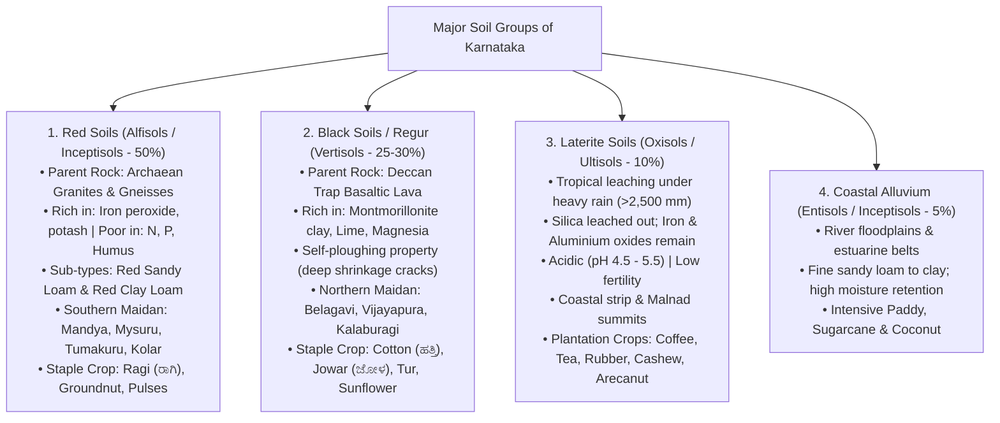
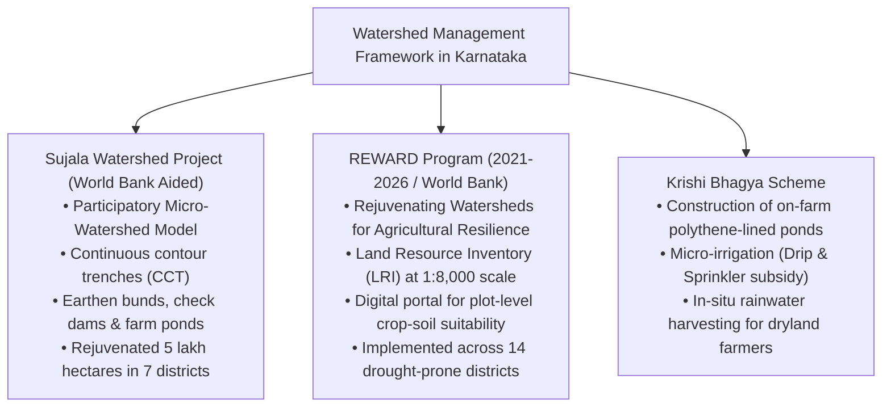

# Karnataka Soils, Soil Classification, Land Degradation and Watershed Management (ಕರ್ನಾಟಕದ ಮಣ್ಣುಗಳು, ಮಣ್ಣಿನ ವರ್ಗೀಕರಣ, ಭೂ ಸವಕಳಿ ಮತ್ತು ಜಲಾನಯನ ನಿರ್ವಹಣೆ)

> [!exam-focus]
> **KPSC High-Yield Examination Focus**:
> - **Four Primary Soil Orders in Karnataka**:
>   1. **Red Soils (ಕೆಂಪು ಮಣ್ಣು / Alfisols - 50% area)**: Widespread across Southern Maidan; rich in iron peroxide giving characteristic red color; deficient in nitrogen, phosphorus, and organic humus; ideal for ragi, groundnut, pulses, and mulberry.
>   2. **Black Soils / Regur / Kari Mannu (ಕಪ್ಪು ಮಣ್ಣು / Vertisols - 25-30% area)**: Derived from Deccan Trap basalts in Northern Maidan (Belagavi, Bagalkote, Vijayapura, Kalaburagi); high montmorillonite clay content; self-ploughing property (deep cracks in summer); highly moisture-retentive; ideal for cotton, jowar, wheat, and oilseeds.
>   3. **Laterite Soils (ಲ್ಯಾಟರೈಟ್ / ಜಂಬಿಟ್ಟಿಗೆ ಮಣ್ಣು / Ultisols/Oxisols - 10% area)**: Found along coastal plains (Uttara Kannada, Udupi, Dakshina Kannada) and Western Ghats peaks; formed by intense tropical leaching under heavy rainfall; acidic (pH 4.5-5.5); ideal for plantation crops (coffee, rubber, cashew, tea, arecanut).
>   4. **Coastal Alluvial Soils (ಕರಾವಳಿ ಮೆಕ್ಕಲು ಮಣ್ಣು / Entisols)**: Deposited by coastal rivers along floodplains and estuaries; fertile loamy texture; ideal for intensive paddy and sugarcane cultivation.
> - **Major Land Degradation Challenges**:
>   - Soil erosion (water sheet and gully erosion on Western Ghats slopes; wind erosion in arid Northern plains).
>   - **Canal Command Salinization / Alkalinization (*Chalu / Kallu Mannu* - ಚಳು ಮಣ್ಣು)**: In Upper Krishna (UKP) and Tungabhadra irrigation belts due to excessive waterlogging and unscientific flood irrigation.
> - **Watershed Management Programs**:
>   - **Sujala Watershed Project (ಸುಜಲಾ ಜಲಾನಯನ ಯೋಜನೆ)**: World Bank award-winning participatory watershed model.
>   - **REWARD Program (2021-2026)**: Rejuvenating Watersheds for Agricultural Resilience through Innovative Development (World Bank aided); Land Resource Inventory (LRI) mapping across 1.4 million hectares.

---

## 1. Soil Genesis and Taxonomic Classification

Soils in Karnataka are derived from the weathering of ancient Archaean granites and gneisses, Deccan Trap basalts, and recent coastal alluvium under diverse climatic conditions.



---

## 2. Exhaustive Analysis of Soil Orders

### 2.1 Red Soils (ಕೆಂಪು ಮಣ್ಣು - Alfisols / Inceptisols)
- **Coverage**: Accounts for approximately **50% of the state's geographical area**, forming the largest soil order in Karnataka.
- **Geological Origin**: Formed in situ by the weathering of ancient Archaean granites, gneisses, and quartzites of the Peninsular Gneissic Complex under conditions of moderate rainfall.
- **Physical & Chemical Profile**:
  - The distinctive red color is caused by the wide diffusion of **iron peroxide / iron oxides**.
  - Soil texture ranges from coarse sandy loam on uplands to deep clayey loam in low-lying river valleys.
  - Highly porous and friable structure with good drainage; low moisture-holding capacity compared to black soils.
  - Chemically deficient in **nitrogen, available phosphorus, organic humus, and lime**, but contains adequate potash. Slightly acidic to neutral pH (6.0 - 7.0).
- **Sub-Divisions**:
  1. *Red Sandy Loam (*Maralu Kempu Mannu*)*: Dominant in Bengaluru Urban and Rural, Kolar, Chikkaballapura, Ramanagara, and Tumakuru. Highly responsive to irrigation and chemical fertilization; the classic soil for finger millet (**Ragi**), groundnut, castor, horse gram, and mulberry.
  2. *Red Clayey Loam*: Dominant in Mysuru, Mandya, Hassan, and Chamarajanagar; supports paddy, sugarcane, and horticultural orchards.

### 2.2 Black Soils / Regur / Kari Mannu (ಕಪ್ಪು ಮಣ್ಣು - Vertisols)
- **Coverage**: Covers approximately **25% to 30%** of the state, concentrated in the Northern Maidan.
- **Geological Origin**: Formed by the sub-aerial weathering of basaltic lava flows of the **Deccan Traps** and weathering of hornblende-schists in the Dharwar system.
- **Physical & Chemical Profile**:
  - Contains high proportions of **montmorillonite clay (40% to 60%)**, imparting extreme plasticity and stickiness when wet.
  - **High Moisture Retention**: Swells significantly upon absorbing moisture and retains moisture deep in the subsoil for months, enabling winter rabi cropping without irrigation.
  - **Self-Ploughing Phenomenon (ಸ್ವಯಂ ಉಳುಮೆ)**: During hot summer months, the soil shrinks and develops wide, deep vertical cracks (up to 1 meter deep). Surface soil crumbs fall into these fissures, aerating the deep soil layers.
  - Chemically rich in **calcium carbonate, lime, magnesium, alumina, and iron**. Deficient in nitrogen, phosphorus, and organic matter. Highly alkaline to neutral pH (7.5 - 8.5).
- **Spatial Distribution**: **Belagavi, Bagalkote, Vijayapura, Kalaburagi, Yadgir, Raichur, Koppal, Gadag, and Dharwad**.
- **Crop Suitability**: World-renowned as the **Black Cotton Soil**; ideal for long-staple cotton, rabi jowar, wheat, Bengal gram, safflower, sunflower, and red gram (tur).

### 2.3 Laterite Soils (ಜಂಬಿಟ್ಟಿಗೆ ಮಣ್ಣು - Oxisols / Ultisols)
- **Coverage**: Approximately **8% to 10%** of the state.
- **Geological Origin & Formation Process**:
  - Formed under unique humid tropical conditions characterized by alternating high temperatures and torrential seasonal precipitation (>2,500-4,000 mm).
  - **Intense Leaching (*Kshalana* - ಕ್ಷಾಲನ)**: Heavy rainwater leaches out soluble silica, lime, and organic bases into deeper layers, leaving a residual crust of insoluble hydrated oxides of **iron and aluminium (sesquioxides)**.
- **Physical & Chemical Profile**:
  - Deep red to yellowish-brown vesicular, porous structure.
  - Soft and easily cut with spades when freshly quarried, but hardens into rock-like building stones (*Chira Kallu*) upon exposure to sun and air.
  - Highly acidic (pH ranges from 4.5 to 5.5).
  - Severely deficient in available phosphorus, potassium, calcium, and nitrogen; prone to toxic aluminium and iron fixations.
- **Spatial Distribution**: Coastal districts (**Uttara Kannada, Udupi, Dakshina Kannada**) and summits of Western Ghats (**Kodagu, Chikkamagaluru, Shivamogga**), plus high-elevation plateau pockets in **Bidar**.
- **Crop Suitability**: Highly suitable for **Plantation Agriculture**: Coffee (Arabica and Robusta), tea, rubber, cashew nut, arecanut, coconut, black pepper, and cardamom when treated with agricultural lime and organic manure.

### 2.4 Coastal Alluvial Soils (ಕರಾವಳಿ ಮೆಕ್ಕಲು ಮಣ್ಣು - Entisols)
- Formed by sediment deposition along river mouths and estuaries of coastal rivers (Netravati, Sharavathi, Kali) and inland river valleys.
- Light-grey to dark-brown loamy texture with high organic silt content.
- Supports intensive multicropped paddy, sugarcane, banana, and coastal coconut groves.

---

## 3. Land Degradation Challenges in Karnataka

```
Major Land Degradation Types in Karnataka
├── 1. Water Erosion (Sheet, Rill and Gully Erosion):
│   ├── Prevalent in steep slopes of Western Ghats and undulating Malnad.
│   └── Triggered by deforestation, steep slope cultivation, and intense monsoon downpours.
├── 2. Wind Erosion:
│   └── Active in hyper-arid plains of Northern Maidan (Challakere, Raichur, Vijayapura) during dry summers.
├── 3. Soil Salinization and Alkalinization (Chalu Mannu - ಚಳು ಮಣ್ಣು):
│   ├── Affects over 1.5 lakh hectares in Upper Krishna (UKP) and Tungabhadra canal commands.
│   └── Caused by unscientific continuous flood irrigation, lack of subsurface drainage, and capillary rise of salts.
└── 4. Soil Acidity and Micronutrient Deficiencies:
    ├── Widespread soil acidity in Coastal & Malnad laterites (pH < 5.5).
    └── Extensive zinc, boron, and organic carbon depletion across dryland agricultural soils.
```

### 3.1 The Canal Command Salinity Crisis (*Chalu Mannu*)
- In the command areas of the **Tungabhadra Project (Raichur, Ballari)** and **Upper Krishna Project (Vijayapura, Bagalkote)**, the introduction of perennial canal water led farmers to switch from traditional dryland millets to water-intensive paddy and sugarcane.
- Excessive flood irrigation combined with poor subsurface drainage and shallow impermeable basaltic clay subsoils caused the water table to rise within 1-2 meters of the surface.
- In hot summer months, intense evaporation draws mineral salts upwards via capillary action, depositing a white saline crust of sodium carbonate and sulfate (*Chalu Mannu*), rendering fertile black soil completely barren and alkaline.

---

## 4. Watershed Management: Sujala and REWARD Programs

Because over **70% of Karnataka's cultivated land is rainfed dryland**, scientific watershed development is the primary strategy for soil conservation and moisture security.



### 4.1 The Sujala Watershed Project (ಸುಜಲಾ ಯೋಜನೆ)
- Implemented in phases across drought-prone districts (Kolar, Tumakuru, Chitradurga, Haveri, Dharwad) with World Bank assistance.
- Won the prestigious **World Bank VAM (Village Level Assessment) Award**.
- Features: Community-led micro-watershed committees; treated entire catchment from ridge to valley through continuous contour trenches (CCT), vegetative vetiver grass barriers, check dams, and farm ponds (*Krishi Honda*).

### 4.2 The REWARD Program (2021–2026)
- **Full Form**: *Rejuvenating Watersheds for Agricultural Resilience through Innovative Development*.
- **Funding & Partnership**: Supported by the World Bank ($60 million) and Government of Karnataka ($26 million).
- **Core Technological Innovation — Land Resource Inventory (LRI)**:
  - High-resolution mapping of soil depth, texture, erosion risk, slope, and groundwater potential at **1:8,000 cadastral scale** across 1.4 million hectares.
  - Direct delivery of plot-specific **Soil Health Cards** and crop advisory portals, empowering dryland farmers to select crops scientifically matched to their exact soil profile.

---

## 5. Comparative Synoptic Matrix of Karnataka Soils

| Parameter | Red Soils (Alfisols) | Black Soils (Vertisols) | Laterite Soils (Oxisols) | Coastal Alluvial (Entisols) |
|---|---|---|---|---|
| **State Area Share** | **~50%** (Largest) | **25% – 30%** | **8% – 10%** | **~5%** |
| **Parent Geology** | Archaean Granites/Gneisses | Deccan Trap Basalt | Archaean & Basalt Leaching | Coastal River Alluvium |
| **Dominant Region** | Southern Maidan | Northern Maidan | Coastal belt & Malnad summits| Estuaries & floodplains |
| **Texture & Clay** | Sandy loam to gravelly clay | Deep Montmorillonite clay | Porous, vesicular laterite | Silty to fine sandy loam |
| **Moisture Capacity** | Low to moderate | **Extremely High** | Low (highly porous) | High |
| **pH Reaction** | Slightly acidic to neutral | **Alkaline (7.5 – 8.5)** | **Acidic (4.5 – 5.5)** | Neutral (6.5 – 7.5) |
| **Deficiencies** | Nitrogen, Phosphorus, Humus | Nitrogen, Phosphorus, Humus | Phosphates, Potash, Calcium | Moderate Nitrogen |
| **Benchmark Crops** | **Ragi, Groundnut, Pulses** | **Cotton, Jowar, Wheat, Tur** | **Coffee, Cashew, Rubber, Tea** | **Paddy, Sugarcane, Coconut** |

---

## 6. Prelims Traps & Mains Answer Blueprint

### 6.1 Prelims Traps
> [!caution]
> - **Trap 1**: Believing Black Soil is the most widespread soil in Karnataka. *Fact*: **Red Soil** covers 50% of the state's area, while Black Soil covers only 25-30%.
> - **Trap 2**: Assuming laterite soil is naturally fertile because it supports lush coffee plantations. *Fact*: Laterite soil is **chemically infertile and highly acidic (pH 4.5-5.5)**; plantation crops thrive only because heavy organic mulching, fertilizer applications, and lime treatments compensate for natural nutrient poverty.
> - **Trap 3**: Confusing the cause of *Chalu Mannu*. *Fact*: *Chalu Mannu* is caused by **excessive canal irrigation and poor drainage**, not by drought or lack of water!

### 6.2 Mains Model Question & Answer Blueprint
**Question**: *Describe the characteristics and distribution of Vertisols (Black Soils) in Karnataka. Analyze the causes and remedial measures for soil salinity in the canal command areas of the state.* (Marks: 15 / 250 Words)

**Model Answer Outline**:
1. **Introduction (35 words)**:
   - Identify Vertisols (Black Cotton Soils / Kari Mannu) as the defining soil order of Northern Karnataka, covering 25-30% of the state across the Deccan Trap basalt formation, possessing unique self-ploughing and moisture-retentive attributes.
2. **Body 1: Characteristics & Regional Distribution (75 words)**:
   - *Genesis*: Derived from Cretaceous-Eocene basaltic lava weathering; distributed across Belagavi, Bagalkote, Vijayapura, Kalaburagi, and Raichur.
   - *Physical Properties*: High montmorillonite clay content (40-60%); deep vertical shrinkage cracks during summer (self-ploughing property aerating subsoil); extreme water retention sustaining rabi crops (jowar, cotton, tur).
   - *Chemical Profile*: Rich in calcium, magnesium carbonates, and potash; deficient in nitrogen, phosphorus, and organic matter; alkaline pH (7.5-8.5).
3. **Body 2: Canal Command Salinity Crisis (*Chalu Mannu*) (80 words)**:
   - *Causes*: In UKP and Tungabhadra canal networks, flood irrigation of water-intensive crops (paddy, sugarcane) on heavy clay soils with poor natural drainage causes the water table to rise.
   - *Capillary Accumulation*: Intense evaporation in arid summers draws groundwater upwards, depositing sodium and magnesium salts on the topsoil, destroying soil structure and sterilizing fertile land.
4. **Body 3: Remedial Interventions (40 words)**:
   - *Subsurface Drainage (SSD)*: Installing perforated underground drainage pipes to lower water tables and flush out salts.
   - *Agronomic Shifts*: Replacing flood irrigation with precision drip systems; cultivating salt-tolerant green manure crops (*Dhaincha*, Sesbania); applying agricultural gypsum ($CaSO_4$) to displace toxic sodium ions.
5. **Conclusion (20 words)**:
   - Conclude that sustainable dryland agriculture in Karnataka requires integrating scientific drainage engineering with watershed soil-health mapping under programs like REWARD.

---

## 7. Sources and Verification
- **Verified On**: 2026-10-13 (Tuesday)
- **Primary Source 1**: National Bureau of Soil Survey and Land Use Planning (NBSS&LUP), *Soils of Karnataka for Optimising Land Use*, Bangalore.
- **Primary Source 2**: Watershed Development Department (WDD), *REWARD Project Implementation Plan*, Government of Karnataka.
- **Primary Source 3**: Dr. M.B. Patil, *Geography of Karnataka*, Vidyanidhi Prakashana.
