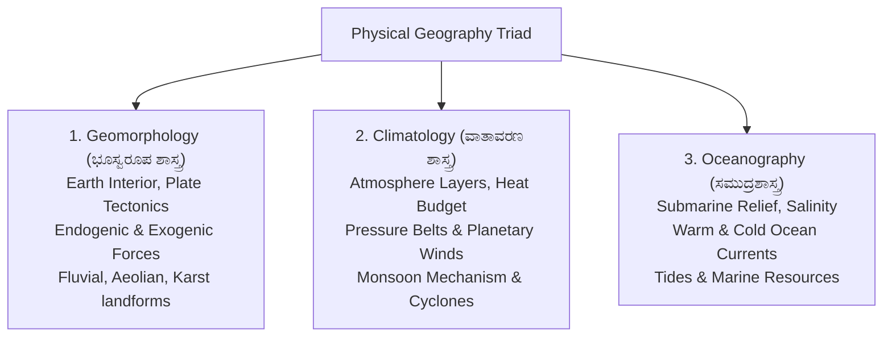
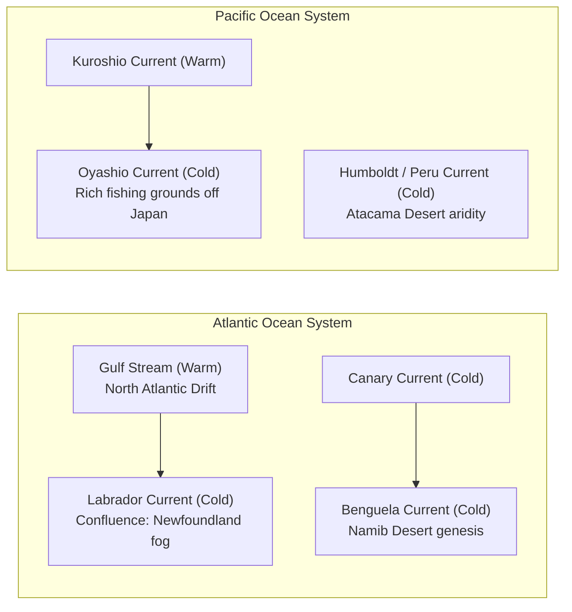

# World and Indian Physical Geography: Geomorphology, Climatology and Oceanography (ಜಾಗತಿಕ ಮತ್ತು ಭಾರತೀಯ ಭೌತ ಭೂಗೋಳ ಶಾಸ್ತ್ರ)

> [!exam-focus]
> **Exam Weightage & Testing Patterns**: Foundational scientific discipline tested across Prelims Paper 1 (3-5 MCQs) and Mains GS-2 Section 1 (conceptual 12.5-mark or 15-mark questions on monsoon mechanisms, plate tectonics, or ocean currents).
> - **Prelims Traps**: Confusing cold ocean currents with warm currents (e.g., Humboldt/Peru & Benguela are cold, whereas Gulf Stream & Kuroshio are warm); mixing up seismic wave characteristics (P-waves are longitudinal and pass through solids, liquids, gases; S-waves are transverse and pass only through solids); misidentifying atmospheric layers (temperature decreases in Troposphere and Mesosphere, but increases in Stratosphere and Thermosphere).
> - **Mains Dimensions**: Dynamic drivers of the Indian Monsoon (ITCZ shift, Somali Jet, Tibetan heating, ENSO, and Positive/Negative IOD); Plate Tectonic explanations of Himalayan orogeny and seismicity; impacts of ocean warming on tropical cyclogenesis in the Arabian Sea.

---

## 1. Physical Earth Systems Framework

The diagram above details the three interconnected pillars of physical geography: lithospheric forces shaping surface landforms, atmospheric energy transfers regulating global climate, and hydrospheric circulations redistributing global heat.

---

## 2. Geomorphology: Earth's Interior & Plate Tectonics

### 2.1 Interior Structure of the Earth
Based on earthquake seismic wave propagation (P-waves and S-waves):
1. **Crust (ಭೂತೊಗಟೆ)**: Solid outermost layer. Continental crust (average thickness 35 km, composed of *Sial* - Silica & Aluminium, granitic rock, density 2.7 g/cm³) and Oceanic crust (thickness 5–10 km, composed of *Sima* - Silica & Magnesium, basaltic rock, density 3.0 g/cm³).
2. **Mantle (ಭೂಕವಚ)**: Extends to a depth of 2,900 km. Constitutes 84% of Earth's volume. Upper mantle contains the semi-molten ductile **Asthenosphere (ಅಸ್ಥೆನೋಸ್ಪಿಯರ್)** (100–400 km), over which lithospheric plates glide.
3. **Core (ಭೂಗರ್ಭ / ಕೇಂದ್ರೀಯ ಗೋಳ)**: Extends from 2,900 km to 6,371 km. Composed of *Nife* (Nickel & Iron).
   - *Outer Core*: Liquid state (S-waves cannot pass through it, creating an S-wave shadow zone beyond 105°). Convection currents of molten iron here generate Earth's **geomagnetic field (geodynamo)**.
   - *Inner Core*: Solid state due to immense pressure, density ~13 g/cm³.
- **Key Discontinuity Boundaries**:
  - *Conrad Discontinuity*: Outer and Inner Crust.
  - *Mohorovicic (Moho) Discontinuity*: Crust and Mantle.
  - *Repetti Discontinuity*: Upper and Lower Mantle.
  - *Gutenberg Discontinuity*: Mantle and Outer Core (at 2,900 km).
  - *Lehmann Discontinuity*: Outer Core and Inner Core (at 5,150 km).

### 2.2 Plate Tectonics Theory (ಫಲಕ ವಿರೂಪಣ ಸಿದ್ಧಾಂತ)
- Advanced by W. J. Morgan, Tuzo Wilson, and Harry Hess (1960s), synthesizing Alfred Wegener's Continental Drift Theory (1912) and Seafloor Spreading.
- The Earth's lithosphere is divided into **seven major plates** (Pacific, North American, South American, Eurasian, African, Indo-Australian, Antarctic) and several minor plates (Nazca, Cocos, Arabian, Philippine).
- **Three Types of Plate Boundaries**:
  1. *Divergent / Constructive Boundaries*: Plates pull apart, magma rises from mantle, creating new oceanic crust (e.g., **Mid-Atlantic Ridge**, East African Rift Valley).
  2. *Convergent / Destructive Boundaries*: Plates collide.
     - *Oceanic-Continental*: Denser oceanic plate subducts into trench, creating volcanic mountain arcs (e.g., Andes, Cascades).
     - *Continental-Continental*: Neither plate subducts fully due to low buoyancy density; intense crumpling forms **Fold Mountains** (e.g., **Himalayan Mountain Range** formed by the Indo-Australian plate colliding into the Eurasian plate).
     - *Oceanic-Oceanic*: Deep ocean trenches and volcanic island arcs (e.g., Mariana Trench, Japanese Archipelago).
  3. *Transform / Conservative Boundaries*: Plates slide past each other horizontally without creation or destruction of crust (e.g., **San Andreas Fault** in California).

---

## 3. Climatology: Atmosphere, Winds and the Indian Monsoon

### 3.1 Atmospheric Layers & Temperature Profiles
| Layer | Altitude | Temperature Trend | Key Atmospheric Phenomena |
|---|---|---|---|
| **Troposphere (ಪರಿವರ್ತನಾ ಮಂಡಲ)** | 0 to 8 km (poles), 18 km (equator) | Decreases at **Normal Lapse Rate (6.5°C per 1,000 m)** | Contains 75% of atmospheric mass; all weather phenomena (clouds, rainfall, storms) occur here |
| **Stratosphere (ಸಮೋಷ್ಣ ಮಂಡಲ)** | Up to 50 km | Increases with altitude | Contains the **Ozone Layer (ಓಜೋನ್ ಪದರ)** absorbing harmful solar UV radiation; ideal for jet aircraft flying |
| **Mesosphere (ಮಧ್ಯಂತರ ಮಂಡಲ)** | 50 km to 80 km | Decreases to **-100°C** (coldest layer of atmosphere) | Meteors burn up upon entering this layer |
| **Thermosphere / Ionosphere (ಅಯಾನು ಮಂಡಲ)** | 80 km to 400 km | Increases rapidly with altitude (up to 1,500°C) | Contains electrically charged ions reflecting radio waves back to Earth; site of **Auroras** |
| **Exosphere (ಬಾಹ್ಯ ಮಂಡಲ)** | Above 400 km | Extremely rarefied gases | Merges gradually with outer space (hydrogen, helium) |

### 3.2 Atmospheric Pressure Belts & Planetary Winds
- **Equatorial Low Pressure Belt (Doldrums)**: 0° to 5° N/S. Intense solar heating creates rising thermal air currents; calm winds, heavy daily convective afternoon rainfall (*4 o'clock showers*).
- **Sub-Tropical High Pressure Belts (Horse Latitudes)**: 30° to 35° N/S. Sinking dry air creates stable high pressure; most of the world's hot deserts (Sahara, Thar, Atacama) are located on the western margins of continents in this belt.
- **Planetary Winds**:
  - *Trade Winds (ವಾಣಿಜ್ಯ ಮಾರುತಗಳು)*: Blow from Sub-Tropical High toward Equatorial Low (Northeast trades in Northern hemisphere, Southeast trades in Southern hemisphere).
  - *Westerlies (ಪಶ್ಚಿಮ ಮಾರುತಗಳು)*: Blow from Sub-Tropical High toward Sub-Polar Low (40° to 60° latitudes; known in the southern ocean as *Roaring Forties, Furious Fifties, Screaming Sixties*).
  - *Polar Easterlies (ಧ್ರುವೀಯ ಪೂರ್ವಾಭಿಮುಖ ಮಾರುತಗಳು)*: Blow from Polar High toward Sub-Polar Low.

### 3.3 The Mechanism of the Indian Monsoon (ಭಾರತೀಯ ಮಾನ್ಸೂನ್ ಕಾರ್ಯವಿಧಾನ)
The Indian Monsoon is a massive seasonal reversal of global wind systems driven by differential thermal and dynamic mechanisms:
1. **Differential Heating**: Vast Asian landmass heats up far more rapidly in summer than the Indian Ocean, creating a deep thermal low-pressure depression over northwest India and Pakistan.
2. **Shift of the ITCZ (ಅಂತರ-ಉಷ್ಣವಲಯದ ಕನ್ವರ್ಜೆನ್ಸ್ ವಲಯ)**: In summer, the Inter-Tropical Convergence Zone shifts northward over the Gangetic plain (*Monsoon Trough*). The Southeast trade winds cross the Equator, deflect to the right due to the **Coriolis Force**, and strike peninsular India as the **Southwest Monsoon (ನೈಋತ್ಯ ಮಾನ್ಸೂನ್)**.
3. **Tibetan Plateau Heating**: The massive elevated plateau of Tibet acts as an atmospheric thermal engine, emitting sensible heat into the upper troposphere, creating a clockwise divergence that powers the **Tropical Easterly Jet (TEJ)** over peninsular India.
4. **Somali Jet (Findlater Jet)**: Low-level cross-equatorial jet stream blowing off the East African coast over Somalia into the Arabian Sea, pumping immense moisture toward the Western Ghats of Karnataka and Kerala.
5. **ENSO (El Niño Southern Oscillation)**:
   - *El Niño (ಎಲ್ ನಿನೋ)*: Abnormal warming of surface waters in the central and eastern tropical Pacific Ocean; weakens the Walker circulation, frequently suppressing Indian monsoon rainfall and triggering droughts.
   - *La Niña (ಲಾ ನಿನಾ)*: Abnormal cooling of the eastern Pacific; generally associated with robust, above-average monsoon precipitation in India.
6. **Indian Ocean Dipole (IOD / ಹಿಂದೂ ಮಹಾಸಾಗರದ ದ್ವಿಧ್ರುವ)**:
   - *Positive IOD*: Western Indian Ocean (near Arabian Sea) becomes warmer than the eastern Indian Ocean near Indonesia; enhances monsoon rainfall in India and can counteract the adverse effects of El Niño.
   - *Negative IOD*: Opposite pattern, associated with suppressed rainfall.

---

## 4. Oceanography: Currents, Tides and Resources

### 4.1 Major Ocean Currents of the World
Ocean currents are massive horizontal flows of seawater driven by planetary winds, Coriolis force, gravity, and water density (thermohaline) gradients.

The diagram above illustrates the circulation of primary warm and cold ocean currents across the Atlantic and Pacific basins, highlighting how the confluence of contrasting currents creates major global fisheries.

| Ocean Current | Nature (Warm / Cold) | Ocean Basin | Geographical Impact & Significance |
|---|---|---|---|
| **Gulf Stream** | Warm | North Atlantic | Moderates Western European winters; creates shipping lanes free of ice |
| **Labrador Current** | Cold | North Atlantic | Flows south from Arctic; meets warm Gulf Stream at **Grand Banks (Newfoundland)**, creating world-famous cod fishing grounds and dense navigational fog |
| **Canary Current** | Cold | North Atlantic | Flows past northwest Africa, contributing to the aridity of the Sahara desert |
| **Benguela Current**| Cold | South Atlantic | Flows past southwest Africa, causing the coastal aridity of the Namib desert |
| **Kuroshio Current** | Warm | North Pacific | Equivalent of Gulf Stream in Pacific; flows past Taiwan and Japan |
| **Oyashio (Kuril)** | Cold | North Pacific | Meets Kuroshio off the coast of Hokkaido, creating nutrient-rich marine ecosystems |
| **Humboldt / Peru** | Cold | South Pacific | Upwelling brings nutrient-rich deep waters; causes extreme dryness in Atacama desert |

### 4.2 Tides and Tidal Dynamics
- Tides are the periodic rise and fall of ocean sea levels caused by the gravitational attraction of the **Moon** and the **Sun**, combined with Earth's rotation.
- **Spring Tides (ಹೆಬ್ಬಬ್ಬರ)**: Occur twice a month during **Syzygy (ಸೂರ್ಯ, ಚಂದ್ರ, ಭೂಮಿ ಒಂದೇ ಸರಳರೇಖೆಯಲ್ಲಿ)**—on New Moon (*Amavasya*) and Full Moon (*Purnima*). Gravitational forces of Sun and Moon reinforce each other, producing the highest high tides and lowest low tides (maximum tidal range).
- **Neap Tides (ಕಿರುಬಬ್ಬರ)**: Occur during the first and third quarters of the Moon when the Sun and Moon are at **right angles (Quadrature / 90°)** relative to Earth. Gravitational forces counteract each other, producing the lowest tidal range.
- **Tidal Energy in India**: Highest tidal range in India is found at the **Gulf of Khambhat** and **Gulf of Kutch** in Gujarat (up to 11 meters), followed by the Sundarbans.

### 4.3 UNCLOS Maritime Zones (ಸಮುದ್ರ ಕಾನೂನು ವಲಯಗಳು)
Defined under the United Nations Convention on the Law of the Sea (UNCLOS, 1982):
1. **Internal Waters (ಆಂತರಿಕ ಜಲರಾಶಿ)**: Landward of the baseline (ports, rivers, bays); full state sovereignty.
2. **Territorial Sea (ಪ್ರಾದೇಶಿಕ ಸಮುದ್ರ)**: Extends **12 nautical miles (nm)** from the baseline; full sovereignty over water, airspace, seabed, and subsoil; foreign ships enjoy the right of *Innocent Passage*.
3. **Contiguous Zone (ಸಮೀಪಸ್ಥ ವಲಯ)**: Extends from 12 nm to **24 nm**; coastal state has jurisdiction to prevent and punish infringement of customs, fiscal, immigration, or sanitary laws.
4. **Exclusive Economic Zone (EEZ / ವಿಶೇಷ ಆರ್ಥಿಕ ವಲಯ)**: Extends from baseline up to **200 nautical miles** (~370 km). Coastal state has sovereign rights for exploring, exploiting, conserving, and managing all living (fisheries) and non-living (oil, gas, polymetallic nodules) natural resources of the seabed and water column. High seas lie beyond the EEZ.

---

## 5. Related Vault Notes
- [[Karnataka_Physiography_and_Rivers]] — Regional manifestation of Sahyadri Western Ghats.
- [[Environment_Biodiversity_Climate]] — Western Ghats ecology and marine biodiversity.
- [[Science_and_Technology_Developments]] — Deep ocean exploration (Samudrayaan mission) and remote sensing.

---

## 6. Likely Questions & Verbatim PYQs

### Prelims Multiple-Choice Questions
- **PYQ (KPSC KAS 2017 Prelims P1)**: The Grand Banks off the coast of Newfoundland in the North Atlantic Ocean is one of the richest fishing grounds in the world because of:
  - (A) Shallow continental shelf with coral reefs
  - (B) Confluence of the warm Gulf Stream and the cold Labrador Current [Correct]
  - (C) Presence of large river estuaries
  - (D) Absence of tropical cyclonic disturbances
- **PYQ (KPSC KAS 2020 Prelims P1)**: In which atmospheric layer is the protective Ozone layer situated that absorbs harmful ultraviolet radiations from the Sun?
  - (A) Troposphere
  - (B) Stratosphere [Correct]
  - (C) Mesosphere
  - (D) Thermosphere
- **Expected Question (Prelims 2026)**: What is the maximum seaward limit of the Exclusive Economic Zone (EEZ) measured from the coastal baseline under UNCLOS 1982?
  - *Answer*: 200 Nautical Miles (nm).

### Mains Analytical Question & Answer Outline
- **Mains GS-2 Question**: *"Explain the role of the Indian Ocean Dipole (IOD) and El Niño Southern Oscillation (ENSO) in modulating the performance of the Southwest Monsoon in India." (15 Marks / 250 Words)*
  - **Introduction**: Define the Southwest Monsoon as a critical macroeconomic lifeline of Indian agriculture; explain that while driven primarily by land-sea thermal contrasts, its inter-annual variability is governed by coupled ocean-atmosphere phenomena across the Pacific (ENSO) and Indian Ocean (IOD).
  - **Mechanisms of ENSO Impact**: During an El Niño year, warm pool shifts eastward to South American coast; Walker circulation weakens and reverses; sinking air column over India and Western Pacific inhibits convective cloud formation, historically resulting in poor monsoon rainfall or severe drought (e.g., 2009, 2014, 2015).
  - **Mechanisms of IOD Impact**: Discovered in 1999 as the Indian Ocean counterpart; Positive IOD causes anomalous warming of western Indian Ocean (Arabian Sea) relative to eastern basin near Sumatra; enhances convection and moisture pumping into the Indian subcontinent.
  - **Interaction & Compensatory Dynamics**: A strong Positive IOD can successfully neutralize or buffer the adverse drying effects of a concurrent El Niño (as demonstrated during the 1997 and 2019 monsoon seasons).
  - **Conclusion**: Emphasize how India Meteorological Department (IMD) coupled dynamic models (Monsoon Mission Coupled Forecast System) now simulate both ENSO and IOD indices for accurate seasonal forecasting.

---

> [!summary] Quick Revision Box (10 Non-Negotiable Facts)
> 1. **Gutenberg Discontinuity**: Boundary separating Mantle from Outer Core at 2,900 km.
> 2. **S-Wave Shadow Zone**: From 105° to 105° on either side; proves Outer Core is liquid.
> 3. **Normal Lapse Rate**: Temperature falls by 6.5°C per 1,000 meters elevation in Troposphere.
> 4. **Mesosphere**: Coldest layer of atmosphere (-100°C); meteors burn up here.
> 5. **Horse Latitudes (30°–35° N/S)**: Sub-tropical high pressure belt; world's hot deserts located here.
> 6. **Somali Jet**: Low-level cross-equatorial wind pumping moisture into Southwest Monsoon.
> 7. **Positive IOD**: Warmer western Indian Ocean; enhances Indian monsoon rainfall.
> 8. **Grand Banks**: Famous fishery created by confluence of warm Gulf Stream and cold Labrador current.
> 9. **Spring Tides**: Occur during Syzygy (New & Full Moon); Sun and Moon gravitational forces combine.
> 10. **EEZ Limit**: Extends up to 200 nautical miles from baseline under UNCLOS 1982.
