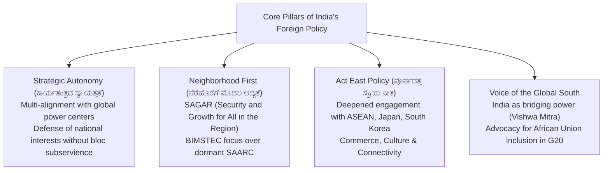

# India's Foreign Policy and International Relations (ಭಾರತದ ವಿದೇಶಾಂಗ ನೀತಿ ಮತ್ತು ಅಂತರರಾಷ್ಟ್ರೀಯ ಸಂಬಂಧಗಳು)

> [!exam-focus]
> **Exam Weightage & Testing Patterns**: Prominent focus area in Mains GS-2 Section 3 (10–15 marks) and Prelims Paper 1 Part 1 (National/International Current Events).
> - **Prelims Traps**: Confusing membership of international groupings (e.g., India is in QUAD, BRICS, SCO, G20, but NOT in G7, ASEAN, or RCEP); mixing up regional connectivity projects (Kaladan Multi-Modal Transit in Myanmar vs Chabahar Port in Iran vs INSTC).
> - **Mains Dimensions**: Evolution from non-alignment to multi-alignment and strategic autonomy; India's positioning as *Vishwa Mitra* (friend of the world) and voice of the Global South; managing border stability with China along the LAC while strengthening Indo-Pacific maritime deterrence through the QUAD.

---

## 1. Foreign Policy Architecture

The flowchart above outlines the contemporary strategic doctrine of Indian diplomacy: anchored in non-negotiable strategic autonomy, prioritizing neighborhood stability, projecting economic and naval partnership across the Indo-Pacific, and championing the collective interests of developing nations.

---

## 2. Core Diplomatic Doctrines

### 2.1 Historical Foundations
1. **Panchsheel (1954)**: Five Principles of Peaceful Coexistence signed with China.
2. **Non-Aligned Movement (NAM, 1961)**: Resistance against military bloc alignment during the Cold War.
3. **The Gujral Doctrine (1996)**:
   - Formulated by Prime Minister I. K. Gujral.
   - Founded on the principle of **Non-Reciprocity (ಪ್ರತಿಯಾಗಿ ಏನನ್ನೂ ನಿರೀಕ್ಷಿಸದೆ ನೆರವು)** towards smaller South Asian neighbors (Bhutan, Bangladesh, Nepal, Maldives, Sri Lanka); India gives more than it receives to build deep regional trust.
4. **Strategic Autonomy & Multi-Alignment (21st Century)**:
   - Shift from passive non-alignment to active multi-alignment with competing geopolitical poles simultaneously (e.g., engaging with the US in QUAD while engaging with Russia and China in BRICS and SCO).

---

## 3. Major Bilateral Strategic Partnerships

### 3.1 Indo-US Strategic Relations
- Elevated to a **Comprehensive Global and Strategic Partnership**.
- **Four Foundational Defense Pacts**:
  1. *GSOMIA (2002)*: General Security of Military Information Agreement (military intelligence sharing).
  2. *LEMOA (2016)*: Logistics Exchange Memorandum of Agreement (mutual access to military bases for refueling and logistics).
  3. *COMCASA (2018)*: Communications Compatibility and Security Agreement (transfer of secure defense communications equipment).
  4. *BECA (2020)*: Basic Exchange and Cooperation Agreement (sharing high-precision geospatial and satellite data for missile targeting).
- **Initiative on Critical and Emerging Technologies (iCET, 2023)**: Cooperation in AI, quantum computing, semiconductors, and co-production of GE F414 jet engines in India.

### 3.2 India-China Dynamics
- **Complex Interdependence**: China is one of India's largest trading partners, yet India faces a massive trade deficit (~$100 billion).
- **Border Friction along the LAC (Line of Actual Control)**:
  - 3,488 km disputed border divided into Western (Ladakh), Middle (Himachal/Uttarakhand), and Eastern (Arunachal Pradesh) sectors.
  - June 2020 Galwan Valley clash froze normal relations; India insists that peace and tranquility on the border is an indispensable prerequisite for normal bilateral relations.

### 3.3 India-Russia Strategic Ties
- Governed by the **Special and Privileged Strategic Partnership**.
- **Defense & Energy**: S-400 Triumf air defense missile systems; BrahMos cruise missile joint venture; licensed production of AK-203 assault rifles at Amethi; Kudankulam nuclear plant; increased import of discounted crude oil post-2022.

---

## 4. Multilateral Groupings and Global Governance

| Grouping | Member States | Key Strategic Objectives | India's Role & Landmark Contributions |
|---|---|---|---|
| **G20** | 19 Nations + EU + **African Union** | Global macroeconomic stability, debt restructuring, sustainable development finance | **Presidency 2023**: New Delhi Leaders' Declaration; achieved consensus; inducted African Union as permanent member |
| **QUAD** | India, USA, Japan, Australia | Free, Open, and Inclusive Indo-Pacific; maritime domain awareness, vaccine diplomacy, submarine cables | Counter-balance to unilateral expansionism in Indian Ocean and South China Sea |
| **BRICS** | Brazil, Russia, India, China, South Africa + Expanded Members (Egypt, Ethiopia, Iran, UAE) | Multipolar world order; New Development Bank (NDDB); alternative to Western Bretton Woods institutions | Champion of reforms in IMF/World Bank; resisted anti-Western weaponization of the bloc |
| **SCO** | India, China, Russia, Pakistan, Central Asian States, Iran, Belarus | Eurasian regional security; counter-terrorism (RATS mechanism in Tashkent); energy corridors | Chaired 2023 Summit; focused on countering three evils: terrorism, separatism, and extremism |
| **BIMSTEC** | Bangladesh, Bhutan, India, Myanmar, Nepal, Sri Lanka, Thailand | Bay of Bengal integration; bridge between South Asia and Southeast Asia | Master Plan for Transport Connectivity; alternative regional engine to paralyzed SAARC |

---

## 5. Related Vault Notes
- [[Post_Independence_India]] — Historic wars, Non-Alignment origin, Simla Agreement.
- [[Public_Administration_and_Governance]] — International administration and diplomacy.
- [[2026-10_October]] — Recent bilateral summits and geopolitical developments.

---

## 6. Likely Questions & Verbatim PYQs

### Prelims Multiple-Choice Questions
- **PYQ (KPSC KAS 2017 Prelims P1)**: The "Panchsheel" agreement embodying the Five Principles of Peaceful Coexistence was signed in 1954 between India and which of the following countries?
  - (A) Soviet Union
  - (B) United States
  - (C) China [Correct]
  - (D) Pakistan
- **PYQ (KPSC KAS 2020 Prelims P1)**: Which of the following is NOT a member of the quadrilateral strategic security dialogue known as the "QUAD"?
  - (A) India
  - (B) Japan
  - (C) United Kingdom [Correct - Members are India, USA, Japan, Australia]
  - (D) Australia
- **Expected Question (Prelims 2026)**: During India's G20 Presidency in 2023, which continental multilateral institution was admitted as a permanent member of the G20?
  - *Answer*: The African Union (AU).

### Mains Analytical Question & Answer Outline
- **Mains GS-2 Question**: *"Examine how India successfully leverages 'multi-alignment' to pursue its national interests in an increasingly fragmented global order." (15 Marks / 250 Words)*
  - **Introduction**: Define multi-alignment as the proactive contemporary reinterpretation of non-alignment, where India engages simultaneously with divergent and competing power axes to maximize sovereign policy space.
  - **Strategic Engagements Across Contradictory Poles**:
    - *Western Alignment (Indo-Pacific)*: Deep defense, intelligence, and semiconductor integration with the US and QUAD partners to secure maritime chokepoints and balance Chinese regional dominance.
    - *Eurasian Alignment*: Continuing strategic, defense, and energy procurement ties with Russia; maintaining active membership in BRICS and SCO to preserve Eurasian continental stability.
    - *Middle Eastern Connectivity*: Building the India-Middle East-Europe Economic Corridor (IMEC) alongside the I2U2 grouping (India, Israel, UAE, USA).
  - **Championing the Global South**: Demonstrating diplomatic leadership by inducting the African Union into the G20, advocating for sovereign debt relief, green energy finance, and food security.
  - **Conclusion**: Conclude that multi-alignment transforms India from a rule-taker into a decisive rule-shaper (*Vishwamitra*) in international governance.

---

> [!summary] Quick Revision Box (10 Non-Negotiable Facts)
> 1. **Panchsheel (1954)**: 5 Principles of Coexistence signed by Nehru and Zhou Enlai.
> 2. **Gujral Doctrine (1996)**: Non-reciprocal diplomatic generosity toward South Asian neighbors.
> 3. **BECA (2020)**: Final Indo-US foundational defense pact sharing satellite geospatial data.
> 4. **QUAD**: Strategic dialogue comprising India, USA, Japan, and Australia for free Indo-Pacific.
> 5. **G20 New Delhi Summit (2023)**: Inducted 55-nation African Union as permanent G20 member.
> 6. **BIMSTEC**: Bay of Bengal regional grouping bridging South and Southeast Asia (7 nations).
> 7. **SCO RATS**: Regional Anti-Terrorist Structure headquartered in Tashkent.
> 8. **Chabahar Port**: Indian strategic port project in Iran bypassing Pakistan to reach Afghanistan.
> 9. **G4 Nations**: India, Japan, Germany, and Brazil collectively bidding for permanent UNSC seats.
> 10. **SAGAR Doctrine**: "Security and Growth for All in the Region" (Indian Ocean maritime framework).
