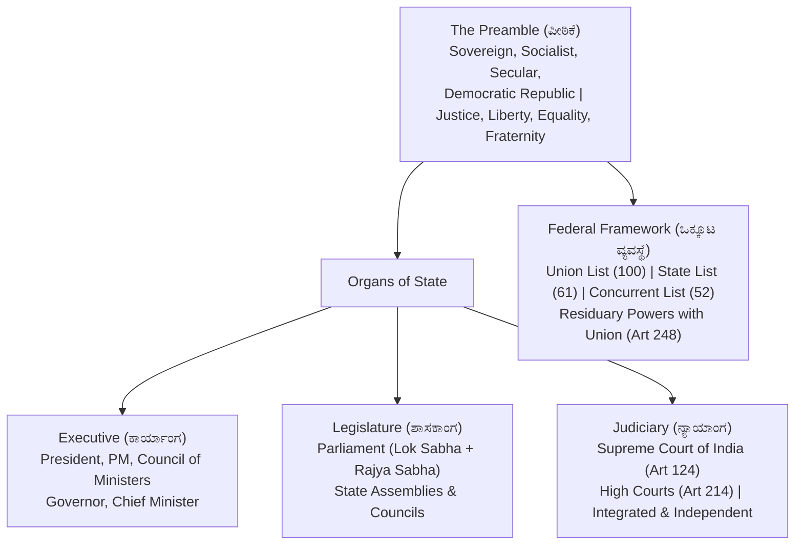

# Indian Constitutional System: Organs of Government, Rights and Federalism (ಭಾರತೀಯ ಸಂವಿಧಾನ ವ್ಯವಸ್ಥೆ: ಸರ್ಕಾರದ ಅಂಗಗಳು, ಮೂಲಭೂತ ಹಕ್ಕುಗಳು ಮತ್ತು ಒಕ್ಕೂಟ ವ್ಯವಸ್ಥೆ)

> [!exam-focus]
> **Exam Weightage & Testing Patterns**: Constitutes the single largest static subject area in Prelims Paper 1 (Humanities: 8-10 MCQs) and Mains GS-2 Section 2 (mandatory 15-mark essay questions on judicial review, federal relations, or constitutional amendments).
> - **Prelims Traps**: Confusing writ jurisdictions between Supreme Court (Article 32: only for Fundamental Rights) and High Courts (Article 226: for Fundamental Rights *and* any other legal right—broader jurisdiction); mixing up amendment procedures under Article 368 (simple majority vs special majority vs special majority with ratification by 50% of state legislatures); confusing the grounds of reasonable restrictions under Article 19(2).
> - **Mains Dimensions**: Basic Structure Doctrine (*Kesavananda Bharati*, 1973); asymmetric federalism (Article 371 series, especially Article 371J for Kalyana Karnataka); Centre-State financial tensions in the GST and Finance Commission devolution era.

---

## 1. Constitutional Architecture Overview

The flowchart above outlines the structural architecture of the Constitution of India, showing how democratic sovereignty in the Preamble divides into three institutional organs governed by constitutional checks and balances and a federal distribution of legislative competencies.

---

## 2. Preamble, Fundamental Rights & Directive Principles

### 2.1 The Preamble (ಸಂವಿಧಾನದ ಪೀಠಿಕೆ)
- **Source**: Based on the *Objective Resolution* moved by Jawaharlal Nehru in the Constituent Assembly on 13 December 1946 (adopted 22 January 1947).
- **Core Declarations**:
  - *Authority*: Derived from *"We, The People of India"*.
  - *Nature of State*: **Sovereign, Socialist, Secular, Democratic, Republic** (ಸಾರ್ವಭೌಮ, ಸಮಾಜವಾದಿ, ಜಾತ್ಯತೀತ, ಪ್ರಜಾಸತ್ತಾತ್ಮಕ, ಗಣರಾಜ್ಯ). Note: *"Socialist, Secular, and Integrity"* were inserted by the **42nd Constitutional Amendment Act, 1976**.
  - *Objectives*: **Justice** (Social, Economic, Political), **Liberty** (of thought, expression, belief, faith, worship), **Equality** (of status and opportunity), and **Fraternity** (assuring the dignity of the individual and unity and integrity of the Nation).
- **Legal Status**: In the *Kesavananda Bharati Case (1973)*, the Supreme Court ruled that the Preamble is an **integral part of the Constitution** and can be amended under Article 368 without violating the Basic Structure. It is **non-justiciable** in courts.

### 2.2 Fundamental Rights (ಮೂಲಭೂತ ಹಕ್ಕುಗಳು: Articles 12–35, Part III)
Borrowed from the US Bill of Rights; hailed by Dr. B. R. Ambedkar as the "most criticized Part" and the cornerstone of constitutional democracy:
1. **Right to Equality (Articles 14–18)**:
   - *Art 14*: Equality before law (British concept) and Equal protection of the laws (US concept).
   - *Art 15*: Prohibition of discrimination on grounds only of religion, race, caste, sex, or place of birth.
   - *Art 16*: Equality of opportunity in public employment (Art 16(4) allows affirmative action reservations).
   - *Art 17*: **Abolition of Untouchability (ಅಸ್ಪೃಶ್ಯತೆ ನಿರ್ಮೂಲನೆ)** — absolute right with no exceptions; enforceable via Protection of Civil Rights Act, 1955.
   - *Art 18*: Abolition of titles (except military and academic distinctions).
2. **Right to Freedom (Articles 19–22)**:
   - *Art 19(1)*: Guarantees six democratic freedoms: (a) speech and expression, (b) peaceful assembly without arms, (c) forming associations or unions/cooperatives, (d) moving freely throughout India, (e) residing and settling anywhere in India, (g) practicing any profession or trade. Subject to reasonable restrictions under Art 19(2) (public order, sovereignty, decency).
   - *Art 20*: Protection in respect of conviction for offences (no ex-post facto law, no double jeopardy, no self-incrimination).
   - *Art 21*: **Protection of Life and Personal Liberty (ಜೀವಿಸುವ ಮತ್ತು ವೈಯಕ್ತಿಕ ಸ್ವಾತಂತ್ರ್ಯದ ಹಕ್ಕು)**: Expanded via *Maneka Gandhi Case (1978)* to include right to live with human dignity, right to privacy (*K.S. Puttaswamy Case, 2017*), right to clean environment, right to livelihood.
   - *Art 21A*: **Right to Education (ಶಿಕ್ಷಣದ ಹಕ್ಕು)**: Free and compulsory education for children aged 6 to 14 years (inserted by **86th Amendment Act, 2002**).
   - *Art 22*: Protection against arbitrary arrest and preventive detention.
3. **Right against Exploitation (Articles 23–24)**:
   - *Art 23*: Prohibition of human trafficking and forced labor (*begar*).
   - *Art 24*: Prohibition of employment of children below 14 years in factories, mines, or hazardous employment.
4. **Right to Freedom of Religion (Articles 25–28)**: Freedom of conscience, profession, practice, and propagation; freedom to manage religious affairs (Art 26); secular taxation ban (Art 27).
5. **Cultural and Educational Rights (Articles 29–30)**: Protection of distinct language, script, or culture of minorities (Art 29); right of minorities to establish and administer educational institutions (Art 30).
6. **Right to Constitutional Remedies (Article 32)**:
   - Termed by Dr. B. R. Ambedkar as the ***"Heart and Soul of the Constitution" (ಸಂವಿಧಾನದ ಆತ್ಮ ಮತ್ತು ಹೃದಯ)***.
   - Empowers Supreme Court to issue five high prerogative **Writs**:
     1. **Habeas Corpus (ಹೆಬಿಯಸ್ ಕಾರ್ಪಸ್)**: "To have the body"; commands production of an illegally detained person before the court.
     2. **Mandamus (ಮ್ಯಾಂಡಮಸ್)**: "We command"; directs a public official/body to perform an obligatory legal duty.
     3. **Prohibition (ಪ್ರೊಹಿಬಿಷನ್)**: Issued by higher court to lower court preventing it from exceeding jurisdiction.
     4. **Certiorari (ಸರ್ಷಿಯೊರರಿ)**: "To be certified"; quashes an illegal order passed by lower tribunal/court.
     5. **Quo-Warranto (ಕೋ-ವಾರಂಟೋ)**: "By what authority"; challenges illegal usurpation of a public office.

### 2.3 Directive Principles of State Policy (ರಾಜ್ಯ ನೀತಿ ನಿರ್ದೇಶಕ ತತ್ವಗಳು: Articles 36–51, Part IV)
Borrowed from the Irish Constitution; non-justiciable moral commands directed at the state to establish a **Welfare State (ಕಲ್ಯಾಣ ರಾಜ್ಯ)** and socio-economic democracy:
- **Socialistic Principles**: Art 38 (social order promoting welfare), Art 39 (equitable distribution of material resources, prevention of concentration of wealth), Art 39A (equal justice and free legal aid), Art 41 (right to work and education), Art 42 (maternity relief), Art 43 (living wage).
- **Gandhian Principles**: Art 40 (**Organization of Village Panchayats**), Art 43 (cottage industries), Art 46 (promotion of educational and economic interests of SC/ST and weaker sections), Art 47 (prohibition of intoxicating drinks), Art 48 (prohibition of slaughter of cows and calves).
- **Liberal-Intellectual Principles**: Art 44 (**Uniform Civil Code / ಏಕರೂಪ ನಾಗರಿಕ ಸಂಹಿತೆ**), Art 45 (early childhood care), Art 48A (protection of environment, forests, and wildlife), Art 50 (Separation of Judiciary from Executive), Art 51 (Promotion of international peace and security).
- **Fundamental Duties (Articles 51A, Part IVA)**: Added by 42nd Amendment (1976) based on **Swaran Singh Committee** recommendations (10 duties originally; 11th added by 86th Amendment in 2002: duty of parents to provide education to children aged 6–14).

---

## 3. Executive, Parliament and Judicial Framework

### 3.1 The Union Executive
- **President of India (ರಾಷ್ಟ್ರಪತಿ: Article 52–62)**: De jure head of state; elected by an electoral college consisting of elected members of both Houses of Parliament and elected members of State Legislative Assemblies (including Delhi and Puducherry). Acts on the binding advice of the Council of Ministers (Article 74).
  - *Pardoning Powers (Article 72)*: Pardon, reprieve, respite, remit, or commute sentences (including court-martial and death sentences).
  - *Ordinance Power (Article 123)*: Promulgate ordinances during parliamentary recess; must be approved within 6 weeks of reassembly.
- **Prime Minister & Council of Ministers (Article 74–75)**: De facto executive authority. Council of Ministers is **collectively responsible to the Lok Sabha (Article 75(3))**. Size of Council capped at **15% of the total strength of the Lok Sabha** (91st Amendment Act, 2003).

### 3.2 Parliament of India (ಸಂಸತ್ತು: Article 79)
- **Lok Sabha (ಹೌಸ್ ಆಫ್ ದಿ ಪೀಪಲ್)**: Maximum strength 550; elected directly by universal adult franchise. Exclusive power over **Money Bills (Article 110)**; Speaker presides over Joint Sessions (Article 108).
- **Rajya Sabha (ರಾಜ್ಯಗಳ ಪರಿಷತ್ತು)**: Permanent house (not subject to dissolution; one-third members retire every two years); maximum strength 250 (238 representing States/UTs, 12 nominated by President).
  - *Special Powers*: Article 249 (authorize Parliament to legislate on State List in national interest); Article 312 (create **All-India Services** via 2/3rd majority resolution).

### 3.3 The Supreme Court of India (ಭಾರತದ ಸರ್ವೋಚ್ಚ ನ್ಯಾಯಾಲಯ: Article 124)
- Current sanctioned strength: Chief Justice of India + 33 Judges (Total 34).
- **Jurisdiction**:
  - *Original Jurisdiction (Article 131)*: Exclusive federal disputes between Centre and States or between two States.
  - *Appellate Jurisdiction (Articles 132–134)*: Civil, criminal, and constitutional appeals.
  - *Advisory Jurisdiction (Article 143)*: President may seek legal opinion on questions of public importance.
  - *Special Leave Petition (SLP - Article 136)*: Discretionary power to grant leave to appeal against any court/tribunal judgment.
  - *Judicial Review (ನ್ಯಾಯಾಂಗ ಪುನರ್ವಿಮರ್ಶೆ)*: Power to examine the constitutionality of legislative enactments and executive orders under Articles 13, 32, 136, 142, and 226.

---

## 4. Indian Federalism & Center-State Dynamics

### 4.1 Seventh Schedule: Distribution of Legislative Powers (ಏಳನೇ ಅನುಸೂಚಿ)
| List | Subject Count (Original / Present) | Representative Subjects |
|---|---|---|
| **Union List (List I)** | 97 / 100 | Defense, Foreign Affairs, Atomic Energy, Railways, Banking, Currency, Inter-State Trade |
| **State List (List II)** | 66 / 61 | Public Order, Police, Public Health & Sanitation, Agriculture, Prisons, Local Government |
| **Concurrent List (List III)**| 47 / 52 | Criminal Law, Marriage & Divorce, Civil Procedure, Education (transferred in 1976), Forests, Trade Unions |

- **Residuary Powers (Article 248)**: Vested exclusively with the **Parliament of India** (unlike the United States, where residuary powers lie with the states).
- **Emergency Provisions**:
  - *National Emergency (Article 352)*: Grounds: War, External Aggression, or Armed Rebellion.
  - *President's Rule (Article 356)*: Failure of constitutional machinery in a State (subject to strict judicial review per *S. R. Bommai Case, 1994*).
  - *Financial Emergency (Article 360)*: Threat to financial stability or credit of India (never imposed in India).

### 4.2 Asymmetric Federalism & Article 371(J) in Karnataka
- **Article 371J (118th Amendment Act, 2012 / 98th Amendment Act, 2012)**:
  - Grants special constitutional status to the six backward districts of the **Kalyana Karnataka (ಕಲ್ಯಾಣ ಕರ್ನಾಟಕ)** region (formerly Hyderabad-Karnataka: Bidar, Kalaburagi, Raichur, Koppal, Yadgir, Ballari, and newly carved Vijayanagara).
  - Establishes a separate statutory **Development Board** with equitable allocation of state budget funds.
  - Grants **reservation in state government employment and educational admissions** (up to 80% local quota within the region and 8% state-wide quota in state cadres) for persons originating from the region.

---

## 5. Related Vault Notes
- [[Panchayati_Raj_and_Decentralization_Karnataka]] — Grassroots democracy under 73rd/74th amendments.
- [[Lokayukta_RTI_and_Sakala_Karnataka]] — Statutory accountability institutions.
- [[Social_Welfare_and_Justice_Karnataka]] — Affirmative action under Articles 15 and 16.

---

## 6. Likely Questions & Verbatim PYQs

### Prelims Multiple-Choice Questions
- **PYQ (KPSC KAS 2017 Prelims P1)**: Article 371(J) of the Constitution of India provides special provisions and reservations for the development of which region in Karnataka?
  - (A) Coastal Karnataka
  - (B) Malnad region
  - (C) Hyderabad-Karnataka (Kalyana Karnataka) [Correct]
  - (D) Old Mysore region
- **PYQ (KPSC KAS 2020 Prelims P1)**: Under Article 32 of the Indian Constitution, which prerogative writ is issued by the higher courts to prevent an inferior court or tribunal from exceeding its legitimate legal jurisdiction?
  - (A) Mandamus
  - (B) Quo-Warranto
  - (C) Prohibition [Correct]
  - (D) Certiorari
- **Expected Question (Prelims 2026)**: By which Constitutional Amendment Act were the words "Socialist, Secular, and Integrity" inserted into the Preamble of the Indian Constitution?
  - *Answer*: 42nd Constitutional Amendment Act, 1976.

### Mains Analytical Question & Answer Outline
- **Mains GS-2 Question**: *"Examine the constitutional validity and socio-economic efficacy of Article 371(J) in mitigating regional imbalances in the Kalyana Karnataka region." (15 Marks / 250 Words)*
  - **Introduction**: Note that Article 371(J) was incorporated via the 98th Constitutional Amendment Act, 2012, based on the recommendations of the High Power Committee on Redressal of Regional Imbalances headed by **Dr. D. M. Nanjundappa (2002)**.
  - **Constitutional Mandate**: Empowers the Governor of Karnataka to establish the Kalyana Karnataka Region Development Board (KKRDB); ensures equitable fund allocation; reserves seats in educational institutions and state government jobs for local domicile candidates.
  - **Socio-Economic Efficacy**:
    - *Education & Jobs*: Over 30,000+ government vacancies filled with local youth; local engineering and medical college seats reserved, increasing higher education gross enrollment ratio (GER).
    - *Infrastructure Push*: KKRDB receives direct capital budget allocations (exceeding Rs. 5,000 crore in Budget 2026-27) for schools, healthcare centers, and rural roads.
  - **Remaining Bottlenecks**: Persistent deficits in Human Development Index (HDI) parameters (malnutrition, maternal mortality, literacy rates in Yadgir and Raichur); under-utilization of KKRDB allocated grants; bureaucratic delays in promotion cadres.
  - **Conclusion**: Emphasize that constitutional empowerment under Article 371(J) must be paired with industrial infrastructure investment, special incentives for teachers and doctors, and administrative decentralization to achieve parity with southern Karnataka.

---

> [!summary] Quick Revision Box (10 Non-Negotiable Facts)
> 1. **Preamble Values**: Sovereign, Socialist, Secular, Democratic, Republic; amended once (42nd Amendment 1976).
> 2. **Article 17**: Abolition of Untouchability; absolute fundamental right without exceptions.
> 3. **Article 21**: Right to Life & Personal Liberty; expanded to include Right to Privacy (Puttaswamy 2017).
> 4. **Article 32**: "Heart and Soul of Constitution"; 5 Writs (Habeas Corpus, Mandamus, Prohibition, Certiorari, Quo-Warranto).
> 5. **Article 40**: Directive principle mandating Organization of Village Panchayats.
> 6. **Article 51A**: 11 Fundamental Duties (Part IVA); recommended by Swaran Singh Committee.
> 7. **Article 110**: Money Bills introduced only in Lok Sabha with prior presidential recommendation.
> 8. **Article 248**: Residuary legislative powers vested exclusively with Parliament of India.
> 9. **Article 312**: Rajya Sabha has exclusive power to create new All-India Services via 2/3rd resolution.
> 10. **Article 371(J)**: 98th Amendment (2012); local reservation and KKRDB for Kalyana Karnataka.
